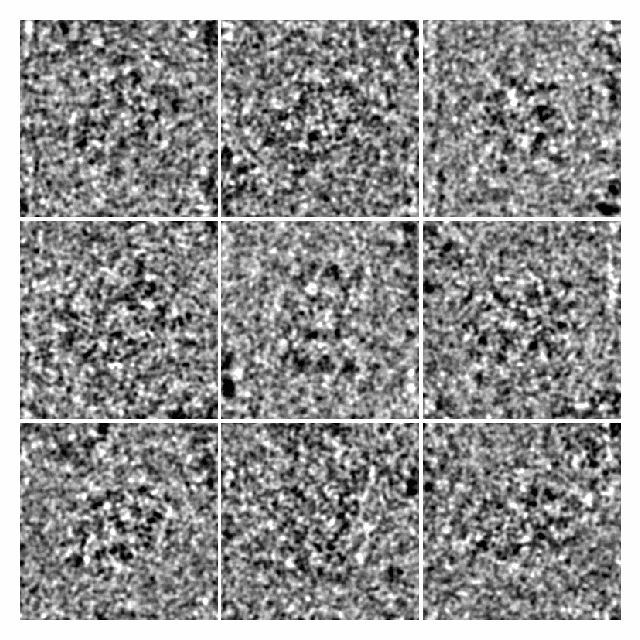
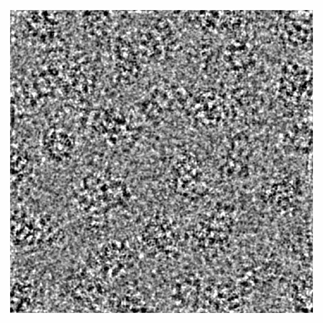
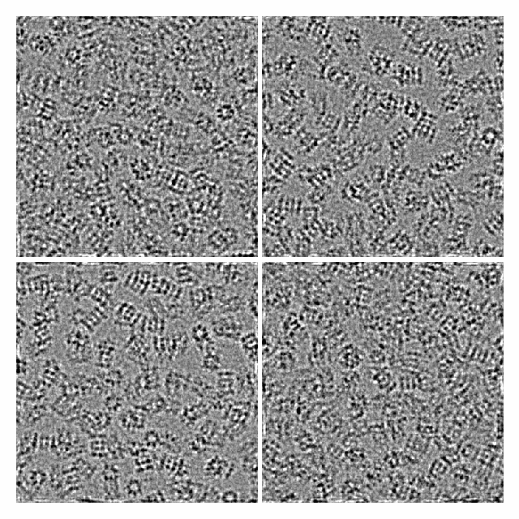
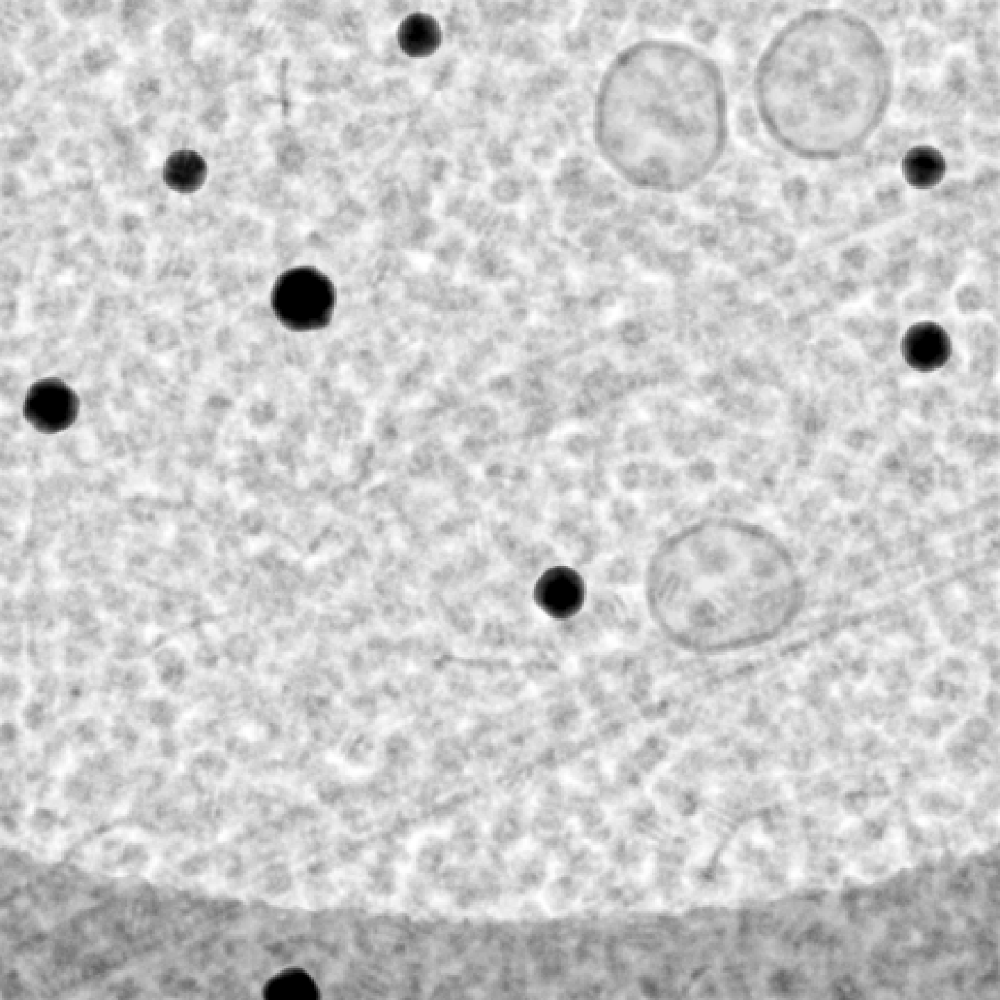
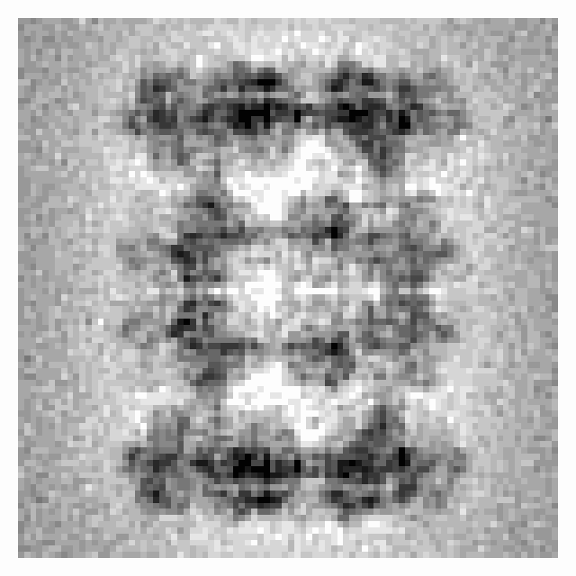
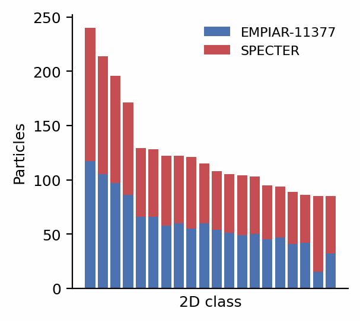

# Basic examples

Complete templates for the most common simulations. Each one runs as shown,
and the thumbnail is what it produced. If you have simulated cryo-EM images
before, start from the closest template and modify it. If you are new to
image simulation, the [walkthrough](walkthrough/index.md) explains every step
these templates take.

<div class="grid cards" markdown>

-   [](#particle-stack)

    **[Particle stack](#particle-stack)**

-   [](#micrograph)

    **[Micrograph](#micrograph)**

-   [](#tilt-series)

    **[Tilt series](#tilt-series)**

-   [](#cellular-specimen)

    **[Cellular specimen](#cellular-specimen)**

-   [](#reconstruction)

    **[Reconstruction](#reconstruction)**

-   [](#matching-a-real-dataset)

    **[Matching a real dataset](#matching-a-real-dataset)**

</div>

The Python templates assume a CUDA GPU and write their output to the working
directory. The command-line versions need a config file only where noted;
[From Python to the command line](walkthrough/command-line.md) explains how
configs, flags and output directories fit together.

## Particle stack

Nine particles of [6BDF](https://www.rcsb.org/structure/6BDF)
(Campbell et al. 2015), each in its own orientation, crowded by copies of
itself in 300 Å of amorphous ice, imaged at 1–2 µm underfocus and 40 e⁻/Ų
on a K3 camera.

=== "Python"

    ```python
    --8<-- "docs-figures/walkthrough/basic_examples.py:particles"
    ```

=== "Command line"

    ```bash
    specter simulate particles \
        --pdb_source 6bdf \
        --n_particles 9 \
        --ice_thickness 300 \
        --defocus 10000,20000 \
        --dose 40 \
        --detector_model k3_300kv
    ```

    The command also writes a RELION `.star` file with each particle's pose
    and CTF.

The thumbnail is low-pass filtered to 10 Å for display. Learn more:
[Particle stacks](walkthrough/particle-stacks.md),
[Generate a particle stack](user-guide/particle-stack.md).

## Micrograph

A 1024 Å field of 6BDF particles packed through a 500 Å slab of ice, imaged
as one exposure at 1.5 µm underfocus. Unlike a particle stack, the specimen is
drawn once and imaged as it lies.

=== "Python"

    ```python
    --8<-- "docs-figures/walkthrough/basic_examples.py:micrograph"
    ```

=== "Command line"

    ```bash
    specter simulate micrograph \
        --pdb_source 6bdf \
        --micrograph_size 1024 \
        --ice_thickness 500
    ```

The thumbnail is low-pass filtered to 12 Å for display. Learn more:
[Micrographs](walkthrough/micrographs.md),
[Generate a micrograph](user-guide/micrograph.md).

## Tilt series

A 600 Å slab of 6BDF particles at 4 Å voxels, tilted from −60° to +60° in 5°
steps in dose-symmetric order, at 3 e⁻/Ų per tilt. Ice is added to each tilt
as it is imaged, and the exposure accumulates from tilt to tilt.

=== "Python"

    ```python
    --8<-- "docs-figures/walkthrough/basic_examples.py:tiltseries"
    ```

=== "Command line"

    The command line tilts a cellular specimen built by
    `specter build tomogram`, rather than a slab of one particle. With the
    example [configs](https://github.com/joelyeois/specter/tree/main/configs),
    one command builds the specimen and images it:

    ```bash
    curl -O https://raw.githubusercontent.com/joelyeois/specter/main/configs/tiltseries.toml
    curl -O https://raw.githubusercontent.com/joelyeois/specter/main/configs/tomogram.toml
    specter simulate tiltseries \
        --config tiltseries.toml \
        --tomogram_config tomogram.toml \
        --min_tilt_angle -60 \
        --max_tilt_angle 60 \
        --n_tilts 25
    ```

The thumbnail shows the noiseless tilts at −60°, −20°, +20° and +60°,
low-pass filtered to 12 Å. Learn more: [Tilt series](walkthrough/tilt-series.md),
[Generate a tilt series](user-guide/tilt-series.md).

## Cellular specimen

A crowded cytoplasm-like specimen for cryo-ET: membranes, filaments,
microtubules, densely packed proteins, gold fiducials and a carbon support
film, with segmentation labels and particle picks as ground truth.

=== "Command line"

    ```bash
    curl -O https://raw.githubusercontent.com/joelyeois/specter/main/configs/tomogram.toml
    specter build tomogram --config tomogram.toml
    ```

    The config lists every component; edit it to change the scene.

Learn more: [Build a tomogram specimen](user-guide/build-tomogram.md), and the
[cryo-ET specimen](concepts/cryoet-specimen/index.md) Theory pages.

## Reconstruction

A gold-standard reconstruction of a real particle set from its CryoSPARC
(Punjani et al. 2017) refinement, through the same forward model the
simulator uses. The thumbnail
is a 6BDF map reconstructed from 1000 simulated particles in the
[Reconstruction](walkthrough/reconstruction.md) walkthrough page, which also
shows the Python route.

=== "Command line"

    ```bash
    specter reconstruct particle \
        --cs_file J205_particles.cs \
        --mrc_file particles.mrcs \
        --dose_per_angstrom 40
    ```

    The run reconstructs half-sets A and B and writes their FSC, under a
    numbered job directory.

Learn more: [Reconstruct a volume](user-guide/reconstruction.md).

## Matching a real dataset

`specter match particles` derives a simulation config whose images match a
real particle set, from its refinement, its images, the atomic model and four
numbers from the acquisition. The thumbnail shows simulated and real
EMPIAR-11377 particles (Fromm et al. 2023) sorting into the same CryoSPARC
2D classes.

=== "Command line"

    ```bash
    specter match particles \
        --metadata_path J205_passthrough_particles.cs \
        --images_path particles.mrcs \
        --pdb_source 8b0x \
        --detector_model falcon4i_300kv \
        --dose 40 --dose_rate 4.1 --energy_filter true
    ```

    The run writes `matched.toml`, which `specter simulate particles` runs as
    it is, and a report of how close the match is.

Learn more: [Match an experimental dataset](user-guide/dataset-twin.md).

## References

- Campbell, M. G., Veesler, D., Cheng, A., Potter, C. S., & Carragher, B.
  (2015). 2.8 Å resolution reconstruction of the *Thermoplasma acidophilum*
  20S proteasome using cryo-electron microscopy. *eLife*, 4, e06380.
  [doi:10.7554/eLife.06380](https://doi.org/10.7554/eLife.06380)
- Fromm, S. A., O'Connor, K. M., Purdy, M., Bhatt, P. R., Loughran, G.,
  Atkins, J. F., Jomaa, A., & Mattei, S. (2023). The translating bacterial
  ribosome at 1.55 Å resolution generated by cryo-EM imaging services.
  *Nature Communications*, 14(1), 1095.
  [doi:10.1038/s41467-023-36742-3](https://doi.org/10.1038/s41467-023-36742-3)
- Punjani, A., Rubinstein, J. L., Fleet, D. J., & Brubaker, M. A. (2017).
  cryoSPARC: Algorithms for rapid unsupervised cryo-EM structure
  determination. *Nature Methods*, 14(3), 290–296.
  [doi:10.1038/nmeth.4169](https://doi.org/10.1038/nmeth.4169)
