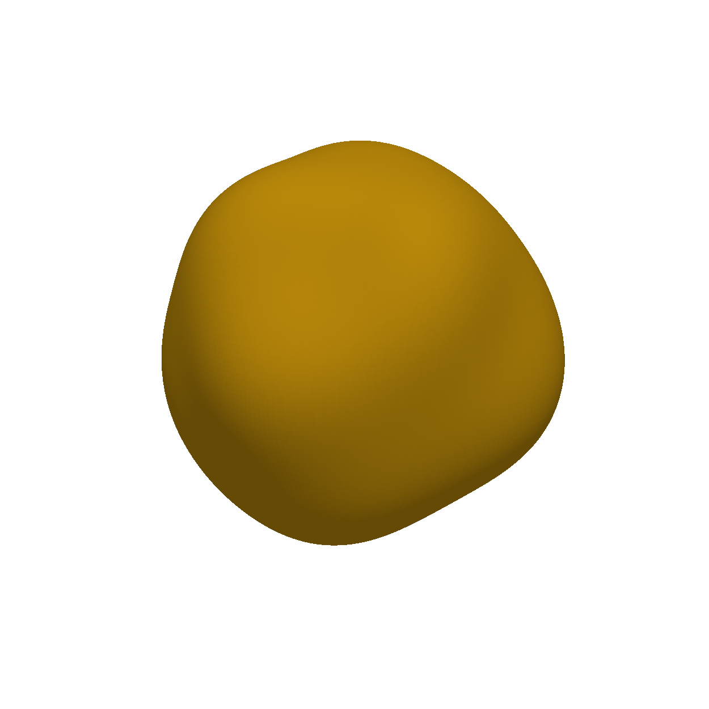
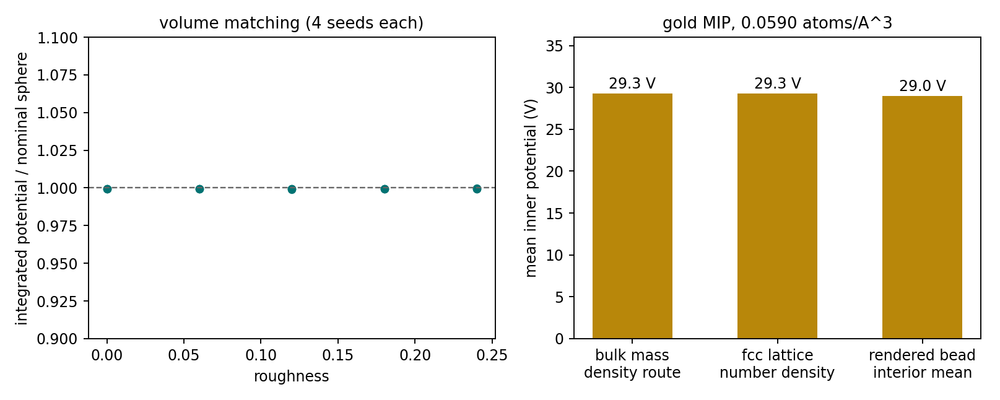
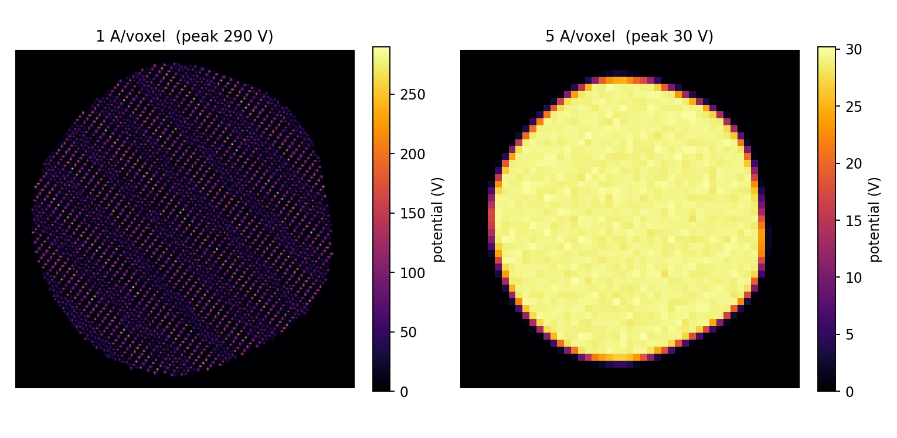
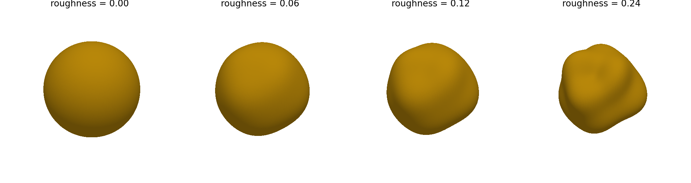

# Gold fiducial beads

{ width="620" style="display:block;margin:1.2em auto;" }
///caption
A single bead's boundary at the default roughness: an irregular quasi-sphere, shaded.
///

Fiducial beads are the one component with no PDB behind them. There is no
atomic structure to hand `PotentialBuilder`, so the density has to come
from bulk material physics instead: gold's bulk mass density → number
density → per-atom potential integral, using SPECTER's own atomic
potential parameterizations.

The generator builds each bead from **real fcc gold atoms**: randomly
oriented, Debye-Waller jittered, and splatted through the atomic
potential kernel, inside an irregular, volume-matched boundary.

!!! example "In code"
    This page is the theory behind [Cellular specimens for cryo-ET](../../tutorials/cellular-specimens.md), which shows it step by step with code and figures.

!!! info "Source"
    `specter.specimen._grid` (`BeadGenerator`, `_BeadShape`), placed by
    `TomogramSpecimenGenerator._stamp_beads`.
    `docs-figures/cryoet_specimen_beads.py` produces the figures.

## Getting to volts

The calibration below fixes the bead's absolute scale, with no free
parameter:

\[
V_0 = n \int V_{\text{atom}}(\mathbf{r})\,d^3r,
\qquad
n = \frac{\rho\,N_A}{M}
\]

with \(\rho = 19.3\ \text{g/cm}^3\) and \(M = 196.97\ \text{g/mol}\) for
gold. The volume integral of one atom's real-space potential is its
\(k = 0\) Fourier component, the same physics `PotentialBuilder` uses per
atom, summed to a bulk mean instead of kept per position. This makes
the calibration resolution-independent: injecting a raw atom count instead
would be dimensionally inconsistent with the V-unit output, and would tie
the result to voxel size for no physical reason.

{ width="900" style="display:block;margin:1.2em auto;" }
///caption
Left, integrated potential across roughness values, normalised to the nominal sphere. Right, gold's mean inner potential by three independent routes.
///

The right panel functions as a consistency check rather than a result.
Bulk mass density and the fcc lattice's own number density
(\(4/a^3\) with \(a = 4.0782\) Å) are unrelated routes to the same
material, and they agree to 0.2%. The rendered bead's interior mean lands
on the same value, ≈29 V, the literature ballpark for gold (Popescu et al.
2007).

## Atoms, not a gas

The bead's atoms form a crystal lattice, not a gas cloud: fcc, with
Debye-Waller jitter (\(u_{\text{RMS}} = 0.087\) Å, from \(B \approx 0.6\)
Ų near room temperature). The generator convolves them with the real
atomic potential kernel:

{ width="900" style="display:block;margin:1.2em auto;" }
///caption
A bead's central slice at 1 Å/voxel, resolving lattice fringes, and at 5 Å/voxel, where it reads as a solid slab.
///

The generator draws each bead's crystal orientation uniformly over
SO(3), so no two fiducials show their fringes running the same way.

The generator doesn't offer a uniform gas of atoms (scattered at bulk
number density, binned into voxels, the fill CryoTomoSim uses; Purnell et
al. 2023) as an alternative fill. A Poisson
gas carries per-voxel shot noise a crystalline solid does not have
(~10% of the projected signal at a 5 Å voxel against ~3% for the
lattice, rising to ~22% at 2 Å) and collapses each atom's whole
potential integral into a single voxel. There is no voxel size at
which it would be more accurate.

## The boundary

Commercial cryo-ET fiducials are citrate-reduced colloidal gold:
multiply-twinned, irregular particles. Neither obvious idealisation
describes them well. An exact sphere isn't a shape gold forms, and fcc
gold's equilibrium truncated octahedron (a Wulff solid), describing an
annealed single crystal instead, gives a population no shape variety at
all, only pose variety.

SPECTER ships a band-limited spherical-harmonic modulation of the radius
instead, reusing the [membrane backend's](../membrane-shape/spherical-harmonics.md)
own harmonic machinery:

\[
R(\hat{u}) = s\,\bigl(1 + a\,f(\hat{u})\bigr),
\qquad
s = \frac{r_{\text{nominal}}}{\bigl\langle (1 + a f)^3 \bigr\rangle^{1/3}}
\]

\(f\) has zero mean and unit RMS over the sphere by Parseval, and \(a\) is
`roughness`. The scale factor \(s\) **volume-matches** every realisation to
a sphere of the nominal radius, which is what the left panel of the
calibration figure above shows: total integrated potential, and therefore
projected signal, never depends on how lumpy a particular bead came out.

{ width="900" style="display:block;margin:1.2em auto;" }
///caption
Bead boundaries at roughness 0, 0.06, 0.12 and 0.24, all volume-matched to the same nominal radius.
///

Below about 0.06 a bead is visually indistinguishable from a sphere while
still costing the harmonic machinery; 0.12–0.20 reads as an irregular
particle; 0.0 gives a clean sphere.

SPECTER deliberately does **not** expose the band limit
(\(\ell_{\max} = 6\)) and spectrum (flat, equal power per mode).
\(\ell_{\max} = 6\) puts
the finest lumps at ~30° of arc, roughly a quarter of the bead across,
which is the scale colloidal gold irregularity shows. The flat spectrum
is a deliberate departure from the membrane backend's
\(\propto \ell^{-2}\) default: that encodes the Helfrich (1973) thermal
bending spectrum of a lipid bilayer, which has no analogue in a metal
nanoparticle. A bead's irregularity comes from growth and twinning, not
bending modes. Neither is known well enough to fit, so exposing them
would only invite tuning an uncalibrated model until an image looked
right. `roughness` stays exposed because you can estimate its amplitude
from EM images of a real bead prep.

## Placement and polydispersity

The packer places beads with the
[sphere RSA backend](packing.md#sphere-packing-for-beads-and-membranes),
right after filaments. A bead is a sphere, so treating it as one
approximates nothing. Proteins are packed by shape-based collision, the
only protein backend.
Beads avoid the membrane shell, the carbon film, and already-placed
filaments and beads; the protein-fill stage that follows then avoids them.
Each bead is built with its atoms and boundary displaced by the sub-voxel
part of its position and inserted at the nearest voxel, so its density, its
instance label and its pick share one position.

They are **not** region-gated. A fiducial sits in the ice, not in a
cytosol or lumen compartment, so `TomogramBeadSpec` has no `location`
field the way a protein spec does.

`radius` accepts a `[low, high]` pair, drawn fresh per instance, since real
colloidal gold isn't monodisperse (a "10 nm" prep spans roughly
8.5–11.5 nm). The generator draws radii *before* packing, so each bead's
collision test uses its own size. `bead_roughness` takes a range the same
way: with a single number every bead is a *different* lumpy shape but the
*same* degree of lumpy, whereas a range mixes near-round particles with
rough, irregular ones, the way a real prep does.

The generator writes all beads to a single `gold-bead` pick file,
regardless of size.

## Parameters at a glance

| Parameter | Meaning | Default |
|---|---|---|
| `radius` | Nominal bead radius, Å; scalar or `[low, high]` per instance | — |
| `count` (`n_copies` in TOML) | Instances in this population | 1 |
| `bead_roughness` | RMS radius modulation as a fraction of radius; scalar or `[low, high]` | 0.12 |
| `parameterization` | Atomic potential model for gold: `kirkland` (Kirkland 2010), `lobato` (Lobato & Van Dyck 2014) or `peng` (Peng et al. 1996) | `kirkland` |

`shtyrov` resolves to `peng` rather than being rejected. Shtyrov fits
scattering factors per bonded species (Shtyrov et al. 2026), the bundled tables contain no
elemental gold, and a fiducial has no bonds to type in any case, so gold
takes the same per-element fallback a structure atom does when its species
misses the table. In a tomogram the beads follow `bulk_scattering_factors`
rather than `scattering_factors`, alongside the carbon film.

Fixed by the material rather than exposed: `GOLD_FCC_ANGSTROM` (4.0782 Å),
`GOLD_U_RMS` (0.087 Å), `GOLD_DENSITY_G_CM3` (19.3), and the roughness
band limit and spectrum.

## Limitations

- **The roughness model is phenomenological.** Its amplitude is
  measurable; its spectrum is a guess that reproduces the right feature
  scale, not a growth model.
- **No twinning geometry.** Real multiply-twinned particles have flat
  facets and re-entrant grooves; a smooth harmonic modulation does not.
- **One crystal per bead.** The model doesn't represent a polycrystalline
  fiducial's grain boundaries.

## References

- Helfrich, W. (1973). Elastic properties of lipid bilayers: theory and
  possible experiments. *Zeitschrift für Naturforschung C*, 28(11–12),
  693–703. [doi:10.1515/znc-1973-11-1209](https://doi.org/10.1515/znc-1973-11-1209)
- Kirkland, E. J. (2010). *Advanced computing in electron microscopy*
  (2nd ed.). Springer.
  [doi:10.1007/978-1-4419-6533-2](https://doi.org/10.1007/978-1-4419-6533-2)
- Lobato, I., & Van Dyck, D. (2014). An accurate parameterization for
  scattering factors, electron densities and electrostatic potentials for
  neutral atoms that obey all physical constraints. *Acta Crystallographica
  Section A: Foundations and Advances*, 70(6), 636–649.
  [doi:10.1107/S205327331401643X](https://doi.org/10.1107/S205327331401643X)
- Peng, L.-M., Ren, G., Dudarev, S. L., & Whelan, M. J. (1996). Robust
  parameterization of elastic and absorptive electron atomic scattering
  factors. *Acta Crystallographica Section A*, 52(2), 257–276.
  [doi:10.1107/S0108767395014371](https://doi.org/10.1107/S0108767395014371)
- Popescu, R., Müller, E., Wanner, M., Gerthsen, D., Schowalter, M.,
  Rosenauer, A., Böttcher, A., Löffler, D., & Weis, P. (2007). Increase of
  the mean inner Coulomb potential in Au clusters induced by surface
  tension and its implication for electron scattering. *Physical Review
  B*, 76(23), 235411.
  [doi:10.1103/PhysRevB.76.235411](https://doi.org/10.1103/PhysRevB.76.235411)
  (Compiles measured bulk-gold values of 16.8–30.2 V and calculated values
  of 25.0–35.9 V, and measures 32.2 ± 3.6 V.)
- Purnell, C., Heebner, J., Swulius, M. T., Hylton, R., Kabonick, S.,
  Grillo, M., Grigoryev, S., Heberle, F., Waxham, M. N., & Swulius, M. T.
  (2023). Rapid synthesis of cryo-ET data for training deep learning
  models. *bioRxiv*.
  [doi:10.1101/2023.04.28.538636](https://doi.org/10.1101/2023.04.28.538636)
  ([CTS source](https://github.com/carsonpurnell/cryotomosim_CTS))
- Shtyrov, A., Wilson, H., Slowik, D., Yamashita, K., Li, J., Wojdyr, M.,
  et al. (2026). Measurement of atomic scattering factors by cryoelectron
  microscopy. *Proceedings of the National Academy of Sciences*, 123(19),
  e2528758123.
  [doi:10.1073/pnas.2528758123](https://doi.org/10.1073/pnas.2528758123)
