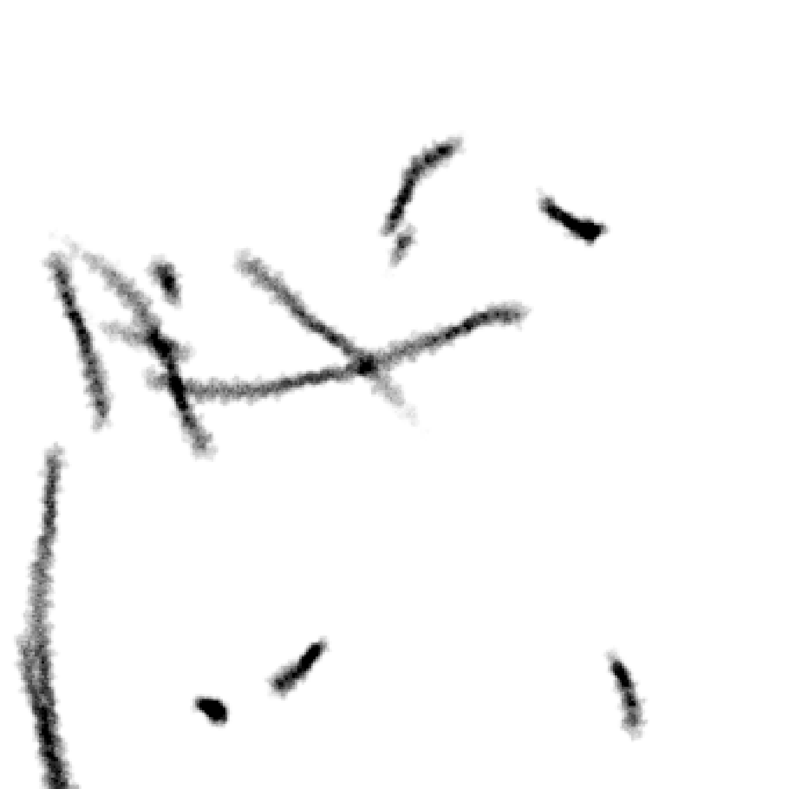
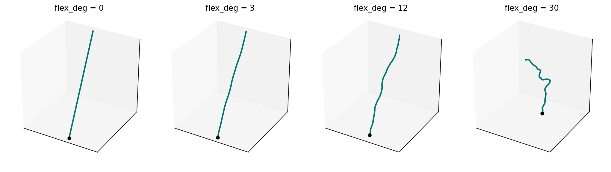
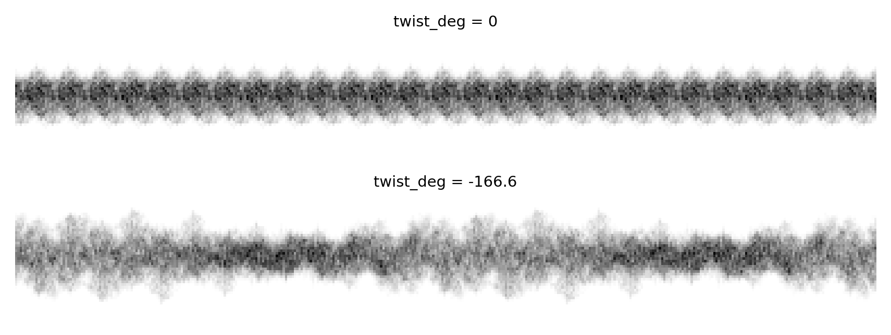
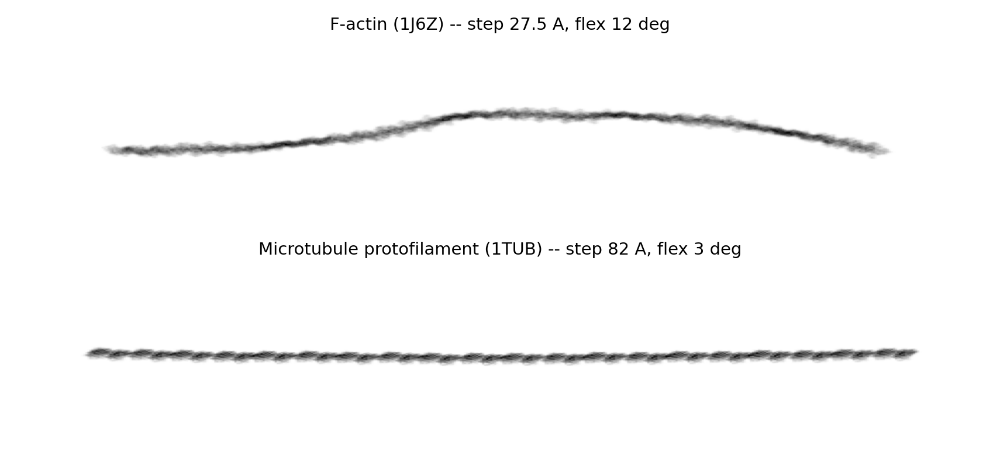

# Filaments

{ width="620" style="display:block;margin:1.2em auto;" }
///caption
A filaments-only specimen: fourteen actin filaments scattered through the box, summed along Z.
///

A filament species consists of a single subunit structure, replicated
along a random walk. Each subunit instance is a rigid-transformed copy
of one rendered template, so a 60-subunit F-actin filament costs one
`PotentialBuilder` render and 60 rigid-body rotations.

SPECTER ships two presets: `ACTIN_SPEC`, corresponding to F-actin, and
`PROTOFILAMENT_SPEC`, corresponding to a single microtubule
protofilament. Define custom geometries via a `FilamentSpec`.

This page covers single-strand filaments only. The complete
microtubule, with its thirteen protofilaments arranged into a closed
tube with a lumen and an A-lattice seam, gets its own page; see
[Microtubules](microtubules.md).

!!! example "In code"
    This page is the theory behind [Cellular specimens for cryo-ET](../../tutorials/cellular-specimens.md), which shows it step by step with code and figures.

!!! info "Source"
    `specter.specimen.filament` (`_path`, `_placement`, `_generator`,
    `_actin`, `_tubulin`), stamped by
    `TomogramSpecimenGenerator._stamp_filaments`.
    `docs-figures/cryoet_specimen_filaments.py` produces the figures,
    calling the same functions the real code path does.

## The path: a persistent random walk

A walk generates each filament's monomer positions along its axis,
following a filament script in the CryoTomoSim source (Purnell et al.
2023): it advances a fixed distance `step` (the monomer's axial rise)
along the current direction, then rotates that direction by a random
angle drawn uniformly from \([0, \texttt{flex\_deg}]\) about a random
axis perpendicular to it:

\[
p_{i+1} = p_i + s\,d_i, \qquad
d_{i+1} = R(\hat{a}_i,\ \theta_i)\,d_i, \quad
\theta_i \sim U(0, \texttt{flex\_deg}),\ \hat{a}_i \perp d_i
\]

Curvature stays bounded *per step* and unbounded *cumulatively*: the
worm-like-chain regime.

{ width="900" style="display:block;margin:1.2em auto;" }
///caption
Filament paths at four flex_deg values, all with the same monomer count and axial rise, drawn at a common scale.
///

All four paths shown have identical contour length; only the tangling
differs. That makes `flex_deg` the persistence knob: raise it, and the
same length of polymer occupies a smaller end-to-end span.

This construction differs from the
[swept-spline membrane backend](../membrane-shape/swept-spline.md)'s
path, which blends the previous direction with a fresh random one at a
fixed weight. Here, the turn is a bounded rotation of the previous
direction, so `flex_deg` caps how sharply a filament can kink over a
single monomer, the physically relevant quantity for a stiff polymer.

## Orientation: a transported frame plus screw twist

Each monomer's rotation combines two operations, reflecting the screw
symmetry of helical polymers:

1. **Carry a frame along the path.** The monomer's canonical \(+Z\)
   axis is rotated onto the local path tangent (monomer \(i\) → monomer
   \(i+1\); the last monomer reuses its predecessor's tangent) by
   parallel transport, which adds no roll about the tangent as the path
   bends (Bishop 1975). On a straight path this is a fixed frame.
2. **Apply the twist.** Rotate about the tangent by an accumulated
   \(i \cdot \texttt{twist\_deg}\), by the right-hand rule about the
   direction of growth. A positive `twist_deg` builds a right-handed helix
   and a negative one a left-handed helix, the sign convention of
   deposited helical parameters, which pair a twist with a positive rise.

Consecutive monomers therefore differ by the bend of the path and by the
twist, and by nothing else. A subunit that sits off the filament axis
would show any further roll as a displacement.

How a structure's coordinates are put into that frame is set per species
by `frame`:

- **`"actin_filament"`** (`ACTIN_SPEC`). `code` names a deposited model of
  F-actin itself, and one subunit is lifted out of it in the filament
  frame (`extract_actin_subunit`). The filament axis is fitted from the
  screw relating consecutive subunits, each found by a least-squares
  superposition of one subunit onto its neighbour. The central subunit is
  then expressed with \(+Z\) along the axis towards the barbed end, the
  origin on the axis level with the subunit's centre, and \(+X\) out
  through that centre. Every copy then sits where a subunit sits in the
  deposited filament: its centre 15.7 Å from the axis, its longest
  principal axis 81° from it.
  Subdomains 2 and 4 (residues 33–69 and 181–269; Kabsch et al. 1990) face
  the pointed end, and their centroid lies 21.7 Å from that of subdomains
  1 and 3 along the axis, which fixes the polarity. Five subunits placed
  this way on a straight path superpose onto the five of the deposited
  filament 7BT7 (Kumari et al. 2020) with a Cα RMSD of 0.31 Å (0.63 Å over
  all atoms), every centre within 0.07 Å and every orientation within
  0.21°. That residual is the deposited model's own: its five chains were
  refined independently and differ from one another by as much.
- **`"microtubule_dimer"`** (`PROTOFILAMENT_SPEC`). `code` names a
  deposited microtubule, and one αβ-tubulin dimer is lifted out of it in
  the microtubule frame (`extract_mt_dimer`, described under
  [Microtubules](microtubules.md#the-dimer-template)), the same template a
  `MicrotubuleSpec` builds its tube wall from. The filament axis of a free
  protofilament is the protofilament's own axis, not the tube axis: the
  origin lies midway between the centroids of the dimer's α and β
  monomers, both of which lie on the \(Z\) axis to within 0.2 Å, \(+Z\)
  points from α to β toward the plus end, and \(+X\) is the face that
  points away from the tube axis in the source lattice. Two dimers placed
  this way on a straight path, `twist_deg = 0` and `step = DIMER_REPEAT`,
  superpose onto two consecutive dimers of each protofilament of 3JAL
  (Zhang et al. 2015) with a Cα RMSD of 0.14 Å. Most of that residual is
  the step: the deposited dimer repeat is 81.76 Å, 0.24 Å short of
  `DIMER_REPEAT`, and at the deposited repeat the RMSD is 0.085 Å.
- **`"principal_axis"`** (the default). `code` is an isolated monomer.
  SPECTER centres it on the filament axis and pre-rotates its coordinates
  so that its **longest principal axis** points along \(+Z\). This is an
  approximation; see [Limitations](#limitations).

`twist_deg` is what separates a helical polymer from a plain stack:

{ width="900" style="display:block;margin:1.2em auto;" }
///caption
The same straight chain of F-actin subunits rendered with twist_deg = 0 and with F-actin's measured -166.6 degrees per subunit.
///

Without twist, every subunit presents the same face from the same side
of the axis, and the strand reads as a uniform ridge. With F-actin's
measured −166.6° per subunit (Dominguez & Holmes 2011), the subunits
alternate between two long-pitch strands, and the projection shows them
crossing over as in a real F-actin filament.

The sign carries the hand. F-actin's one-start (genetic) helix is
left-handed: each subunit turns −166.6° about the filament axis for
+27.5 Å of rise. Superposing consecutive subunits of the deposited
filaments 6DJO (Chou & Pollard 2019) and 7BT7 (Kumari et al. 2020) gives
−166.6° to −166.8° for 27.5–27.6 Å, the same sign. Because the twist
is close to 180°, every second subunit lies on one of two long-pitch
strands, which wind the other way: \(2 \times (-166.6^\circ) + 360^\circ =
+26.8^\circ\) per 55 Å, a right-handed pair of strands crossing every
~36 nm. The idealised twist of −166.15°, which repeats after exactly 13
subunits in 6 turns, is a drawing convenience rather than a measurement
(Dominguez & Holmes 2011).

## Presets

{ width="900" style="display:block;margin:1.2em auto;" }
///caption
F-actin and a microtubule protofilament rendered at the same scale.
///

| Preset | `code` | `frame` | `step` (Å) | `flex_deg` | `twist_deg` | `n_monomers` |
|---|---|---|---|---|---|---|
| `ACTIN_SPEC` | 7BT7 (ADP-F-actin filament; Kumari et al. 2020) | `"actin_filament"` | 27.5 | 12.0 | −166.6 | (20, 60) |
| `PROTOFILAMENT_SPEC` | 3JAL (13-protofilament microtubule; Zhang et al. 2015) | `"microtubule_dimer"` | 82.0 | 3.0 | 0.0 | (10, 30) |

`step` and `twist_deg` are measured values. F-actin's rise and twist come
from cryo-EM reconstructions of the filament: 27.6 Å and −166.6 ± 0.6°
(Dominguez & Holmes 2011), and 27.5 Å and 166.4° (von der Ecken et al.
2015). They refine the helix of the first atomic model of the filament
(Holmes et al. 1990); the twist of individual subunits varies about this
mean (Egelman et al. 1982), and `ACTIN_SPEC` uses the mean. They are also
the helical parameters deposited with 7BT7, the filament its subunit comes
from; that subunit carries its bound ADP and Mg²⁺. The protofilament's
step is the dimer repeat of the GDP microtubule lattice,
`DIMER_REPEAT` (see [Microtubules](microtubules.md#lattice-constants)),
and its dimer is the one a `MicrotubuleSpec` uses, so a free
protofilament and a protofilament in a tube stack the same dimer
identically. `flex_deg` is a tuned value in both cases, taken from
CryoTomoSim (Purnell et al. 2023), not a persistence-length measurement.

`twist_deg = 0` is correct for the protofilament preset: a single
protofilament does not itself twist. `PROTOFILAMENT_SPEC` gives you a
single protofilament only. For the full tube, see
[`MicrotubuleSpec`](microtubules.md).

## Placement

Every instance starts at a uniformly random point in the volume and
walks in a uniformly random initial direction, with no rejection
sampling and no obstacle awareness:

- A filament that wanders **outside the volume** gets truncated at
  render time, the same edge behaviour applied to placed particles.
- SPECTER drops a monomer landing **inside the carbon film** after the
  fact, leaving a gap rather than redirecting the walk.
- Filaments do **not** avoid the membrane shell or each other, and
  aren't region-gated: a filament can cross a vesicle wall and continue
  through its lumen.

Everything placed after filaments avoids them, though: beads and the
protein-fill stage both treat placed filament voxels as obstacles.

Each placed copy records a point on the filament path together with the
subunit's rotation, and these are what the filament's oriented-point
picks hold; a path per filament is written beside them. For an
`"actin_filament"` species that point lies on the filament axis level with
the subunit, and the subunit's own centre is 15.7 Å from it, along the
copy's rotated \(+X\) axis. For a `"microtubule_dimer"` species it is the
midpoint of the dimer's two monomers, on the protofilament axis.

## Parameters at a glance

| Parameter | Meaning | Default |
|---|---|---|
| `code` | PDB ID or local file for the monomer; for an extracted `frame`, the deposited model the subunit is lifted from (an F-actin filament, or the PDB ID of a microtubule) | — |
| `step` | Axial rise per monomer, Å | — |
| `flex_deg` | Maximum per-step turn, degrees | — |
| `twist_deg` | Helical twist per monomer, degrees | 0.0 |
| `n_copies` | Independent filament instances of this species | 1 |
| `n_monomers` | Monomers per instance; an int, or a `(min, max)` drawn per instance | (10, 30) |
| `frame` | `"principal_axis"` for an isolated monomer, `"actin_filament"` for a subunit lifted out of a deposited F-actin model, `"microtubule_dimer"` for a tubulin dimer lifted out of a deposited microtubule | `"principal_axis"` |

In a TOML config these are `[[filaments]]` tables, or `actin = true` for
the `ACTIN_SPEC` preset; see
[Build a tomogram specimen](../../user-guide/build-tomogram.md).

## Limitations

- **No branching.** Each filament is a single path; you cannot
  represent Y-junctions or networks.
- **One protofilament only.** A full microtubule, with its
  13-protofilament tube geometry, gets
  [its own component](microtubules.md).
- **No collision avoidance during the walk.** SPECTER doesn't redirect
  monomers landing inside another object; it resolves overlaps only
  through the post-hoc dropping described under [Placement](#placement).
- **The stacking axis of a `"principal_axis"` species is an
  approximation.** The monomer's canonical \(+Z\) comes from its longest
  principal axis, and its centre is put on the filament axis. Neither
  follows from how neighbouring subunits contact each other, which is
  what sets a real docking axis, and the inertia tensor of an isolated
  monomer doesn't capture it. A PDB structure's native coordinate axes
  carry no inherent relationship to its stacking direction either, so
  some convention has to apply; this is that convention, not a
  structurally validated docking. It applies to custom species only; both
  presets take their subunit from a deposited polymer instead.
- **Every F-actin subunit is the same straight-filament subunit.** The
  deposited model is a straight ADP filament, and each copy is a rigid
  copy of one of its subunits. The changes of subunit structure that
  bending and nucleotide state cause (Reynolds et al. 2022) are not
  represented, and on a bent path the subunits follow the bend rigidly.
- **A free protofilament is a straight lattice protofilament.** Every
  dimer of `PROTOFILAMENT_SPEC` is the straight dimer of the
  microtubule lattice. The outward curvature of protofilaments peeling
  away from a depolymerising end, and the curved conformation of
  unpolymerised GDP-tubulin, are not represented; `flex_deg` bends the
  path, and the dimers follow it rigidly.

## References

- Bishop, R. L. (1975). There is more than one way to frame a curve.
  *The American Mathematical Monthly*, 82(3), 246–251.
  [doi:10.1080/00029890.1975.11993807](https://doi.org/10.1080/00029890.1975.11993807)
- Chou, S. Z., & Pollard, T. D. (2019). Mechanism of actin polymerization
  revealed by cryo-EM structures of actin filaments with three different
  bound nucleotides. *Proceedings of the National Academy of Sciences*,
  116(10), 4265–4274. (PDB 6DJO)
  [doi:10.1073/pnas.1807028115](https://doi.org/10.1073/pnas.1807028115)
- Dominguez, R., & Holmes, K. C. (2011). Actin structure and function.
  *Annual Review of Biophysics*, 40, 169–186.
  [doi:10.1146/annurev-biophys-042910-155359](https://doi.org/10.1146/annurev-biophys-042910-155359)
- Egelman, E. H., Francis, N., & DeRosier, D. J. (1982). F-actin is a helix
  with a random variable twist. *Nature*, 298(5870), 131–135.
  [doi:10.1038/298131a0](https://doi.org/10.1038/298131a0)
- Holmes, K. C., Popp, D., Gebhard, W., & Kabsch, W. (1990). Atomic model
  of the actin filament. *Nature*, 347(6288), 44–49.
  [doi:10.1038/347044a0](https://doi.org/10.1038/347044a0)
- Kabsch, W., Mannherz, H. G., Suck, D., Pai, E. F., & Holmes, K. C.
  (1990). Atomic structure of the actin:DNase I complex. *Nature*,
  347(6288), 37–44.
  [doi:10.1038/347037a0](https://doi.org/10.1038/347037a0)
- Kumari, A., Kesarwani, S., Javoor, M. G., Vinothkumar, K. R., &
  Sirajuddin, M. (2020). Structural insights into actin filament
  recognition by commonly used cellular actin markers. *The EMBO Journal*,
  39(14), e104006. (PDB 7BT7)
  [doi:10.15252/embj.2019104006](https://doi.org/10.15252/embj.2019104006)
- Purnell, C., Heebner, J., Swulius, M. T., Hylton, R., Kabonick, S.,
  Grillo, M., Grigoryev, S., Heberle, F., Waxham, M. N., & Swulius, M. T.
  (2023). Rapid synthesis of cryo-ET data for training deep learning
  models. *bioRxiv*.
  [doi:10.1101/2023.04.28.538636](https://doi.org/10.1101/2023.04.28.538636)
  ([CTS source](https://github.com/carsonpurnell/cryotomosim_CTS))
- Reynolds, M. J., Hachicho, C., Carl, A. G., Gong, R., & Alushin, G. M.
  (2022). Bending forces and nucleotide state jointly regulate F-actin
  structure. *Nature*, 611(7935), 380–386.
  [doi:10.1038/s41586-022-05366-w](https://doi.org/10.1038/s41586-022-05366-w)
- von der Ecken, J., Müller, M., Lehman, W., Manstein, D. J., Penczek,
  P. A., & Raunser, S. (2015). Structure of the F-actin–tropomyosin
  complex. *Nature*, 519(7541), 114–117.
  [doi:10.1038/nature14033](https://doi.org/10.1038/nature14033)
- Zhang, R., Alushin, G. M., Brown, A., & Nogales, E. (2015). Mechanistic
  origin of microtubule dynamic instability and its modulation by EB
  proteins. *Cell*, 162(4), 849–859.
  [doi:10.1016/j.cell.2015.07.012](https://doi.org/10.1016/j.cell.2015.07.012)
  (PDB 3JAL)
