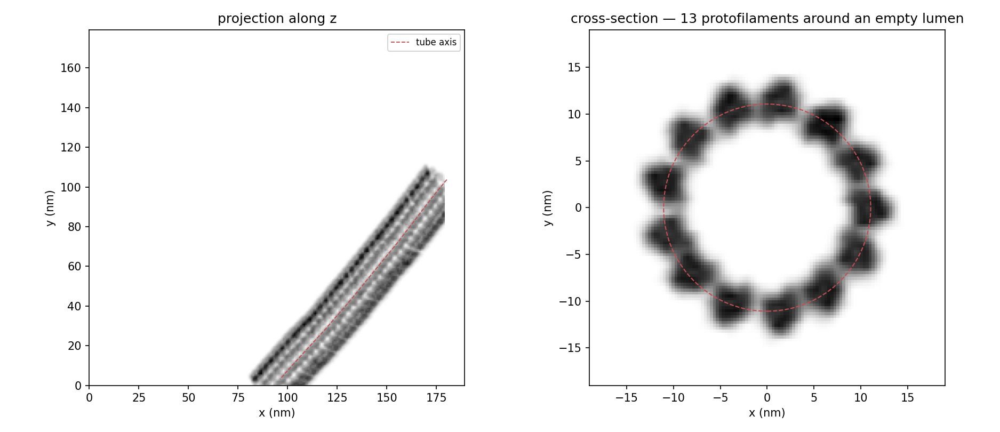
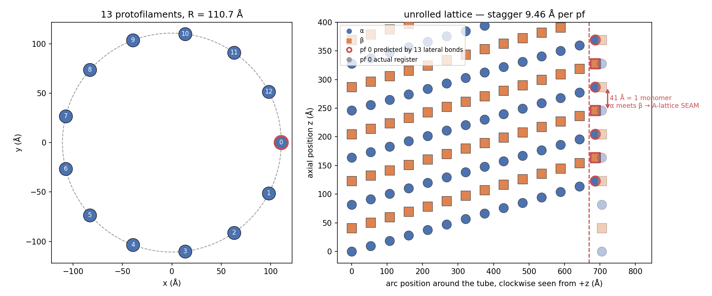
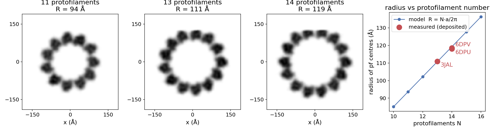
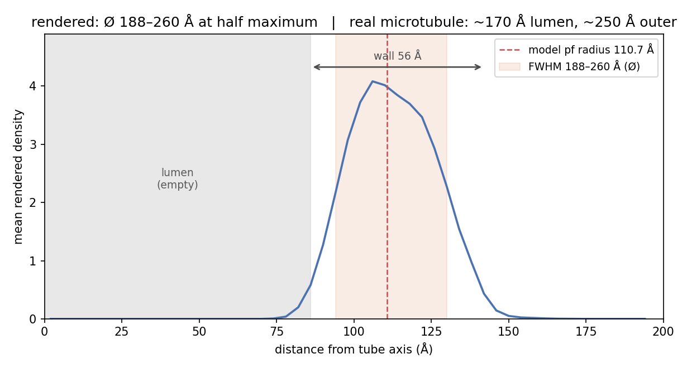
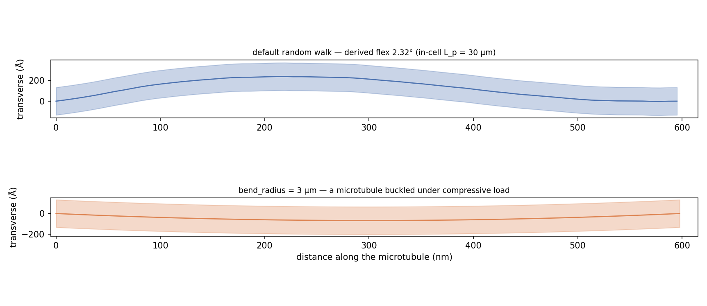

# Microtubules

<div class="grid" markdown>

{ width="900" style="grid-column: 1 / -1;" }
///caption
A rendered microtubule: projection along z, and a cross-section perpendicular to the tube showing 13 protofilaments around an empty lumen.
///

</div>

A microtubule is a closed tube of 13 protofilaments, each a stack of
αβ-tubulin dimers, wrapped so the lateral tubulin–tubulin bonds form a
3-start helix (Mandelkow et al. 1986). `specter build tomogram` builds a microtubule as many
rigid copies of a single tubulin dimer, the same machinery
[filaments](filaments.md) use, so a microtubule costs one
`PotentialBuilder` render plus one rotation per dimer.

`PROTOFILAMENT_SPEC` is different: it gives you a **single**
protofilament, one strand, no tube, no lumen, no seam. It stacks the same
dimer template described [below](#the-dimer-template) along a
[filament](filaments.md) path, so a straight free protofilament is one
protofilament of this lattice.

!!! example "In code"
    This page is the theory behind [Cellular specimens for cryo-ET](../../tutorials/cellular-specimens.md), which shows it step by step with code and figures.

!!! info "Source"
    `specter.specimen.filament` (`_lattice`, `_frames`, `_tube`, `_tubulin`),
    stamped by `TomogramSpecimenGenerator._stamp_microtubules`.
    `docs-figures/cryoet_specimen_microtubules.py` produces the
    figures, calling the same functions the real code path does and
    measuring the annotated numbers off the rendered volume.

## The lattice

Two relations set the geometry, both consequences of closing the tube:

\[
R = \frac{N \, a_\mathrm{lat}}{2\pi},
\qquad
s = \frac{n_\mathrm{start} \, r}{N}
\]

\(R\) is the radius of the protofilament centres, \(a_\mathrm{lat}\)
the lateral spacing between protofilaments, \(r\) the monomer rise and
\(s\) the axial stagger between adjacent protofilaments' registers.

The 3-start helix is left-handed (Mandelkow et al. 1986): stepping
laterally to the neighbouring protofilament turns \(-360^\circ/N\) about
the tube axis for \(+s\) of rise. Superposing laterally adjacent monomers
of the deposited lattices gives the same sign, −27.7° for +9.46 Å in 3JAL
(Zhang et al. 2015) and −25.75° for +8.99 Å in 6DPU (Zhang et al. 2018).
`build_tube_instances` lays the protofilaments out clockwise about the
direction in which their registers climb, which reproduces a 3JAL patch of
three protofilaments by four monomers to within 1 Å per subunit; the
mirror-image lattice, which has the same radius, stagger and seam,
misplaces the neighbouring protofilaments by up to 19 Å.

{ width="900" style="display:block;margin:1.2em auto;" }
///caption
The 13-protofilament cross-section, and the unrolled lattice showing the stagger and the seam.
///

### The seam is not a special case

Walking once around the tube accumulates \(N s = n_\mathrm{start} r\)
of axial offset: three monomers, i.e. **1.5 dimers**. Since the
repeating unit is the dimer, following 13 lateral bonds back around to
protofilament 0 lands half a dimer away from where protofilament 0
starts. That half-dimer is one monomer, so an α ends up
against a β: the A-lattice **seam**, with the other twelve junctions
B-lattice (Mandelkow et al. 1986).

The code carries no special case for it. Because the stagger derives
from \(N\), the same arithmetic produces a seam at every protofilament
number.

## Protofilament number

{ width="900" style="display:block;margin:1.2em auto;" }
///caption
Rendered cross-sections at 11, 13 and 14 protofilaments, and radius versus protofilament number against deposited structures.
///

`n_protofilaments` changes the radius, since the same lateral spacing
has to fit around a longer circumference. The right-hand panel checks
the model against the deposited reconstructions its constants come from
(Zhang et al. 2015; Zhang et al. 2018).

### Lattice constants

Measured off deposited microtubule reconstructions, not taken from a
textbook: 3JAL, a 13-protofilament GMPCPP microtubule co-polymerized with
EB3 (Zhang et al. 2015), and the undecorated 14-protofilament GMPCPP and
GDP microtubules 6DPU and 6DPV (Zhang et al. 2018). Radius and lateral
spacing are fitted to the coordinates (`measure_source_lattice`); rise and
stagger come from the deposited helical parameters, whose lateral rise
\(s\) gives the monomer rise as \(r = s N / n_\mathrm{start}\).

| | [3JAL](https://www.rcsb.org/structure/3JAL) (13 pf) | [6DPU](https://www.rcsb.org/structure/6DPU) (14 pf) | [6DPV](https://www.rcsb.org/structure/6DPV) (14 pf) | behaviour |
|---|---|---|---|---|
| nucleotide | GMPCPP + EB3 | GMPCPP | GDP | |
| radius of pf centres | 110.9 Å | 118.0 Å | 118.5 Å | scales with N |
| lateral spacing | 53.7 Å | 53.2 Å | 53.5 Å | ~constant |
| monomer rise | 41.0 Å | 42.0 Å | 40.85 Å | set by the nucleotide |
| lateral stagger | 9.46 Å | 8.99 Å | 8.75 Å | tracks \(n_\mathrm{start} r / N\) |

The rise depends on the nucleotide, not on \(N\). GTP hydrolysis
compacts the lattice, shortening the dimer repeat from about 83 Å to 81 Å
(Alushin et al. 2014); for 13-protofilament microtubules Zhang et al.
(2018) measure 83.95 Å with GMPCPP and 81.76 Å with GDP, and EB3 compacts
the GMPCPP lattice of 3JAL to the GDP spacing. A microtubule in a cell is a
GDP lattice, so `MONOMER_RISE` is 41.0 Å and `DIMER_REPEAT` 82.0 Å.

The stagger isn't a fixed property of the lateral bond: a lattice with a
different protofilament number accommodates it by sliding the lateral
bond, which keeps the protofilaments close to parallel with the tube axis
at every \(N\).

!!! warning "No supertwist"
    Non-13-protofilament microtubules do supertwist slightly
    (Chrétien & Wade 1991), and SPECTER does not model it. The residual implied by deposited
    helical parameters is ~0.1°, and those parameters aren't precise
    enough to pin it down: two 14-protofilament entries report 25.7°
    vs 25.75° per subunit, which alone moves the implied skew by
    ~0.15°. Modelling it properly needs direct moiré-period
    measurements as a source, not PDB metadata.

## The dimer template

The wall only comes out right if **two** of the dimer's axes are
pinned: its protofilament axis, and the face that points radially
outwards. `align_principal_axis_to_z` (used for filament monomers and
membrane proteins) fixes only the first, leaving the roll about it
arbitrary.

Rather than calibrate that roll, SPECTER takes it from a structure that
already has it. Deposited microtubule reconstructions are solved in the
microtubule frame, with protofilaments running as columns of monomers
at constant \((x, y)\), and their asymmetric unit is a small
multi-protofilament patch. `extract_mt_dimer` fits the tube axis from
those neighbouring protofilaments, lifts out one αβ dimer, and
re-expresses it with \(+Z\) along the protofilament, pointing from α to β
toward the plus end, and \(+X\) pointing outwards. The origin is the
midpoint of the α and β centroids, which both lie on the \(Z\) axis to
within 0.2 Å in 3JAL, so the dimer's own protofilament axis runs through
it. A tube places that origin on the wall, at the protofilament radius; a
free protofilament (`PROTOFILAMENT_SPEC`) places it on the filament path.
It caches the result next to the downloaded structure.

The nucleotides identify the dimer and its polarity. Each tubulin monomer
binds a guanine nucleotide on the face that points to the plus end. The
nucleotide of α, at the non-exchangeable N-site, lies at the interface
inside the dimer and is covered by the dimer's own β. The nucleotide of β,
at the exchangeable E-site, lies at the interface with the next dimer, so
β and its nucleotide are exposed at the plus end (Mitchison 1993; Nogales
et al. 1998; Nogales et al. 1999). Both β subunits adjacent to an α along
the protofilament sit one monomer rise away, and the axial geometry alone
cannot tell the dimer partner from the β of the neighbouring dimer.
`extract_mt_dimer` therefore pairs an α with the β whose atoms contact the
α's nucleotide, and takes the direction from α to β as the plus end. In
3JAL the partner β lies 3.6 Å from the α's GTP and the other adjacent β
26 Å from it; the plus end points along the deposited \(-z\).

The default source is **3JAL**, a 13-protofilament GMPCPP microtubule
co-polymerized with EB3, which compacts its lattice to the GDP spacing
(Zhang et al. 2015); extraction drops its two bound EB3 chains. The
commoner kinesin-decorated microtubule structures, such as
[3JAT](https://www.rcsb.org/structure/3JAT) (Zhang et al. 2015), and the
undecorated [6DPU](https://www.rcsb.org/structure/6DPU) (Zhang et al.
2018) are 14-protofilament lattices, so their dimer sits at the wrong
radius for the 13-protofilament default.

{ width="760" style="display:block;margin:1.2em auto;" }
///caption
Radial density profile of the rendered tube.
///

The rendered wall peaks within 5 Å of the predicted protofilament radius,
and the lumen stays empty. Its full width at half maximum runs a little broader
than a real microtubule's, since the tubulin dimer is a real structure
with a soft rendered edge, not a shell of zero thickness.

## Bending

{ width="900" style="display:block;margin:1.2em auto;" }
///caption
The default random walk at the in-cell persistence length versus a buckled arc, both drawn at true scale with the real tube width.
///

A microtubule's axis follows the same persistent random walk filaments
use, carried by [parallel-transport frames](#framing) (Bishop 1975) so the
protofilaments don't shear apart around a bend. Its flex angle is
**derived**, not tuned: matching the walk's
\(\langle\theta^2\rangle = f^2/3\) to a worm-like chain's
\(2\Delta s / L_p\) gives

\[
f = \sqrt{6 \, \Delta s / L_p} \approx 2.3^\circ
\]

at the apparent persistence length of microtubules in cells, 30 µm
(Brangwynne et al. 2007). Over a 600 nm field the tangent then turns by
about 11° RMS, and the axis departs from its chord by about 15 nm at most
(median over walks), some 60% of the tube's 25 nm diameter.

The in-cell value is about 100 times shorter than the thermal persistence
length measured in vitro, which spans 0.5–8 mm across studies and
approaches 6.3 mm for long taxol-stabilized microtubules (Pampaloni et al.
2006; 5.2 mm in Gittes et al. 1993). Brangwynne et al. (2007) trace the
difference to growth: force fluctuations in the cytoplasm deflect the
growing tip, and the surrounding elastic network freezes the resulting
bends in, so the shapes of microtubules in a cell form a persistent random
walk with this shorter apparent persistence length. SPECTER builds
cellular specimens, so the walk uses the in-cell value.

A microtubule under compressive load is a separate case: in cells it
buckles into smooth arcs with a wavelength of about 3 µm (Brangwynne et
al. 2006). **`bend_radius`** models such a bend as an arc of constant
curvature in one plane, and it replaces the walk rather than adding to
it, so the frozen-in bends the in-cell persistence length already
describes are never counted twice. The two differ in shape more than in
extent: over 600 nm the walk's tangent turns about as far as that of the
3 µm-radius arc in the figure (about 11.5°), but it does so with randomly
varying curvature in three dimensions. Raising the flex angle instead
produces a kinked tube, a different object.

Bending doesn't strain the lattice: no stretched outer wall, no
compressed inner wall, no protofilament-number transition. At a 10 µm
radius of curvature the real wall strain is
\(r/R_\mathrm{curv} = 0.125\%\), far below what a voxel grid resolves.

### Framing

Each ring's protofilaments sit at fixed azimuths around the axis, so
any roll drift between consecutive path points would shear them
relative to one another. `parallel_transport_frames` carries one
reference normal along the path, removing only the component each new
tangent invalidates: the minimum rotation that stays orthogonal, so no
spurious twist accumulates. This is a discrete form of the relatively
parallel (rotation-minimizing) frame of Bishop (1975). Single-strand
filaments use the same frames, with their helical twist added on top
([Filaments](filaments.md)).

## Placement

SPECTER centres every microtubule on a uniformly random point and, by
default, spans the volume's diagonal, so it crosses the field the way
real ones do instead of trailing off from an interior point.

`confine_to_slab` (default on) rejects initial directions that would
leave the volume's thinnest dimension before the tube reaches full
length. You can't steeply tilt a micrometre-long, 25 nm-wide tube
inside 100–300 nm of ice; rejecting on the actual box keeps that a
consequence of the specimen rather than a tilt-angle parameter.

Otherwise placement inherits filaments' limitations: microtubules
aren't region-gated, and don't avoid one another, the membrane shell,
or the carbon film (SPECTER drops dimers landing in carbon afterwards,
leaving a gap). Everything placed after them *does* avoid them, though:
beads and the whole protein-fill stage read placed microtubule voxels
as obstacles.

### Ground truth

Every dimer of one tube shares a **single** instance-label id, so a
microtubule reads as one object in the segmentation rather than ~950
loose dimers. `export_picks` writes one `-microtubule` entry per tube
carrying its axis polyline, radius and protofilament count. The polyline's
points run from the minus end to the plus end, since every dimer's \(+Z\)
follows the axis in the direction of increasing point index. The
per-dimer copies stay available in `microtubule_dimer_instances`.

## Parameters at a glance

| Parameter | Meaning | Default |
|---|---|---|
| `code` | Dimer structure | the extracted 3JAL dimer |
| `n_protofilaments` | Protofilaments around the tube | 13 |
| `n_start` | Lateral-bond helix starts | 3 |
| `n_copies` | Independent microtubules of this species | 1 |
| `length` | Contour length, Å | the volume diagonal |
| `bend_radius` | Radius of curvature, Å | `None` (in-cell random walk) |
| `confine_to_slab` | Reject steeply tilted directions | `True` |

In a TOML config these are `[[microtubules]]` tables; see
[Build a tomogram specimen](../../user-guide/build-tomogram.md).

```toml
[[microtubules]]
n_copies = 2
n_protofilaments = 13
bend_radius = 30000.0    # 3 µm; omit for the in-cell random walk
```

## Limitations

- **No MIPs.** The lumen stays empty: no microtubule inner proteins, no
  lumenal particles.
- **No MAPs or motors.** No kinesin/dynein decoration, no tau, no tip
  structures (flared or ram's-horn ends).
- **No supertwist**, as above.
- **No lattice defects** other than the seam: no protofilament-number
  transitions partway along a tube.
- **No collision avoidance**, inherited from filament placement.

## References

- Alushin, G. M., Lander, G. C., Kellogg, E. H., Zhang, R., Baker, D., &
  Nogales, E. (2014). High-resolution microtubule structures reveal the
  structural transitions in αβ-tubulin upon GTP hydrolysis. *Cell*,
  157(5), 1117–1129.
  [doi:10.1016/j.cell.2014.03.053](https://doi.org/10.1016/j.cell.2014.03.053)
- Bishop, R. L. (1975). There is more than one way to frame a curve.
  *The American Mathematical Monthly*, 82(3), 246–251.
  [doi:10.1080/00029890.1975.11993807](https://doi.org/10.1080/00029890.1975.11993807)
- Brangwynne, C. P., MacKintosh, F. C., Kumar, S., Geisse, N. A.,
  Talbot, J., Mahadevan, L., Parker, K. K., Ingber, D. E., & Weitz, D. A.
  (2006). Microtubules can bear enhanced compressive loads in living cells
  because of lateral reinforcement. *The Journal of Cell Biology*, 173(5),
  733–741.
  [doi:10.1083/jcb.200601060](https://doi.org/10.1083/jcb.200601060)
- Brangwynne, C. P., MacKintosh, F. C., & Weitz, D. A. (2007). Force
  fluctuations and polymerization dynamics of intracellular microtubules.
  *Proceedings of the National Academy of Sciences*, 104(41), 16128–16133.
  [doi:10.1073/pnas.0703094104](https://doi.org/10.1073/pnas.0703094104)
- Chrétien, D., & Wade, R. H. (1991). New data on the microtubule surface
  lattice. *Biology of the Cell*, 71(1–2), 161–174.
  [doi:10.1016/0248-4900(91)90062-R](https://doi.org/10.1016/0248-4900(91)90062-R)
- Gittes, F., Mickey, B., Nettleton, J., & Howard, J. (1993). Flexural
  rigidity of microtubules and actin filaments measured from thermal
  fluctuations in shape. *The Journal of Cell Biology*, 120(4), 923–934.
  [doi:10.1083/jcb.120.4.923](https://doi.org/10.1083/jcb.120.4.923)
- Mandelkow, E. M., Schultheiss, R., Rapp, R., Müller, M., & Mandelkow, E.
  (1986). On the surface lattice of microtubules: helix starts,
  protofilament number, seam, and handedness. *The Journal of Cell Biology*,
  102(3), 1067–1073.
  [doi:10.1083/jcb.102.3.1067](https://doi.org/10.1083/jcb.102.3.1067)
- Mitchison, T. J. (1993). Localization of an exchangeable GTP binding site
  at the plus end of microtubules. *Science*, 261(5124), 1044–1047.
  [doi:10.1126/science.8102497](https://doi.org/10.1126/science.8102497)
- Nogales, E., Wolf, S. G., & Downing, K. H. (1998). Structure of the αβ
  tubulin dimer by electron crystallography. *Nature*, 391(6663), 199–203.
  [doi:10.1038/34465](https://doi.org/10.1038/34465)
- Nogales, E., Whittaker, M., Milligan, R. A., & Downing, K. H. (1999).
  High-resolution model of the microtubule. *Cell*, 96(1), 79–88.
  [doi:10.1016/S0092-8674(00)80961-7](https://doi.org/10.1016/S0092-8674(00)80961-7)
- Pampaloni, F., Lattanzi, G., Jonáš, A., Surrey, T., Frey, E., &
  Florin, E.-L. (2006). Thermal fluctuations of grafted microtubules
  provide evidence of a length-dependent persistence length. *Proceedings
  of the National Academy of Sciences*, 103(27), 10248–10253.
  [doi:10.1073/pnas.0603931103](https://doi.org/10.1073/pnas.0603931103)
- Zhang, R., Alushin, G. M., Brown, A., & Nogales, E. (2015). Mechanistic
  origin of microtubule dynamic instability and its modulation by EB
  proteins. *Cell*, 162(4), 849–859.
  [doi:10.1016/j.cell.2015.07.012](https://doi.org/10.1016/j.cell.2015.07.012)
  (PDB 3JAL, 3JAT)
- Zhang, R., LaFrance, B., & Nogales, E. (2018). Separating the effects of
  nucleotide and EB binding on microtubule structure. *Proceedings of the
  National Academy of Sciences*, 115(27), E6191–E6200. (PDB 6DPU, 6DPV)
  [doi:10.1073/pnas.1802637115](https://doi.org/10.1073/pnas.1802637115)
