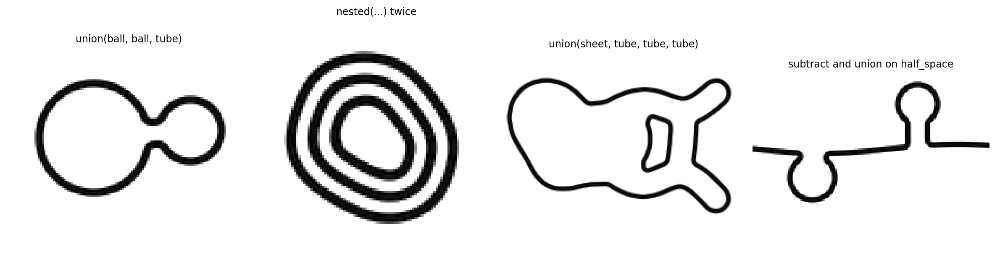
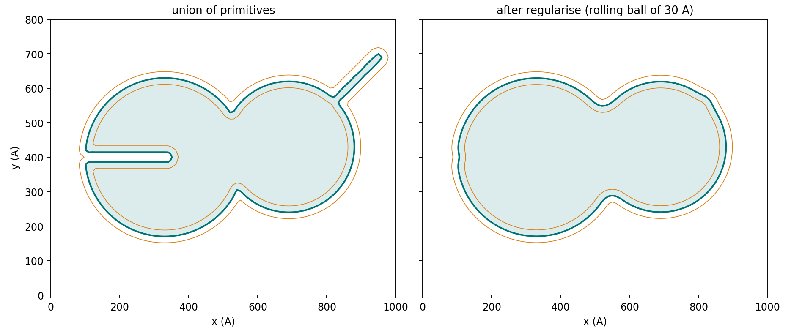

# Geometry

This page describes how `specter.specimen.membrane` represents a
membrane's mid-surface, composes it from primitives, makes it fit for a
bilayer and renders it.

!!! example "In code"
    This page is the theory behind [Cellular specimens for cryo-ET](../../tutorials/cellular-specimens.md), which shows it step by step with code and figures.

!!! info "Source"
    `specter.specimen.membrane._geometry` (`Grid`, `regularise`, `reach`),
    `._primitives`, `._render` (`render_bilayer`).
    `docs-figures/membrane_shape.py` produces the figures.

## The coarse grid

A `Grid` covers a physical box with nodes at a spacing \(h\), 10 Å by
default, and extends a padding past the box on every side
(\(2 r_{\min} + 4h\), 100 Å at the defaults), so that a solid leaving the
box is cut by the renderer and not by the grid. Fields on it are indexed
`(x, y, z)`. The grid spacing is independent of the output voxel size:
the surface is smooth on the scale of \(r_{\min}\) = 30 Å, so a 10 Å grid
with cubic B-spline interpolation represents it, and the output
resolution enters only when the profile is rendered.

`redistance` converts any field whose sign marks the solid into a signed
distance. A Euclidean distance transform finds the nearest surface sample
for each node, and a closest-point iteration on the zero set of the
spline interpolant refines it, which makes the distance accurate below
the node spacing. The distance transform runs on the GPU through CuPy
when the grid is on a CUDA device and CuPy is importable, and through
SciPy otherwise.

## Primitives

Each primitive is the solid within a radius of a skeleton, and there are
three kinds of skeleton:

| Skeleton | Primitive | Solid |
|---|---|---|
| Point | `ball`, `ellipsoid` | A sphere or a rotated ellipsoid |
| Curve | `tube` | Points within a radius of a spline through control points; the radius may vary along the curve |
| Surface patch | `sheet`, `cap` | Points within a half-thickness of a bounded, optionally bent, plane (with optional holes) or of a spherical cap |

`half_space` is the one unbounded primitive: everything below a height
function, which gives a plasma membrane crossing the box.

A curve or patch skeleton is sampled more finely than the grid and the
solid is the union of balls centred on the samples (`skeleton_solid`).
The helpers `random_walk` (a persistent random walk reflected off a
bounding box), `wobbly` (a circle with a few random Fourier modes) and
`rot_to` supply the control points, outlines and orientations.

## Composition

Signed distances compose by pointwise operations:

| Operation | Field | Meaning |
|---|---|---|
| `union(a, b, ...)` | \(\min(\phi_a, \phi_b, \dots)\) | Either solid |
| `subtract(a, b, gap)` | \(\max(\phi_a, \mathrm{gap} - \phi_b)\) | `a` with `b`, grown by `gap`, removed |
| `nested(phi, grid, gap)` | \(\phi + \mathrm{gap}\), regularised | A second surface `gap` inside the first |
| `undulate(phi, grid, rng, amplitude, wavelength)` | \(\phi\) plus smooth noise | Relief of a given amplitude and wavelength |

The result of a union or a subtraction has the right sign everywhere and
is not a distance near the creases where the operands meet. The
regularisation that follows restores the distance.

{ width="900" style="display:block;margin:1.2em auto;" }
///caption
Four compositions outside the organelle kinds, each a central section of the potential rendered at 10 Å per voxel: two vesicles joined by a neck, a vesicle with two nested layers 90 Å apart, a sheet continuous with three tubules, and a plasma membrane with a pit and a bud.
///

A membrane system is a list of such surfaces. A multilamellar vesicle is
an outer surface and its `nested` copies, and a mitochondrion is an outer
membrane and an inner one. `render_bilayer` adds their potentials.

## Regularisation

A raw composition has creases where primitives meet, and may have spikes
thinner than a bilayer and slots narrower than one. `regularise` rolls a
ball of radius \(r\) = `R_MIN` = 30 Å over both sides of the surface: a
morphological closing (dilate by \(r\), erode by \(r\)) followed by an
opening (erode by \(r\), dilate by \(r\)), each step a shift of the
signed distance followed by `redistance`, then a Gaussian smoothing of
one node spacing. A surface that survives both has no curvature radius
below \(r\) on either side, and no two parts of it closer than \(2r\).

{ width="850" style="display:block;margin:1.2em auto;" }
///caption
A section through a union of two balls with a spike of 12 Å radius and a slot 30 Å wide, before and after regularisation. The mid-surface is drawn in teal and the two leaflets of a 37 Å bilayer, at \(\phi = \pm 18.5\) Å, in orange. The smallest reach rises from 0 Å to 32.5 Å.
///

In the example the crease between the balls becomes a fillet, the spike
is removed by the opening and the slot is filled by the closing.

A closing followed by an opening is not idempotent. The opening can join
two pockets of the complement through a neck thinner than the bilayer.
The reach is therefore measured after rolling. Wherever it is below the
accepted minimum the thin side is filled, so that a neck of solvent
becomes lumen and a web of lumen becomes solvent, and the field is rolled
again. After five such repairs a field that still fails raises
`ReachError`, so a field returned by `regularise` always has room for its
leaflets.

## Reach

The reach at a surface point, on one side, is the distance \(s\) along
the normal over which \(\phi\) remains equal to \(s\). A reach of \(s\)
means that no curvature radius on that side is below \(s\) and that no
other part of the membrane lies within \(2s\). `reach` measures it on
both sides of every surface point by sampling the spline interpolant of
\(\phi\) along the normal, out to 80 Å in steps of 2.5 Å, and ending the
reach where the field departs from an exact distance by more than 2 Å.

The accepted minimum, `MIN_REACH`, is 25 Å. The leaflets of a 37 Å
bilayer lie 18.5 Å either side of the mid-surface, so a reach above that
keeps each leaflet a single unfolded sheet, and two mid-surfaces at least
50 Å apart keep their facing leaflets from merging. This is why two
bilayer sheets must stay apart: \(\psi(\phi)\) reads only the distance to
the nearest mid-surface, and where two sheets are closer than the
profile's width the rendered potential between them is that of neither.

## Narrow-band rendering

`render_bilayer` evaluates \(\psi(\phi(\mathbf{x}))\) on the output grid.
The output volume is divided into cubic blocks of 64 voxels. For each
surface, the coarse nodes within the profile's half-width (plus two node
spacings) of the mid-surface select the blocks the membrane crosses, and
only those blocks are evaluated, in batches of \(2^{24}\) voxels: \(\phi\)
is interpolated at every voxel centre with a cubic B-spline and the
potential is read from a table of \(\psi\) at 0.25 Å spacing, averaged
over one output voxel along the normal
(see [Bilayer profile](../cryoet-specimen/bilayer.md#rendering-on-the-output-grid)).

The cost therefore has two parts. The geometry costs in proportion to the
number of coarse nodes, which is the box volume over \(h^3\) and does not
depend on the output voxel size. The rendering costs in proportion to
the number of blocks crossed, which follows the membrane's area and not
the volume of the box, so halving the voxel size multiplies it by about
four where a dense evaluation would multiply it by eight.

## Limitations

See [Membrane shape](index.md#limitations).
