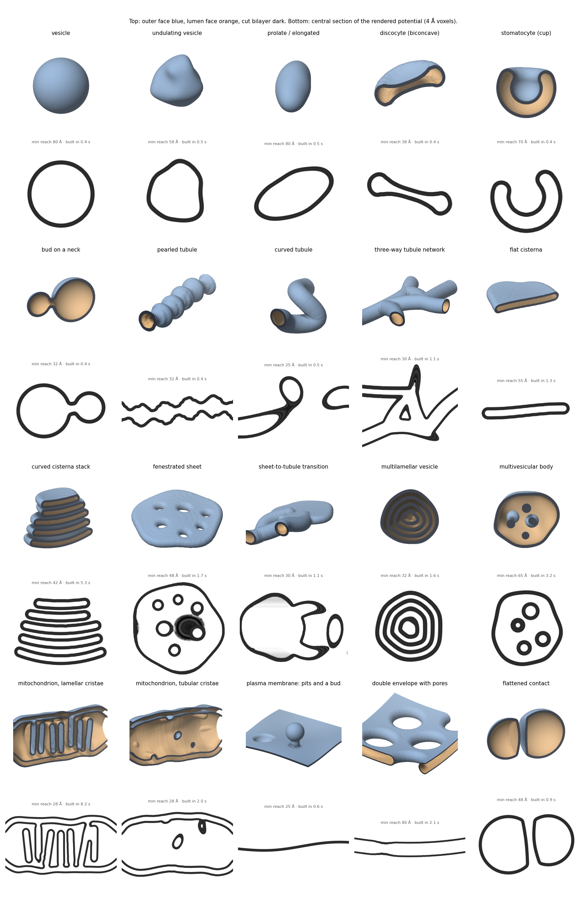

# Membrane shape

{ width="900" style="display:block;margin:1.2em auto;" }
///caption
Twenty shapes, each composed from the primitives on the [Geometry](geometry.md#composition) page, regularised and rendered by the same code. In each pair the upper panel is the bilayer shell of the mid-surface: the face looking away from the lumen is blue, the face looking into it orange, and the bilayer is dark where it is cut by the box or by a plane through the centre. The lower panel is a central section of the rendered potential at 4 Å per voxel. Each caption gives the smallest reach on any of the shape's surfaces and the time to build and regularise its geometry on one GPU. The four organelle kinds of [Organelle kinds](organelles.md) are presets among such compositions.
///

A membrane is modelled as the boundary of a solid. The solid is held as a
signed distance \(\phi(\mathbf{x})\) on a coarse grid, negative inside and
zero on the bilayer's mid-surface, and every membrane of every organelle
is built by the same four steps:

1. **Compose** a solid from primitives, each the set of points within a
   radius of a skeleton (a point, a curve or a surface patch), joined by
   boolean operations on their distances.
2. **Regularise** it with a rolling ball, which leaves no curvature radius
   and no half self-distance below the ball's radius.
3. **Check the reach**, the distance over which \(\phi\) remains an exact
   distance along each surface normal, so that both leaflets of the
   bilayer fit everywhere.
4. **Render** the calibrated bilayer profile \(\psi(\phi(\mathbf{x}))\) on
   the output grid, in the blocks of the volume a membrane crosses.

!!! example "In code"
    This page is the theory behind [Cellular specimens for cryo-ET](../../tutorials/cellular-specimens.md), which shows it step by step with code and figures.

!!! info "Source"
    `specter.specimen.membrane._geometry`, `._primitives`, `._organelles`,
    `._render`, `._generator`. `docs-figures/membrane_shape.py` produces
    the figures.

The pages of this section follow that order:

- [Geometry](geometry.md): the grid, the primitives and their
  composition, regularisation, the reach check and the narrow-band
  renderer.
- [Organelle kinds](organelles.md): the four recipes
  (`vesicle`, `tubules`, `cisterna`, `mitochondrion`), their settings,
  defaults and smallest supported values, and where their randomness is
  drawn.

The method produces a signed field and a potential volume.
[Bilayer & transmembrane proteins](../cryoet-specimen/bilayer.md) covers
the profile \(\psi(d)\) itself and how proteins embed in the bilayer, and
[Cryo-ET specimen assembly](../cryoet-specimen/index.md) covers how a
membrane fits into a whole specimen.

## Why a solid

A bilayer has two leaflets, each half the bilayer thickness from the
mid-surface. Rendering it as \(\psi(\phi)\) is correct only where
\(\phi\) is the true distance to the mid-surface on both sides, out to the
edge of the profile. Two conditions break that. Where the mid-surface
curves with a radius below the half-thickness, the inner leaflet folds
onto itself. Where two parts of the surface approach within one bilayer
thickness, their leaflets overlap and the potentials of two sheets add
in the gap.

Describing the membrane as the boundary of a solid turns both conditions
into properties of one field. Boolean operations on solids always return
a closed, orientable surface with a defined inside, so the lumen is known
without a separate classification of the shape. A morphological
regularisation of the solid bounds the curvature and the self-distance
together. The result is checked numerically before anything is rendered
(see [Geometry](geometry.md#reach)).

## Use

`MembraneGenerator` builds one organelle. The `kind` selects the recipe
and its keyword settings size it, each a scalar or a `[low, high]` range:

```python
from specter.specimen.membrane import MembraneGenerator

gen = MembraneGenerator(voxel_size=10.0, kind="mitochondrion", seed=3)
volume = gen.generate()      # (Z, Y, X) potential, volts
gen.params                   # the value drawn for each setting
gen.field                    # signed distance of the outermost membrane
```

In a `specter build tomogram` config the same settings are the keys of a
`[[membrane]]` table:

```toml
[[membrane]]
kind = "vesicle"
radius = [150.0, 350.0]
n_copies = 3
```

Shapes outside the four kinds are composed directly from the primitives
and rendered with `render_bilayer`
(see [Geometry](geometry.md#composition)).

## Limitations

- **The geometry grid is 10 Å and the smallest curvature radius 30 Å.**
  Features of the mid-surface below the rolling-ball radius, `R_MIN` =
  30 Å, are removed by the regularisation, and the accepted reach is
  25 Å. Highly curved membranes such as the rim of a tightly stacked
  cisterna or a narrow crista junction are therefore rounder than in a
  cell. A box needing more than 24 million geometry nodes is built on a
  coarser grid, with a warning.
- **Transmembrane proteins are placed on the outermost membrane only.**
  `MembraneGenerator.field` holds the outer mid-surface, so the inner
  layers of a multilamellar vesicle and a mitochondrion's inner membrane
  and cristae carry no proteins.
- **A surface cut open by the box encloses no lumen.** A composition
  that leaves the grid, such as a `half_space`, is rendered where it
  crosses the box, and the region classification finds no enclosed
  space behind it. `TomogramSpecimenGenerator` skips an organelle whose
  interior extends outside its own output box.
- **The default size ranges are engineering choices.** The ranges in
  `ORGANELLE_DEFAULTS` were chosen to give recognisable organelles that
  fit a lamella-sized box. They are not measured distributions.
- **One bilayer profile serves every membrane.** A mitochondrion's inner
  and outer membranes and every layer of a vesicle are rendered with the
  same \(\psi(d)\) and thickness.
