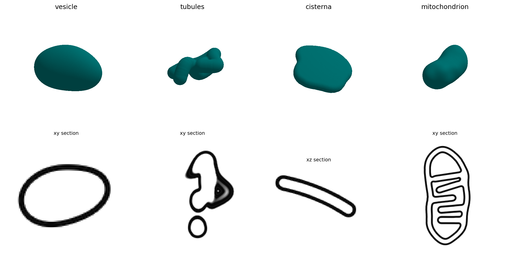

# Organelle kinds

An organelle kind is a short recipe that composes the
[primitives](geometry.md#primitives) into a membrane system.
`MembraneGenerator(kind=...)` and a `[[membrane]]` table's `kind` select
it, and its settings are quantities visible in a tomogram: a radius, a
length, a lumen width.

!!! example "In code"
    This page is the theory behind [Cellular specimens for cryo-ET](../../tutorials/cellular-specimens.md), which shows it step by step with code and figures.

!!! info "Source"
    `specter.specimen.membrane._organelles` (`ORGANELLE_DEFAULTS`,
    `plan_organelle`), `._generator` (`MembraneGenerator`).
    `docs-figures/membrane_shape.py` produces the figure.

{ width="900" style="display:block;margin:1.2em auto;" }
///caption
The four organelle kinds at their default settings (seed 3): the outermost mid-surface above, a central section of the potential at 10 Å per voxel below. The cisterna is cut along z, the others in the xy plane.
///

## Settings

Every setting is a scalar or a `[low, high]` range, in Å or as a count. A
range is drawn uniformly once per membrane (counts as whole numbers,
inclusive). A setting left out takes the default below. A value below the
smallest supported one is refused with an error, as is a setting the kind
does not have.

### `vesicle`

A prolate spheroid of random orientation with smooth surface relief.

| Setting | Meaning | Default | Smallest |
|---|---|---|---|
| `radius` | Mean radius, Å | [200, 340] | 60 |
| `elongation` | Long axis over short axis | [1.0, 1.5] | 1.0 |
| `undulation` | Amplitude of the surface relief, Å | [5, 45] | 0 |
| `layers` | Number of nested bilayers | 1 | 1 |

The semi-axes are \(r e^{2/3}\) and twice \(r e^{-1/3}\), which keeps the
volume of a sphere of radius \(r\). The relief amplitude is capped at
0.15 of the shortest semi-axis and its wavelength is drawn between 350
and 700 Å. Additional layers are copies of the outer surface 90 Å apart,
added until the next would leave no lumen.

### `tubules`

A branched network of tubes of one radius, as in tubular endoplasmic
reticulum.

| Setting | Meaning | Default | Smallest |
|---|---|---|---|
| `radius` | Tube radius, Å | [110, 170] | 60 |
| `length` | Length of each branch, Å | [1200, 1800] | 300 |
| `branches` | Number of branches | [2, 4] | 1 |

Each branch is a persistent random walk in steps of 300 Å, reflected off
a box of half-width 0.4 of the length in x and y and 0.2 of the length
(at least the radius) in z, so the network lies flat in the lamella. A
branch starts, with equal probability, where the previous one started or
at an interior point of the previous one.

### `cisterna`

A flattened sac: a bent sheet with an irregular outline.

| Setting | Meaning | Default | Smallest |
|---|---|---|---|
| `diameter` | Mean lateral diameter, Å | [800, 1120] | 300 |
| `lumen_width` | Distance between the two faces' mid-surfaces, Å | [100, 160] | 70 |
| `fenestrations` | Number of holes through the sac | [0, 1] | 0 |

The sheet's normal is tilted slightly off z and its mid-plane is bowed
by a random quadratic and a sinusoid. Each fenestration is a hole of
130 to 180 Å radius.

### `mitochondrion`

An outer membrane and an inner boundary membrane with cristae.

| Setting | Meaning | Default | Smallest |
|---|---|---|---|
| `radius` | Radius of the outer membrane, Å | [470, 560] | 300 |
| `length` | Length of the straight part, Å | [900, 1440] | 300 |
| `crista_spacing` | Distance between cristae along the axis, Å | [230, 330] | 180 |
| `membrane_gap` | Outer to inner membrane, Å | 130 | 90 |

The outer membrane is a bowed tube with rounded ends and a relief of
20 Å, its long axis in the xy plane. The inner membrane is the outer
surface moved in by `membrane_gap`, from which the cristae are
subtracted: at every `crista_spacing` along the axis, a lamellar sheet of
72 Å half-thickness across the matrix and a tube of 78 Å radius joining
it to the boundary, the crista junction. The two membranes are separate
surfaces and their potentials add.

## Where the randomness enters

A seed determines an organelle in two stages.

**Sizes are drawn at plan time.** Constructing a `MembraneGenerator`
calls `plan_organelle`, which draws one value per setting, the vesicle's
orientation and the mitochondrion's azimuth. The plan reports the extent
the organelle can reach before any geometry exists, which is what sizes
its local grid (`target_shape` when omitted) and what a tomogram uses to
place it. The drawn values are available as `MembraneGenerator.params`
and the extent as `bounding_radius`.

**Nuisance draws happen at build time.** The relief, a tubule's path, a
cisterna's outline, bend and holes, and each crista's position and tilt
are drawn inside `generate()`, from a second stream derived from the same
seed.

**A build that fails its reach check is redrawn.** If
[`regularise`](geometry.md#regularisation) raises `ReachError`, the
build is repeated with a fresh nuisance stream, up to four attempts in
total, and the sizes drawn at plan time are kept. The organelle's
extent, and so its place in a tomogram, does not change with the redraw.
The error is raised to the caller only if every attempt fails.

## Fitting a box

`max_radius` bounds the organelle's bounding radius. When a draw exceeds
it, the size settings left at their defaults (`radius`, `length`,
`diameter`) are scaled down together until the organelle fits or they
reach their smallest values. A size the caller gave is never changed.

`specter build tomogram` passes `max_radius` for every `[[membrane]]`
entry without its own `target_shape`: 0.75 of half the box's limiting
extent, which is the smallest axis the specimen may not be clipped on,
or the largest axis when every axis is clippable.

## Limitations

See [Membrane shape](index.md#limitations).
