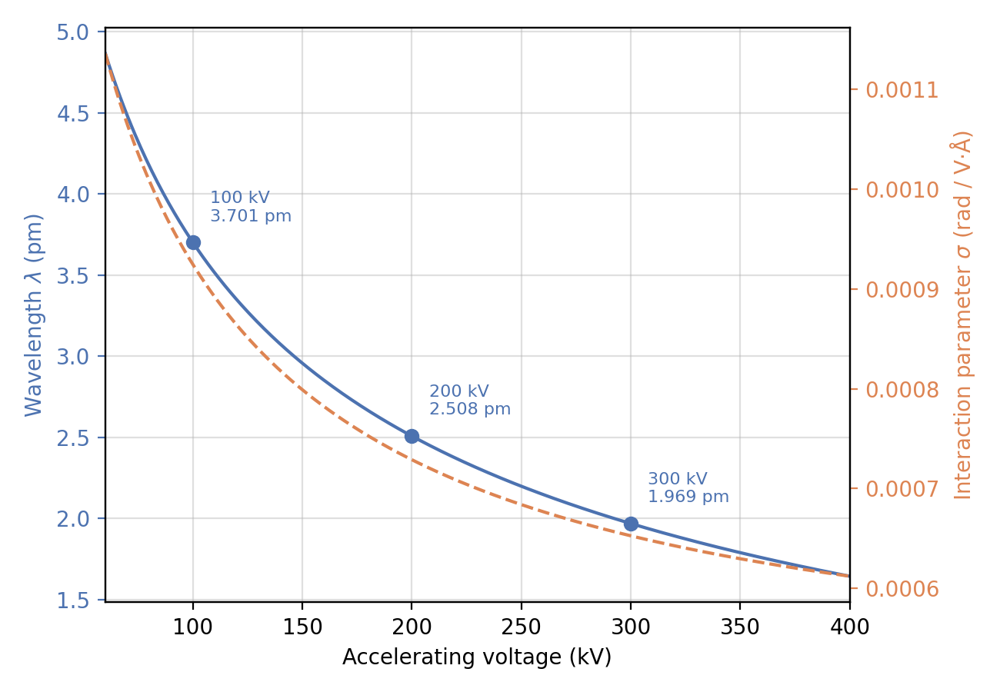

# Scattering

Once a [specimen](../specimens.md) potential volume \(V(x,y,z)\) exists,
[forward simulation](../forward-simulation.md) starts by propagating an
electron plane wave through it to obtain a complex-valued 2D exit wave
\(\psi(x,y)\) at the specimen's far face. `Scattering` (eager,
whole-volume) and `IterativeScattering` (on-the-fly slice sampling under
rotation, used by `TiltSeries` and `Sample`) both implement this as one of
several propagation models, selected by `scattering_model`:
`"multislice"` (default, most accurate), `"rytov"`, `"firstborn"`,
`"kinematic"`, and `"projection"`, in roughly decreasing order of physical
accuracy and increasing order of speed. Every model shares the same two
physical quantities.

!!! example "In code"
    This page is the theory behind [Scattering](../../walkthrough/scattering.md) and [Inelastic scattering and energy filtering](../../tutorials/inelastic.md), which show it step by step with code and figures.

!!! info "Source"
    `specter.scattering.Scattering` / `IterativeScattering`.
    `docs-figures/scattering_overview.py` and
    `docs-figures/scattering_accuracy.py` produce the figures below,
    calling the same classes the real code path does.

## Two numbers set the whole propagation problem

An electron accelerated through voltage \(U\) (kV) has a relativistic de
Broglie wavelength (`energy_to_wavelength`; Kirkland 2010, Ch. 2):

\[
\lambda = \frac{hc}{\sqrt{eU\,(eU + 2 m_e c^2)}}
\]

and interacts with the specimen's electrostatic potential through the
interaction parameter (`interaction_parameter`; Kirkland 2010, Eq. 5.6):

\[
\sigma = \frac{2\pi}{\lambda\, eU}\cdot\frac{eU + m_e c^2}{eU + 2 m_e c^2}
\]

where \(m_e c^2 = 511\) keV is the electron rest mass energy. \(\sigma\)
turns a potential (in volts) into a phase (in radians): every
propagation model below multiplies \(V\) by \(\sigma\) before doing
anything else with it. `Scattering` evaluates both quantities once per
instance and reuses them for every slice and every particle.

{ width="600" }
///caption
Wavelength and interaction parameter vs. accelerating voltage, with the standard 100/200/300 kV checkpoints marked.
///

300 kV gives \(\lambda = 1.9687\) pm, matching the standard textbook
checkpoint (1.969 pm) used elsewhere in this documentation to validate
physics-critical code (see [Atomic potentials](../atomic-potentials.md)).
Both \(\lambda\) and \(\sigma\) fall monotonically with voltage: a faster
electron has a shorter wavelength and interacts more weakly per unit
potential, which is why higher-voltage microscopes penetrate thicker
specimens with less multiple scattering.

## Choosing a propagation model

| Model | Exit wave | Cost | Use |
|---|---|---|---|
| [`multislice`](multislice.md) | Full recursive transmit/propagate | \(O(n_z)\) sequential FFT pairs | Default; most accurate for thick specimens |
| [`rytov`](rytov.md) | Exponentiated, parallel sum over slices | \(O(n_z)\) parallel FFT pairs | `Ghostbuster`'s default reconstruction model |
| [`firstborn`](other-modes.md) | Linearized, parallel sum over slices | \(O(n_z)\) parallel FFT pairs | Thin, weakly scattering specimens |
| [`kinematic`](other-modes.md) | Un-linearized single-scattering sum | \(O(n_z)\) parallel FFT pairs | Rarely more accurate than `firstborn` in practice; see [Other propagation modes](other-modes.md) |
| [`projection`](other-modes.md) | Projected potential, no propagation | One FFT-free sum | Fastest; thin specimens or coarse previews |

All five agree closely for a thin specimen and diverge as thickness
grows, since `multislice` is the only one that repeatedly re-propagates
the wave between scattering events rather than approximating the whole
volume as a single scattering step. See
[Rytov](rytov.md#accuracy-vs-thickness) and [Other propagation
modes](other-modes.md#accuracy-vs-thickness) for the measured error curves.

## Two conventions shared by every model

**Ewald sphere curvature sign.** Before propagation, `ews_curvature_sign`
(`"negative"` by default) determines the order in which the beam traverses
the volume's Z-slices. Under `"negative"` the beam enters at slice 0 and
exits after the last slice; under `"positive"` it enters at the last slice
and exits after slice 0. Which sign describes a dataset follows from the
instrument's image geometry rather than from a software convention; see
[Ewald-sphere curvature sign](../../user-guide/reconstruction.md#ewald-sphere-curvature-sign).
Multislice, Rytov, and first Born each propagate a slice's contribution a
different net distance to the exit plane (DeRosier 2000), so reversing the traversal order
changes which face of the specimen accumulates the least propagation and
which the most.

**Amplitude contrast.** `alpha` (0 by default) sets the fraction of the
potential treated as absorptive, via `potential.apply_amplitude_contrast`:
\(V \to V\,(\sqrt{1-\alpha^2} + i\alpha)\). `potential.apply_amplitude_contrast` applies
this once, upstream of every model except `"ctf"` (a projected-potential-only
mode that feeds directly into the aberration stage; see
[Aberrations](../aberrations.md)), so a single `alpha` value carries
through the whole propagation.

## `Scattering` vs. `IterativeScattering`

`Scattering` takes an already-rotated, already-padded volume and runs the
whole recursion eagerly. `IterativeScattering` instead samples Z-slices
on the fly from a volume under an arbitrary affine pose
(`VolumeRotator.sample_rotated_slices`), which is what
`TiltSeries` uses: at large tilt angles the traversed slice count
`nz_new` exceeds the volume's own Z-extent, and resampling per-slice
avoids ever materializing a second full-size rotated copy of the volume.
Both classes implement the same five models with the same formulas; only
the source of each Z-slice differs.

## Mean-free-path absorption support

For particle generators, `Propagation(absorption_model="inelastic_mfp")`
uses a calibrated imaginary potential (Vulović et al. 2013) instead of `alpha`. Set `alpha=0`
when constructing `Propagation` directly. Without `inelastic_mfp_specimen`,
the solvent-present case uses uniform absorption; specifying a specimen MFP
builds a material-dependent field before solvent blending. With no solvent
and no specimen MFP, no absorption is assigned.

The `specter simulate particles`, `simulate micrograph` and
`simulate tiltseries` configs expose the same settings as flat TOML fields,
each with a matching `--<field>` flag:

| Field | Default | Meaning |
|---|---|---|
| `absorption_model` | `"alpha"` | `"alpha"` scales the real potential by the amplitude-contrast ratio; `"inelastic_mfp"` derives the imaginary potential per material from a mean free path and ignores `alpha`, including a `.cs`/`.star` file's |
| `inelastic_mfp_solvent` | unset | Ice mean free path in Å; unset takes the voltage-dependent value described below |
| `inelastic_mfp_specimen` | unset | Specimen mean free path in Å; unset gives the specimen the ice value, so it carries no absorption contrast (2460 Å is the derived protein value at 300 kV) |
| `objective_aperture` | unset | Objective aperture semi-angle in mrad (see [Objective aperture](#objective-aperture)); unset applies no aperture |
| `dose_envelope_target` | `"transfer_function"` | Where the dose envelope acts: `"transfer_function"` filters the whole image, solvent included; `"specimen"` damages the specimen potential before ice is added |

`inelastic_mfp_solvent`, `inelastic_mfp_specimen` and `objective_aperture`
take effect only under `absorption_model="inelastic_mfp"`.

The solvent mean free path defaults to the value for amorphous ice at the
generator's accelerating voltage, from `potential.ice_inelastic_mfp`. Two
voltages are measured: 3950 Å at 300 kV (Rice et al. 2018) and 2030 Å at
120 kV (Grimm et al. 1996). No energy-filtered measurement of ice has been
found at 200 kV or 100 kV. At those and any other voltage the value is a power
law in \(\beta^2\) through the two measurements, 3040 Å ± 7% at 200 kV and
1730 Å ± 20% at 100 kV, and a warning reports it as an estimate. The standard
cross-section formulas (Langmore & Smith 1992; Vulović et al. 2013) depart
from the measured energy dependence (Feja & Aebi 1999; Rice et al. 2018) by
up to a factor of 1.8, but that error lies in the overall slope, which the two
measurements fix; only the shape of the curve between them is assumed.
`INELASTIC_MFP_PROTEIN_A` is a 300 kV value; at another voltage the same
protein-to-ice ratio, 0.62, applies to the ice value there, with the caveat
that the ratio itself has only been derived at 300 kV.

All five wave models in `Scattering` consume `uniform_absorption` with the
same result as an explicit constant imaginary potential. Multislice,
projection and Rytov give exponential slab attenuation. First Born and
kinematic retain their respective linear and single-scattering
approximations; they do not become exact Beer–Lambert propagators for thick
absorbing specimens. The `ctf` model rejects uniform absorption.

`TiltSeries` applies the same model to a tilt series. The absorption
field is computed from the dry specimen volume before ice is blended into it,
with the occupancy that weights the ice, and with the mean free paths a
particle `Specimen` resolves: the solvent value or its voltage-dependent
default, the optional specimen value, and the objective-aperture rate
described below. The solvent term is present only when ice is blended. The
field receives the same tilt padding and edge taper as the elastic volume, and
`IterativeScattering.multislice_absorptive` samples both through the same
rotated slices, so absorption follows the specimen at every tilt. Without a
specimen mean free path the field is uniform, but it is constructed as a
constant over the volume rather than applied as a scalar. A tilted slice
extends past the rotated slab into vacuum, so a scalar would absorb where the
beam crosses no material; the field is zero there, and a slab of thickness
\(t\) attenuates as \(\exp(-t/(\Lambda\cos\theta))\) at tilt \(\theta\). An
explicit `absorption` field passed to `Sample.tilt_series` takes precedence
over the mean-free-path settings. The field is a second volume of the padded
size, which doubles the resident memory of the specimen.

A micrograph's `Sample` applies the model too. The dry specimen
exists without its ice only while the ice is being blended into it, so the
field is written by the blend itself, one z-slab at a time, from the occupancy
read that also weights the ice. For a `Field` this takes place in
`Field.draw`, once per specimen; for a pre-assembled volume, in
`Sample.prepare`. The field is therefore computed on the same device as the
ice, a slab at a time, and costs one additional canvas and no additional
occupancy pass. It is propagated alongside the potential by
`IterativeScattering.multislice_absorptive`, which requires
`scattering_model="multislice"`. Without a specimen mean free path and with
ice filling the box, the absorption is uniform and no field is built: the beam
is untilted, every slice is filled with material (the reflect-padded margin
under `pad_fft` included), and a constant imaginary potential \(V_{ab}\)
factorises out of each slice's transmission function. The exit wave of a box
of thickness \(t\) is then multiplied by \(\exp(-\sigma t V_{ab})\), which
is exact for the multislice recursion. An `IceProfile` leaves vacuum in part
of the box, so the uniform case with a profile builds a field that is zero
where the profile window excludes ice.

`TomogramReconstructor` rejects `absorption_model="inelastic_mfp"`
explicitly. Its iterative path needs material information that distinguishes
specimen, solvent, and vacuum, and a pre-solvated real potential is
insufficient for the occupancy estimator. It still supports `alpha`. This
restriction does not remove the low-level propagators' support for supplied
complex potentials.

A spectral, exposure-resolved absorption model is available separately through
the [frozen-plasmon Python API](frozen-plasmon.md).

### Objective aperture

Electrons scattered elastically beyond the objective aperture are removed from
the image in the same way as inelastically scattered electrons are removed by
an energy filter. A multislice grid does not carry this scattering. At 1 Å per
pixel the Nyquist frequency (0.5 Å⁻¹) lies inside a 12 mrad aperture
(0.61 Å⁻¹ at 300 kV), and finer grids attenuate it: through 400 Å of amorphous
ice the cross section below sends 2.8% of the beam beyond 12 mrad, whereas the
propagated wave carries 0.49% at 0.5 Å per pixel and 1.9% at 0.125 Å per pixel.

`Optics(objective_aperture=...)`, in milliradians, therefore charges this loss
as an additional absorption rate for each material. The rate is the elastic
cross section integrated beyond the aperture,

\[
\frac{1}{\Lambda_{ap}} = n\,(\sigma c_1)^2
    \int_{k_{ap}}^{\infty} \overline{|f(k)|^2}\,2\pi k\,dk ,
\]

evaluated with Kirkland (2010) factors for water (including its intramolecular
interference) and for the standard protein composition
(`potential.aperture_mfp_ice`, `potential.aperture_mfp_protein`). At 300 kV and
12 mrad, \(\Lambda_{ap}\) is 14,200 Å for ice and 10,400 Å for protein. The
rate adds to the inelastic one, and where the aperture lies inside the grid's
Nyquist frequency the potential is low-passed at the aperture
(`potential.aperture_lowpass`) so that the scattering the grid does carry is
not also counted. A micrograph's `Sample` applies the same per-slice filter to
its untilted specimen volume. A tilt series cannot use that filter, because it acts on
transverse frequencies of the beam frame and the beam direction changes from
tilt to tilt. `TiltSeries` instead removes all 3D frequencies beyond
the aperture (`potential.aperture_lowpass_isotropic`), a spherical filter that
commutes with rotation. On the Ewald sphere the two filters coincide to within
\(\theta^2/8\) relative at scattering angle \(\theta\), so they keep and remove
the same first-order scattering. The aperture requires `absorption_model="inelastic_mfp"`,
because the `alpha` model's fitted constant already represents this loss.

On a 6BDF particle (Campbell et al. 2015) in 400 Å of ice at 300 kV, a 12 mrad aperture raises the
effective amplitude contrast measured from a defocus series by 0.0075, from
0.063 to 0.070 at the provisional protein mean free path. Yonekura et al.
(2006) measured 6.9 ± 1.9% on energy-filtered images under the same aperture
and voltage.

### Frozen-plasmon exposure simulation

The [frozen-plasmon Python API](frozen-plasmon.md), following Himes &
Grigorieff (2021), adds separate spectral
absorption sources, explicit solvent trajectories, paired slice propagation
and incoherent exposure integration. It requires explicit source calibration;
the included Drude spectrum is a development approximation.

## References

- Campbell, M. G., Veesler, D., Cheng, A., Potter, C. S., & Carragher, B.
  (2015). 2.8 Å resolution reconstruction of the *Thermoplasma acidophilum*
  20S proteasome using cryo-electron microscopy. *eLife*, 4, e06380.
  [doi:10.7554/eLife.06380](https://doi.org/10.7554/eLife.06380)
- DeRosier, D. J. (2000). Correction of high-resolution data for curvature of
  the Ewald sphere. *Ultramicroscopy*, 81(2), 83–98.
  [doi:10.1016/S0304-3991(99)00120-5](https://doi.org/10.1016/S0304-3991(99)00120-5)
- Feja, B., & Aebi, U. (1999). Determination of the inelastic mean free path
  of electrons in vitrified ice layers for on-line thickness measurements by
  zero-loss imaging. *Journal of Microscopy*, 193(1), 15–19.
  [doi:10.1046/j.1365-2818.1999.00436.x](https://doi.org/10.1046/j.1365-2818.1999.00436.x)
- Grimm, R., Typke, D., Bärmann, M., & Baumeister, W. (1996). Determination
  of the inelastic mean free path in ice by examination of tilted vesicles
  and automated most probable loss imaging. *Ultramicroscopy*, 63(3–4),
  169–179.
  [doi:10.1016/0304-3991(96)00035-6](https://doi.org/10.1016/0304-3991(96)00035-6)
- Himes, B., & Grigorieff, N. (2021). Cryo-TEM simulations of amorphous
  radiation-sensitive samples using multislice wave propagation. *IUCrJ*,
  8(6), 943–953.
  [doi:10.1107/S2052252521008538](https://doi.org/10.1107/S2052252521008538)
- Kirkland, E. J. (2010). *Advanced computing in electron microscopy* (2nd
  ed.). Springer.
  [doi:10.1007/978-1-4419-6533-2](https://doi.org/10.1007/978-1-4419-6533-2)
- Langmore, J. P., & Smith, M. F. (1992). Quantitative energy-filtered
  electron microscopy of biological molecules in ice. *Ultramicroscopy*,
  46(1–4), 349–373.
  [doi:10.1016/0304-3991(92)90024-E](https://doi.org/10.1016/0304-3991(92)90024-E)
- Rice, W. J., Cheng, A., Noble, A. J., Eng, E. T., Kim, L. Y., Carragher,
  B., & Potter, C. S. (2018). Routine determination of ice thickness for
  cryo-EM grids. *Journal of Structural Biology*, 204(1), 38–44.
  [doi:10.1016/j.jsb.2018.06.007](https://doi.org/10.1016/j.jsb.2018.06.007)
- Vulović, M., Ravelli, R. B. G., van Vliet, L. J., Koster, A. J., Lazić, I.,
  Lücken, U., Rullgård, H., Öktem, O., & Rieger, B. (2013). Image formation
  modeling in cryo-electron microscopy. *Journal of Structural Biology*,
  183(1), 19–32.
  [doi:10.1016/j.jsb.2013.05.008](https://doi.org/10.1016/j.jsb.2013.05.008)
- Yeo, J., & Loh, N. D. (2026). Pursuing the physics of cryo-EM image
  formation. In *Current approaches to cryo-electron microscopy* (Progress
  in Molecular Biology and Translational Science, pp. 41–69). Elsevier.
  [doi:10.1016/bs.pmbts.2026.05.001](https://doi.org/10.1016/bs.pmbts.2026.05.001)
- Yonekura, K., Braunfeld, M. B., Maki-Yonekura, S., & Agard, D. A. (2006).
  Electron energy filtering significantly improves amplitude contrast of
  frozen-hydrated protein at 300 kV. *Journal of Structural Biology*,
  156(3), 524–536.
  [doi:10.1016/j.jsb.2006.07.016](https://doi.org/10.1016/j.jsb.2006.07.016)
