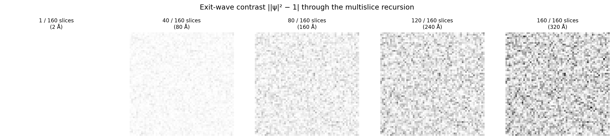
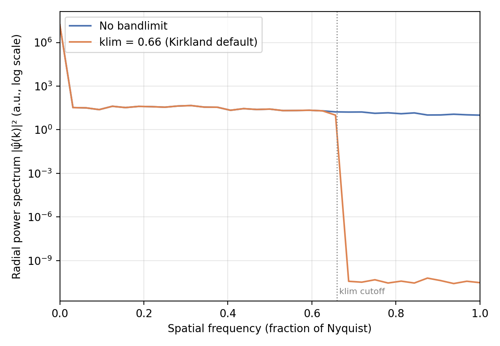

# Multislice

`scattering_model="multislice"` is the default and most accurate
propagation model. It follows the multislice method of Cowley & Moodie
(1957), in the FFT formulation of Ishizuka & Uyeda (1977) as presented by
Kirkland (2010, Ch. 6): alternate multiplying the wave by each slice's
transmission function with propagating it a fixed distance (one voxel of
Z) via a Fresnel propagator, repeated once per Z-slice of the potential
volume.

!!! example "In code"
    This page is the theory behind [Scattering](../../walkthrough/scattering.md#oversampling) and [Tilt series](../../walkthrough/tilt-series.md), which show it step by step with code and figures.

!!! info "Source"
    `Scattering.multislice` / `IterativeScattering.multislice`.
    `docs-figures/scattering_accuracy.py` produces the figures,
    reproducing the same recursion `Scattering.multislice` runs internally
    (reading its registered Fresnel propagator and \(\sigma\) directly), so
    the traced intermediate states cannot drift from what the real
    implementation computes.

## The recursion

For slice index \(i\) with potential \(V_i\), the wave immediately after
transmission through that slice is

\[
\psi_i^{\,\mathrm{post}} = t_i \, \psi_{i-1}, \qquad
t_i = \exp\!\big(i\,\sigma\,\Delta z\, V_i\big)
\]

where \(\Delta z\) is the slice thickness (`Scattering` assumes
\(\Delta z = \) `pixel_size`, i.e. a cubic voxel) and \(\sigma\) is the
[interaction parameter](index.md#two-numbers-set-the-whole-propagation-problem).
The wave is then Fresnel-propagated one slice forward before the next
transmission:

\[
\psi_i = \mathcal{F}^{-1}\!\big[\mathcal{F}[\psi_i^{\,\mathrm{post}}]\cdot F\big],
\qquad
F(k) = \exp\!\big(i\pi\lambda\,\Delta z\,k^2\big)
\]

\(F\) is the paraxial (small-angle) Fresnel propagator for one slice
thickness. It depends only on \(\lambda\), \(\Delta z\), and spatial
frequency \(k\), so `Scattering` computes it once at construction time and
reuses it for every slice and every particle in a batch. `Scattering`
starts the recursion at \(\psi_0 = t_0\) (a unit incident wave on the
first slice) and returns \(\psi_{n_z-1}\) after all \(n_z\) slices.

## Watching the recursion accumulate

The figure below traces this recursion through a real potential volume: a
320 Å-thick `RandomIcemaker` vitreous-ice slab (2 Å pixels, 300 kV),
showing the exit-wave contrast \(\big||\psi|^2 - 1\big|\) (the deviation
of the intensity from its unit incident-wave baseline, which is what
varies pixel to pixel here) after 1, 40, 80, 120, and all 160
slices.

{ width="900" style="display:block;margin:1.2em auto;" }
///caption
Exit-wave contrast (the deviation of intensity from its unit baseline) through the multislice recursion, at five depths through a 320 Å ice slab. White = no deviation from the unit baseline; darker = larger deviation, in either direction.
///

After a single slice the intensity is uniform: a thin phase object barely
perturbs \(|\psi|^2\), since a pure phase factor \(e^{i\phi}\) has unit
magnitude regardless of \(\phi\). Texture only appears after propagation
converts phase variation into amplitude variation (Fresnel diffraction),
and it grows with depth as more slices contribute scattered phase that
subsequent propagation steps continue to convert. A specimen thick enough
that phase-to-amplitude conversion happens *within* it, rather than only
once at the detector, needs multislice instead of a single-step model.

## Grid aliasing: `oversample` and `klim`

Each slice's transmission-then-propagation step is a circular
(FFT-based) convolution on a fixed grid. The transmission function
\(t = e^{i\sigma V \Delta z}\) and the wave \(\psi\) each carry content up to
the grid's Nyquist frequency, so their product reaches twice it, and the
part above Nyquist wraps around instead of being lost. Because the
recursion reuses the same grid at every one of the potentially thousands
of slices in a thick specimen, this aliasing compounds slice over slice.

SPECTER's default remedy is to refine the grid rather than to cut the
band. With `oversample = 2`, each slice is interpolated onto an xy grid
twice as fine before the exponential (Fourier zero-padding, which adds no
content) and the recursion runs there. The image is formed on that grid
as well: the transfer function is applied to the fine-grid exit wave, the
intensity \(|\psi|^2\) is taken there, and the detector samples the
intensity to the pixel grid with a band-limited crop. The intensity of a
band-limited wave has twice the wave's bandwidth, and in a thick specimen
it also carries cross terms between the scattering inside the pixel band
and the scattering above it, which a pixel integrates; forming
\(|\psi|^2\) on the pixel grid folds both. Measured on the 2000 Å case
against the fine-grid intensity, cropping the wave to the pixel grid first
left 1.2e-3 of the image power in error at low frequencies and 1.8e-2 near
Nyquist, the same size as the aliasing itself. The first-Born exit wave,
linear in the potential and so already band-limited to the volume grid, is
interpolated onto the image grid for the same reason. The product then has room to exist, and the
result is converged: measured against a 4x reference on a 6bdf particle (Campbell et al. 2015) at
1 Å/px, the 2x grid agrees to 3e-7 of the scattered power, the float32
noise floor, with no bandlimit applied at all. On the volume's own grid
(`oversample = 1`) the wrapped content costs 0.2% of the scattered power
in thin ice and 1.1% in 2000 Å of ice, rising to 1.9% in the shells near
Nyquist and about 0.3% at low frequencies. The cost is roughly three times
the multislice time; no additional volume memory is used, since slices are
interpolated a chunk at a time.

`oversample` is the Fourier-space counterpart of `pad_fft`. Both give
the FFT headroom by zero-padding, in dual domains: `pad_fft` pads real
space, a wider frame at the same pixel size, which refines the
\(k\)-sampling but leaves the Nyquist frequency where it was, and so
prevents the wave wrapping at the frame edge; `oversample` pads Fourier
space, finer pixels in the same frame, which raises the Nyquist frequency
but leaves the \(k\)-sampling alone, and so prevents the product wrapping
at Nyquist. Neither does the other's job. The errors quoted above were
measured with `pad_fft` on.

`klim` is the older remedy, Kirkland's (2010): zero the outer fraction of
\(k\)-space after every propagation step so that nothing can wrap into the
retained band. It is kept for comparison, and its cutoff is a fraction of
the volume's Nyquist on whichever grid the recursion runs on. It is more
expensive in a way that is easy to miss. The content above the cut is
genuinely scattered, and in a thick specimen it scatters again into the
low frequencies: cutting at 0.66 of Nyquist left ten times more error at
low frequencies than leaving the aliasing in place (2% of the scattered
power against 0.3%, at 2000 Å of ice), besides discarding the band above
the cut outright. `klim` is therefore `None` in every shipped config.

{ width="600" }
///caption
Radial power spectrum of the exit wave with and without klim=0.66, at the full 320 Å slab thickness.
///

The same wrap occurs wherever a band-limited field is exponentiated.
`rytov` and `projection` are linear in the potential up to their one final
exponential, and that exponential aliases on the volume grid at the same
level as the whole multislice recursion: 1.2e-3 of the scattered power in
thin ice and 1.0e-2 in 2000 Å of ice, with the same frequency profile. Both
therefore take their exponential on the `oversample` grid as well, at the
cost of one fine-grid exponential per image rather than per slice. `firstborn`
and `ctf` are linear throughout and need nothing; `kinematic` exponentiates
each slice separately and its harmonics are hundreds of times smaller, so it
is left on the volume grid.

## Ewald sphere curvature and the traversal order

`ews_curvature_sign="negative"` (the default) walks the Z-slices in
order: the beam enters at slice 0 and leaves through the last slice, which
is therefore the face adjacent to the exit plane. `"positive"` reverses
the order. Because each slice propagates a different net distance to the
exit plane (DeRosier 2000), the traversal order changes the result; which
order describes a dataset follows from the instrument's image geometry
([Ewald-sphere curvature sign](../../user-guide/reconstruction.md#ewald-sphere-curvature-sign)). A projection-only model has no such
asymmetry: summing a volume's slices is commutative regardless of order.

## `IterativeScattering` and tilted volumes

`TiltSeries` needs the exit wave along an arbitrary tilt axis,
beyond the volume's own Z axis. `IterativeScattering.multislice`
implements the identical recursion above, but fetches each Z-slice via
`VolumeRotator.sample_rotated_slices` under the requested affine pose
rather than indexing directly into `V`. Two further mechanisms apply:

- **`pad_fft`**, on by default for a tilt series, runs the entire
  recursion on a canvas padded by `fft_pad_margin` (32) pixels on each
  side, which sample the volume beyond the field and are zero where it ends.
  A tilt keeps that canvas through the transfer function, itself a circular
  convolution, and the detector crops the image to the field, so the CTF's
  delocalisation draws on what surrounds the field instead of wrapping the
  field's opposite edges into each other. The FFT treats
  the frame as periodic, and under tilt its two edges cross the slab at
  depths a frame width times \(\tan\theta\) apart, so an unpadded
  recursion joins a phase step there that every slice diffracts into both
  edges. The oversampled slice interpolation is periodic too, and rings
  from the same join. A laterally uniform slab at 60° images 16% off flat
  at the frame edge without the margin, 1.0% with 16 px and 0.3% with
  32 px, for 5–9% more time per tilt. Padding once and cropping once
  avoids discarding field content that is still propagating at every
  intermediate step; padding-and-cropping at every step measurably makes
  results worse, not better.
- **`checkpoint_chunks`** wraps groups of slices in
  `torch.utils.checkpoint`, trading one extra forward pass per chunk
  during backpropagation for activation memory that scales with the
  chunk size rather than with the full slice count. The tradeoff applies
  only when multislice sits inside a differentiable pipeline (e.g.
  `TomogramReconstructor`).

## References

- Campbell, M. G., Veesler, D., Cheng, A., Potter, C. S., & Carragher, B.
  (2015). 2.8 Å resolution reconstruction of the *Thermoplasma acidophilum*
  20S proteasome using cryo-electron microscopy. *eLife*, 4, e06380.
  [doi:10.7554/eLife.06380](https://doi.org/10.7554/eLife.06380)
- Cowley, J. M., & Moodie, A. F. (1957). The scattering of electrons by atoms
  and crystals. I. A new theoretical approach. *Acta Crystallographica*,
  10(10), 609–619.
  [doi:10.1107/S0365110X57002194](https://doi.org/10.1107/S0365110X57002194)
- DeRosier, D. J. (2000). Correction of high-resolution data for curvature of
  the Ewald sphere. *Ultramicroscopy*, 81(2), 83–98.
  [doi:10.1016/S0304-3991(99)00120-5](https://doi.org/10.1016/S0304-3991(99)00120-5)
- Ishizuka, K., & Uyeda, N. (1977). A new theoretical and practical approach
  to the multislice method. *Acta Crystallographica Section A*, 33(5),
  740–749.
  [doi:10.1107/S0567739477001879](https://doi.org/10.1107/S0567739477001879)
- Kirkland, E. J. (2010). *Advanced computing in electron microscopy* (2nd
  ed.). Springer.
  [doi:10.1007/978-1-4419-6533-2](https://doi.org/10.1007/978-1-4419-6533-2)
  Ch. 6.
