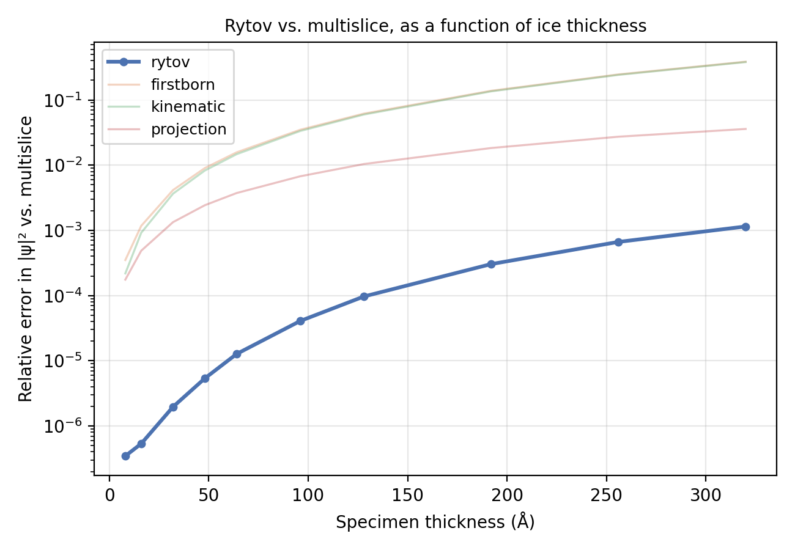

# Rytov

`scattering_model="rytov"` computes the exit wave as a single exponentiated
sum over all Z-slices rather than a sequential slice-by-slice recursion.
It is `Ghostbuster`'s default propagation model for single-particle
reconstruction, while `TomogramReconstructor` and every generation
pipeline default to [`multislice`](multislice.md).

!!! example "In code"
    This page is the theory behind [Scattering](../../walkthrough/scattering.md#propagation-models) and [Reconstruction](../../walkthrough/reconstruction.md), which show it step by step with code and figures.

!!! info "Source"
    `Scattering.rytov` / `IterativeScattering.rytov` /
    `IterativeScattering.parallel_rytov`.
    `docs-figures/scattering_accuracy.py` produces the figures.

## The exponentiated Born series

Rytov Fresnel-propagates each slice's contribution to the exit plane,
accumulates it in the phase, and exponentiates the sum once at the end:

\[
\psi = \exp\!\left(i\sigma\,\Delta z\sum_{z} \mathcal{F}^{-1}\!\big[\mathcal{F}[V_z]\cdot F_z\big]\right)
\]

where \(F_z\) is the same Fresnel propagator as
[multislice](multislice.md#the-recursion), evaluated at the distance from
slice \(z\) to the exit plane rather than a single slice thickness. This
is the Rytov approximation (Keller 1969; Devaney 1981), in the slice-wise
form derived by Yeo & Loh (2026): the exponentiated first Born series. Expanding
the exponential to first order recovers
[`firstborn`](other-modes.md#first-born) exactly, so Rytov and first Born
agree wherever the linearization is valid and diverge only once the
per-slice phase \(\sigma\,\Delta z\,V_z\) is no longer small.

## A sum, not a recursion

Multislice's per-slice transmission depends on the *already-propagated*
wave from every previous slice (`psi_{i} = t_i * psi_{i-1}`), which is
why multislice must run sequentially. Rytov's sum over slices is
independent of any other slice's contribution before the final
exponentiation, so it parallelizes: `IterativeScattering.parallel_rytov`
computes every slice's contribution as one batched FFT pair rather than
`nz_new` sequential ones, with optional chunked gradient checkpointing to
bound memory. A fully parallel forward pass is both faster and, via
checkpointing, cheaper to hold gradients for than replaying a sequential
recursion hundreds to a thousand slices deep, which is what would make
Rytov attractive inside an iterative, tilt-aware reconstruction loop.
`parallel_rytov` is not one of the `scattering_model` options: it is absent
from `specter.options.ScatteringModel`, from every config and from the CLI.
It is reached either by calling the method directly or by constructing
`IterativeScattering(..., scattering_model="rytov_parallel")`, an
undocumented string that `IterativeScattering.forward` dispatches on and
that falls outside the type annotation. `Scattering` does not accept it.
The method is correctness- and gradient-tested
(`tests/test_scattering.py`), but no pipeline, config or reconstructor
calls it, and `TomogramReconstructor` (the one class that uses
`IterativeScattering`) defaults to `scattering_model="multislice"`.

## Accuracy vs. thickness

The tradeoff is accuracy at large thickness: Rytov has no per-slice
feedback, so it cannot represent multiple scattering the way multislice's
recursion can. The figure below sweeps specimen thickness for the same
`RandomIcemaker` ice slab used in the [multislice
page](multislice.md#watching-the-recursion-accumulate), measuring each
model's relative error in exit-wave intensity \(|\psi|^2\) against
`multislice` as the reference:

{ width="600" }
///caption
Relative error in exit-wave intensity vs. multislice, as a function of ice thickness, for Rytov (highlighted) against the other three approximate modes (faint, for context).
///

Across this thickness range (up to 320 Å, spanning typical single-particle
ice thickness), Rytov's error stays one to two orders of magnitude below
`firstborn`, `kinematic`, and `projection`'s. The exponentiated form
makes the difference: Rytov shares first Born's linear-in-slices
structure, but `firstborn` adds \(1\) to the accumulated phase \(\Theta\),
so its intensity carries a spurious \(|\Theta|^2\) that grows with
thickness, while Rytov exponentiates it, so \(|\psi|^2 = e^{-2\,\mathrm{Im}\,\Theta}\)
stays close to 1.

Close to 1 is not exactly 1. Propagating each slice to the exit plane gives
its contribution an imaginary part, whose mean over the field is zero but
whose fluctuation raises the mean of \(e^{-2\,\mathrm{Im}\,\Theta}\) above
1, by an amount that grows with thickness. Over the 320 Å of the sweep
above it is barely visible in the mean intensity
([Other propagation modes](other-modes.md#accuracy-vs-thickness)). On a 6BDF particle (Campbell et al. 2015) in structured ice it is
1.7% at 500 Å, 3.3% at 1000 Å and 6.7% at 2000 Å, while multislice's mean
intensity stays at 1.000 and Rytov's intensity pattern still correlates
with multislice's at 0.979 or better
([Propagation models](../../walkthrough/scattering.md#propagation-models)).
`firstborn`/`kinematic` drift far more at large thickness. `projection`'s
placement on this plot has a separate explanation; see [Other propagation
modes](other-modes.md#accuracy-vs-thickness).

## References

- Campbell, M. G., Veesler, D., Cheng, A., Potter, C. S., & Carragher, B.
  (2015). 2.8 Å resolution reconstruction of the *Thermoplasma acidophilum*
  20S proteasome using cryo-electron microscopy. *eLife*, 4, e06380.
  [doi:10.7554/eLife.06380](https://doi.org/10.7554/eLife.06380)
- Devaney, A. J. (1981). Inverse-scattering theory within the Rytov
  approximation. *Optics Letters*, 6(8), 374–376.
  [doi:10.1364/OL.6.000374](https://doi.org/10.1364/OL.6.000374)
- Keller, J. B. (1969). Accuracy and validity of the Born and Rytov
  approximations. *Journal of the Optical Society of America*, 59(8),
  1003–1004.
  [doi:10.1364/JOSA.59.001003](https://doi.org/10.1364/JOSA.59.001003)
- Yeo, J., & Loh, N. D. (2026). Pursuing the physics of cryo-EM image
  formation. In *Current approaches to cryo-electron microscopy* (Progress
  in Molecular Biology and Translational Science, pp. 41–69). Elsevier.
  [doi:10.1016/bs.pmbts.2026.05.001](https://doi.org/10.1016/bs.pmbts.2026.05.001)
