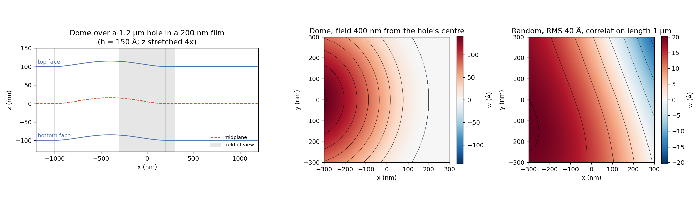
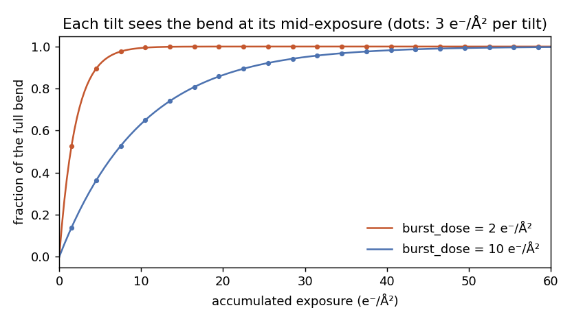
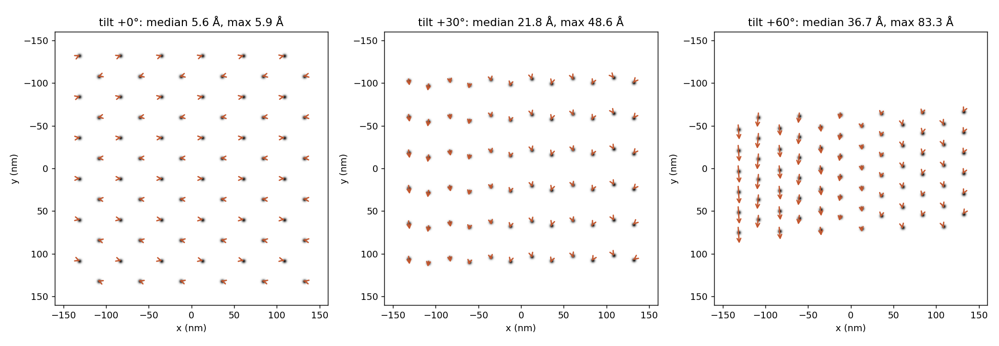

# Specimen deformation

{ width="900" style="display:block;margin:1.2em auto;" }
///caption
Left: a dome over a 1.2 µm hole in a 200 nm film, its midplane and faces in cross-section. Centre and right: the deflection over a 600 nm field of view for a dome and for a random deflection.
///

Irradiation releases the stress a vitrified film is frozen with, and the
film relieves it by bending out of its plane. Brilot et al. (2012)
measured central deflections of 150–250 Å over holey carbon; Naydenova,
Jia & Russo (2020) measured less than 1 Å on gold foil with holes no
wider than eleven ice thicknesses, and placed the motion in a burst over
the first few e⁻/Ų. A tilt series records the same specimen many times,
so each tilt images a specimen bent by a different amount, and a
reconstruction that assumes a rigid specimen misplaces its material.

`TiltSeries` simulates this when given a `Deformation`. The bend is a
property of the specimen: it is defined once, in the specimen's frame,
and every tilt views it from its own angle at the stage it had reached
when that tilt was recorded.

!!! info "Source"
    `specter.settings.Deformation` (the parameters),
    `specter.imaging._deformation` (the deflections and the sampling map),
    `TiltSeries.displaced` and `TiltSeries.rotation` (the ground truth).
    `docs-figures/specimen_deformation.py` produces the figures.

## Thin-plate kinematics

The bend is described by a deflection \(w(x, y)\) of the specimen's
midplane. A film is thin compared with its lateral extent, so every
point moves with the midplane as in a Kirchhoff plate: a material line
normal to the midplane stays straight and normal to it. A point at
height \(z\) above the midplane is displaced by

\[
\mathbf{u}(x, y, z) = \left(-z\,\frac{\partial w}{\partial x},\
-z\,\frac{\partial w}{\partial y},\ w\right),
\]

where \(x, y, z\) are measured in Å from voxel
\((n_z/2, n_y/2, n_x/2)\) of the specimen volume (integer division), the
rotation centre of the tilt series. Where the film slopes, its top and
bottom faces slide in opposite directions, and a particle in it turns
with the local slope: by \(\partial w/\partial y\) about \(x\) and by
\(-\partial w/\partial x\) about \(y\).

The lever arm \(z\) is held at the volume's faces beyond them. The
vacuum a steep tilt samples far above the specimen therefore moves with
the specimen's surface rather than by an amount that grows with its
distance from the midplane.

## Deflections

`model="dome"` is a film over a circular support hole of radius \(a\),
clamped at the rim:

\[
w(r) = h\left(1 - \frac{r^2}{a^2}\right)^2 \quad (r \le a), \qquad
w(r) = 0 \quad (r > a),
\]

the deflection of a clamped circular plate under uniform load. The film
meets the support with zero slope, so the displacement is continuous
across the rim at every depth. A hinged edge, which meets the support
at an angle, would tear a thick specimen there: the slope jump times the
half-depth separates the two sides by about 60 Å for a 200 nm film.
`hole_offset` places the field of view within the hole, which decides
whether it sees the crown, the flank or the rim.

`model="random"` is a smooth deflection with no support geometry, for a
whole cell or a lamella. It is a stationary Gaussian process with a
squared-exponential covariance,

\[
\langle w(\mathbf{r})\, w(\mathbf{r}') \rangle =
h^2 \exp\!\left(-\frac{|\mathbf{r} - \mathbf{r}'|^2}{2\ell^2}\right),
\]

drawn per series from its seed as a sum of 512 random Fourier features.
The default correlation length \(\ell = 1\) µm lies within the
0.33–2.9 µm Zivanov, Nakane & Scheres (2019) fitted to beam-induced
motion across three datasets. The field and its derivatives are
evaluated exactly on a coarse grid, interpolated by bicubic Hermite
onto a table at the voxel size, and read bilinearly by every tilt.

## Growth with exposure

The bend develops over the burst. At an accumulated exposure \(D\) the
deflection is \(f(D)\,w\), with

\[
f(D) = 1 - e^{-D / D_b},
\]

and tilt \(i\) is imaged at the exposure halfway through its own
recording, its pre-exposure plus half its dose. The default
\(D_b = 2\) e⁻/Ų follows the burst Naydenova et al. observe in the
first ~4 e⁻/Ų.

{ width="560" style="display:block;margin:1.2em auto;" }
///caption
Fraction of the full bend against accumulated exposure, with each tilt's mid-exposure marked, for two burst doses.
///

The deformation therefore grows monotonically over a series but is
front-loaded: at 3 e⁻/Ų per tilt and the default burst dose, the first
tilt sees half the bend and the third 98% of it. The order in which
tilts are recorded decides which angles fall in the burst.

## Sampling the bent specimen

The volume is rendered undeformed. A sample point \(\mathbf{s}\) of the
bent specimen reads the undeformed volume where its material came from,
the solution \(\mathbf{X}\) of \(\mathbf{s} = \mathbf{X} +
f\,\mathbf{u}(\mathbf{X})\), found by fixed-point iteration to
\(10^{-3}\) voxel. The value read is divided by
\(\det(\mathbf{I} + f\,\nabla\mathbf{u})\), evaluated in closed form, so
that the deformation conserves the integrated potential. Both happen
inside the interpolation each tilt already performs to sample its
rotated slices, so the bend adds no interpolation of its own; an
untilted view is resampled too, rather than read directly from the
volume.

The bend lifts material by up to its height, so the volume gains that
much vacuum above and below its faces. The defocus is referred to the
midplane, which the padding leaves in place, so the vacuum does not
change the image. A multislice tilt costs about 1.3 to 1.6 times as
much as a rigid one.

{ width="900" style="display:block;margin:1.2em auto;" }
///caption
Simulated tilts of two bead layers 150 Å above and below the midplane, on the flank of a 150 Å dome. Arrows show each bead's displacement against a rigid specimen, magnified three times.
///

At 0° the two layers move apart along the slope by 5.6 Å, the faces'
opposite in-plane slide. Away from 0° the lift \(w\) appears across the
tilt axis as \(w \sin\theta\): up to 83 Å at 60°.

## Ground truth

`specter simulate tiltseries` writes, beside the tilt series, the full
deflection as `<filename>_deflection.mrc` (in Å, on the specimen
volume's xy grid) and `<filename>_deformation.json`, which records the
parameters, the seed, the origin voxel and, per tilt, its mid-exposure
dose and the fraction \(f_i\) of the bend it imaged. Together they
determine where every specimen point was at every tilt. With
`deformation_picks_dir` set, every copick `.ndjson` pick file in that
directory is also written per tilt under `<filename>_picks/tilt_NNN/`,
with each position displaced and each orientation turned by the bend.
From Python, `TiltSeries.displaced(points, i)` and
`TiltSeries.rotation(points, i)` give the same quantities.

| Support | Model | Typical `deformation_height` |
|---|---|---|
| Holey carbon, thin ice | `dome` | 150–250 Å (Brilot et al. 2012) |
| Gold foil, narrow holes | `dome` | below 1 Å (Naydenova et al. 2020) |
| Whole cell, lamella | `random` | unmeasured out of plane; set per study |

## Limitations

- The kinematics are linear in the displacement gradient, which leaves an
  error of order its square. `Deformation` and `TiltSeries` refuse a bend
  whose slope plus bending strain at the specimen's faces exceeds 0.2;
  measured domes over thin ice stay below 0.07.
- The bend is the only motion modelled. Stage drift, per-frame motion
  within a tilt, uncorrelated motion of individual molecules and ice
  thinning are not included.
- No out-of-plane deformation of a lamella during a tilt series has been
  measured, so the random model's amplitude for one is a choice rather
  than a calibrated value.
- `TomogramReconstructor` assumes a rigid specimen.

## References

- Brilot, A. F., Chen, J. Z., Cheng, A., Pan, J., Harrison, S. C., Potter, C. S., Carragher, B., Henderson, R., & Grigorieff, N. (2012). Beam-induced motion of vitrified specimen on holey carbon film. *Journal of Structural Biology*, 177(3), 630–637. [doi:10.1016/j.jsb.2012.02.003](https://doi.org/10.1016/j.jsb.2012.02.003)
- Naydenova, K., Jia, P., & Russo, C. J. (2020). Cryo-EM with sub–1 Å specimen movement. *Science*, 370(6513), 223–226. [doi:10.1126/science.abb7927](https://doi.org/10.1126/science.abb7927)
- Zivanov, J., Nakane, T., & Scheres, S. H. W. (2019). A Bayesian approach to beam-induced motion correction in cryo-EM single-particle analysis. *IUCrJ*, 6(1), 5–17. [doi:10.1107/S205225251801463X](https://doi.org/10.1107/S205225251801463X)
