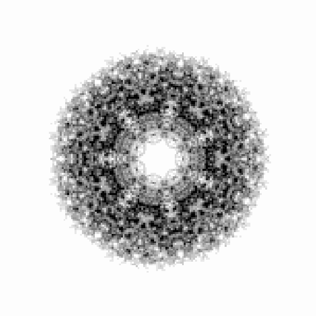
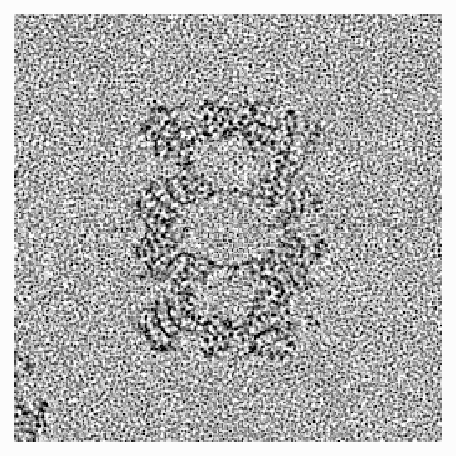
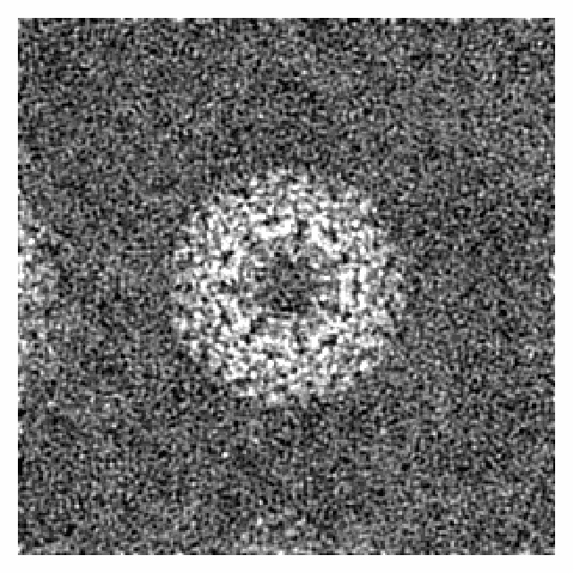
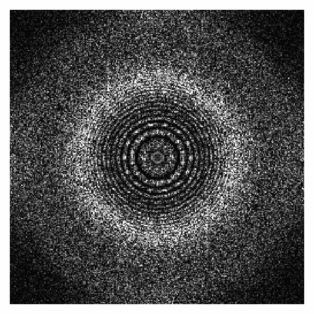
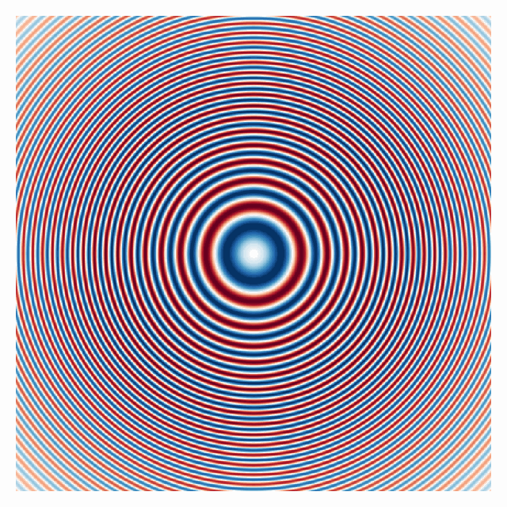
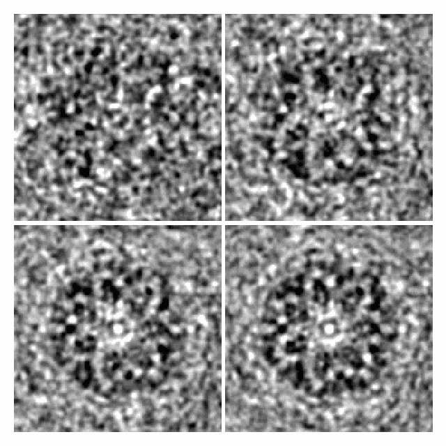

# Example gallery

Every worked example in these docs, by its figure. The
[basic examples](basic-examples.md) are templates to copy, the
[walkthrough](walkthrough/index.md) builds the forward model one stage at a
time, and the [tutorials](tutorials/index.md) take it into advanced topics.

## Basic examples

-   

    **[Particle stack](basic-examples.md#particle-stack)**

-   

    **[Micrograph](basic-examples.md#micrograph)**

-   

    **[Tilt series](basic-examples.md#tilt-series)**

-   

    **[Cellular specimen](basic-examples.md#cellular-specimen)**

-   

    **[Reconstruction](basic-examples.md#reconstruction)**

-   

    **[Matching a real dataset](basic-examples.md#matching-a-real-dataset)**

## Walkthrough

-   

    **[Structures and potentials](walkthrough/potentials.md)**

-   

    **[Specimens: crowding and ice](walkthrough/specimens.md)**

-   

    **[Scattering](walkthrough/scattering.md)**

-   

    **[Contrast transfer function](walkthrough/ctf.md)**

-   

    **[Partial coherence](walkthrough/coherence.md)**

-   

    **[Detection](walkthrough/detection.md)**

-   

    **[Particle stacks](walkthrough/particle-stacks.md)**

-   

    **[Micrographs](walkthrough/micrographs.md)**

-   

    **[Tilt series](walkthrough/tilt-series.md)**

-   

    **[Reconstruction](walkthrough/reconstruction.md)**

## Tutorials

-   

    **[Simulating a real dataset](tutorials/real-dataset.md)**

-   

    **[Cellular specimens for cryo-ET](tutorials/cellular-specimens.md)**

-   

    **[Radiation damage and the solvent](tutorials/dose-damage.md)**

-   

    **[Inelastic scattering and energy filtering](tutorials/inelastic.md)**

-   

    **[Gradients through the forward model](tutorials/differentiable.md)**

-   

    **[Composing a forward model by hand](tutorials/custom-forward-model.md)**

-   

    **[Building an ice library](tutorials/ice-library.md)**

