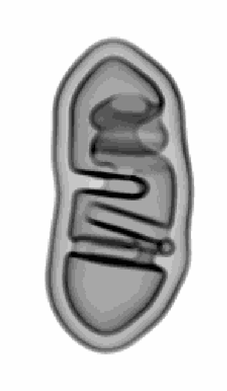
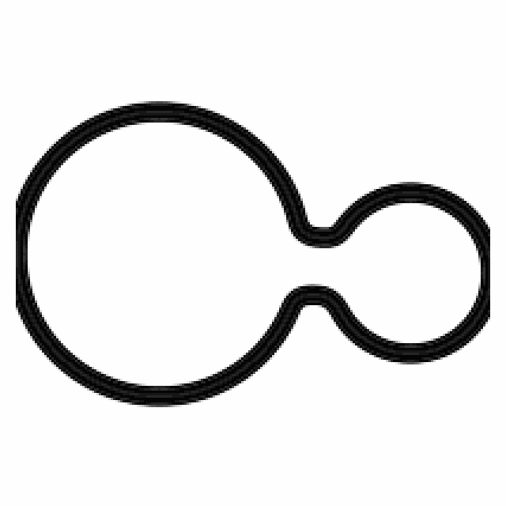

# Example gallery

Short recipes: one task and one figure each, in a single block of code to
copy and adapt. A recipe tagged `basic` uses the high-level objects and their
defaults. One tagged `specialized` reaches below them, into the engines or
the geometry.

For whole workflows, start from the [basic examples](basic-examples.md). The
[walkthrough](walkthrough/index.md) builds the forward model one stage at a
time, and the [tutorials](tutorials/index.md) take it into advanced topics.

-   

    **[The four organelle kinds](recipes/membrane-organelles.md)**

    `basic`

-   

    **[Composing a membrane from primitives](recipes/membrane-primitives.md)**

    `specialized`

