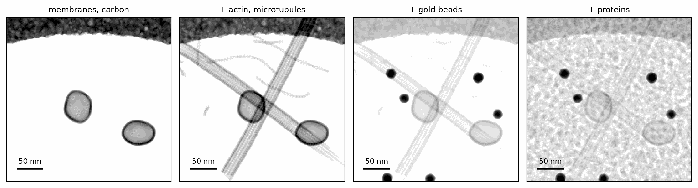
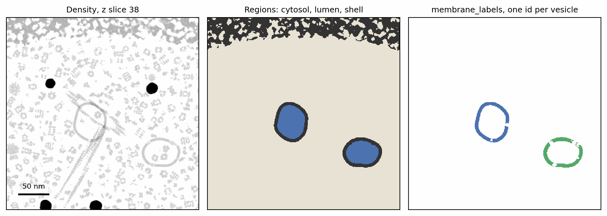
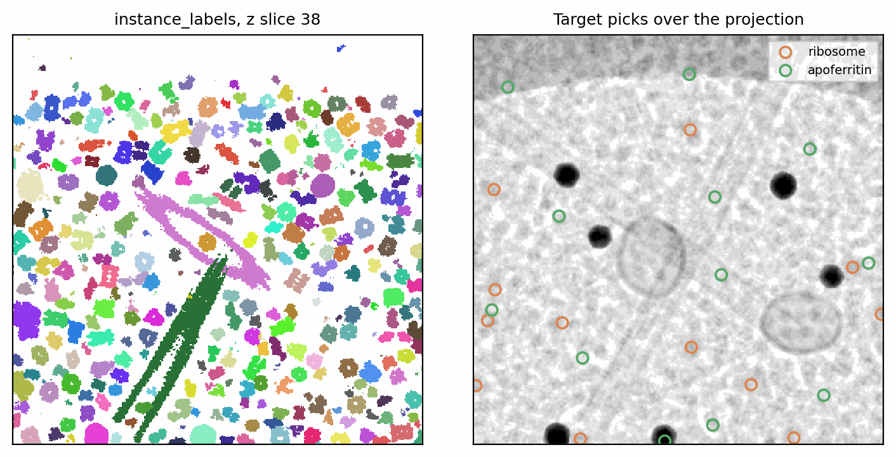
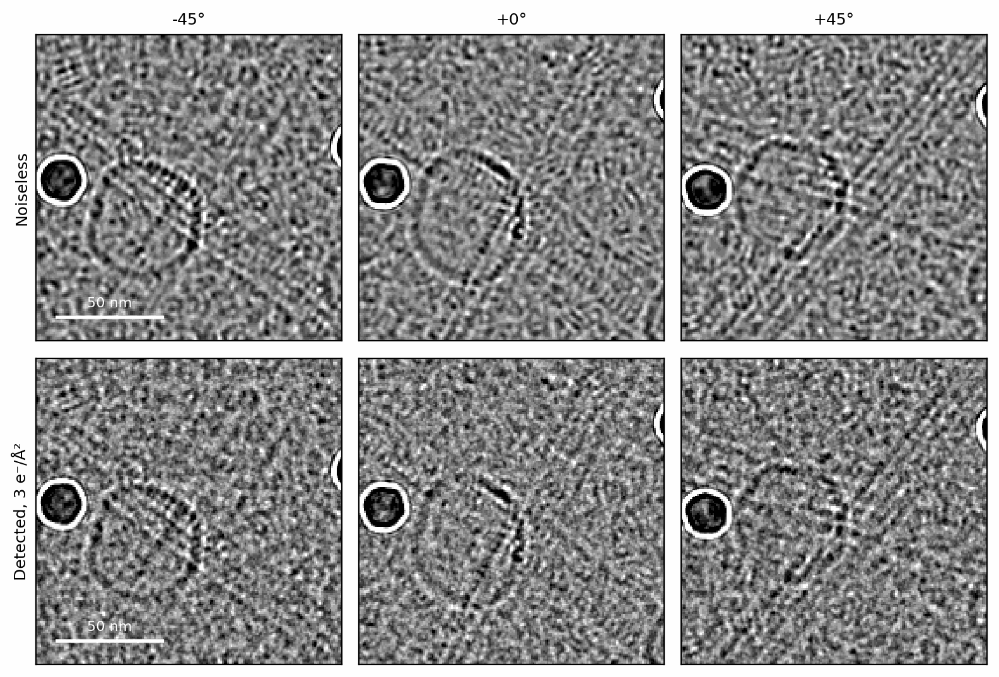

# Cellular specimens for cryo-ET

A tomogram of a cell is crowded: membranes enclose compartments, actin and
microtubules cross the field, proteins pack the space between them, and gold
fiducials and the edge of the carbon support sit in the ice. This tutorial
builds such a specimen from Python with `TomogramSpecimenGenerator`, one
component at a time, reads back the ground truth it records (regions,
segmentation labels and particle picks), and images it as a tilt series. A
specimen built this way is the input for training or validating a particle
picker or a segmentation model, since every voxel's origin is known.

Before you start: this tutorial assumes [Structures and potentials](../walkthrough/potentials.md)
and [Tilt series](../walkthrough/tilt-series.md).

## Setup

The generator assembles one potential volume on a shared voxel grid. At
8 Å voxels a 768 × 3072 × 3072 Å specimen takes seconds per stage; production
specimens use 2–5 Å, at the costs tabulated in
[Benchmarks](../user-guide/build-tomogram.md#benchmarks-resolution-vs-time-and-memory).

```python
--8<-- "docs-figures/tutorials/cellular_specimens.py:setup"
```

`clip_axes` lets an instance's centre stay inside the box while its body runs
off a lateral face, as it does when the field of view is a crop of a larger
cell. The seed fixes every placement, so each of the stages below can be
rebuilt with one more component and the earlier ones stay where they were.

## Membranes and the carbon film

A `MembraneGenerator` draws one closed membrane: here a vesicle whose surface
is a spherical-harmonic perturbation of an ellipsoid with semi-axes drawn
from 200–320 Å, rendered as a 37 Å lipid bilayer and studded with
bacteriorhodopsin (`1C3W`; Luecke et al. 1999) at 20 sites per vesicle. `MembraneInstance` wraps
each one for the tomogram, which places it by collision-rejecting random
placement. `CarbonFilmSpec` paints the edge of the carbon support into the
field before anything else is placed:

```python
--8<-- "docs-figures/tutorials/cellular_specimens.py:membranes"
```

```{ .text .output }
--8<-- "docs-includes/tutorials/cellular_specimens-membranes.txt"
```

One of the three requested vesicles did not fit beside the others and the
film, and the generator drops it with a warning rather than letting it
overlap. `gen.membrane_instances` is the request and
`gen.placed_membrane_instances` what was placed; compare the two when you
need a count. The two placed vesicles carry 40 transmembrane proteins.

## The cytoskeleton

Filaments are random walks of rigid monomer copies; `ACTIN_SPEC` holds
F-actin's rise, twist and flexibility, and `dataclasses.replace` sets how
many filaments to draw and how long each is. Microtubules are whole
13-protofilament tubes, each built from many copies of one αβ-tubulin dimer
and bent along a 3 µm radius:

```python
--8<-- "docs-figures/tutorials/cellular_specimens.py:cytoskeleton"
```

```{ .text .output }
--8<-- "docs-includes/tutorials/cellular_specimens-cytoskeleton.txt"
```

Neither is gated to a region or kept clear of the membranes; the proteins
packed later avoid them. Monomers and dimers that land inside the carbon
film are removed, with a warning that counts them.

## Gold fiducials

Each bead is built from face-centred cubic gold atoms at bulk density, with
its own crystal orientation and an irregular boundary, so it averages to
gold's mean inner potential rather than being a uniform ball. A
`[low, high]` radius draws each bead's size independently:

```python
--8<-- "docs-figures/tutorials/cellular_specimens.py:beads"
```

```{ .text .output }
--8<-- "docs-includes/tutorials/cellular_specimens-beads.txt"
```

## Packing proteins

Proteins come in two tiers. A *target* (`n_copies` set) is placed first, at
exactly that count, and is the species a picker would be trained to find.
*Filler* (`ratio`, the default) is then packed around the targets, the
cytoskeleton and the beads until the region reaches `occupancy_fraction` or
no further copy fits. `build_filler_pool_specs` draws filler species from a
bundled reference table of cytosolic proteins (Pei et al. 2016), here the 11
of at least 300 kDa.
`location` restricts a species to the cytosol or to the lumen of the
vesicles:

```python
--8<-- "docs-figures/tutorials/cellular_specimens.py:proteins"
```

```{ .text .output }
--8<-- "docs-includes/tutorials/cellular_specimens-proteins.txt"
```

{ width="900" style="display:block;margin:1.2em auto;" }
///caption
The specimen projected along the beam after each stage, each panel on its
own grey scale: the vesicles and the carbon film along one edge; then actin
filaments and two microtubules; then six gold beads; then 1,684 packed
proteins. The vesicles, filaments and beads keep their positions from stage
to stage.
///

Both targets, the human 80S ribosome (`6QZP`; Natchiar et al. 2017) and
human apoferritin (`7VD8`; Fan et al. 2021), reached their exact counts. The
filler stopped at 1,644 cytosolic copies of 11 species and 16 RuBisCO
complexes (`1BXN`; Hansen et al. 1999) in the two small lumens. In the final panel the dense protein fill lowers the contrast of the
vesicles and microtubules, while the gold beads still stand out.

## Ground truth

The generator records what it placed. `gen.regions` partitions the volume
into the membrane shell, the lumen enclosed by membranes, and the cytosol
connected to the box faces; `gen.instance_labels` gives every protein
instance its own integer id; `gen.membrane_labels` gives each membrane one;
and `gen.export_picks` writes the positions and orientations of every species
as copick-style (Ermel et al. 2026) `.ndjson` files:

```python
--8<-- "docs-figures/tutorials/cellular_specimens.py:ground-truth"
```

```{ .text .output }
--8<-- "docs-includes/tutorials/cellular_specimens-ground-truth.txt"
```

The 1,740 instance ids account for every placed object: 40 transmembrane
proteins, 8 actin filaments and 2 microtubules (one id each, however many
monomers they contain), 6 beads, 24 targets and 1,660 filler proteins.
Filaments and microtubules also get a `_path.ndjson` file, one entry per
filament or tube, alongside the monomer picks. Filler picks are written by
default; pass `include_filler=False` to keep only the targets.

{ width="900" style="display:block;margin:1.2em auto;" }
///caption
One z slice through the first vesicle: the density (left), the regions
(centre: cytosol in beige, lumen in blue, shell in dark grey), and
`membrane_labels`, one id per vesicle (right). The carbon film reads as
shell to the region classifier, the same as a bilayer.
///

{ width="800" style="display:block;margin:1.2em auto;" }
///caption
`instance_labels` for the same slice, one random colour per instance (left),
and the picks of the two target species over the projected specimen
(right).
///

The regions come from topology rather than geometry: empty space that
reaches a face of the box is cytosol and space sealed inside a membrane is
lumen, which is why a lumen filler species cannot leak out of a vesicle.
[Regions](../concepts/cryoet-specimen/index.md#regions) and
[Ground truth](../concepts/cryoet-specimen/index.md#ground-truth) describe
both in full.

## Imaging the specimen

The assembled volume is an ordinary potential, so it images through the
same objects as any other specimen. `Sample.from_volume` wraps it, and
`tilt_series` adds amorphous ice around it and images it over a
dose-symmetric (Hagen et al. 2017) ±45° series at 3 e⁻/Ų per tilt:

```python
--8<-- "docs-figures/tutorials/cellular_specimens.py:tilt-series"
```

```{ .text .output }
--8<-- "docs-includes/tutorials/cellular_specimens-tilt-series.txt"
```

A tilted beam crosses the slab obliquely, so the field a volume can supply
shrinks with the tilt. At 176 px (1408 Å) this 3072 Å-wide volume covers
tilts up to 49.5°, beyond the series' 45°; a larger field would reach past
the volume's edges at the high tilts, which the series then fills by
reflection.

{ width="800" style="display:block;margin:1.2em auto;" }
///caption
The tilts at −45°, 0° and +45°, noiseless (top) and detected at 3 e⁻/Ų
(bottom), at 4 µm underfocus and low-pass filtered to 20 Å for display. A
vesicle and a gold bead move across the field as the specimen tilts.
///

The same objects take the specimen further: a finer voxel size for
subtomogram averaging, an `Exposure` with frames and a detector model, or
`TomogramReconstructor` to reconstruct the tomogram back.

## From the command line

`specter build tomogram` builds the same specimen from a TOML config and
writes the volume, the label volumes and the picks;
`specter simulate tiltseries --tomogram_config` builds one and images it in
a single command:

```bash
specter build tomogram --config tomogram.toml
specter simulate tiltseries --config tiltseries.toml --tomogram_config tomogram.toml
```

Each Python object above is one table of that config:

| Python | TOML |
|---|---|
| `TomogramSpecimenGenerator(target_shape=, voxel_size=, clip_axes=, seed=)` | `target_shape`, `voxel_size`, `clip_axes`, `seed` |
| `MembraneInstance(MembraneGenerator(...))`, repeated | `[[membrane]]` with `n_copies` |
| `TransmembraneSpec("1C3W", frequency=20)` | `[[membrane_transmembrane_specs]]` with `n_copies` |
| `replace(ACTIN_SPEC, ...)`, `FilamentSpec(...)` | `actin = true`, or `[[filaments]]` |
| `MicrotubuleSpec(...)` | `[[microtubules]]` |
| `TomogramBeadSpec(radius=, count=)` | `[[beads]]` with `radius`, `n_copies` |
| `CarbonFilmSpec(...)` | `[[carbon_film]]` |
| `TomogramProteinSpec(..., n_copies=)` | `[targets]` |
| `TomogramProteinSpec(...)` with `ratio`, `build_filler_pool_specs` | `[filler]`, `filler_from_pei2016 = true` |
| `occupancy_fraction` | `filler_occupancy_fraction` |

[Build a tomogram specimen](../user-guide/build-tomogram.md) covers the
config, the output files and the compute settings, and
[Chaining with `specter build tomogram`](../user-guide/tilt-series.md#chaining-with-specter-build-tomogram)
the one-command tilt series.

## See also

- [Cryo-ET specimens](../concepts/cryoet-specimen/index.md#assembly-order): the assembly order, regions and ground truth.
- [Membrane shape](../concepts/membrane-shape/index.md) and [Bilayer & transmembrane proteins](../concepts/cryoet-specimen/bilayer.md#transmembrane-placement).
- [Filaments](../concepts/cryoet-specimen/filaments.md#placement) and [Microtubules](../concepts/cryoet-specimen/microtubules.md#the-lattice).
- [Gold fiducial beads](../concepts/cryoet-specimen/beads.md#atoms-not-a-gas) and [Carbon support film](../concepts/cryoet-specimen/carbon-film.md#the-rim).
- [Regions & protein packing](../concepts/cryoet-specimen/packing.md#two-priority-tiers).

## References

- Ermel, U. H., Schwartz, J., Zhao, Z., Ji, D., Peck, A., Yu, Y.,
  Paraan, M., Carragher, B., Frangakis, A. S., & Harrington, K. I. S.
  (2026). copick: An open dataset interface and toolkit for collaborative
  annotation and analysis of cryo-electron tomography data. *Protein
  Science*, 35(5), e70578.
  [doi:10.1002/pro.70578](https://doi.org/10.1002/pro.70578)
- Fan, H., Wang, B., Zhang, Y., Zhu, Y., Song, B., Xu, H., Zhai, Y.,
  Qiao, M., & Sun, F. (2021). A cryo-electron microscopy support film
  formed by 2D crystals of hydrophobin HFBI. *Nature Communications*,
  12(1), 7257.
  [doi:10.1038/s41467-021-27596-8](https://doi.org/10.1038/s41467-021-27596-8)
- Hagen, W. J. H., Wan, W., & Briggs, J. A. G. (2017). Implementation of a
  cryo-electron tomography tilt-scheme optimized for high resolution
  subtomogram averaging. *Journal of Structural Biology*, 197(2), 191–198.
  [doi:10.1016/j.jsb.2016.06.007](https://doi.org/10.1016/j.jsb.2016.06.007)
- Hansen, S., Vollan, V. B., Hough, E., & Andersen, K. (1999). The crystal
  structure of rubisco from *Alcaligenes eutrophus* reveals a novel
  central eight-stranded β-barrel formed by β-strands from four subunits.
  *Journal of Molecular Biology*, 288(4), 609–621.
  [doi:10.1006/jmbi.1999.2701](https://doi.org/10.1006/jmbi.1999.2701)
- Luecke, H., Schobert, B., Richter, H.-T., Cartailler, J.-P., & Lanyi, J. K.
  (1999). Structure of bacteriorhodopsin at 1.55 Å resolution. *Journal of
  Molecular Biology*, 291(4), 899–911.
  [doi:10.1006/jmbi.1999.3027](https://doi.org/10.1006/jmbi.1999.3027)
- Natchiar, S. K., Myasnikov, A. G., Kratzat, H., Hazemann, I., &
  Klaholz, B. P. (2017). Visualization of chemical modifications in the
  human 80S ribosome structure. *Nature*, 551(7681), 472–477.
  [doi:10.1038/nature24482](https://doi.org/10.1038/nature24482)
- Pei, L., Xu, M., Frazier, Z., & Alber, F. (2016). Simulating cryo
  electron tomograms of crowded cell cytoplasm for assessment of automated
  particle picking. *BMC Bioinformatics*, 17(1), 405.
  [doi:10.1186/s12859-016-1283-3](https://doi.org/10.1186/s12859-016-1283-3)
