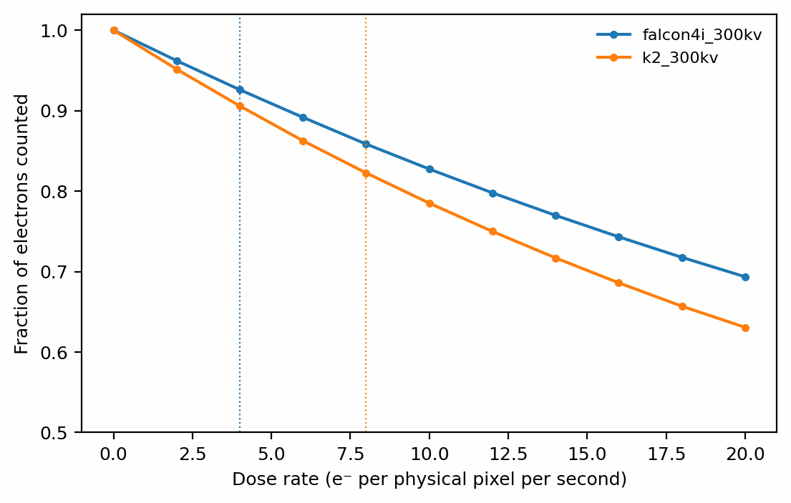

# The coincidence radius of a camera

`basic` · detection · runs in about 15 s on one GPU

A counting detector loses electrons that land close together within one of
its hardware frames (Li et al. 2013). `Image.detect` models the loss with a
`coincidence_radius` in simulation pixels, which depends on the camera, on the
dose rate it was operated at, and on the simulation's own pixel size and frame
count. Two functions carry a camera's calibration over to a simulation.

{ width="560" style="display:block;margin:1.2em auto;" }
///caption
The fraction of incident electrons counted under uniform illumination, for
the two cameras with a calibrated exclusion radius. Dotted lines mark each
camera's typical dose rate.
///

```python
--8<-- "docs-figures/tutorials/coincidence_radius.py:recipe"
```

```{ .text .output }
--8<-- "docs-includes/tutorials/coincidence_radius-recipe.txt"
```

`coincidence_occupancy` gives the mean number of electrons per exclusion disc
per hardware frame, the one number the loss depends on.
`coincidence_radius_for_simulation` returns the radius that reproduces that
occupancy with the simulation's electrons per pixel per frame. A radius above
zero requires `Exposure(n_frames=...)`.

## Variations

- **Use a dataset's own dose rate.** Replace `TYPICAL_DOSE_RATE_E_PX_S[camera]`
  by the rate recorded in the acquisition metadata, in electrons per physical
  pixel per second.
- **Simulate a K3 in CDS mode.** The camera then counts at 750 Hz (Sheng et
  al. 2022) in place of
  `HARDWARE_FRAME_RATE_HZ["k3_300kv"]`, which doubles the occupancy at the same
  dose rate. The K3 has no entry in `EXCLUSION_RADIUS_PX`, so its radius has to
  be supplied.
- **Add the camera's MTF and DQE(0).** `detect(exposure, detector="falcon4i_300kv",
  coincidence_radius=radius)` applies both alongside the loss.

## See also

- [Detection](../walkthrough/detection.md): the detector stage in full.
- [Coincidence loss](../concepts/detector.md#coincidence-loss): the model.

## References

- Li, X., Zheng, S. Q., Egami, K., Agard, D. A., & Cheng, Y. (2013).
  Influence of electron dose rate on electron counting images recorded with
  the K2 camera. *Journal of Structural Biology*, 184(2), 251–260.
  [doi:10.1016/j.jsb.2013.08.005](https://doi.org/10.1016/j.jsb.2013.08.005)
- Sheng, Y., Harrison, P. J., Vogirala, V., Yang, Z., Strain-Damerell, C.,
  Frosio, T., Himes, B. A., Siebert, C. A., Zhang, P., & Clare, D. K. (2022).
  Application of super-resolution and correlative double sampling in
  cryo-electron microscopy. *Faraday Discussions*, 240, 261–276.
  [doi:10.1039/D2FD00049K](https://doi.org/10.1039/D2FD00049K)
