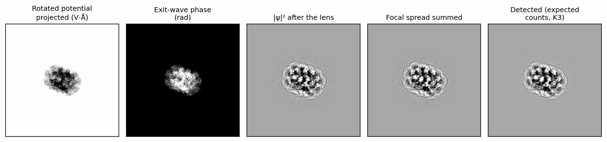
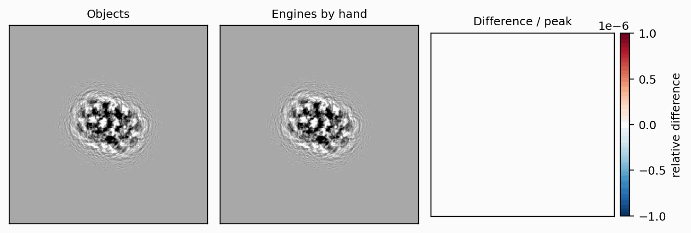
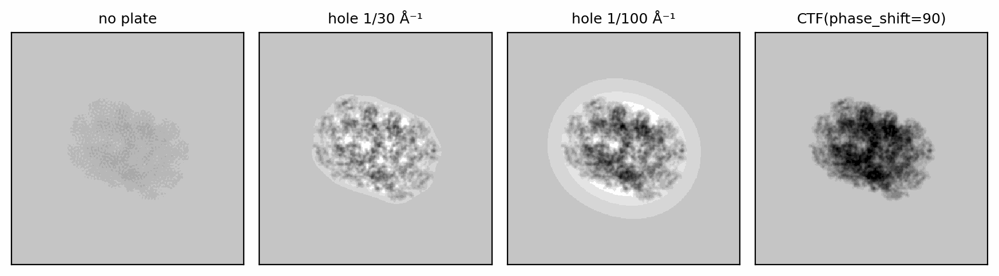
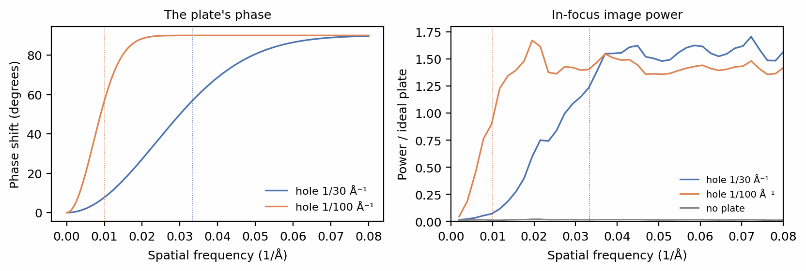

# Composing a forward model by hand

The objects of the walkthrough (`Specimen`, `ExitWave`, `Image`) do not
compute anything themselves. Each verb orders calls to a small set of
engines, ordinary PyTorch modules that each implement one stage of image
formation: `VolumeRotator` turns a volume to a pose, `Scattering` propagates
the electron wave through it, `Aberration` applies the objective lens,
`FocalSpread` sums the image over the source's energy spread, and `Detector`
records it. This tutorial rebuilds one particle from those engines, shows the
result is identical to the objects', and then replaces one stage with a model
of its own, a phase plate with a finite hole, which no setting of the
built-in transfer function expresses.

Composing by hand is the route when you need a stage SPECTER does not have:
a different lens or detector model, an extra filter, a measurement inserted
between two stages. For everything else, the objects carry the bookkeeping
this tutorial makes explicit.

Before you start: this tutorial follows the chain of
[Scattering](../walkthrough/scattering.md),
[Contrast transfer function](../walkthrough/ctf.md),
[Partial coherence](../walkthrough/coherence.md) and
[Detection](../walkthrough/detection.md).

## The reference

One particle of 6BDF (Campbell et al. 2015) at 2 Å voxels, imaged at 1.5 µm underfocus with the
chromatic focal spread on, and recorded on a K3 without noise, so that the two
routes can be compared exactly:

```python
--8<-- "docs-figures/tutorials/custom_forward_model.py:objects"
```

```{ .text .output }
--8<-- "docs-includes/tutorials/custom_forward_model-objects.txt"
```

## Rotating the potential

`VolumeRotator` samples the template on a grid turned to the pose. The pose is
an affine matrix built from the quaternion and from the shift, converted from
ångströms to the rotator's normalized coordinates:

```python
--8<-- "docs-figures/tutorials/custom_forward_model.py:rotate"
```

```{ .text .output }
--8<-- "docs-includes/tutorials/custom_forward_model-rotate.txt"
```

`origin="relion"` puts the rotation centre where RELION (Scheres 2012) and
CryoSPARC (Punjani et al. 2017) put it,
so a pose read from a particle file means the same here as there
([Poses](../concepts/conventions.md#poses)). A specimen with neighbours or ice
would add them now, around the rotated particle, with
`specter.crowding.CrowdWithDuplicates` and `specter.ice.blend_ice_into_volume`.

## Propagating the wave

`Scattering` runs multislice (Cowley & Moodie 1957) through the volume and
returns the wave at its exit face:

```python
--8<-- "docs-figures/tutorials/custom_forward_model.py:scatter"
```

```{ .text .output }
--8<-- "docs-includes/tutorials/custom_forward_model-scatter.txt"
```

Two settings here are easy to get wrong by hand. `oversample=2` runs the
recursion on a grid twice as fine as the voxels, which keeps the product of
the wave and each slice's transmission function from aliasing
([Grid aliasing](../concepts/scattering/multislice.md#grid-aliasing-oversample-and-klim)).
`crop=False` keeps the wave on that grid: the image is formed there, and only
the detector samples it down to pixels, since the intensity has twice the
wave's bandwidth.

## Applying the lens

`Aberration` multiplies the wave's spectrum by the transfer function, on the
same fine grid:

```python
--8<-- "docs-figures/tutorials/custom_forward_model.py:lens"
```

```{ .text .output }
--8<-- "docs-includes/tutorials/custom_forward_model-lens.txt"
```

The defocus has to be corrected first. The wave was computed at the exit
face, but a nominal defocus is that of the specimen's midplane, half the box
depth above it and that much nearer focus; `defocus_midplane_shift` gives the
correction, minus that distance, −256 Å here. The objects carry it on the
wave as `ExitWave.defocus_shift` and subtract it in
`apply_ctf` ([The defocus reference plane](../concepts/conventions.md#the-defocus-reference-plane)).

## Summing the focal spread and detecting

`FocalSpread` forms the intensity as a weighted sum of images at the defocus
offsets the beam's energy spread produces, and `Detector` takes the expected
counts on the fine grid, Fourier-crops them to the pixels, and applies the
camera's MTF:

```python
--8<-- "docs-figures/tutorials/custom_forward_model.py:detect"
```

```{ .text .output }
--8<-- "docs-includes/tutorials/custom_forward_model-detect.txt"
```

The dose, the pixel area and the camera's DQE(0) scale the intensity into
expected counts before the detector sees it, because DQE(0) is a counting
efficiency rather than part of the MTF
([DQE(0): a separate counting efficiency](../concepts/detector.md#dqe0-a-separate-counting-efficiency)).
With `noise=None` the detector stops at the expected counts; the objects draw
Poisson noise from per-image seeds at this point.

{ width="900" style="display:block;margin:1.2em auto;" }
///caption
The particle after each engine: the rotated potential (projected), the phase
of the exit wave, the intensity after the lens, the intensity summed over the
focal spread, and the detected expected counts.
///

{ width="760" style="display:block;margin:1.2em auto;" }
///caption
The image from the objects (left) and from the engines called by hand
(centre). Their difference (right) is zero at every pixel.
///

The two images agree bit for bit, because the objects make exactly these
calls in this order. [How the objects use it](../concepts/pipeline-overview.md#how-the-objects-use-it)
lists the engine behind each verb.

## Replacing a stage: a phase plate with a hole

The built-in `phase_shift` term shifts every scattered beam by the same phase
relative to the unscattered one, which is an ideal phase plate
([Phase shift and amplitude contrast](../concepts/aberrations.md#phase-shift-and-amplitude-contrast)).
A real Zernike plate has a hole for the unscattered beam (Danev & Nagayama
2001), and the scattered
beams that pass through the hole, those below a cut-on frequency, are not
shifted. That is a new transfer function, and a few lines express it as a
stage of its own, applied after the lens:

```python
--8<-- "docs-figures/tutorials/custom_forward_model.py:plate"
```

```{ .text .output }
--8<-- "docs-includes/tutorials/custom_forward_model-plate.txt"
```

As the hole shrinks to nothing the custom stage reproduces the built-in term,
to within 10⁻⁶, which checks its sign convention against the library's.

{ width="900" style="display:block;margin:1.2em auto;" }
///caption
The particle in focus without a phase plate, with plates whose holes cut on at
1/30 Å⁻¹ and 1/100 Å⁻¹, and with the ideal plate of the built-in term, on one
grey scale and low-pass filtered to 4 Å for display. A finite hole leaves a
bright halo around the particle, wider for the smaller cut-on frequency, and
removes the particle's low-frequency contrast.
///

{ width="900" style="display:block;margin:1.2em auto;" }
///caption
Left: the phase each plate applies against spatial frequency, with its cut-on
marked. Right: the rotationally averaged image power relative to the ideal
plate's. Below its cut-on a plate transfers progressively less, approaching
the plate-free image towards zero frequency.
///

Below the cut-on, the image loses the contrast the ideal plate gives it,
progressively towards zero frequency. Above it, the plate shifts the scattered
wave exactly as the ideal plate does, and the image power is still 1.3 to 1.6
times the ideal plate's up to 0.2 Å⁻¹: an image is quadratic in the wave, and
its scattered-times-scattered terms now pair the unshifted frequencies inside
the hole with the shifted ones outside it, which the ideal plate shifts
together. The halo is the artifact known from real Zernike plates (Edgcombe 2014), and the
model produces it without its being put in by hand.

The same pattern replaces any other stage: a function from a wave (or an
intensity) to a wave (or an intensity) on the same grid, inserted where it
acts. A custom detector, for instance, takes the expected counts in place of
`Detector`.

## See also

- [How the objects use it](../concepts/pipeline-overview.md#how-the-objects-use-it):
  the engine behind each verb.
- [Grid aliasing](../concepts/scattering/multislice.md#grid-aliasing-oversample-and-klim)
  and [The defocus reference plane](../concepts/conventions.md#the-defocus-reference-plane):
  the two conventions a hand-built chain must reproduce.
- [Temporal coherence is integrated, not enveloped](../concepts/aberrations.md#temporal-coherence-is-integrated-not-enveloped):
  the focal-spread sum.

## References

- Campbell, M. G., Veesler, D., Cheng, A., Potter, C. S., & Carragher, B.
  (2015). 2.8 Å resolution reconstruction of the *Thermoplasma acidophilum*
  20S proteasome using cryo-electron microscopy. *eLife*, 4, e06380.
  [doi:10.7554/eLife.06380](https://doi.org/10.7554/eLife.06380)
- Cowley, J. M., & Moodie, A. F. (1957). The scattering of electrons by atoms
  and crystals. I. A new theoretical approach. *Acta Crystallographica*,
  10(10), 609–619.
  [doi:10.1107/S0365110X57002194](https://doi.org/10.1107/S0365110X57002194)
- Danev, R., & Nagayama, K. (2001). Transmission electron microscopy with
  Zernike phase plate. *Ultramicroscopy*, 88(4), 243–252.
  [doi:10.1016/S0304-3991(01)00088-2](https://doi.org/10.1016/S0304-3991(01)00088-2)
- Edgcombe, C. J. (2014). Imaging of weak phase objects by a Zernike phase
  plate. *Ultramicroscopy*, 136, 154–159.
  [doi:10.1016/j.ultramic.2013.09.004](https://doi.org/10.1016/j.ultramic.2013.09.004)
- Punjani, A., Rubinstein, J. L., Fleet, D. J., & Brubaker, M. A. (2017).
  cryoSPARC: Algorithms for rapid unsupervised cryo-EM structure
  determination. *Nature Methods*, 14(3), 290–296.
  [doi:10.1038/nmeth.4169](https://doi.org/10.1038/nmeth.4169)
- Scheres, S. H. W. (2012). RELION: Implementation of a Bayesian approach to
  cryo-EM structure determination. *Journal of Structural Biology*, 180(3),
  519–530.
  [doi:10.1016/j.jsb.2012.09.006](https://doi.org/10.1016/j.jsb.2012.09.006)
