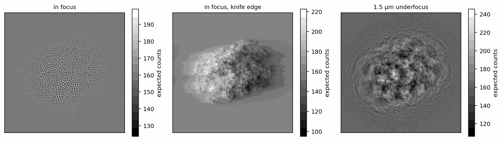

# A transfer function of your own

`specialized` · image formation · runs in about 20 s on one GPU

The built-in transfer function is a phase aberration with envelopes. An
optical element it does not describe can be applied to the wave directly: an
`ExitWave` holds its samples in `array`, and `dataclasses.replace` returns the
same wave around a new array, which the remaining verbs then image. The
example is a knife edge that blocks one half of the back focal plane.

{ width="900" style="display:block;margin:1.2em auto;" }
///caption
Expected counts for one 20S proteasome at 40 e⁻/Ų: in focus, in focus with
a knife edge in the back focal plane, and at 1.5 µm underfocus without it. The
edge turns the phase object's gradient along x into intensity, which gives the
particle a relief shaded from one side.
///

```python
--8<-- "docs-figures/tutorials/custom_transfer.py:recipe"
```

```{ .text .output }
--8<-- "docs-includes/tutorials/custom_transfer-recipe.txt"
```

The function acts on the array's own grid, whose spacing is `pixel_size /
oversample`, and it must return an array of the same shape. Applied after
`apply_ctf`, as here, it composes with the built-in lens, which has already
referred the defocus to the specimen's midplane. Applied before, it would act
on the wave at the exit face.

## Variations

- **Change the element.** Any function of the wave's spectrum fits the same
  two lines: an annular aperture, a measured phase map, an aberration written
  in a basis other than Zernike polynomials.
- **Apply it to a whole stack.** The array is `(n, Y, X)`, and the function
  above already broadcasts over `n`.
- **Record with noise.** `detect(exposure, detector="k3_300kv", seed=0)` draws
  Poisson counts through the camera's MTF.

## See also

- [Composing a forward model by hand](custom-forward-model.md): the same idea
  one level down, with a phase plate inserted between the engines.
- [Inspecting an exit wave](exit-wave.md): what an `ExitWave` holds.
- [Aberrations](../concepts/aberrations.md): the built-in transfer function.
