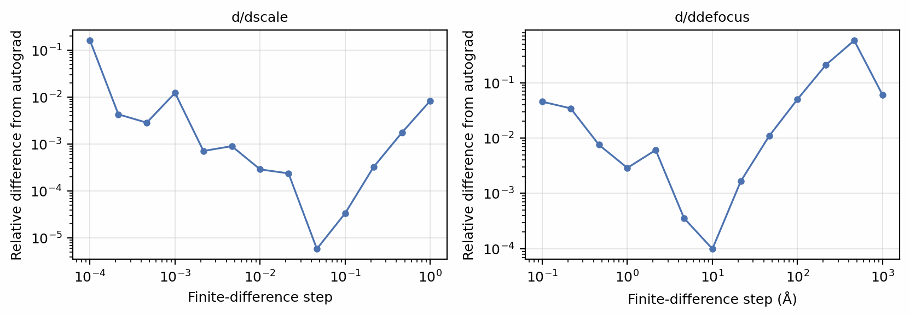
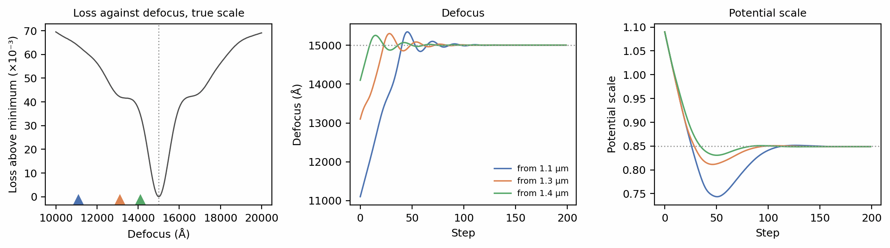
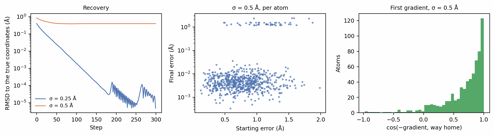

# Gradients through the forward model

Every stage of SPECTER's forward model is a PyTorch operation: rendering the
potential, rotating it, propagating the wave, applying the transfer function,
forming the intensity and converting it to counts. A simulated image is
therefore a differentiable function of everything that went into it, and
`torch.autograd` returns its derivative with respect to any input you mark
with `requires_grad`. This tutorial checks those derivatives against finite
differences, uses them to recover a defocus and a potential scale from noisy
images, and then recovers atomic coordinates themselves, which shows both
what gradients can do and what images cannot determine.

Before you start: this tutorial assumes the walkthrough pages
[Contrast transfer function](../walkthrough/ctf.md) and
[Reconstruction](../walkthrough/reconstruction.md).

## A differentiable image

The setup renders 6BDF (Campbell et al. 2015) at 2 Å voxels and defines the
image of 16 random poses as a function of two scalars: a potential scale,
which multiplies the rendered potential, and the defocus. SPECTER has no setting for the scale;
the function multiplies the tensor itself, which is all it takes to make any
quantity differentiable.

```python
--8<-- "docs-figures/tutorials/differentiable.py:setup"
```

```{ .text .output }
--8<-- "docs-includes/tutorials/differentiable-setup.txt"
```

`image` contains no gradient code. The scale enters the template before
`Specimen.scatter` rotates it, the defocus reaches the transfer function
inside `ExitWave.apply_ctf`, and autograd follows both through propagation
and detection. `intensity(cc=None)` and `noise=None` keep the function
deterministic: expected counts, with no focal spread and no Poisson draw.

## Checking the gradient

A gradient is only useful if it is correct. Comparing it with a central
finite difference of a scalar that depends on every pixel tests the whole
chain at once:

```python
--8<-- "docs-figures/tutorials/differentiable.py:gradcheck"
```

```{ .text .output }
--8<-- "docs-includes/tutorials/differentiable-gradcheck.txt"
```

{ width="900" style="display:block;margin:1.2em auto;" }
///caption
The relative difference between central finite differences and autograd,
against the finite-difference step. Small steps are dominated by float32
rounding in the difference of two nearly equal images, large ones by the
curvature of the function; in between, the two agree to below 10⁻³.
///

The finite difference is the approximation here, not the gradient: its error
has the classic V shape, rising at small steps from float32 rounding and at
large ones from truncation. The defocus side turns over sooner, because the
transfer function oscillates with defocus, and a step of 100 Å is already a
noticeable fraction of the defocus period of the highest frequencies.
Autograd has neither error.

## Fitting imaging parameters

The data are 16 noisy images simulated at a potential scale of 0.85 and a
defocus of 15000 Å. The images are counts, so the loss is their Poisson
negative log-likelihood:

```python
--8<-- "docs-figures/tutorials/differentiable.py:data"
```

```{ .text .output }
--8<-- "docs-includes/tutorials/differentiable-data.txt"
```

Before optimising, scan the loss along the defocus to see what the
optimiser faces:

```python
--8<-- "docs-figures/tutorials/differentiable.py:landscape"
```

```{ .text .output }
--8<-- "docs-includes/tutorials/differentiable-landscape.txt"
```

Adam (Kingma & Ba 2015) then fits both parameters together, from three
starting defoci up to 4000 Å away. The defocus is optimised in micrometres, so that one learning
rate suits both parameters:

```python
--8<-- "docs-figures/tutorials/differentiable.py:fit"
```

```{ .text .output }
--8<-- "docs-includes/tutorials/differentiable-fit.txt"
```

{ width="900" style="display:block;margin:1.2em auto;" }
///caption
Left: the loss against defocus at the true scale, with the three starting
defoci marked. Centre and right: the defocus and the potential scale against
optimisation step. Every start converges to the same answer.
///

All three starts reach a defocus within 5 Å of the true value and a
potential scale within 0.002 of it, the precision 16 noisy images allow.
The landscape is not a simple bowl: the minimum is a narrow well, and on
either side of it the loss flattens into a shoulder where it barely falls,
so the gradient that leads a start into the well nearly vanishes there. All three starts crossed the shoulder here, and nothing
guarantees that a start further out would. Scanning the loss first, as above,
is the inexpensive way to choose a start inside the well's reach.

## Fitting atomic coordinates

`Specimen.from_atoms` renders the potential from the atoms at every pose
instead of rotating a fixed volume, so the image is a differentiable function
of the coordinates themselves (see
[Rendering from coordinates](../walkthrough/potentials.md#rendering-from-coordinates)).
The target is 24 noiseless views of ubiquitin
([1UBQ](https://www.rcsb.org/structure/1UBQ), 660 atoms; Vijay-Kumar et al.
1987):

```python
--8<-- "docs-figures/tutorials/differentiable.py:atoms"
```

```{ .text .output }
--8<-- "docs-includes/tutorials/differentiable-atoms.txt"
```

Displacing every atom by Gaussian noise and minimising the squared image
difference recovers the coordinates, at two noise levels:

```python
--8<-- "docs-figures/tutorials/differentiable.py:atoms-fit"
```

```{ .text .output }
--8<-- "docs-includes/tutorials/differentiable-atoms-fit.txt"
```

From 0.25 Å of noise per axis, every atom returns to its site, to an RMSD
below 10⁻⁴ Å. From 0.5 Å, the images still match closely and
the median atom is recovered to a few thousandths of an ångström, but 48
atoms remain more than 0.2 Å from their own sites. Where they went is
diagnostic:

```python
--8<-- "docs-figures/tutorials/differentiable.py:swaps"
```

```{ .text .output }
--8<-- "docs-includes/tutorials/differentiable-swaps.txt"
```

Every stuck atom sits on a neighbour's site. Fifteen swapped places with an
atom of the same element, which leaves the potential, and therefore every
image, exactly unchanged: no amount of data can tell those configurations
apart. The other 33 swapped with a neighbour of a different element 1.22 to
2.38 Å away, 25 of them a carbon and an oxygen. Exchanging two such atoms
changes the image only slightly, and leaves the optimiser in a shallow local
minimum.
Images determine the density; they determine atom identities only as far as
the density does.

```python
--8<-- "docs-figures/tutorials/differentiable.py:first-gradient"
```

```{ .text .output }
--8<-- "docs-includes/tutorials/differentiable-first-gradient.txt"
```

{ width="900" style="display:block;margin:1.2em auto;" }
///caption
Left: the RMSD to the true coordinates against step, from 0.25 Å and 0.5 Å
of noise per axis. Centre: each atom's final error against its starting
error, from 0.5 Å; the upper band is the atoms that swapped sites. Right: the
cosine between each atom's first step and the direction back to its site.
///

The first gradient already points most atoms home, and the atoms that end up
swapped started, on average, 1.14 Å from their sites, against 0.77 Å for
those recovered: far enough to sit nearer a neighbour's site than their own.

## From the command line

`specter reconstruct particle` runs the same machinery on a map rather than
on coordinates, and its `--lr_R`, `--lr_T` and `--lr_D` flags refine each
particle's rotation, shift and defocus alongside the map. That refinement is
not yet validated against ground truth; see
[Limitations](../user-guide/reconstruction.md#limitations).

## See also

- [Reconstruction](../walkthrough/reconstruction.md): fitting a whole map by
  gradient descent through this forward model.
- [From a single atom to a potential volume](../concepts/atomic-potentials.md#from-a-single-atom-to-a-potential-volume):
  the analytic render that makes the potential differentiable in the
  coordinates.
- [`IterativeScattering` and tilted volumes](../concepts/scattering/multislice.md#iterativescattering-and-tilted-volumes):
  gradient checkpointing for long propagations.

## References

- Campbell, M. G., Veesler, D., Cheng, A., Potter, C. S., & Carragher, B.
  (2015). 2.8 Å resolution reconstruction of the *Thermoplasma acidophilum*
  20S proteasome using cryo-electron microscopy. *eLife*, 4, e06380.
  [doi:10.7554/eLife.06380](https://doi.org/10.7554/eLife.06380)
- Kingma, D. P., & Ba, J. (2015). Adam: A method for stochastic optimization.
  *International Conference on Learning Representations (ICLR)*.
  [arXiv:1412.6980](https://arxiv.org/abs/1412.6980)
- Vijay-Kumar, S., Bugg, C. E., & Cook, W. J. (1987). Structure of ubiquitin
  refined at 1.8 Å resolution. *Journal of Molecular Biology*, 194(3),
  531–544. [doi:10.1016/0022-2836(87)90679-6](https://doi.org/10.1016/0022-2836(87)90679-6)
