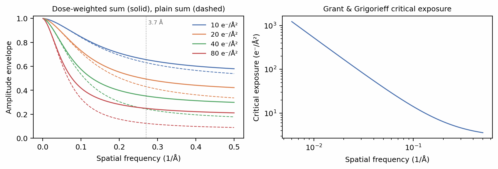
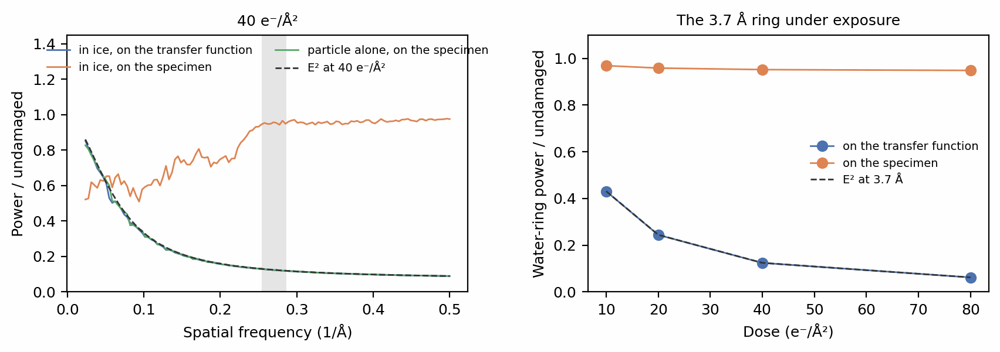
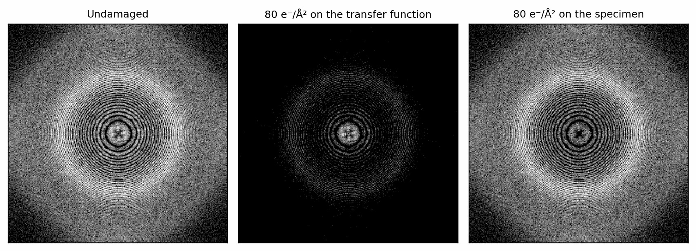
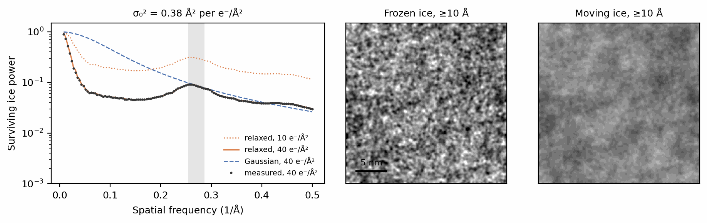

# Radiation damage and the solvent

An exposure changes the specimen while it is being imaged. The electrons that
form the image also break bonds in the protein, so its high-resolution
structure fades as the dose accumulates, and they deposit energy in the ice,
which rearranges between frames. The two are different processes and
SPECTER models them separately: the protein is *damaged*, its potential
attenuated by an empirical envelope, while the solvent *decorrelates*, each
frame holding proper water in a different arrangement. This tutorial applies
the damage envelope, shows why applying it to the whole image misrepresents
the ice, and models the solvent's motion on its own.

Before you start: this tutorial assumes [Specimens: crowding and
ice](../walkthrough/specimens.md), [Contrast transfer
function](../walkthrough/ctf.md) and [Detection](../walkthrough/detection.md).

Both the specimen-side damage and the solvent motion are opt-in. Their effect
on matching real particle stacks, and the motion variances that real data
support, are still being validated.

## Setup

Four particles of 6BDF (Campbell et al. 2015) in a box of ice, imaged at
1.5 µm underfocus:

```python
--8<-- "docs-figures/tutorials/dose_damage.py:setup"
```

```{ .text .output }
--8<-- "docs-includes/tutorials/dose_damage-setup.txt"
```

## The damage envelope

Grant & Grigorieff (2015) measured that the signal at spatial frequency \(k\)
decays with exposure \(N\) as \(e^{-N/N_e(k)}\), with a *critical exposure*
\(N_e(k) = a k^{b} + c\) that is shorter for finer detail. A frame recorded at
accumulated exposure \(N\) carries \(e^{-N/2N_e}\) of its undamaged amplitude,
and an image summed over an exposure \(D\) carries the average of that over
the exposure. For a dose-weighted movie sum, the form single-particle images
take, the amplitude envelope at equal noise is

\[
E(k) = \sqrt{\frac{1}{D}\int_0^{D} e^{-N/N_e(k)}\,dN},
\]

and for a plain sum of frames, the form a tilt takes, it is the average of
\(e^{-N/2N_e}\) itself:

```python
--8<-- "docs-figures/tutorials/dose_damage.py:envelope"
```

```{ .text .output }
--8<-- "docs-includes/tutorials/dose_damage-envelope.txt"
```

{ width="900" style="display:block;margin:1.2em auto;" }
///caption
Left: the amplitude envelope of a dose-weighted sum (solid) and a plain sum
(dashed) at 10, 20, 40 and 80 e⁻/Ų. Right: the critical exposure, the dose
after which the intensity at each frequency has fallen to \(1/e\).
///

At 3.7 Å the critical exposure is 5.0 e⁻/Ų, so a 40 e⁻/Ų exposure keeps 35%
of the amplitude there in a dose-weighted sum and 24% in a plain one. The
weighted sum keeps more because it gives the early, undamaged frames more
weight; the noise it is normalised to is the same.

## Where the envelope acts

The envelope can act in two places. On the transfer function
(`apply_ctf(dose_envelope=...)`), it multiplies the whole image, ice
included. On the specimen (`Specimen.damage()`), it attenuates the particle's
3D potential before the ice is added, so the water is never damaged:

```python
--8<-- "docs-figures/tutorials/dose_damage.py:routes"
```

```{ .text .output }
--8<-- "docs-includes/tutorials/dose_damage-routes.txt"
```

The printed band is the 3.7 Å water ring, the strongest feature of the ice's
structure. On the transfer function its power follows \(E^2\) exactly, down
to 12% at 40 e⁻/Ų and 6% at 80. That is the protein's damage law applied to
the solvent, as if the water's own structure were destroyed by the beam.
Water is not damaged in that sense: each frame of a raw movie shows the ring
at full strength across 50 e⁻/Ų. On the specimen, the ring keeps 95% to 97%
of its power at every dose, the remainder being the particle's own
contribution to that band, which is damaged.

The damaged specimen alone shows that the envelope still reaches the
particle exactly:

```python
--8<-- "docs-figures/tutorials/dose_damage.py:dry"
```

```{ .text .output }
--8<-- "docs-includes/tutorials/dose_damage-dry.txt"
```

{ width="900" style="display:block;margin:1.2em auto;" }
///caption
Left: image power at 40 e⁻/Ų over the undamaged image's. The particle alone
(green) follows \(E^2\) (dashed), and so does the whole image in ice when the
envelope acts on the transfer function (blue, under the green). In ice with
the envelope on the specimen (orange), the ice keeps its power and the
spectrum recovers towards 1 wherever the ice dominates. Right: the water
ring's power against dose; the grey band on the left marks the ring.
///

Between 0.1 and 0.2 Å⁻¹ the particle alone keeps 22% of its power at
40 e⁻/Ų, matching \(E^2\) = 0.223, while the solvated image keeps 70% on the
specimen route, because most of the image power there is the ice's.

{ width="900" style="display:block;margin:1.2em auto;" }
///caption
Power spectra averaged over the four particles, on one logarithmic scale. On
the transfer function (centre) 80 e⁻/Ų darkens every ring, the water ring
included. On the specimen (right) the ice's spectrum is unchanged.
///

`Envelopes(dose_envelope_target="specimen")` selects the specimen route in
every simulator, and `"transfer_function"`, the default, the other. A
micrograph and a tilt series damage their specimen the same way, before or
apart from the ice blended into them; a tilt is damaged by its own dose after
the pre-exposure of the tilts before it.

## The solvent under exposure

What the beam does to the ice is make it move. Every frame still holds water
with the equilibrium structure, but successive frames hold different
arrangements of it, so the ice's Fourier amplitudes lose correlation with dose.
A summed image keeps only the fraction \(\mathcal S(k)\) of a frozen ice's
power that survives that averaging. `Ice(motion_variance=...)` applies it as
a filter on the ice, parameterized by the \(\sigma_0^2\) of McMullan et al.
(2015), the per-axis displacement variance per e⁻/Ų measured from the decorrelation of
the 3.7 Šring (0.38 Ų for their 300 kV exposure):

```python
--8<-- "docs-figures/tutorials/dose_damage.py:motion"
```

```{ .text .output }
--8<-- "docs-includes/tutorials/dose_damage-motion.txt"
```

{ width="900" style="display:block;margin:1.2em auto;" }
///caption
Left: the fraction of the projected ice's power that survives 40 e⁻/Ų in
40 frames, measured from the two volumes (points), against the relaxed
coherence model SPECTER uses (solid; dotted at 10 e⁻/Ų) and McMullan's
independent-kick Gaussian model (dashed). Right: one projection of the frozen
and the moving ice, low-pass filtered to 10 Å, on one grey scale.
///

The filter keeps the mean potential, 4.5474 V in both volumes, so the ice
still displaces and absorbs as before; only its fluctuation changes. At the
ring the two models agree by construction (0.087 and 0.088). They part at long
wavelengths. Relaxed ice is nearly incompressible, so its density
fluctuations decorrelate far faster than independently kicked molecules
would: between 0.05 and 0.1 Å⁻¹ it keeps 6% of its power where the Gaussian
model keeps 62%. The measured fraction follows the relaxed model to within
0.01 in every band above 0.05 Å⁻¹. The long-wavelength ice texture visible in
the frozen projection is therefore what an exposure averages away.

## Counting the exposure once

The dose envelope on the transfer function would fade the solvent a second
time on top of either specimen-side model, so `apply_ctf` refuses it for a
wave whose specimen was damaged or whose solvent was filtered. Both
specimen-side models also need the exposure they act on:

```python
--8<-- "docs-figures/tutorials/dose_damage.py:refusals"
```

```{ .text .output }
--8<-- "docs-includes/tutorials/dose_damage-refusals.txt"
```

## From the command line

`specter simulate particles`, `simulate micrograph` and `simulate tiltseries`
take the same settings as flags or TOML fields:

```bash
specter simulate particles \
    --pdb_source 6bdf \
    --dose 40 --n_frames 40 \
    --dose_envelope true \
    --dose_envelope_target specimen \
    --ice_motion_variance 0.38
```

`--ice_motion_variance` with `--dose_envelope true` requires
`--dose_envelope_target specimen`; the config validator refuses the other
combination before any work is done. `--dose_weights_path` replaces the equal
frame weights with a motion-correction job's own.

## See also

- [The solvent under exposure](../concepts/ice.md#the-solvent-under-exposure):
  the coherence models, their measurement and validation.
- [Envelopes](../concepts/aberrations.md#envelopes): the dose envelope's
  closed forms and where it acts.
- [Specimens: crowding and ice](../walkthrough/specimens.md#radiation-damage):
  `damage()` in the order a specimen is built.

## References

- Campbell, M. G., Veesler, D., Cheng, A., Potter, C. S., & Carragher, B.
  (2015). 2.8 Å resolution reconstruction of the *Thermoplasma acidophilum*
  20S proteasome using cryo-electron microscopy. *eLife*, 4, e06380.
  [doi:10.7554/eLife.06380](https://doi.org/10.7554/eLife.06380)
- Grant, T., & Grigorieff, N. (2015). Measuring the optimal exposure for
  single particle cryo-EM using a 2.6 Å reconstruction of rotavirus VP6.
  *eLife*, 4, e06980.
  [doi:10.7554/eLife.06980](https://doi.org/10.7554/eLife.06980)
- McMullan, G., Vinothkumar, K. R., & Henderson, R. (2015). Thon rings from
  amorphous ice and implications of beam-induced Brownian motion in single
  particle electron cryo-microscopy. *Ultramicroscopy*, 158, 26–32.
  [doi:10.1016/j.ultramic.2015.05.017](https://doi.org/10.1016/j.ultramic.2015.05.017)
