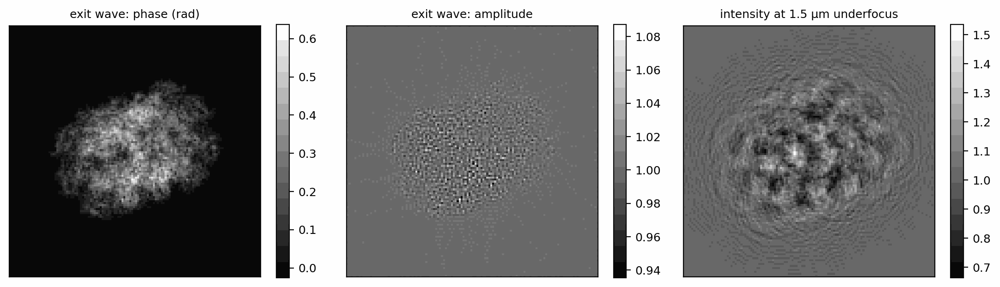

# Inspecting an exit wave

`basic` · image formation · runs in about 20 s on one GPU

`Specimen.scatter` returns an `ExitWave`: the complex wave leaving the
specimen, before the lens acts on it. The object holds the wave as a tensor
together with the grid it was computed on, so each stage of image formation
can be read, plotted, or replaced.

{ width="900" style="display:block;margin:1.2em auto;" }
///caption
One 20S proteasome at 2 Å per pixel and 300 kV: the phase and the amplitude
of its exit wave, and the intensity after 1.5 µm of underfocus. The particle
is a phase object, so the wave's amplitude stays within 9% of the vacuum
beam's and the contrast appears only after the lens.
///

```python
--8<-- "docs-figures/tutorials/exit_wave.py:recipe"
```

```{ .text .output }
--8<-- "docs-includes/tutorials/exit_wave-recipe.txt"
```

`array` is the wave on the propagation grid, which multislice samples
`oversample` times finer than the pixels, and `pixels()` returns it on the
pixel grid. `defocus_shift` is the distance from the exit face, where the
wave was computed, to the specimen's midplane, to which the nominal defocus
refers; `apply_ctf` subtracts it
([The defocus reference plane](../concepts/conventions.md#the-defocus-reference-plane)).

## Variations

- **Change the scattering model.** `specimen.scatter(poses, voltage=300.0,
  scattering_model="projection")` replaces multislice by the projection
  approximation; `"firstborn"` and `"ctf"` are the other models.
- **Add neighbours and ice first.** `specimen.crowd(min_distance=...)` and
  `specimen.solvate(model="gd", thickness=0)` return specimens whose exit
  waves include them.
- **Keep the FFT margin.** With `pad_fft=True` the wave is propagated on
  `pad_nxy` pixels, wider than the image's `nxy`, and the detector crops the
  margin.

## See also

- [Scattering](../walkthrough/scattering.md): the models, compared.
- [A transfer function of your own](custom-transfer-function.md): acting on
  the wave's array.
- [Composing a forward model by hand](custom-forward-model.md): the engines
  behind `scatter`, `apply_ctf` and `detect`.
