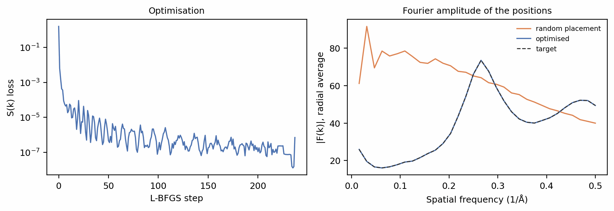
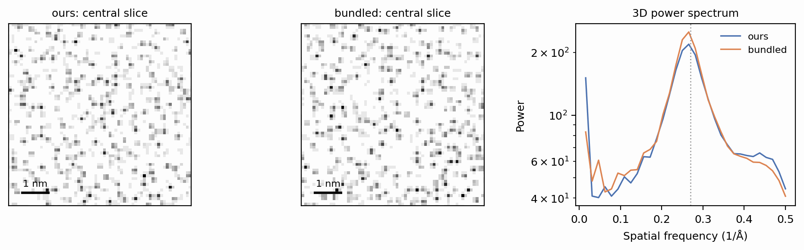
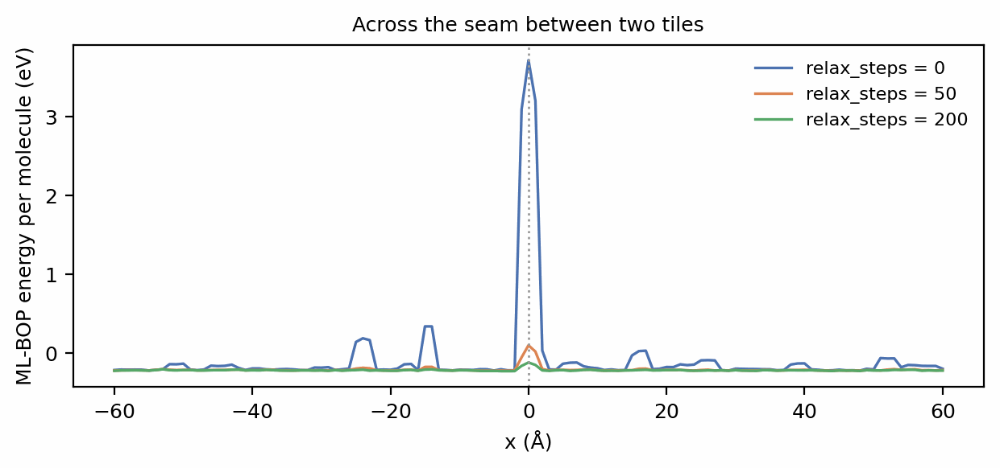

# Building an ice library

SPECTER's amorphous ice comes from a library of water configurations, each a
periodic cell of molecular positions optimised to reproduce the structure of
real low-density amorphous ice. Optimising a configuration takes minutes, so
the library is built once and `IceBank` draws randomly rotated, randomly
translated crops from it in milliseconds. This tutorial builds a small
library of your own: one configuration optimised from random positions,
inspected against its target, loaded beside the bundled library, used to
solvate a specimen, and tiled into a box larger than its cell.

Before you start: this tutorial assumes the walkthrough page
[Specimens: crowding and ice](../walkthrough/specimens.md), which introduces
the `"gd"` ice this library serves.

## When you need your own library

The library SPECTER ships holds 20 configurations, each a 256 Å periodic
cell optimised at 1 Å per voxel, and most simulations never need another.
A configuration is stored as continuous coordinates rather than a voxel
grid, so it renders at any voxel size, but two of its properties are fixed
when it is built:

- **The frequency range of its structure.** The optimisation matches the
  structure factor only up to the Nyquist frequency of the grid it ran on,
  0.5 Å⁻¹ for the bundled 1 Å cells. To simulate finer voxels with
  constrained structure there, build at that voxel size.
- **Its cell size.** A box larger than one cell is assembled from several
  crops, whose seams need healing ([below](#boxes-larger-than-one-cell)).
  A library of larger cells serves such boxes from a single crop.

A third reason is wanting more independent configurations than the bundled
20, for a dataset large enough that reused crops could become visible.

The setup imports the library functions and makes a directory for the new
library. Never write into the bundled library inside the package.

```python
--8<-- "docs-figures/tutorials/ice_library.py:setup"
```

## Building one configuration

`build_one_ice_config` optimises one configuration and writes it to a
library directory, named after its seed by `ice_config_filename`. A 64 Å
cell at 1 Å per voxel keeps the example to a couple of minutes:

```python
--8<-- "docs-figures/tutorials/ice_library.py:build"
```

```{ .text .output }
--8<-- "docs-includes/tutorials/ice_library-build.txt"
```

The optimisation recipe is fixed rather than exposed: it matches the
structure factor \(S(k)\) of a molecular-dynamics frame of low-density
amorphous ice, and holds the coarse-grained ML-BOP water energy (Chan et al.
2019) near that frame's measured −0.413 eV per molecule. Two libraries built
under different recipes would be two different phases of ice, and `IceBank`
would draw from them interchangeably. The S(k) loss reported is measured on the coordinates
as stored, which the file keeps in a fixed-point encoding, so it is what any
later simulation reads back.

## Watching the optimisation

`build_one_ice_config` keeps only the final result. The same optimisation,
run directly through `GradientSKIcemaker` with the same seed, records its
progress at every step:

```python
--8<-- "docs-figures/tutorials/ice_library.py:trajectory"
```

```{ .text .output }
--8<-- "docs-includes/tutorials/ice_library-trajectory.txt"
```

The two runs follow the same recipe from the same starting positions, and
differ in their last digits and the step at which they stop, because GPU
reductions are not bit-reproducible.

{ width="900" style="display:block;margin:1.2em auto;" }
///caption
Left: the S(k) loss against L-BFGS step. Right: the rotationally averaged
Fourier amplitude of the water positions, for the random start and the
optimised configuration, against the target, up to the 0.5 Å⁻¹ the
optimisation constrains.
///

Uniformly random positions have no structure: their Fourier amplitude falls
smoothly with frequency, and overlapping molecules give an ML-BOP energy of
17.20 eV per molecule. The optimised positions follow the target's water
ring at 0.27 Å⁻¹ (3.7 Å) and its second peak, and the energy ends at
−0.366 eV per molecule, approaching the target value. Below 0.1 Å⁻¹ the target
is low, the signature of a nearly incompressible liquid whose density
fluctuates little over long distances; see
[The optimisation target: S(k)](../concepts/ice.md#the-optimisation-target-sk).

## Loading the library

`IceBank(cache_dir=...)` reads every configuration in a directory; with no
directory it reads the bundled library. Both serve crops the same way:

```python
--8<-- "docs-figures/tutorials/ice_library.py:bank"
```

```{ .text .output }
--8<-- "docs-includes/tutorials/ice_library-bank.txt"
```

{ width="900" style="display:block;margin:1.2em auto;" }
///caption
A central slice of a 64 Å crop from the new library and from the bundled one
(left, centre), and the 3D power spectrum of each crop (right). The dotted
line marks 3.7 Å.
///

The two libraries agree where it matters for imaging: the crops' mean
potentials, 4.55 V and 4.51 V, match, and both spectra peak at the water
ring. Each crop is a random rotation and
translation of a configuration, rendered with the water-molecule kernel at
whatever voxel size the request asks for.

## Using it in a simulation

A specimen draws its ice from a library through `solvate`'s `cache_dir`:

```python
--8<-- "docs-figures/tutorials/ice_library.py:specimen"
```

```{ .text .output }
--8<-- "docs-includes/tutorials/ice_library-specimen.txt"
```

From the command line, the same setting is the config field `ice_cache_dir`.

## Boxes larger than one cell

A box larger than the library's cells is assembled from several
independently rotated crops placed side by side. Where two crops meet,
molecules from both can sit closer than any real water would. `IceBank`
heals the seams by relaxing the molecules within 6 Å of each tile face
against the ML-BOP energy, for `relax_steps` Adam steps, holding
the rest fixed. A 128 × 128 × 64 Å canvas from the 64 Å cell has seams at
\(x = 0\) and \(y = 0\):

```python
--8<-- "docs-figures/tutorials/ice_library.py:tiling"
```

```{ .text .output }
--8<-- "docs-includes/tutorials/ice_library-tiling.txt"
```

{ width="900" style="display:block;margin:1.2em auto;" }
///caption
The ML-BOP energy per molecule of 3 Å slabs across the canvas, for 0, 50 and
200 relaxation steps. Each slab is cut out of the canvas the same way, so its
absolute level sits above the bulk value and only differences along \(x\)
are meaningful. The peak is the seam at \(x = 0\); the smaller bumps are
clashes along the seam at \(y = 0\), which every slab crosses.
///

Unrelaxed, the clashes at the seams raise the whole canvas's energy to
0.080 eV per molecule, against −0.366 for the configuration itself. Fifty
steps bring it to −0.329 and 200 to −0.357, and the seam's peak in the slab
profile all but disappears. Relaxation only moves molecules near the faces,
so it costs little next to the optimisation that built the cell; a library
of cells larger than your boxes avoids seams altogether.

## From the command line

`specter build ice` builds a library of several configurations, one per
seed, sharded across GPUs and resumable:

```bash
specter build ice --n_configs 8 --n 64 --dx 1.0 --output_dir ice --device 0
```

Point a simulation at it with `ice_cache_dir = "ice"`.
[Using the ice cache](../user-guide/ice-cache.md) covers the flags and what
each cell size costs to build.

## See also

- [The optimisation target: S(k)](../concepts/ice.md#the-optimisation-target-sk)
  and [The optimisation](../concepts/ice.md#the-optimisation): what the
  configurations are optimised against, and how.
- [ML-BOP energy penalty (default)](../concepts/ice.md#ml-bop-energy-penalty-default):
  the water energy the recipe targets.
- [Rendering](../concepts/ice.md#rendering): how a crop's positions become a
  potential.

## References

- Chan, H., Cherukara, M. J., Narayanan, B., Loeffler, T. D., Benmore, C.,
  Gray, S. K., & Sankaranarayanan, S. K. R. S. (2019). Machine learning
  coarse grained models for water. *Nature Communications*, 10(1), 379.
  [doi:10.1038/s41467-018-08222-6](https://doi.org/10.1038/s41467-018-08222-6)
