# Tutorials

These tutorials cover topics beyond the [walkthrough](../walkthrough/index.md),
which they assume you have read. Each is a self-contained page of code and
figures, built from a script in
[`docs-figures/tutorials/`](https://github.com/joelyeois/specter/tree/main/docs-figures/tutorials)
that you can run yourself with `uv run python docs-figures/tutorials/<name>.py`.
Read them in any order.

## In depth

-   [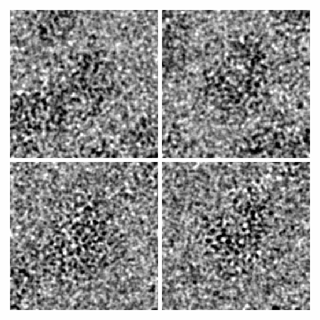](real-dataset.md)

    **[Simulating a real dataset](real-dataset.md)**

    Image a structure at the poses and transfer functions of a CryoSPARC or
    RELION refinement, and compare it with the experimental particles.

-   [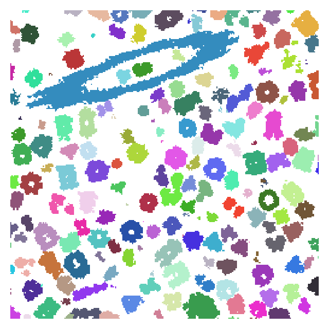](cellular-specimens.md)

    **[Cellular specimens for cryo-ET](cellular-specimens.md)**

    Build a crowded cellular volume from membranes, filaments, packed proteins,
    gold beads and carbon, with its ground truth, and tilt it.

-   [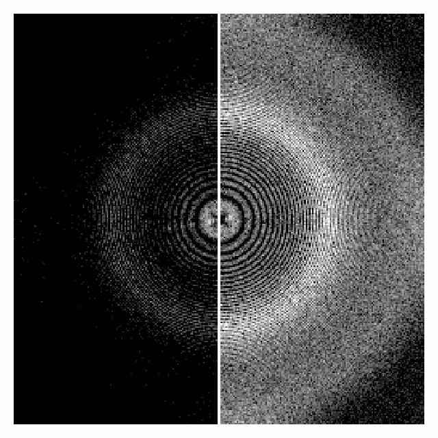](dose-damage.md)

    **[Radiation damage and the solvent](dose-damage.md)**

    Fade the specimen with the electron dose while the ice keeps its
    structure, and let the solvent decorrelate under the exposure.

-   [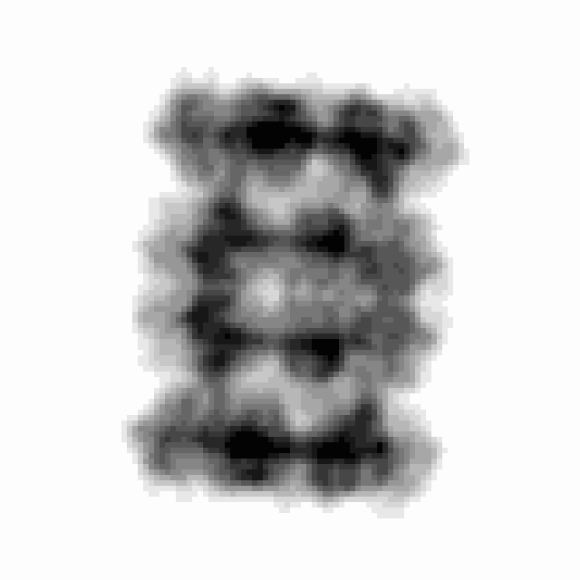](inelastic.md)

    **[Inelastic scattering and energy filtering](inelastic.md)**

    Remove inelastically scattered electrons as an energy filter does, and
    model what an unfiltered image keeps.

-   [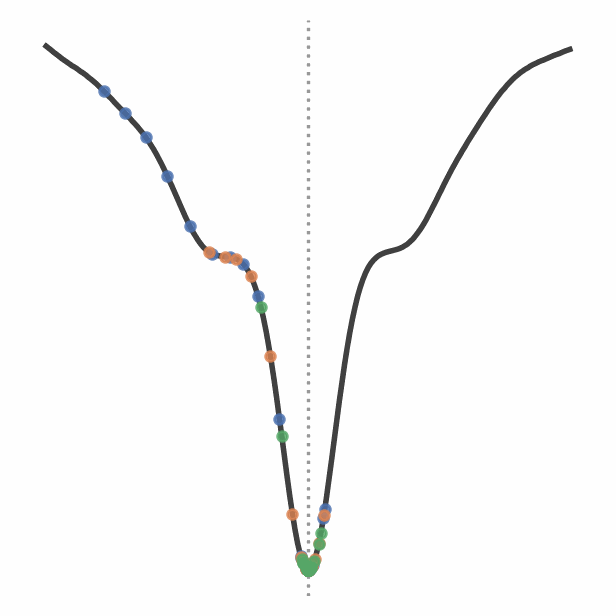](differentiable.md)

    **[Gradients through the forward model](differentiable.md)**

    Differentiate an image with respect to its imaging parameters and atomic
    coordinates, and recover them by gradient descent.

-   [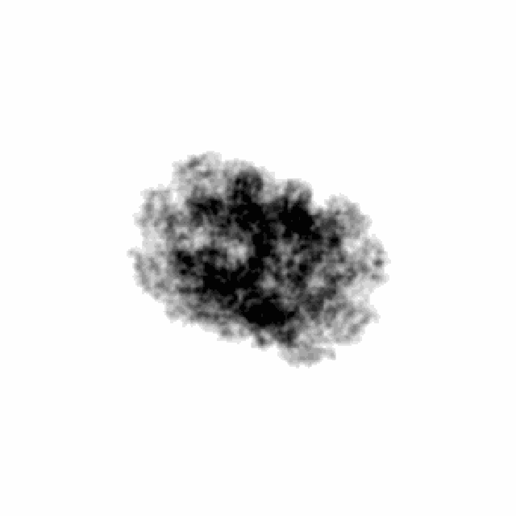](custom-forward-model.md)

    **[Composing a forward model by hand](custom-forward-model.md)**

    Rebuild the image from SPECTER's engines one stage at a time, then
    replace a stage with your own.

-   [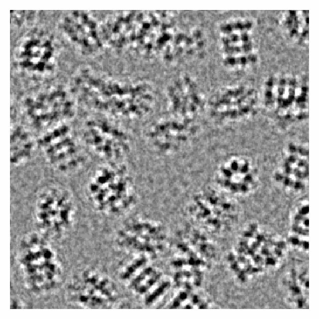](tilt-series-engines.md)

    **[A tilt series from the engines](tilt-series-engines.md)**

    Blend the ice, size the volume for the tilt range, and propagate, focus
    and detect each tilt by hand, identically to the objects.

-   [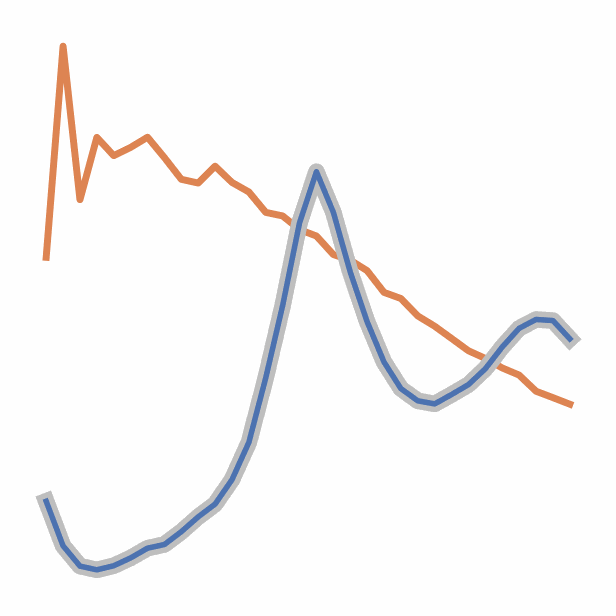](ice-library.md)

    **[Building an ice library](ice-library.md)**

    Optimise amorphous ice against its structure factor, and draw and tile
    crops of it at the voxel size you need.

## Short recipes

A recipe is one task and one figure, in a single block of code to copy and
adapt, plotting included. One tagged `basic` uses the high-level objects and
their defaults. One tagged `specialized` reaches below them, into the engines
or the geometry.

-   [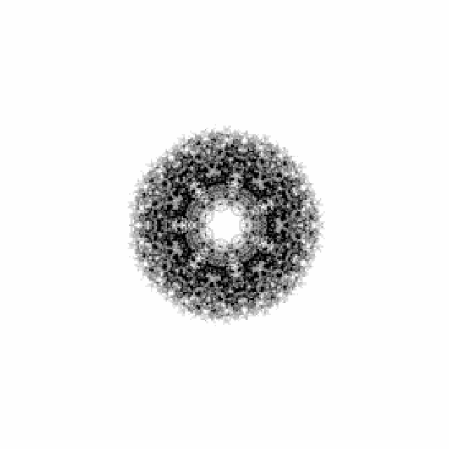](pdb-potential.md)

    **[A potential from a PDB entry](pdb-potential.md)**

    `basic` · An atomic model rendered into a potential volume, plotted
    as a slice and two projections.

-   [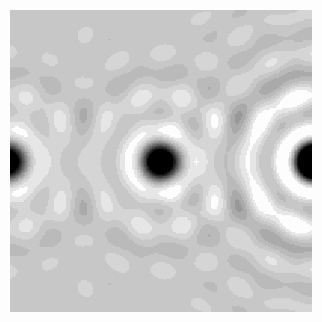](single-atoms.md)

    **[Single atoms in bright field](single-atoms.md)**

    `specialized` · The projected potentials of five single atoms, and their
    coherent bright-field image.

-   [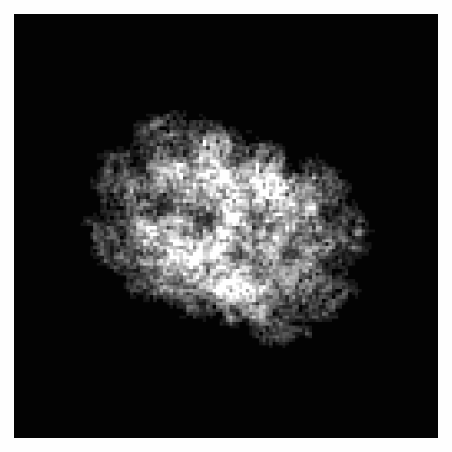](exit-wave.md)

    **[Inspecting an exit wave](exit-wave.md)**

    `basic` · The phase and amplitude of the wave leaving a particle, and
    the grid it is held on.

-   [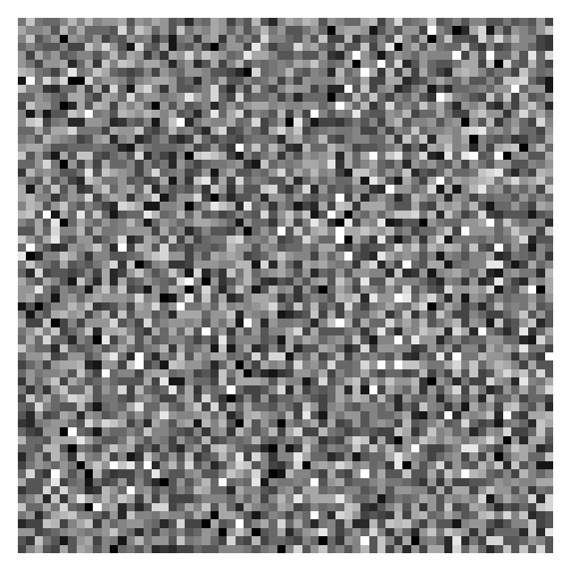](coincidence-radius.md)

    **[The coincidence radius of a camera](coincidence-radius.md)**

    `basic` · A camera's calibrated coincidence loss carried over to a
    simulation's pixel size and frames.

-   [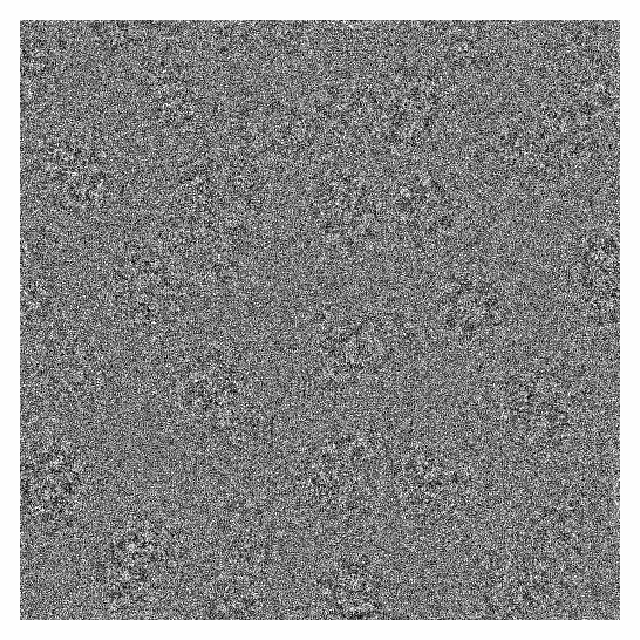](save-micrographs.md)

    **[Saving micrographs with a STAR file](save-micrographs.md)**

    `basic` · A stack of micrographs written as an MRC file, with the STAR
    file that records each image's transfer function.

-   [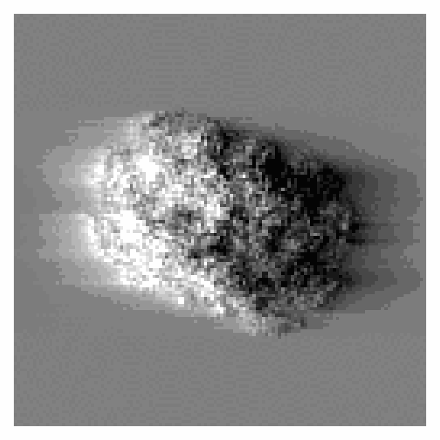](custom-transfer-function.md)

    **[A transfer function of your own](custom-transfer-function.md)**

    `specialized` · A knife edge in the back focal plane, applied to the
    wave's array between two verbs.

-   [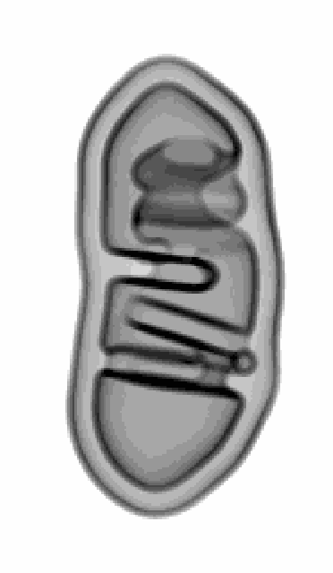](membrane-organelles.md)

    **[The four organelle kinds](membrane-organelles.md)**

    `basic` · A vesicle, a branched tubule, a cisterna and a mitochondrion
    from `MembraneGenerator`.

-   [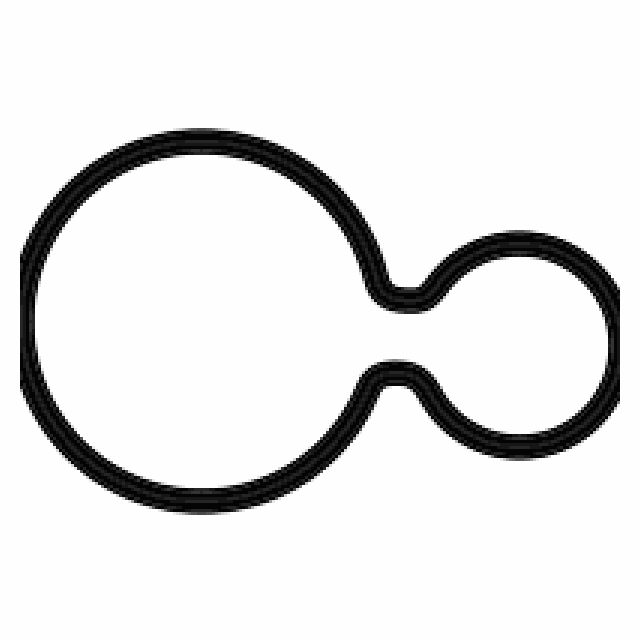](membrane-primitives.md)

    **[Composing a membrane from primitives](membrane-primitives.md)**

    `specialized` · A budding vesicle from two balls and a tube, regularised
    and rendered as a bilayer.

-   [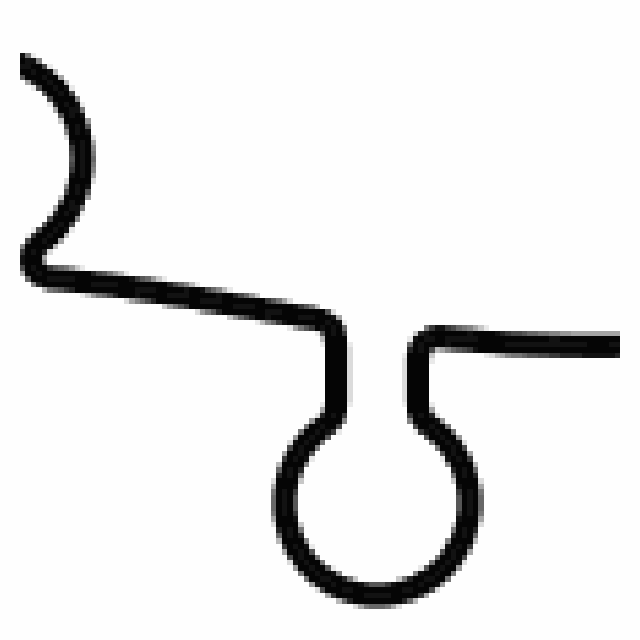](membrane-gallery.md)

    **[A gallery of composed membranes](membrane-gallery.md)**

    `specialized` · Eight shapes from a discocyte to a plasma membrane, each
    a few lines of primitives.

For the same workflows run from a TOML config with the `specter` command, see
the [Command-line guides](../user-guide/particle-stack.md).
