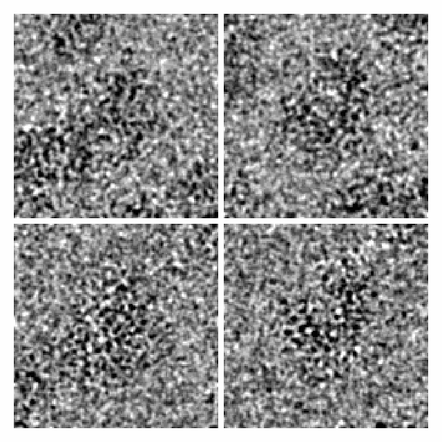
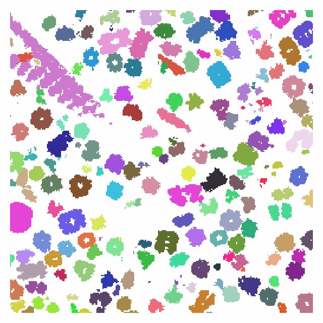
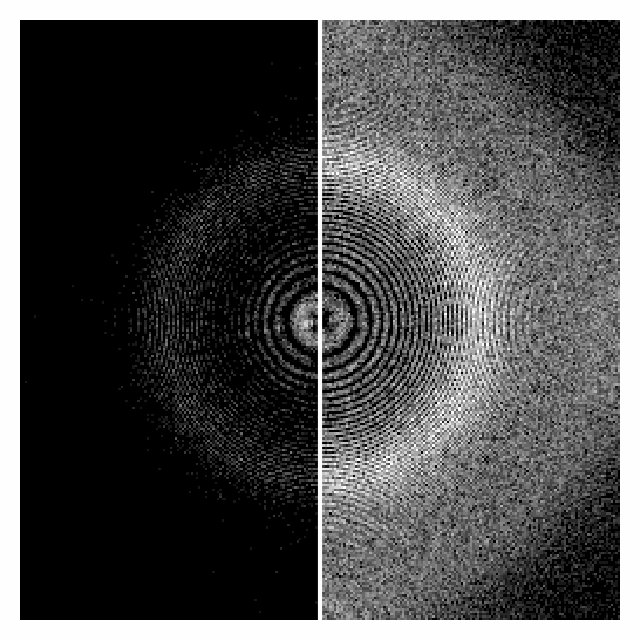
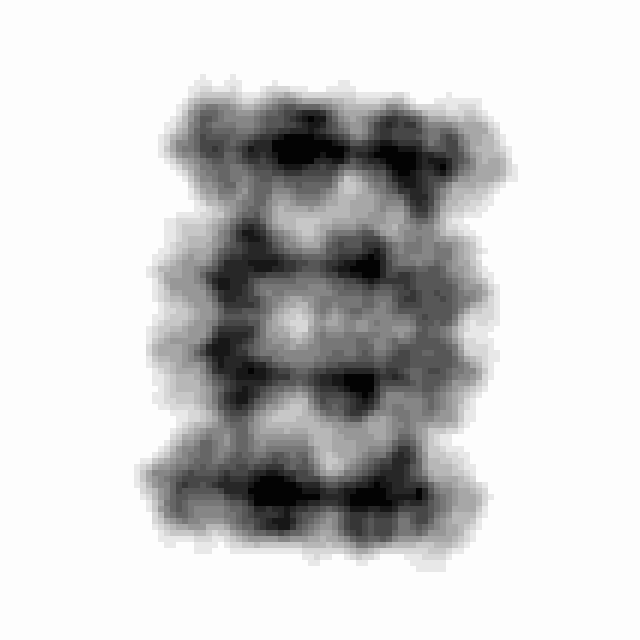
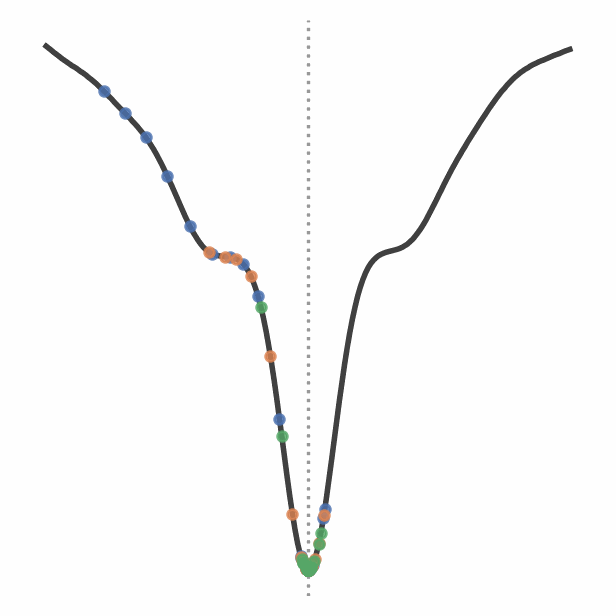
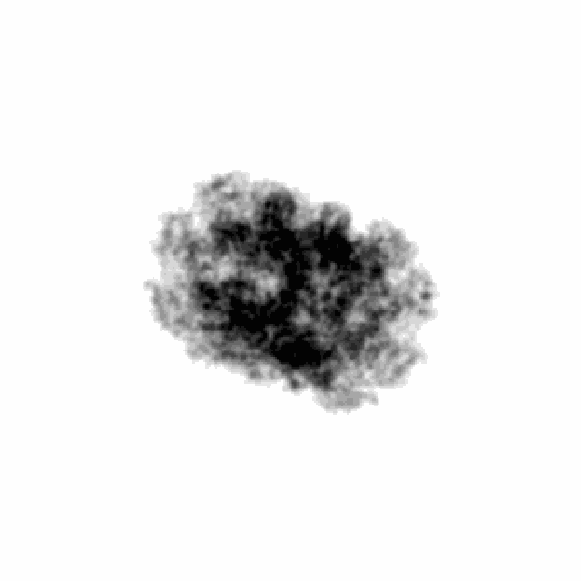
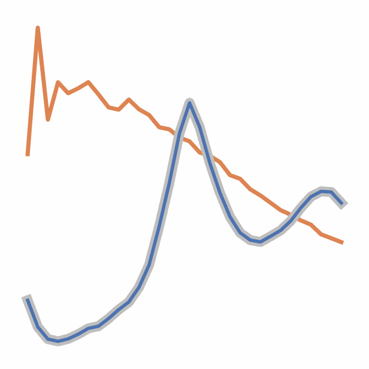

# Tutorials

These tutorials cover topics beyond the [walkthrough](../walkthrough/index.md),
which they assume you have read. Each is a self-contained page of code and
figures, built from a script in
[`docs-figures/tutorials/`](https://github.com/joelyeois/specter/tree/main/docs-figures/tutorials)
that you can run yourself with `uv run python docs-figures/tutorials/<name>.py`.
Read them in any order.

-   

    **[Simulating a real dataset](real-dataset.md)**

    Image a structure at the poses and transfer functions of a CryoSPARC or
    RELION refinement, and compare it with the experimental particles.

-   

    **[Cellular specimens for cryo-ET](cellular-specimens.md)**

    Build a crowded cellular volume from membranes, filaments, packed proteins,
    gold beads and carbon, with its ground truth, and tilt it.

-   

    **[Radiation damage and the solvent](dose-damage.md)**

    Fade the specimen with the electron dose while the ice keeps its
    structure, and let the solvent decorrelate under the exposure.

-   

    **[Inelastic scattering and energy filtering](inelastic.md)**

    Remove inelastically scattered electrons as an energy filter does, and
    model what an unfiltered image keeps.

-   

    **[Gradients through the forward model](differentiable.md)**

    Differentiate an image with respect to its imaging parameters and atomic
    coordinates, and recover them by gradient descent.

-   

    **[Composing a forward model by hand](custom-forward-model.md)**

    Rebuild the image from SPECTER's engines one stage at a time, then
    replace a stage with your own.

-   

    **[Building an ice library](ice-library.md)**

    Optimise amorphous ice against its structure factor, and draw and tile
    crops of it at the voxel size you need.

For the same workflows run from a TOML config with the `specter` command, see
the [Command-line guides](../user-guide/particle-stack.md).
