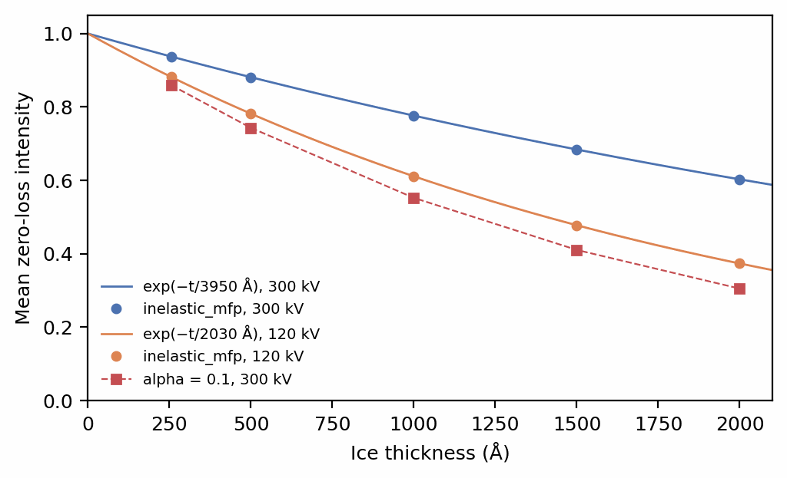
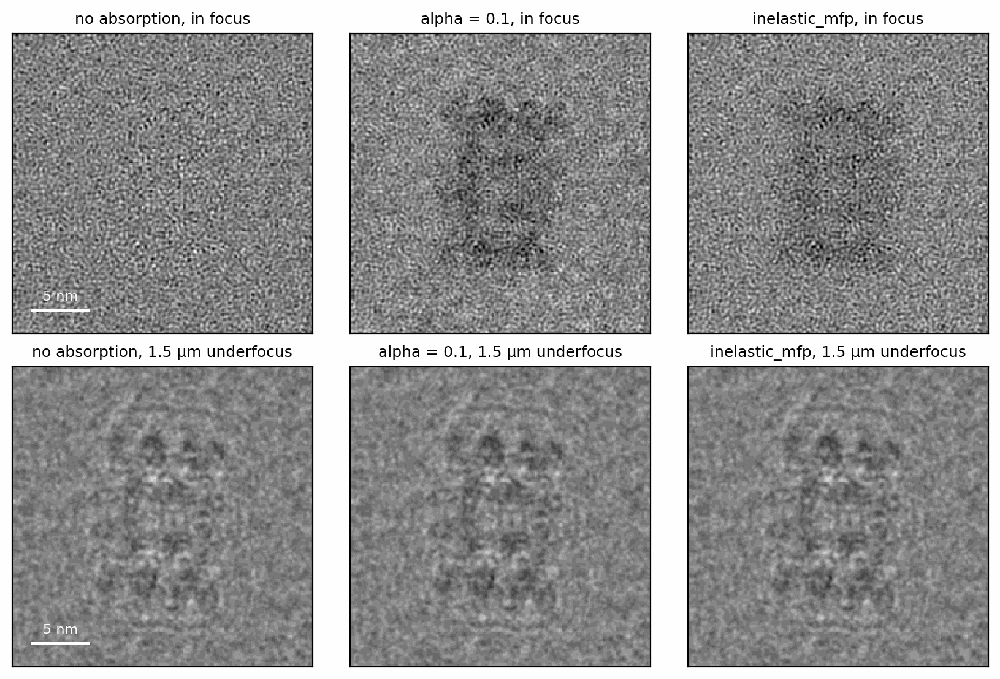
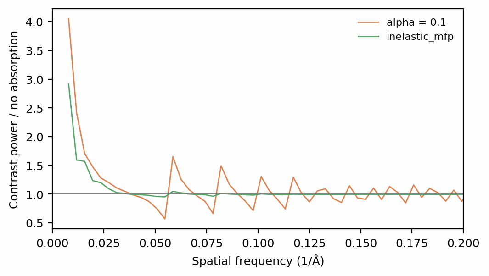
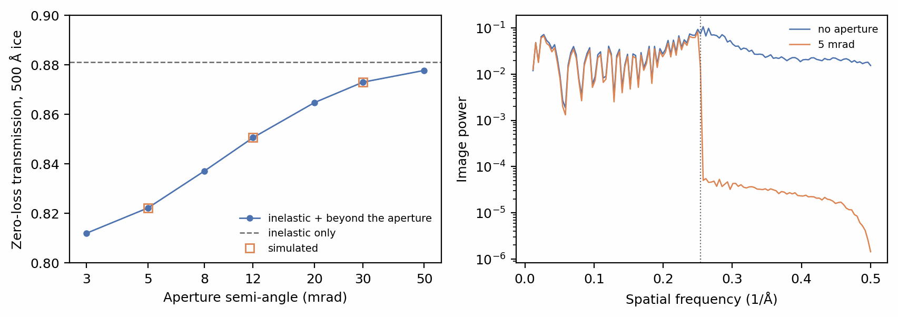
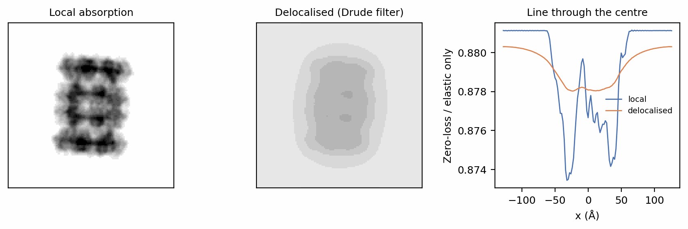

# Inelastic scattering and energy filtering

Most electrons that interact with a frozen specimen scatter inelastically:
they lose a few to a few hundred eV to plasmons and ionisations. An energy
filter's slit removes them, so an energy-filtered image is formed only by the
electrons that lost no energy, the *zero-loss* beam. To a simulation, losing those electrons is
absorption: an imaginary part of the potential, under which the wave's
intensity decays as it crosses the specimen. This tutorial compares the two
ways SPECTER assigns that absorption, adds the objective aperture, and shows
the frozen-plasmon model of Himes & Grigorieff (2021), in which the absorption
is spread laterally the way inelastic scattering is.

Before you start: this tutorial assumes
[Scattering](../walkthrough/scattering.md) and [Contrast transfer
function](../walkthrough/ctf.md).

## Setup

The inelastic mean free path \(\lambda\) is the distance over which a beam
loses a fraction \(1 - 1/e\) of its zero-loss electrons. SPECTER carries
measured values for amorphous ice (Grimm et al. 1996; Rice et al. 2018) and a
derived value for protein:

```python
--8<-- "docs-figures/tutorials/inelastic.py:setup"
```

```{ .text .output }
--8<-- "docs-includes/tutorials/inelastic-setup.txt"
```

The ice values are apparent mean free paths, measured on the zero-loss
channel through a real objective aperture and energy slit, which is the
quantity a simulation of filtered images needs. They are measured at 300 and
120 kV only; at any other voltage SPECTER estimates one from the two and
warns that it has.

## Energy-filtered transmission

`Propagation(absorption_model="inelastic_mfp")` gives each material the
imaginary potential that removes electrons at its mean free path. A slab of
ice of thickness \(t\) should then transmit \(e^{-t/\lambda}\) of the beam,
which is the Beer–Lambert law the zero-loss intensity of real energy-filtered
images follows:

```python
--8<-- "docs-figures/tutorials/inelastic.py:beer-lambert"
```

```{ .text .output }
--8<-- "docs-includes/tutorials/inelastic-beer-lambert.txt"
```

The mean zero-loss intensity matches \(e^{-t/\lambda}\) to the fourth decimal
at every thickness and both voltages. Through 2000 Å of ice, 40% of the beam
is lost at 300 kV and 63% at 120 kV.

## Amplitude contrast as absorption

The default model, `absorption_model="alpha"`, takes its imaginary potential
from the amplitude-contrast ratio instead: every voxel absorbs in proportion
to its own potential, with the ratio `alpha` the same in ice and protein.
`alpha` is the constant a CTF estimation program assumes, typically 0.07 (Toyoshima & Unwin 1988)
to 0.1 for cryo-EM data, not a measured absorption. Read as one, it absorbs far too
much:

```python
--8<-- "docs-figures/tutorials/inelastic.py:alpha"
```

```{ .text .output }
--8<-- "docs-includes/tutorials/inelastic-alpha.txt"
```

{ width="640" style="display:block;margin:1.2em auto;" }
///caption
The mean intensity leaving a slab of amorphous ice. Under `inelastic_mfp`
(circles) it follows \(e^{-t/\lambda}\) with the measured mean free path
(lines). Under `alpha = 0.1` at 300 kV (squares) the ice absorbs as if its
mean free path were 1684 Å, more strongly than ice at 120 kV.
///

`alpha = 0.1` attenuates ice exactly exponentially, as a mean free path of
1684 Å, 43% of the measured 3950 Å. Through 500 Å it keeps 74% of the beam,
where energy filtering keeps 88%.

## What each model does to contrast

The same particle in 500 Å of ice under no absorption, `alpha = 0.1`, and
`inelastic_mfp` with the protein's mean free path:

```python
--8<-- "docs-figures/tutorials/inelastic.py:contrast"
```

```{ .text .output }
--8<-- "docs-includes/tutorials/inelastic-contrast.txt"
```

{ width="900" style="display:block;margin:1.2em auto;" }
///caption
Each image divided by its own mean and low-pass filtered to 8 Å. In focus
(top) a phase object is nearly invisible; the particle appears through its
absorption, 0.95% darker than the surrounding ice under `alpha` and 0.80%
under `inelastic_mfp` (measured at 10 Å). At 1.5 µm underfocus (bottom) phase contrast
dominates all three.
///

{ width="600" style="display:block;margin:1.2em auto;" }
///caption
The defocused image's power, each image normalised by its mean, relative to
the image with no absorption. `alpha` (orange) moves power at every
frequency; `inelastic_mfp` (green) only below about 0.04 Å⁻¹.
///

The two models differ in where their absorption has structure. Under
`alpha` the imaginary potential has the same atomic detail as the real one,
so it adds an amplitude-contrast term to the transfer function at every
frequency and shifts the zeros of its oscillation: between 0.04 and 0.2 Å⁻¹
the power ratio swings between 0.57 and 1.65. Under `inelastic_mfp` the
absorption follows how much of each voxel is protein rather than water,
coarse-grained over 2 Å, and in projection that contrast sits mostly at the
scale of the particle. It adds power below 0.04 Å⁻¹, by a factor of 1.83 on
average below 0.02 Å⁻¹ and 1.07 from 0.02 to 0.04 Å⁻¹, and leaves 0.04 to
0.2 Å⁻¹ within 5%. The
mean intensity separates them too: `alpha` keeps 74% of the beam, as for
pure ice, while `inelastic_mfp` keeps 88%.

## The objective aperture

Electrons scattered elastically beyond the objective aperture leave the image
too. A potential sampled at 1 Å per pixel holds scattering only up to
0.5 Å⁻¹, about 9.8 mrad at 300 kV, so the loss beyond a typical aperture
cannot be propagated. `objective_aperture`, a semi-angle in mrad, instead
charges it as a further absorption rate per material, from the elastic cross
section integrated beyond the aperture:

```python
--8<-- "docs-figures/tutorials/inelastic.py:aperture"
```

```{ .text .output }
--8<-- "docs-includes/tutorials/inelastic-aperture.txt"
```

{ width="900" style="display:block;margin:1.2em auto;" }
///caption
Left: the transmission of 500 Å of ice with the inelastic loss and the loss
beyond the aperture (line), and as simulated (squares); the dashed line is
the inelastic loss alone. Right: the particle's image power at 1.5 µm
underfocus. A 5 mrad aperture lies inside the grid's Nyquist frequency, and
the scattering beyond it (dotted line, 0.254 Å⁻¹) is removed from the
potential as well.
///

A 12 mrad aperture, about the 70 µm aperture of a Krios, lowers the
transmission of 500 Å of ice from 0.8811 to 0.8507. An aperture narrower than
the grid's Nyquist frequency also low-passes the potential at its own cut-off,
so the scattering the grid does carry is not counted twice; beyond 0.254 Å⁻¹
the 5 mrad image keeps a residual three orders of magnitude below the
unfiltered one. The aperture needs `absorption_model="inelastic_mfp"`, since
under `alpha` the fitted constant already stands in for that loss.

## Delocalised absorption: the frozen-plasmon model

An inelastic event is not confined to the atom it happens at. A plasmon is a
collective excitation of the valence electrons over a nanometre or more
(Egerton 2011), so
the map of where zero-loss electrons are removed is a blurred copy of the
map of material. `specter.imaging.simulate_frozen` propagates a specimen
state with a separate *absorption source*, spread laterally by a
`PlasmonFilter` built from an energy-loss spectrum, and integrates an
exposure frame by frame from explicit states, so solvent motion and damage
can change between frames. The bundled `PlasmonFilter.approximate_drude`
spectrum is a development approximation, not a measured one; the comparison
below shows what delocalisation does, not its calibrated size.

```python
--8<-- "docs-figures/tutorials/inelastic.py:frozen"
```

```{ .text .output }
--8<-- "docs-includes/tutorials/inelastic-frozen.txt"
```

{ width="900" style="display:block;margin:1.2em auto;" }
///caption
What the absorption alone does to the zero-loss image of the particle in
500 Å of ice: each image divided by the elastic-only image, on one grey
scale. Local absorption (left) casts a sharp shadow of the particle;
delocalised absorption (centre) spreads it. Right: a line through the centre.
///

Both runs remove the same electrons, 12.03% of the beam, since the filter
spreads the source without changing its total. Locally, the particle's shadow
is 0.87% darker than the surrounding ice; delocalised, 0.23%, and the
pixel-to-pixel variation of the removal falls from 0.0027 to 0.0008. The
model forms the zero-loss image only: it removes inelastically scattered
electrons, but does not add the energy-loss electrons an unfiltered image
would also record.

## From the command line

`specter simulate particles`, `simulate micrograph` and `simulate tiltseries`
take the mean-free-path model as flags or TOML fields:

```bash
specter simulate particles \
    --pdb_source 6bdf \
    --absorption_model inelastic_mfp \
    --inelastic_mfp_specimen 2460 \
    --objective_aperture 12
```

`--alpha` is ignored under `inelastic_mfp`, including an amplitude contrast
read from a `.cs` or `.star` file. `--inelastic_mfp_solvent` overrides the
measured ice value. The frozen-plasmon model is reachable from Python only,
since it needs explicit source and spectrum data a config cannot carry.

## See also

- [Mean-free-path absorption
  support](../concepts/scattering/index.md#mean-free-path-absorption-support):
  the measured mean free paths, their voltage dependence, and the protein
  value.
- [Objective aperture](../concepts/scattering/index.md#objective-aperture):
  the cross section integrated beyond the aperture.
- [Frozen-plasmon forward model](../concepts/scattering/frozen-plasmon.md):
  the components, normalisation and limitations.
- [Phase shift and amplitude
  contrast](../concepts/aberrations.md#phase-shift-and-amplitude-contrast):
  amplitude contrast in the transfer function.

## References

- Egerton, R. F. (2011). *Electron energy-loss spectroscopy in the electron
  microscope* (3rd ed.). Springer.
  [doi:10.1007/978-1-4419-9583-4](https://doi.org/10.1007/978-1-4419-9583-4)
- Grimm, R., Typke, D., Bärmann, M., & Baumeister, W. (1996). Determination
  of the inelastic mean free path in ice by examination of tilted vesicles
  and automated most probable loss imaging. *Ultramicroscopy*, 63(3–4),
  169–179.
  [doi:10.1016/0304-3991(96)00035-6](https://doi.org/10.1016/0304-3991(96)00035-6)
- Himes, B., & Grigorieff, N. (2021). Cryo-TEM simulations of amorphous
  radiation-sensitive samples using multislice wave propagation. *IUCrJ*,
  8(6), 943–953.
  [doi:10.1107/S2052252521008538](https://doi.org/10.1107/S2052252521008538)
- Rice, W. J., Cheng, A., Noble, A. J., Eng, E. T., Kim, L. Y., Carragher,
  B., & Potter, C. S. (2018). Routine determination of ice thickness for
  cryo-EM grids. *Journal of Structural Biology*, 204(1), 38–44.
  [doi:10.1016/j.jsb.2018.06.007](https://doi.org/10.1016/j.jsb.2018.06.007)
- Toyoshima, C., & Unwin, N. (1988). Contrast transfer for frozen-hydrated
  specimens: Determination from pairs of defocused images.
  *Ultramicroscopy*, 25(4), 279–291.
  [doi:10.1016/0304-3991(88)90003-4](https://doi.org/10.1016/0304-3991(88)90003-4)
