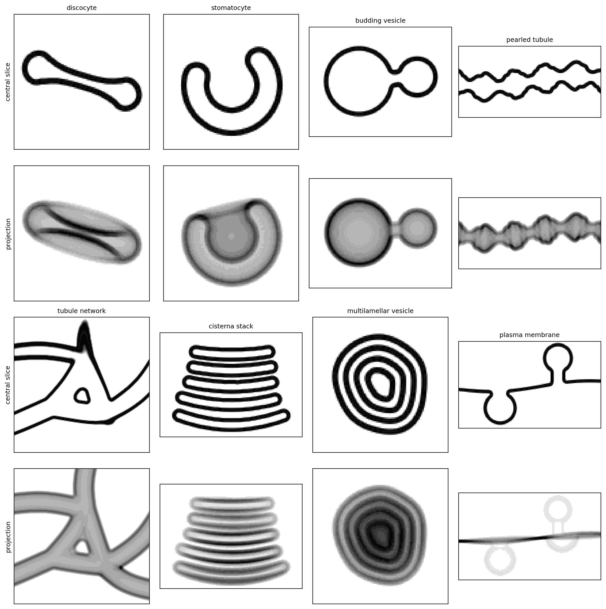

# A gallery of composed membranes

`specialized` · membranes · runs in about 1 min on one GPU

Eight membrane shapes, each a few lines of the primitives in
`specter.specimen.membrane`. A shape returns its grid and a list of
regularised fields; a list with several entries renders several membranes
into one volume, as in the nested bilayers of a multilamellar vesicle or the
sacs of a stack.

{ width="900" style="display:block;margin:1.2em auto;" }
///caption
Each shape at 10 Å per voxel, as its central slice (above) and its projection
(below). The discocyte, the stomatocyte, the cisterna stack and the plasma
membrane are cut and projected along y, which shows them side on; the others
along z.
///

```python
--8<-- "docs-figures/tutorials/membrane_gallery.py:recipe"
```

```{ .text .output }
--8<-- "docs-includes/tutorials/membrane_gallery-recipe.txt"
```

The printed reach is the smallest, over each shape's surfaces and both of
their sides, of the distance along the normal over which the field remains an
exact distance. No radius of curvature left by `regularise` is below it. It
has to exceed the 18.5 Å from the mid-surface to a leaflet of the 37 Å
bilayer, and every shape here clears the accepted minimum of 25 Å
([Reach](../concepts/membrane-shape/geometry.md#reach)).

## Variations

- **Draw another instance.** The tubule network, the cisterna stack and the
  multilamellar vesicle take their randomness from `rng`; pass
  `np.random.default_rng(seed)` with another seed.
- **Render finer.** `voxel_size` is that of the output only. The shape is
  built on the coarse `Grid`, so the same surfaces render at any spacing.
- **Start from one shape.**
  [Composing a membrane from primitives](membrane-primitives.md) walks through
  the budding vesicle step by step.

## See also

- [The four organelle kinds](membrane-organelles.md): the presets, which need
  no geometry.
- [Membrane shape](../concepts/membrane-shape/index.md): the method.
