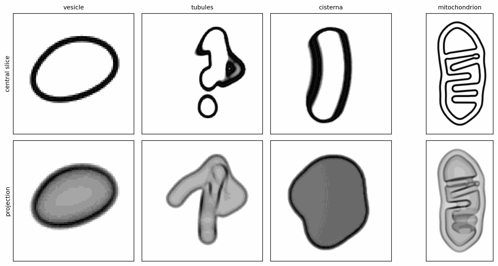

# The four organelle kinds

`basic` · membranes · runs in about 10 s on one GPU

`MembraneGenerator` builds one organelle as a potential volume. Its `kind`
selects one of four presets, and a seed fixes everything random about the
instance: the sizes it draws, the path of each tubule, and the surface
relief.

{ width="900" style="display:block;margin:1.2em auto;" }
///caption
One instance of each kind at 12 Å per voxel: the central z-slice of the
potential (top) and its projection along z (bottom).
///

```python
--8<-- "docs-figures/tutorials/membrane_organelles.py:recipe"
```

```{ .text .output }
--8<-- "docs-includes/tutorials/membrane_organelles-recipe.txt"
```

## Variations

- **Fix a setting, or draw it from a range.** Each kind takes its own
  settings as keyword arguments, in ångströms. A scalar is shared by every
  seed, and a `[low, high]` pair is drawn uniformly per seed:
  `MembraneGenerator(kind="vesicle", radius=[150.0, 350.0], layers=3, ...)`.
  [Organelle kinds](../concepts/membrane-shape/organelles.md#settings) lists
  the settings of each kind, and `ORGANELLE_DEFAULTS` holds their defaults.
- **Read an instance before building it.** The sizes are drawn when the
  generator is constructed, so `generator.params` and
  `generator.bounding_radius` are available without calling `generate()`.
- **Render into a given box.** `target_shape=(nz, ny, nx)` replaces the box
  that is otherwise sized to hold the organelle.

## See also

- [Composing a membrane from primitives](membrane-primitives.md): shapes the
  four kinds do not cover.
- [Cellular specimens for cryo-ET](cellular-specimens.md):
  organelles placed in a crowded tomogram, with proteins embedded in them.
- [Membrane shape](../concepts/membrane-shape/index.md): the method.
