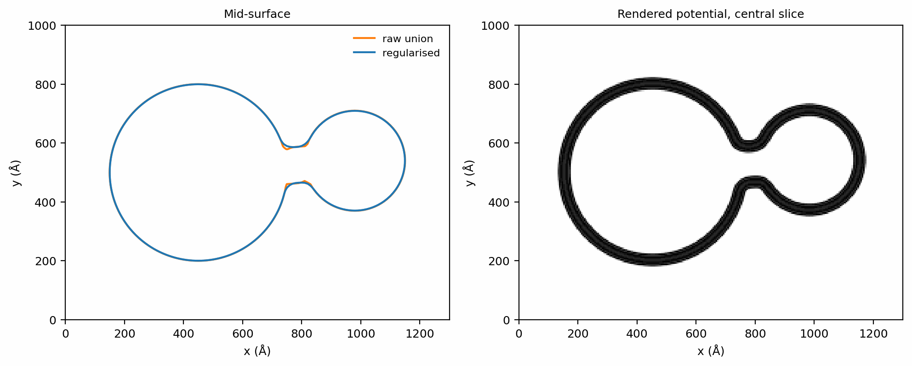

# Composing a membrane from primitives

`specialized` · membranes · runs in about 5 s on one GPU

The organelle kinds are compositions of a small set of primitives, and the
same primitives build shapes the kinds do not cover. A membrane is the
boundary of a solid, held as a signed distance \(\phi\) on a coarse grid.
This recipe composes a budding vesicle from two balls and a tube,
regularises it, and renders the bilayer around its surface.

{ width="900" style="display:block;margin:1.2em auto;" }
///caption
Left: the surface \(\phi = 0\) on the central z-plane, for the raw union and
after regularisation, which rounds the creases where the neck meets the two
balls. Right: the central slice of the potential rendered at 5 Å per voxel.
///

```python
--8<-- "docs-figures/tutorials/membrane_primitives.py:recipe"
```

```{ .text .output }
--8<-- "docs-includes/tutorials/membrane_primitives-recipe.txt"
```

The reach is the distance over which \(\phi\) stays an exact distance along
the surface normal. It has to exceed half the bilayer thickness, 18.5 Å
here, for the two leaflets to fit on both sides. The raw union fails that at
its creases; `regularise` enforces 25 Å by default and raises `ReachError`
when it cannot.

## Variations

- **Other primitives.** `ellipsoid`, `sheet`, `cap` and `half_space` are
  further solids, `subtract` carves one out of another, `undulate` adds
  random surface relief, and `nested` gives the solid a fixed distance
  inside a regularised one. [Primitives](../concepts/membrane-shape/geometry.md#primitives)
  and [Composition](../concepts/membrane-shape/geometry.md#composition)
  describe each.
- **Several membranes in one volume.** `render_bilayer` takes a list of
  regularised fields. For a multilamellar vesicle, pass
  `[smooth] + [membrane.nested(smooth, grid, 78.0 * k) for k in (1, 2, 3)]`.
  Fields regularised separately are not checked against each other, so
  keeping them more than a bilayer thickness apart is left to the recipe.
- **A different resolution.** The geometry lives on the coarse grid, so
  `voxel_size` changes only the rendering step.

## See also

- [The four organelle kinds](membrane-organelles.md): the ready-made
  compositions.
- [Geometry](../concepts/membrane-shape/geometry.md): the grid,
  regularisation, the reach check and the renderer.
