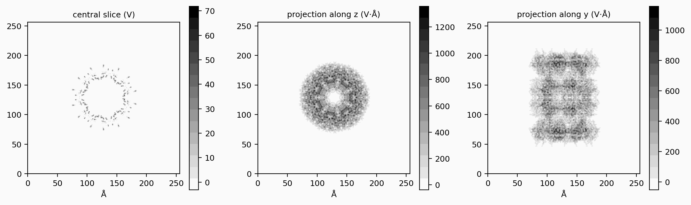

# A potential from a PDB entry

`basic` · potentials · runs in about 30 s on one GPU

`Structure.from_pdb` reads an atomic model from an accession code or a local
file, and `Structure.render` sums the atoms' potentials on a cubic grid. The
result is a `Specimen` whose `potential` is an ordinary tensor in volts,
indexed `(Z, Y, X)`, ready to be plotted, saved, or imaged.

{ width="900" style="display:block;margin:1.2em auto;" }
///caption
The potential of the 20S proteasome (PDB 6BDF; Campbell et al. 2015) at 1 Å
per voxel: its central z-slice, and its projections along z and along y.
///

```python
--8<-- "docs-figures/tutorials/pdb_potential.py:recipe"
```

```{ .text .output }
--8<-- "docs-includes/tutorials/pdb_potential-recipe.txt"
```

The model is centred in the box, and the first call downloads the entry into
SPECTER's PDB cache. The box must hold the model's largest extent, printed
above, at the chosen voxel size.

## Variations

- **Save the map.** `specter.io.write_mrc("6bdf.mrc", potential, voxel_size)`
  writes the volume with its voxel size in the header.
  `specter build potential --pdb_source 6bdf` does the whole recipe from the
  command line; see [Render a potential map](../user-guide/potential-map.md).
- **Choose the scattering factors.** `Structure.from_pdb("6bdf",
  scattering_factors="kirkland")` replaces the default, which is fitted per bonded
  species (Shtyrov et al. 2026).
  [Scattering factors](../walkthrough/potentials.md#scattering-factors)
  compares the parameterizations.
- **Read a deposited asymmetric unit.** `assembly=False` skips the biological
  assembly and renders the chains as deposited.
- **Blur by the deposited B-factors.**
  `structure.render(..., use_deposited_bfactors=True)`.

## See also

- [Structures and potentials](../walkthrough/potentials.md): voxel size,
  scattering factors and B-factors in detail.
- [Inspecting an exit wave](exit-wave.md): the next stage of the chain.
- [Atomic potentials](../concepts/atomic-potentials.md): the method.

## References

- Campbell, M. G., Veesler, D., Cheng, A., Potter, C. S., & Carragher, B.
  (2015). 2.8 Å resolution reconstruction of the *Thermoplasma acidophilum*
  20S proteasome using cryo-electron microscopy. *eLife*, 4, e06380.
  [doi:10.7554/eLife.06380](https://doi.org/10.7554/eLife.06380)
- Shtyrov, A., Wilson, H., Slowik, D., Yamashita, K., Li, J., Wojdyr, M.,
  et al. (2026). Measurement of atomic scattering factors by cryoelectron
  microscopy. *Proceedings of the National Academy of Sciences*, 123(19),
  e2528758123.
  [doi:10.1073/pnas.2528758123](https://doi.org/10.1073/pnas.2528758123)
