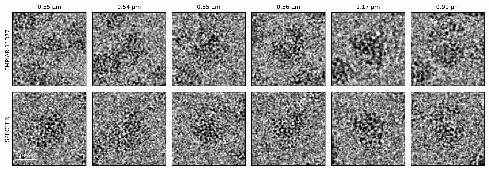
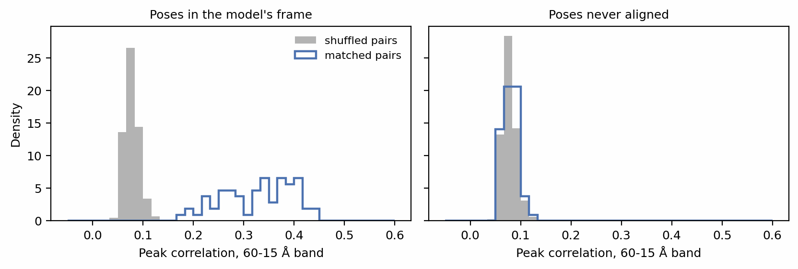
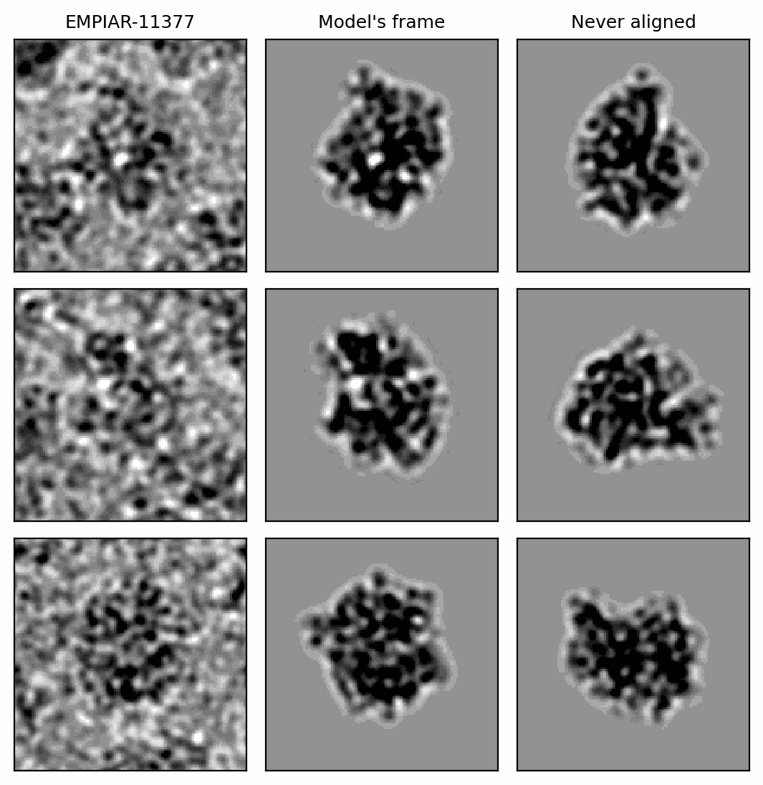
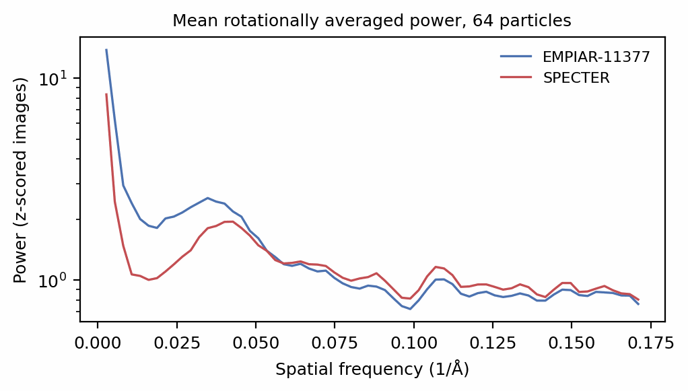

# Simulating a real dataset

A refined particle set records, for every image, the pose the particle was
seen in and the transfer function it was imaged through. Simulating the same
particles at those poses and transfer functions gives a stack that pairs with
the experimental one image by image: the same view of the same molecule at
the same defocus. That pairing is what makes a simulation comparable with
data, whether you want training data that looks like a given dataset, a
matched control for an analysis, or a test of how close the forward model
comes to a real microscope. This tutorial reads a CryoSPARC (Punjani et al.
2017) particle set, simulates its particles, checks that the poses really
describe the atomic model's views, compares the two stacks, and writes the
simulated stack back out as a RELION (Scheres 2012) file.

Before you start: this tutorial uses the objects introduced in
[Particle stacks](../walkthrough/particle-stacks.md) and
[Detection](../walkthrough/detection.md).

## The data

The example is 64 particles of [EMPIAR-11377](https://www.ebi.ac.uk/empiar/EMPIAR-11377/)
(Fromm et al. 2023; Iudin et al. 2023), a translating 70S ribosome
([PDB 8B0X](https://www.rcsb.org/structure/8B0X); Berman et al. 2000),
recorded on a Falcon 4i at 0.731 Å/px and refined in CryoSPARC. The images
and two versions of the particle metadata are in
[`docs-figures/data/`](https://github.com/joelyeois/specter/tree/main/docs-figures/data).
To keep them small, the images were Fourier-cropped from 512 px to 128 px,
and the metadata rescaled to match with `specter.match.rescale_metadata`,
which scales the pixel size and every pixel-unit shift so the file describes
the images in hand.

`extract_parameters_from_csfile` reads a CryoSPARC `.cs` file, and
`extract_parameters_from_starfile` a RELION `.star` file, into the same
tuple:

```python
--8<-- "docs-figures/tutorials/real_dataset.py:parameters"
```

```{ .text .output }
--8<-- "docs-includes/tutorials/real_dataset-parameters.txt"
```

The quaternions and shifts become a `Poses`, the transfer-function terms a
`CTF`, and `ids` numbers the rows so both stay matched to their images. The
terms are those CryoSPARC refined, including the higher-order ones (beam
tilt, trefoil, tetrafoil) it fits per exposure group, converted to the units a
`CTF` holds: defocus and Cs in ångströms, the astigmatism angle in degrees. A passthrough file
carries no image references, so the reader takes the pixel size from the
alignment and warns you to check it against the stack; here the rescaled file
and the cropped images agree at 2.924 Å.

The images themselves load in the file's row order:

```python
--8<-- "docs-figures/tutorials/real_dataset.py:images"
```

```{ .text .output }
--8<-- "docs-includes/tutorials/real_dataset-images.txt"
```

Polarity matters for every comparison below. A simulated image is in
detector counts, with the particle dark at underfocus
([Image polarity](../concepts/conventions.md#image-polarity)); a CryoSPARC
restack stores the opposite contrast and records it as `blob/sign = -1`.
`load_experimental_images` multiplies every image by its sign (taken as -1
when the file does not record one), so the two arrive in the same
convention.

## Simulating the same particles

Render the model at the dataset's own pixel size, surround it with
neighbours and ice as on any other stack, and image it at the dataset's
poses, transfer functions and anisotropic magnification:

```python
--8<-- "docs-figures/tutorials/real_dataset.py:simulate"
```

```{ .text .output }
--8<-- "docs-includes/tutorials/real_dataset-simulate.txt"
```

Two settings come from the acquisition rather than the particle file, which
records neither: the dose and the detector. `detector_pixel_size` is the
camera's own pixel. The images were recorded at 0.731 Å and binned to
2.924 Å, and the detector's MTF belongs to the recording pixel, not the
binned one ([Images resampled after recording](../concepts/detector.md#images-resampled-after-recording)).

{ width="900" style="display:block;margin:1.2em auto;" }
///caption
Six experimental particles (top) and the same particles simulated at their
refined poses and transfer functions (bottom), titled with each particle's
defocus. Every image is normalized and low-pass filtered to 12 Å for display.
///

## Checking that the poses describe the model

The pairing only holds if the poses place the *atomic model* in each
particle's view. A refinement started from an ab initio map reports poses in
that map's own orientation, which is arbitrary, and the model rendered at
those poses shows different views. Nothing in the file reveals this, and no
rotationally averaged statistic can detect it, since every view of a molecule
has the same average spectrum.

`specter.match.matched_index_correlation` tests the pairing directly. It
band-passes both stacks to 60-15 Å, takes the peak cross-correlation of each
simulated particle with its own experimental image, and compares their mean
with its distribution over 1000 random pairings of the two stacks, a
permutation test that accounts for the spread of the random pairings as well
as of the matched pairs. The two metadata files
hold the same particles with two pose sets: one from a refinement aligned to
the deposited map, and one from a refinement that never was:

```python
--8<-- "docs-figures/tutorials/real_dataset.py:pose-check"
```

```{ .text .output }
--8<-- "docs-includes/tutorials/real_dataset-pose-check.txt"
```

{ width="900" style="display:block;margin:1.2em auto;" }
///caption
Peak correlation of each simulated particle with its own experimental image
(outline) against 50 random pairings (grey). With poses in the model's frame
(left) every matched pair is separated from the shuffled ones. With poses
never aligned to the model (right) the matched pairs are indistinguishable
from random ones.
///

The check renders the particles noiselessly, without ice or neighbours,
because only the view is under test. Aligned poses score 0.328 against 0.082
for a random pairing, 55.6 standard deviations of the random pairings above
them, and a matched pair beats a mismatched one in every comparison. The
unaligned set scores 0.080 against 0.077 (z = 1.7), the level of a random
pairing, although its poses are
not wrong in themselves: they differ from the aligned set by a single
rotation of 142.3°, the same for every particle to within 0.001°. To fix such
a set, align the refined map to a map rendered from the model (CryoSPARC's
Align 3D) and re-export the particles from the aligned job.

{ width="560" style="display:block;margin:1.2em auto;" }
///caption
Three experimental particles (left) beside the model rendered at their
aligned poses (centre) and at their unaligned poses (right), all low-pass
filtered to 25 Å. These are the three particles whose aligned view correlates
best with the data. At this signal-to-noise ratio the correlation is the test,
not the eye.
///

## Comparing the stacks

With the views matched, the stacks can be compared frequency by frequency.
The rotationally averaged power of the z-scored images averages over the
particles' defoci, which range over a factor of three:

{ width="640" style="display:block;margin:1.2em auto;" }
///caption
Mean rotationally averaged power of the 64 experimental and 64 simulated
particles, each image normalized to zero mean and unit variance.
///

The simulation carries about half the experimental power below 1/50 Å⁻¹ and
three quarters of it between 50 and 20 Å, and agrees to within 10% above
1/20 Å⁻¹. Settings chosen by hand, as here, do not reproduce a dataset's
contrast. `specter match particles` takes the detector and dose from the
acquisition, derives the ice thickness and the neighbour spacing from the
data, and reports what remains per band as a matched-pose signal-to-noise
ratio; see
[Match an experimental dataset](../user-guide/dataset-twin.md).

## Writing the stack out

`create_particle_starfile` writes a stack and a RELION `.star` file that
records each particle's pose and transfer function, so the simulated stack
imports into RELION or CryoSPARC with its ground truth attached. Reading it
back returns the parameters it was simulated with:

```python
--8<-- "docs-figures/tutorials/real_dataset.py:star"
```

```{ .text .output }
--8<-- "docs-includes/tutorials/real_dataset-star.txt"
```

The same reader takes a RELION particle file, in either the single-block
layout written here or the `optics` + `particles` layout of RELION 3.1 and
later (Zivanov et al. 2020), so a RELION refinement drives a simulation exactly as a CryoSPARC one
does.

## From the command line

`specter simulate particles` takes the particle file as `cs_path` or
`star_path`, and simulates its particles at their poses and transfer
functions:

```bash
specter simulate particles \
    --pdb_source 8b0x \
    --cs_path empiar-11377-64particles-pdbframe.cs \
    --n_pixels 128 \
    --dose 40 \
    --detector_model falcon4i_300kv
```

The pixel size, voltage and amplitude contrast then come from the file, and
the dose, detector and ice from the config. `specter match particles` runs
the pose check above first, stops if it fails, and then derives the rest of
the config from the data; see
[Match an experimental dataset](../user-guide/dataset-twin.md) and
[Generate a particle stack](../user-guide/particle-stack.md#example-matching-empiar-11377).

## See also

- [Poses](../concepts/conventions.md#poses) and
  [The defocus reference plane](../concepts/conventions.md#the-defocus-reference-plane):
  the conventions a particle file is read in.
- [Images resampled after recording](../concepts/detector.md#images-resampled-after-recording):
  why the detector's pixel is set separately.
- [Image polarity](../concepts/conventions.md#image-polarity).

## References

- Berman, H. M., Westbrook, J., Feng, Z., Gilliland, G., Bhat, T. N.,
  Weissig, H., Shindyalov, I. N., & Bourne, P. E. (2000). The Protein Data
  Bank. *Nucleic Acids Research*, 28(1), 235–242.
  [doi:10.1093/nar/28.1.235](https://doi.org/10.1093/nar/28.1.235)
- Fromm, S. A., O'Connor, K. M., Purdy, M., Bhatt, P. R., Loughran, G.,
  Atkins, J. F., Jomaa, A., & Mattei, S. (2023). The translating bacterial
  ribosome at 1.55 Å resolution generated by cryo-EM imaging services.
  *Nature Communications*, 14(1), 1095.
  [doi:10.1038/s41467-023-36742-3](https://doi.org/10.1038/s41467-023-36742-3)
- Iudin, A., Korir, P. K., Somasundharam, S., Weyand, S., Cattavitello, C.,
  Fonseca, N., Salih, O., Kleywegt, G. J., & Patwardhan, A. (2023). EMPIAR:
  The Electron Microscopy Public Image Archive. *Nucleic Acids Research*,
  51(D1), D1503–D1511.
  [doi:10.1093/nar/gkac1062](https://doi.org/10.1093/nar/gkac1062)
- Punjani, A., Rubinstein, J. L., Fleet, D. J., & Brubaker, M. A. (2017).
  cryoSPARC: Algorithms for rapid unsupervised cryo-EM structure
  determination. *Nature Methods*, 14(3), 290–296.
  [doi:10.1038/nmeth.4169](https://doi.org/10.1038/nmeth.4169)
- Scheres, S. H. W. (2012). RELION: Implementation of a Bayesian approach to
  cryo-EM structure determination. *Journal of Structural Biology*, 180(3),
  519–530. [doi:10.1016/j.jsb.2012.09.006](https://doi.org/10.1016/j.jsb.2012.09.006)
- Zivanov, J., Nakane, T., & Scheres, S. H. W. (2020). Estimation of
  high-order aberrations and anisotropic magnification from cryo-EM data sets
  in *RELION*-3.1. *IUCrJ*, 7(2), 253–267.
  [doi:10.1107/S2052252520000081](https://doi.org/10.1107/S2052252520000081)
