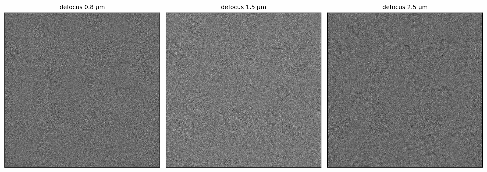

# Saving micrographs with a STAR file

`basic` · input and output · runs in about 15 s on one GPU

`Image.save` writes a stack of images as an MRC file, which records the pixel
size and nothing else about how the images were formed.
`create_micrograph_starfile` writes the RELION (Scheres 2012) `.star` file
that goes with it: one row per micrograph, holding the voltage, the pixel
size and the transfer function a downstream program needs.

{ width="900" style="display:block;margin:1.2em auto;" }
///caption
Three micrographs of one field of 20S proteasomes (Campbell et al. 2015) at
2 Å per pixel and 40 e⁻/Ų, read back from the saved stack. Each title is the
defocus read from the STAR file's row for that image.
///

```python
--8<-- "docs-figures/tutorials/save_micrographs.py:recipe"
```

```{ .text .output }
--8<-- "docs-includes/tutorials/save_micrographs-recipe.txt"
```

`rlnMicrographName` addresses each image as its one-based index in the stack,
so the `.star` and the `.mrcs` must stay in one directory under one base
name. The spherical aberration is written in millimetres and the defoci in
ångströms, as RELION expects; the `CTF` object holds all three in ångströms.
`rlnAmplitudeContrast` is the value the wave was scattered with, which is 0
unless a `Propagation` setting gives another. `specterDosePerAngstrom` is a
SPECTER column, which RELION ignores.

`read_micrograph_starfile` returns the transfer-function terms in the units
and under the keys of `CTF.params`, so a file written here, or by
`specter simulate micrograph`, can supply the `CTF` of a later simulation.

## Variations

- **Record a tilt series.** `tilt_angles=` takes one angle per image, in
  degrees, and writes it as `specterTiltAngle`.
- **Record the detector's coincidence loss.** `coincidence_radius=` takes one
  radius or one per image, in pixels, and writes it as
  `specterCoincidenceRadius`
  ([The coincidence radius of a camera](coincidence-radius.md)).
- **Save a particle stack.** `create_particle_starfile` writes the poses and
  shifts of each particle beside its transfer function
  ([A real dataset](real-dataset.md#writing-the-stack-out)).

## See also

- [Micrographs](../walkthrough/micrographs.md): fields, samples and ice
  thickness profiles.
- [Generate a micrograph](../user-guide/micrograph.md): the command that
  writes this pair of files for a whole run.
- [Conventions](../concepts/conventions.md): units and sign conventions of
  the transfer-function terms.

## References

- Campbell, M. G., Veesler, D., Cheng, A., Potter, C. S., & Carragher, B.
  (2015). 2.8 Å resolution reconstruction of the *Thermoplasma acidophilum*
  20S proteasome using cryo-electron microscopy. *eLife*, 4, e06380.
  [doi:10.7554/eLife.06380](https://doi.org/10.7554/eLife.06380)
- Scheres, S. H. W. (2012). RELION: Implementation of a Bayesian approach to
  cryo-EM structure determination. *Journal of Structural Biology*, 180(3),
  519–530.
  [doi:10.1016/j.jsb.2012.09.006](https://doi.org/10.1016/j.jsb.2012.09.006)
