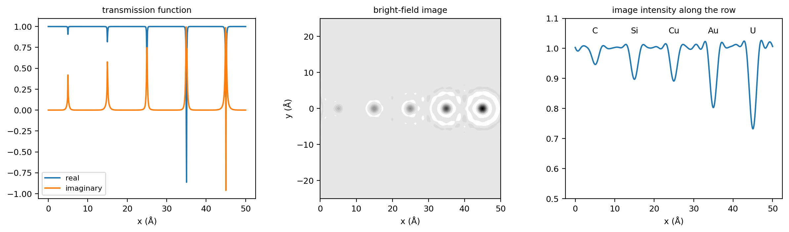

# Single atoms in bright field

`specialized` · potentials · runs in a few seconds on a CPU

The projected potential of a single atom is available as a function of
radius, without a structure file or a volume. This recipe evaluates it for
the five-element test row of Kirkland (2010, Ch. 5), carbon, silicon, copper,
gold and uranium, forms the transmission function of the row, and images it
in coherent bright field at the Scherzer condition (Scherzer 1949). It is the
calculation behind the comparison with Kirkland's figures in
[Atomic potentials](../concepts/atomic-potentials.md#worked-example-reproducing-kirklands-textbook-figures).

{ width="900" style="display:block;margin:1.2em auto;" }
///caption
Five single atoms 10 Å apart at 200 kV. Left: the real and imaginary parts of
the transmission function along the row. Centre: the coherent bright-field
image, on a grey scale from 0.72 to 1.03. Right: the image intensity along
the row. The dip at each atom deepens with atomic number.
///

```python
--8<-- "docs-figures/tutorials/single_atoms.py:recipe"
```

```{ .text .output }
--8<-- "docs-includes/tutorials/single_atoms-recipe.txt"
```

`kirkland_atomic_potential_2d` returns the projected potential in V Å at each
radius, and the interaction parameter \(\sigma\) converts it to the phase of
the transmission function \(t = e^{i\sigma V_{\mathrm{2D}}}\). The lens is
written out here as the phase \(\chi(k)\) of spherical aberration and
defocus, with an objective aperture at the Scherzer cut-off; the `Aberration`
engine applies the same phase to a wave from `scatter`
([Contrast transfer function](../walkthrough/ctf.md)).

## Variations

- **Use another parameterization.** `lobato_atomic_potential_2d`, also in
  `specter.atom`, takes the same arguments (Lobato & Van Dyck 2014).
- **Plot the potential itself.** `kirkland_atomic_potential_3d(Z, r)` returns
  the potential in volts at each distance from the nucleus.
- **Change the atoms.** `atom_number` maps any element symbol to its atomic
  number; the row can hold any elements at any positions.

## See also

- [Atomic potentials](../concepts/atomic-potentials.md): the
  parameterizations, and these results beside Kirkland's figures.
- [Potentials](../walkthrough/potentials.md): the same atomic potentials
  summed over a whole structure.
- [A potential from a PDB entry](pdb-potential.md): rendering a volume.

## References

- Kirkland, E. J. (2010). *Advanced computing in electron microscopy* (2nd
  ed.). Springer.
  [doi:10.1007/978-1-4419-6533-2](https://doi.org/10.1007/978-1-4419-6533-2)
- Lobato, I., & Van Dyck, D. (2014). An accurate parameterization for
  scattering factors, electron densities and electrostatic potentials for
  neutral atoms that obey all physical constraints. *Acta Crystallographica
  Section A: Foundations and Advances*, 70(6), 636–649.
  [doi:10.1107/S205327331401643X](https://doi.org/10.1107/S205327331401643X)
- Scherzer, O. (1949). The theoretical resolution limit of the electron
  microscope. *Journal of Applied Physics*, 20(1), 20–29.
  [doi:10.1063/1.1698233](https://doi.org/10.1063/1.1698233)
