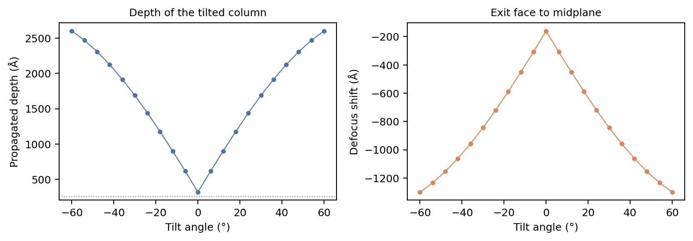
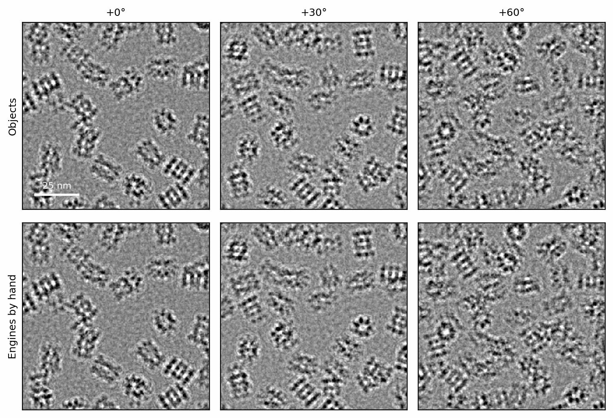

# A tilt series from the engines

`Sample.tilt_series` prepares a specimen volume for a set of tilted views, and
`TiltSeries.scatter` propagates one of them. Between the two calls the object
blends ice into the volume, sizes the volume for the tilt range, propagates
each tilt through a column whose depth depends on the angle, and refers the
defocus of each exit wave to the specimen's midplane. This tutorial makes the
same calls by hand, with the engines of
[Composing a forward model by hand](custom-forward-model.md), and shows that
the result is identical to the objects'.

The hand-built loop is the route when a tilt needs a stage of its own: a
transfer function that varies across the series, a detector model, a
measurement on the exit wave of every tilt. For everything else the objects
carry the bookkeeping this tutorial makes explicit.

Before you start: this tutorial follows
[Tilt series](../walkthrough/tilt-series.md) and
[Composing a forward model by hand](custom-forward-model.md).

## The specimen and the acquisition

A slab 256 Å thick, packed with 20S proteasomes (PDB 6BDF; Campbell et al.
2015) at 4 Å per voxel, and 21 tilts of 3 e⁻/Ų in dose-symmetric order
(Hagen et al. 2017):

```python
--8<-- "docs-figures/tutorials/tilt_series_engines.py:specimen"
```

```{ .text .output }
--8<-- "docs-includes/tutorials/tilt_series_engines-specimen.txt"
```

## The reference

The objects' route, recorded without noise so that the two can be compared
exactly:

```python
--8<-- "docs-figures/tutorials/tilt_series_engines.py:objects"
```

```{ .text .output }
--8<-- "docs-includes/tutorials/tilt_series_engines-objects.txt"
```

## Blending the ice

The ice goes into the volume first, at the volume's own extent.
`resolve_icemaker` returns the bundled library of optimised ice for the voxel
size, and `blend_ice_into_volume` tiles it over the volume and adds it to each
voxel in proportion to the room the specimen leaves there:

```python
--8<-- "docs-figures/tutorials/tilt_series_engines.py:ice"
```

```{ .text .output }
--8<-- "docs-includes/tutorials/tilt_series_engines-ice.txt"
```

Both routes draw the ice from the global random stream, which `specter.seed`
resets, so the two volumes are the same. The ice is blended into the volume
at the extent it was given, before the volume is sized for the tilt range.

## Sizing the volume for the tilt range

A tilted view samples the slab over a footprint wider than the image.
`tilt.estimate_required_extent` returns the extent a set of poses needs along
each axis:

```python
--8<-- "docs-figures/tutorials/tilt_series_engines.py:fit"
```

```{ .text .output }
--8<-- "docs-includes/tutorials/tilt_series_engines-fit.txt"
```

For a tilt of θ about x, a frame of n pixels over a slab of n<sub>z</sub>
voxels needs (n + n<sub>z</sub> sin θ) / cos θ voxels along y, and n along x.
The axis along the tilt axis is sampled as far as the propagation canvas,
which is wider than the image by the FFT margin, and each axis takes 8 voxels
of interpolation slack per side. `pad_volume_xy_for_tilt` reflect-pads an axis
that falls short. This volume was built 704 voxels wide, so nothing is padded
and no reflected material enters an image; a volume built at the image's own
width would be mirrored outwards at its edges.

## Spline coefficients

A tilted view samples its slices between the voxels of the volume. A tilt
series interpolates there with a cubic B-spline, which reads the spline's
coefficients in place of the voxel values:

```python
--8<-- "docs-figures/tutorials/tilt_series_engines.py:spline"
```

```{ .text .output }
--8<-- "docs-includes/tutorials/tilt_series_engines-spline.txt"
```

The coefficients extend past a face the specimen reaches, as the ice does in
z, and decay by 0.27 per voxel beyond it. Eight slices of vacuum above and
below hold them; without the margin each face would gain 0.2 voxels of
material. `cubic_bspline_coefficients_` then solves for the coefficients in
place. `TiltSeries(interpolation="linear")` selects trilinear sampling, which
needs neither step.

## The engines

Four engines are built once and serve every tilt:

```python
--8<-- "docs-figures/tutorials/tilt_series_engines.py:engines"
```

```{ .text .output }
--8<-- "docs-includes/tutorials/tilt_series_engines-engines.txt"
```

`IterativeScattering` is the multislice engine for a volume too large to
rotate whole: it samples the volume slice by slice along the tilted beam.
Four of its settings differ from a particle's. `interpolation = "cubic"`
reads the volume as the spline coefficients it now holds. `pad_fft=True` propagates on a
canvas 32 pixels wider than the image on each side: a uniform slab at 60°
images 16% off flat at the frame edge with no margin, and 0.3% off with this
one.
`keep_pad=True` leaves that margin on the wave through the lens, whose
delocalisation would otherwise act on a cropped edge; the detector crops it.
`roi_padding_mode="zeros"` makes everything outside the volume vacuum, which
is what lies above and below a tilted slab. The lens is therefore built on the
canvas, 320 pixels at twice the sampling, rather than on the image.

## One tilt

Each tilt is a pose, a propagation, a defocus correction, a lens and a
detector:

```python
--8<-- "docs-figures/tutorials/tilt_series_engines.py:tilt"
```

```{ .text .output }
--8<-- "docs-includes/tutorials/tilt_series_engines-tilt.txt"
```

The defocus correction is the step with no counterpart in a particle stack.
The engine propagates through the whole depth the tilted volume spans along
the beam, which `tilt.nz_tilt_for_pose` returns: 80 slices untilted, the slab
and its spline margin, and 650 at 60°, where the 704-voxel width of the slab
lies mostly along the beam. The
wave therefore leaves half that depth below the specimen's centre, while the
nominal defocus is the centre's. The shift is minus that distance, and it is
subtracted from the defocus before the lens acts
([The defocus reference plane](../concepts/conventions.md#the-defocus-reference-plane)).
Omitting it at 60° would image the specimen 1300 Å further from focus than
the transfer function says.

{ width="800" style="display:block;margin:1.2em auto;" }
///caption
Left: the depth each tilt is propagated through, with the slab's own
thickness dotted. Right: the defocus shift, minus half that depth.
///

{ width="760" style="display:block;margin:1.2em auto;" }
///caption
Expected counts at 0°, 30° and 60° from the objects (above) and from the
engines called by hand (below), low-pass filtered to 12 Å for display.
///

The 21 images agree bit for bit, because the objects make these calls in this
order.

## What the object adds

`TiltSeries` does four things this loop leaves out, each with a setting of
its own:

- **Absorption.** With `absorption_model="inelastic_mfp"` the object builds an
  imaginary potential from the dry specimen and the ice, fits it like the
  volume, and calls `IterativeScattering.multislice_absorptive` with both
  ([Inelastic scattering and energy filtering](inelastic.md)).
- **Radiation damage.** With `damaged=True` the dry specimen is kept as its
  spectrum and rendered for each tilt under the envelope of its accumulated
  exposure, before the ice is added
  ([Radiation damage and the solvent](dose-damage.md)).
- **Deformation.** A `Deformation` bends the volume as the series accumulates
  dose ([Specimen deformation](../concepts/specimen-deformation.md)).
- **Placement.** A volume that does not fit on the device stays on the host,
  and the engine fetches the block each slice needs.

A loop that needs one of them alongside a stage of its own can take the
object's exit wave, `series.scatter(i).array`, and continue by hand from the
lens.

## See also

- [Tilt series](../walkthrough/tilt-series.md): the objects' route, with noise
  and inelastic losses.
- [Composing a forward model by hand](custom-forward-model.md): the same
  engines for one particle, with a stage replaced.
- [Generate a tilt series](../user-guide/tilt-series.md): the command-line
  route.

## References

- Campbell, M. G., Veesler, D., Cheng, A., Potter, C. S., & Carragher, B.
  (2015). 2.8 Å resolution reconstruction of the *Thermoplasma acidophilum*
  20S proteasome using cryo-electron microscopy. *eLife*, 4, e06380.
  [doi:10.7554/eLife.06380](https://doi.org/10.7554/eLife.06380)
- Hagen, W. J. H., Wan, W., & Briggs, J. A. G. (2017). Implementation of a
  cryo-electron tomography tilt-scheme optimized for high resolution
  subtomogram averaging. *Journal of Structural Biology*, 197(2), 191–198.
  [doi:10.1016/j.jsb.2016.06.007](https://doi.org/10.1016/j.jsb.2016.06.007)
