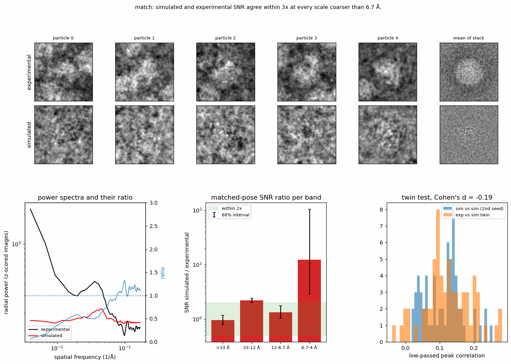

# Match an experimental dataset

`specter match particles` derives a simulation config that matches a real
particle set, and reports how close the match is. It takes the refined
particle set, its images and the atomic model, and writes a `matched.toml`
that `specter simulate particles` runs as is. The only settings it asks for
are the four an acquisition record carries and no particle file does.

## What you provide

| input | flag | where it comes from |
|---|---|---|
| refined particle set | `--metadata_path` | a CryoSPARC (Punjani et al. 2017) passthrough `.cs` or a RELION (Scheres 2012) `.star` |
| particle images | `--images_path` (optional) | the stack the metadata refers to, in its order; unset reads the paths the file itself points at |
| atomic model | `--pdb_source` | PDB accession or local file, with the assembly that matches the particle |
| detector | `--detector_model` | methods section, EMDB record; the default, `unknown`, applies no MTF, no DQE(0) and no coincidence loss, and the report says so |
| total dose per movie, e⁻/Ų | `--dose` | methods section, EMDB record, import settings |
| dose rate, e⁻/physical px/s | `--dose_rate` | methods section; unset falls back to the detector's typical rate and the report says so |
| energy filter | `--energy_filter` | methods section; recorded in the report |
| objective lens and source (optional) | `--cc`, `--energy_spread` | the microscope model: default 2.7 mm and 0.7 eV FWHM (Titan Krios, X-FEG), about 0.3 eV for a cold FEG; set the chromatic focal spread every probe carries, and are written to `matched.toml`. They apply to energy-filtered data too: the source's spread passes any zero-loss slit |
| exposure-filter weights (optional) | `--dose_weights_path`, `--dose_weights_max_frequency` | the per-frame weights the motion correction applied, e.g. CryoSPARC's `refm_empirical_dw.npy`, carried into every probe and the matched config; unset `--dose_weights_max_frequency` is derived from the motion-correction job's own files |
| absorption (optional) | `--absorption_model`, `--inelastic_mfp_solvent`, `--inelastic_mfp_specimen` | default `inelastic_mfp`, which ignores the dataset's amplitude contrast; unset mean free paths take the measured ice value for the voltage (Grimm et al. 1996; Rice et al. 2018), and give the specimen the ice's value |

The particle set must be aligned to the atomic model: its poses have to
reproduce the experimental views when the model is rendered at them. A
refinement that started from an ab initio volume is in that volume's own
orientation, not the model's. Run an Align 3D of the refined map against a
map rendered from the model, re-extract the particles from the aligned job,
and pass that particle set. The command checks this first and stops if it
fails, because nothing downstream is meaningful otherwise.

```bash
specter match particles \
    --metadata_path J205_passthrough_particles.cs \
    --images_path exp_2000.mrcs \
    --pdb_source 8b0x \
    --detector_model falcon4i_300kv \
    --dose 40 --dose_rate 4.1 --energy_filter true \
    --device cuda:0
```

## What it does

1. **Pose alignment.** A noiseless, ice-free render at the refinement's
   poses is correlated with the experimental images pair by pair and
   compared with the spread of 1000 random pairings, a permutation test.
   Pass or fail, with the fix named.
2. **Acquisition card to physics.** Detector MTF and DQE(0) by name; the
   coincidence radius from the detector's exclusion radius and hardware
   frame rate together with the dose rate, converted to the simulation's
   pixel size and frame count at constant occupancy; the radiation-damage
   envelope from the dose and voltage (Grant & Grigorieff 2015), applied to
   the specimen only. The
   solvent is decorrelated instead by beam-induced motion at a fixed
   variance of 0.38 Ų per e⁻/Ų (McMullan et al. 2015), and absorption
   comes from measured inelastic mean free paths rather than from the
   dataset's amplitude contrast. Nothing in this step is fitted.
3. **Probes.** Ice thickness and neighbour spacing are the two quantities
   the images have to supply. Each candidate is rendered at 64 particles
   and scored on the background variance outside the particle against the
   experiment. The probes and the pose check run at a box Fourier-cropped
   by two, against the images cropped the same way, since what they measure
   lies below 10 Å; the candidates render concurrently in worker
   processes.
4. **Comparison at matched poses.** Two seeds at the chosen settings, at
   the native box, against the experiment: the signal-to-noise ratio of each stack per frequency
   band, the twin test, and the screens for fixed patterns and background
   mismatch. A clearly positive residual envelope, measured on the
   particle's signal between 10 and 4 Å, is reported as a warning and is
   not written into the matched configuration.
5. **Output.** `matched.toml`, `match_report.md`, `match_report.png`, and
   with `--write_stack N` a stack of `N` particles simulated from the
   matched config.

Runtime depends on native box size, ice thickness, absorption settings and
available GPUs; the two-seed comparison at the native box is usually most
of it. The optional full stack is extra. With a material-specific
`inelastic_mfp_specimen`, multislice keeps the elastic and absorption fields
separate and assembles complex potentials a slice chunk at a time. This
avoids a full complex-volume copy without changing numerical precision.
The default uniform absorption already uses bounded chunks. See the
[production memory, timing and Fourier comparisons](../assets/match-absorption-memory/README.md)
for measured results and the remaining memory limits.
The shared dose-damage and solvent-exposure filters have a separate
[production FFT comparison](../assets/dose-damage-memory/README.md), including
the default uniform-absorption path.

## Reading the report

The report below comes from 64 particles of EMPIAR-11377 (Fromm et al.
2023; Iudin et al. 2023), Fourier-cropped
to a 128 px box at 2.924 Å. With so few particles, `--n_battery 64` keeps
the two-seed comparison within the set (its default is 200):

```bash
--8<-- "docs-includes/cli-guides/dataset_twin-command.txt"
```

```{ .text .output }
--8<-- "docs-includes/cli-guides/dataset_twin-run.txt"
```

{ width="900" style="display:block;margin:1.2em auto;" }
///caption
The report figure of the run above. The pose check passed with a matched-pair correlation of 0.327 against 0.082
for shuffled pairs. The per-band SNR ratios are 0.97, 2.21 and 1.34 from
coarse to 6.7 Å, so the verdict is a match. The 6.7-4 Å ratio of 12.34 has
a 68% interval of 2.90 to 105.84, since the experiment carries almost no
signal there. The twin test gives Cohen's d = -0.19. Ice thickness was not
resolved at 64 particles, and the report keeps the first candidate, 0 Å,
with a warning.
///

The `matched.toml` it wrote, which `specter simulate particles --config
matched.toml` runs as is:

```{ .toml .output }
--8<-- "docs-includes/cli-guides/dataset_twin-toml.txt"
```

The figure shows five experimental particles above their simulated twins
and the mean image of each stack, the overlaid radial power spectra with
their ratio, the per-band SNR ratio, and the twin-test histograms. The
table lists every derived value with its provenance: metadata, detector
table, probe, measured, or fallback.

The number to read first is the **matched-pose SNR ratio**, simulated over
experimental, per band. Near 1 in every band means the simulation carries
the experiment's signal and noise at every scale. A ratio that is flat and
modest is a contrast or dose question; a ratio that grows with frequency is
an envelope. If a broad excess remains after every derivable parameter is
set, the report says so: that residual is not a parameter of the forward
model, and no knob should be turned to hide it. Without an energy filter
some residual is expected, since the forward model removes inelastically
scattered electrons but does not add their image back.

Each ratio is reported with a 68% interval from a bootstrap over the
compared particles. The interval is wide wherever the experiment carries
little signal, which with a few hundred particles is usually the finest
band: a ratio of 454 there can have an interval of 118 to 4500. A band
coarser than 6.7 Å counts as a residual only when the lower end of its
interval exceeds 3, so a point value above 3 that the data cannot
distinguish from it does not change the verdict. A ratio of `inf` means the
experiment shows no coherent signal in that band at all.

The overlaid **power spectra** are there because they are the view most
people know, not because they decide anything. A stack can have half the
experiment's low-frequency power and still be indistinguishable in a mixed
2D classification, or twice it and separate cleanly.

## What it does not do

It does not run a classification. The report is designed to replace the
loop of simulating thousands of particles and classifying them in
CryoSPARC while parameters are being chosen; a mixed 2D classification
remains the right final validation, run once, with two seeds, reading the
count of classes near the input ratio alongside chi-squared.

A simulated stack is written as a `.mrcs` with a RELION `.star`, which
CryoSPARC imports directly. To bring the experimental refinement into the
same RELION format, for example to pool both sets through one import path,
[`specter convert cs2star`](../api/cli/convert.md) converts a CryoSPARC
particle `.cs` (joined with its passthrough file where the job splits them)
into a RELION 3.1 `.star`. It converts metadata only and leaves the image
stacks where they are; `--image-basename` writes image paths in the form
CryoSPARC's particle importer expects.

It does not fit a B-factor, a potential scale or a coincidence radius to
the classification. Each of those was, in earlier hand tuning, standing in
for something the model lacked, and the report names the lack instead.

It cannot reproduce specimen packing that is not random. A close-packed
monolayer of virus particles has neighbours at fixed angles, and the
simulator places neighbours at random; the neighbour-spacing probe will
report the mismatch it cannot close.

## Limitations

- The refinement file supplies the box and pixel size. The probes run at a
  box Fourier-cropped by `probe_bin` (default 2, capped so the probe pixel
  stays at or below 5 Å), but the final two-seed comparison simulates at
  the native box. Above about 512 px, Fourier-crop the stack first and pass
  it as `--images_path`.
- Probe simulations are dealt round-robin over the devices named by
  `device`, one worker process per device by default (`probe_workers`).
  Naming several devices (`--device 0,1,2,3`) is what shortens a run;
  extra processes on one GPU are time-sliced and gain nothing.
- Only detectors with a calibrated exclusion radius get a coincidence
  term; the others get zero and a warning. Only detectors with a bundled
  MTF get one.
- Ice thickness and neighbour spacing are chosen from the candidate lists
  in the config (`ice_candidates`, `crowd_candidates`), not fitted
  continuously. The matched config always has neighbours: every
  `crowd_candidates` entry must be a positive multiple of the structure's
  diameter (default 1.0 and 1.3). A real particle sits in crowded ice, and a
  no-neighbour candidate scored within noise of a sparse one, so the choice
  between them changed from run to run.
- The probe scores carry run-to-run noise comparable to the differences
  between candidates: on EMPIAR-11377 at the default `n_probe`, one setting
  scored 0.083 and 0.097 on two runs with the same seed and device, while
  the candidates differed by at most 0.03. Each probe therefore keeps the
  first entry of its candidate list (box-depth ice, one diameter's spacing)
  unless the best-scoring candidate beats it in 95% of bootstrap replicates
  over the probe particles. The report gives every score with its bootstrap
  error, says which way each probe went, and warns when a value is the
  fallback rather than a measurement; a larger `n_probe` narrows the noise.
- One spacing and one thickness serve the whole stack; the simulator has no
  per-micrograph variation.

## References

- Fromm, S. A., O'Connor, K. M., Purdy, M., Bhatt, P. R., Loughran, G.,
  Atkins, J. F., Jomaa, A., & Mattei, S. (2023). The translating bacterial
  ribosome at 1.55 Å resolution generated by cryo-EM imaging services.
  *Nature Communications*, 14(1), 1095.
  [doi:10.1038/s41467-023-36742-3](https://doi.org/10.1038/s41467-023-36742-3)
- Grant, T., & Grigorieff, N. (2015). Measuring the optimal exposure for
  single particle cryo-EM using a 2.6 Å reconstruction of rotavirus VP6.
  *eLife*, 4, e06980.
  [doi:10.7554/eLife.06980](https://doi.org/10.7554/eLife.06980)
- Grimm, R., Typke, D., Bärmann, M., & Baumeister, W. (1996). Determination
  of the inelastic mean free path in ice by examination of tilted vesicles
  and automated most probable loss imaging. *Ultramicroscopy*, 63(3–4),
  169–179.
  [doi:10.1016/0304-3991(96)00035-6](https://doi.org/10.1016/0304-3991(96)00035-6)
- Iudin, A., Korir, P. K., Somasundharam, S., Weyand, S., Cattavitello, C.,
  Fonseca, N., Salih, O., Kleywegt, G. J., & Patwardhan, A. (2023). EMPIAR:
  The Electron Microscopy Public Image Archive. *Nucleic Acids Research*,
  51(D1), D1503–D1511.
  [doi:10.1093/nar/gkac1062](https://doi.org/10.1093/nar/gkac1062)
- McMullan, G., Vinothkumar, K. R., & Henderson, R. (2015). Thon rings from
  amorphous ice and implications of beam-induced Brownian motion in single
  particle electron cryo-microscopy. *Ultramicroscopy*, 158, 26–32.
  [doi:10.1016/j.ultramic.2015.05.017](https://doi.org/10.1016/j.ultramic.2015.05.017)
- Punjani, A., Rubinstein, J. L., Fleet, D. J., & Brubaker, M. A. (2017).
  cryoSPARC: Algorithms for rapid unsupervised cryo-EM structure
  determination. *Nature Methods*, 14(3), 290–296.
  [doi:10.1038/nmeth.4169](https://doi.org/10.1038/nmeth.4169)
- Rice, W. J., Cheng, A., Noble, A. J., Eng, E. T., Kim, L. Y., Carragher,
  B., & Potter, C. S. (2018). Routine determination of ice thickness for
  cryo-EM grids. *Journal of Structural Biology*, 204(1), 38–44.
  [doi:10.1016/j.jsb.2018.06.007](https://doi.org/10.1016/j.jsb.2018.06.007)
- Scheres, S. H. W. (2012). RELION: Implementation of a Bayesian approach to
  cryo-EM structure determination. *Journal of Structural Biology*, 180(3),
  519–530.
  [doi:10.1016/j.jsb.2012.09.006](https://doi.org/10.1016/j.jsb.2012.09.006)
