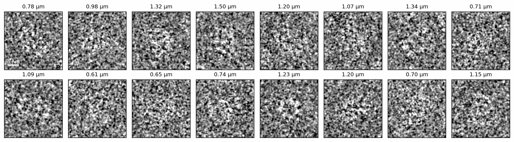
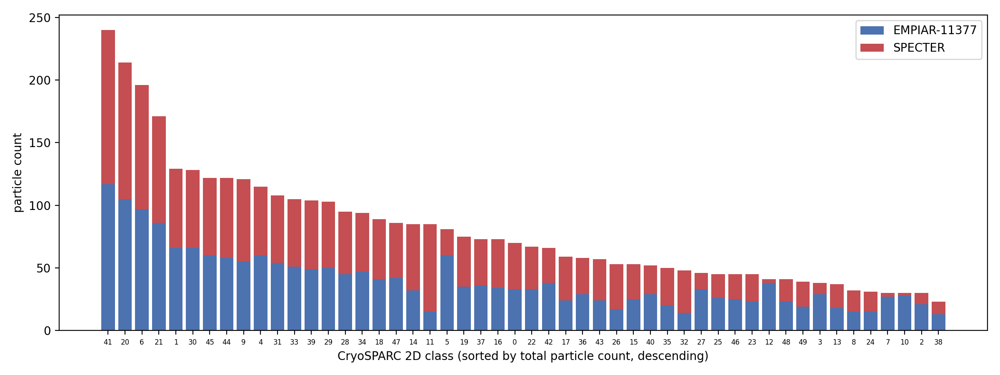

# Generate a particle stack

`specter simulate particles` builds a physics-based cryo-EM particle stack
from a single PDB/mmCIF structure: it samples a scattering potential,
applies pose/CTF/dose sampling, propagates through the forward model
(multislice by default), and writes a `.mrcs` +
[RELION](https://relion.readthedocs.io/) (Scheres 2012) `.star` file pair.
It's the fastest way to get simulated data out of SPECTER.

## Basic usage

Every run loads a TOML config first, then applies any flags given on the
command line as overrides:

```bash
specter simulate particles --config configs/particle.toml
```

```bash
specter simulate particles \
    --config configs/particle.toml \
    --pdb_source 6bdf \
    --n_particles 200 \
    --device cuda:0 \
    --output_dir particles
```

`configs/particle.toml` is the canonical starting point. Copy it and edit
for your own runs. See [Configure a run](configuration.md) for the full
TOML/CLI field reference.

The second command, at 16 particles and with a fixed seed, writes the stack
below:

```bash
--8<-- "docs-includes/cli-guides/particle_stack-command.txt"
```

```{ .text .output }
--8<-- "docs-includes/cli-guides/particle_stack-run.txt"
```

{ width="900" style="display:block;margin:1.2em auto;" }
///caption
The 16 particles the command wrote, each titled with its own defocus, drawn
from the config's 0.5-1.5 µm range. Each particle sits in box-depth ice among
copies of itself, and the stack is normalized with inverted contrast, so the
particle is light. At the config's 20 e⁻/Ų the particle is barely visible
in a single image; each is low-pass filtered to 15 Å for display.
///

## What you'll usually tune

- **Data source**: `cs_path` or `star_path`, to take poses and per-particle
  CTF from an existing CryoSPARC (Punjani et al. 2017) or RELION dataset
  instead of synthesizing them. Leave both unset for a synthetic stack.
- **Specimen**: `pdb_source` (fetched and cached under
  `~/.cache/specter/pdb/`), `assembly` (biological assembly vs. asymmetric unit),
  `n_pixels`/`pixel_size` for the simulation box, `ice_thickness`.
  `ice_thickness` sets the depth of the ice column and so the contrast; it
  does not change the specimen. Crowding neighbours are placed within
  `crowd_max_distance_z` of the particle, which defaults to the template's
  own depth rather than the full box depth, so thicker ice adds water above
  and below the neighbour slab instead of more neighbours.
- **Microscope**: `voltage`, `dose`, `cs`, `alpha` (amplitude contrast).
- **Sampling**: `defocus`, `shift` (max in-plane shift), `n_particles`.
- **Models**: `scattering_model` (`multislice` is the accurate default;
  `firstborn`/`projection` trade accuracy for speed), `noise_model`,
  `detector_model` (`none` skips detector effects; `k3_300kv`/`k3_200kv`/
  `k2_300kv`/`falcon4i_*`/`falcon3ec_300kv` apply a real detector's MTF/noise).
- **Post-processing**: `normalize_particles`, and `save_exitwaves` /
  `save_clean_exitwaves` if you want the pre-detector signal too (see
  below).

Everything else (ice model, crowding, aberration richness, potential
building method, and so on) lives under
["Advanced"](../api/cli/simulate.md#specter-simulate-particles-advanced) in both the
TOML and the command reference; [Configure a run](configuration.md)
documents it field-by-field.

## Per-particle sampling ranges

`dose`, `defocus`, `coincidence_radius`, `astigmatism`,
`astigmatism_angle`, `phaseshift`, the beam tilts `tiltx`/`tilty`, and the
higher-order aberrations `trefoil1`/`trefoil2` and
`tetrafoil1`-`tetrafoil4` each take either a single number (constant for
every particle) or a `[low, high]` pair, sampled uniformly per particle:

```toml
[sampling]
defocus = [5000.0, 15000.0]   # Å, sampled per particle
```

```toml
[microscope]
dose = 20.0               # e⁻/Ų, constant for every particle
```

On the command line the same fields take a comma-separated string, since a
flag can only carry one token: `--defocus 5000,15000`. That spelling still
works in a TOML file too, so configs written before the numeric form keep
working.

## Absorption, radiation damage and solvent motion

The CLI's Absorption panel, together with two exposure fields, controls how
the simulation removes electrons from the image and how it treats the
specimen and the solvent under the electron dose. Every field is off by
default, and the defaults reproduce the amplitude-contrast model.

- **Absorption**: `absorption_model` selects where the imaginary potential
  comes from. The default, `"alpha"`, scales the real potential by the
  amplitude-contrast ratio `alpha`. `"inelastic_mfp"` instead derives it per
  material from a measured inelastic mean free path: `inelastic_mfp_solvent`
  for the ice (unset takes the measured value for the run's voltage, 3950 Å
  at 300 kV (Rice et al. 2018) and 2030 Å at 120 kV (Grimm et al. 1996), and
  an estimate with a warning elsewhere)
  and `inelastic_mfp_specimen` for the particle (unset gives the particle
  the ice's value, so it carries no absorption contrast; 2460 Å is the
  derived value for protein at 300 kV). `alpha` is then set to 0, including
  the value read from a `.cs`/`.star` file and the one written to the output
  `.star`. `objective_aperture` (semi-angle in mrad, unset by default)
  additionally charges the elastic scattering beyond the aperture as
  absorption, and requires `absorption_model = "inelastic_mfp"`.
  `"inelastic_mfp"` is not available with `scattering_model = "ctf"`. See
  [Scattering](../concepts/scattering/index.md#mean-free-path-absorption-support).
- **Dose weighting**: `dose_weights_path` points at a `(n_frames, n_bins)`
  `.npy` of an exposure filter's per-frame weights, such as CryoSPARC's
  `refm_empirical_dw.npy`, and requires `n_frames`. The frames are then
  summed in Fourier space under those weights rather than equally, which
  leaves the signal unchanged and raises the noise floor toward Nyquist as a
  signal-preserving dose weighting does in real data.
  `dose_weights_max_frequency` is the frequency, in 1/Å, of the last weight
  bin; unset derives it from the motion-correction job's own files, since
  the pixel size alone does not determine it.
- **Radiation damage**: with `dose_envelope = true`, the Grant & Grigorieff
  (2015) envelope acts on the transfer function by default
  (`dose_envelope_target = "transfer_function"`), which fades the solvent
  together with the particle. `dose_envelope_target = "specimen"` instead
  damages the particle's own potential, and those of its crowding
  neighbours, before the ice is added, so the water keeps its structure.
  The occupancy that decides how much ice each voxel receives is read from
  the undamaged particle. See [Aberrations](../concepts/aberrations.md#envelopes).
- **Solvent motion**: `ice_motion_variance` is the beam-induced displacement
  of the water per axis, in Ų per e⁻/Ų (McMullan et al. 2015 measured
  0.38 at 300 kV). The ice fluctuation is filtered to what survives the
  summed exposure, frame weights included, and its mean is kept. Unset, the
  ice is frozen. One filter serves the whole ice canvas, so the dose must be
  a single value rather than a range. With `dose_envelope` on it requires
  `dose_envelope_target = "specimen"`, since an envelope on the transfer
  function would fade the solvent a second time. See
  [Ice structure](../concepts/ice.md#the-solvent-under-exposure).

Specimen damage and solvent exposure filter the complete 3D field. Large
fields use bounded FFT and weighting batches to limit GPU scratch while
keeping the same resolution, dose and frame count. See the
[production timing, memory and Fourier comparison](../assets/dose-damage-memory/README.md)
for measured savings and the remaining memory limits.

## Output: .mrcs + .star

Results land in `output_dir` as `<filename>.mrcs` (the image stack) and
`<filename>.star` (a RELION-format star file with one row per particle):
pose (`rlnAngleRot`/`rlnAngleTilt`/`rlnAnglePsi`, `rlnOrigin{X,Y}Angst`),
CTF (`rlnVoltage`, `rlnSphericalAberration`, `rlnAmplitudeContrast`,
`rlnDefocus{U,V}`, `rlnDefocusAngle`, `rlnPhaseShift`), plus SPECTER-specific
physics parameters not covered by the RELION spec
(`specterDosePerAngstrom`, `specterCoincidenceRadius`). Import the `.star` file directly into RELION, or
read it with [`starfile`](https://github.com/teamtomo/starfile) /
[`mrcfile`](https://github.com/ccpem/mrcfile) from Python. The first rows of
the `.star` file the run above wrote:

```{ .text .output }
--8<-- "docs-includes/cli-guides/particle_stack-star.txt"
```

Output batches are copied into preallocated host stacks, and per-particle
normalization runs in bounded chunks using the same background mask and
statistics. This reduces host RAM for large stacks without changing batch
size or simulation precision. Multi-GPU generation runs each device's range
of particle indices in its own worker process and reassembles one shard at a
time in particle order.
See the [production comparison](../assets/particle-output-memory/README.md)
for GPU/host memory, timings, and matched image/Fourier checks.

## Example: matching EMPIAR-11377

As a check against real data, the command below drives
`specter simulate particles` from a real [CryoSPARC](https://cryosparc.com/)
`.cs` file instead of randomly sampled poses. `cs_path` reads pixel size,
voltage, alpha, pose, and CTF straight from the `.cs` file, matching a real
experimental dataset particle for particle:

```bash
specter simulate particles \
    --pdb_source 8b0x \
    --cs_path docs-figures/data/empiar-11377-64particles-pdbframe.cs \
    --n_pixels 128 \
    --dose 40 \
    --detector_model falcon4i_300kv \
    --device cuda:0
```

Pass `--star_path particles.star` instead of `--cs_path` to drive the same
code path from a RELION `.star` file: SPECTER reads both the single-block
layout it writes itself and the RELION 3.1+ two-block (`optics` +
`particles`) layout (Zivanov et al. 2020). The two flags are mutually exclusive.

`docs-figures/data/empiar-11377-64particles-pdbframe.cs` holds 64 particles
of a refinement of [EMPIAR-11377](https://www.ebi.ac.uk/empiar/EMPIAR-11377/)
(Iudin et al. 2023), a translating 70S ribosome dataset (PDB
[8b0x](https://www.rcsb.org/structure/8B0X); Berman et al. 2000; Fromm et
al. 2023), with their poses in the frame of the atomic model and rescaled to
128 px. The
poses must be in the model's frame: a refinement whose map was never aligned
to the model gives every particle the wrong view, which no statistic over the
whole stack reveals. The matching real images are in
`docs-figures/data/empiar-11377-64particles-128px.mrcs`, and
[Simulating a real dataset](../tutorials/real-dataset.md) simulates them at
their refined poses and transfer functions and compares the two:

{ width="900" style="display:block;margin:1.2em auto;" }
///caption
Six experimental particles (top) and the same particles simulated at their
refined poses and transfer functions (bottom), low-pass filtered to 12 Å for
display.
///

That is a qualitative check on a handful of particles. The stronger, quantitative check
comes from CryoSPARC itself. Pool 2000 real EMPIAR-11377 particles with 2000
SPECTER particles (same `pdb_source`/physics parameters, generated in bulk
offline) into one stack, then run that stack through a single CryoSPARC 2D
Classification job. If the simulated particles are physically realistic,
CryoSPARC should sort them into the same classes as the real particles
they're mixed with, in roughly the same proportion per class. That's what
happens across nearly all 50 classes:

{ width="900" style="display:block;margin:1.2em auto;" }
///caption
Per-class particle counts from a CryoSPARC 2D Classification job run on a pooled real+simulated EMPIAR-11377 stack, split by source.
///

This second figure isn't reproducible from the repo alone: it requires
running CryoSPARC. But `docs-figures/data/empiar-11377-mixed-2dclasses.csv`
holds the per-particle class assignments behind it, committed to the repo.
[`docs-figures/particle_stack_empiar_11377.py`](https://github.com/joelyeois/specter/blob/main/docs-figures/particle_stack_empiar_11377.py)
regenerates both figures. To derive a simulation config for a full
experimental particle set rather than the 5-row demo slice, see [Match an
experimental dataset](dataset-twin.md).

## Inspecting the forward model (exit waves)

Set `save_exitwaves = true` to also write the exit wave of the full
specimen, the complex wave leaving the volume before the transfer function
and the detector are applied. Set `save_clean_exitwaves = true` to write the
exit wave of the specimen alone: the particle and its crowding neighbours
without ice, without absorption, and without radiation damage, which serves
as the reference those effects are measured against. Each complex wave is
written as a magnitude/phase pair of stacks alongside the usual output:

- `<filename>_exitwave_magnitude.mrcs` and `<filename>_exitwave_phase.mrcs`
- `<filename>_clean_exitwave_magnitude.mrcs` and
  `<filename>_clean_exitwave_phase.mrcs`

These are useful for debugging the forward model, or for comparing signal
before the aberration and detector stages, without re-running the whole
pipeline.

## Batch size

`batchsize` is how many particles go through the forward model at once. It
affects speed and peak memory only, never the images. The default is:

```toml
[compute]
batchsize = "auto"
```

which takes the smaller of two bounds. The first is what fits: the memory
free on `device` at run time, against the FFT-padded volume the box size
implies (a 256-pixel box with `pad_fft = true` holds 512×512×256 volumes, not
256³). The second is what is worth batching. Batching amortises the fixed cost
of a forward pass, but only until a single pass already saturates the device;
beyond that point a larger batch consumes memory in proportion to its size
without reducing the time per particle.

The box size decides which bound binds. At a 256-pixel box one particle covers
67 million padded voxels and saturates a current GPU on its own, so `"auto"`
resolves to 2. At a 64-pixel box a particle covers 1 million, and batching is
worth roughly a factor of two. The CLI prints the chosen value at the start of
generation:

```
batchsize='auto' -> 2 particle(s) per pass (~3.2 GiB estimated peak, 42.5 GiB free on cuda:0)
```

The estimated peak there is a small fraction of what is free, which is the
saturation bound binding rather than the memory one: the run is not short of
memory, a larger batch would not go faster.

Set an integer instead to pin it, worth doing when benchmarking, when
sharing a GPU with a job that will grow after SPECTER has taken its reading,
or on CPU under a Slurm `--mem` limit (the CPU reading is the host's, not the
cgroup's). The estimate stays deliberately conservative; `specter.memory`
documents both bounds along with their measured basis.

## Multi-GPU

The default is `device = "cuda"`, which uses the GPU when there is one and
falls back to the CPU, with a warning, when there is not. An explicit index
names particular hardware: `"cuda:0"` or `"0,1"` fails rather than running
somewhere else.

`device` accepts a comma-separated list of GPU indices (e.g. `"0,1,2,3"`) to
split particle generation across multiple GPUs; a single index (`"cuda:0"`)
or `"cpu"` runs on one device. The stack is cut into one contiguous range of
particle indices per device, and each range runs in its own spawned worker
process, which writes `particle_shard_<k>.pt`; the shards are then read back
and joined in particle order. Every particle draws from its own seed, so a
seeded stack is the same on any number of devices. With
`batchsize = "auto"`, every worker uses the same batch size, sized to
whichever GPU in the pool has the least free memory.

## Using it from Python instead of the CLI

`run_particle_stack(config)` (`specter.pipelines`) is the same function the
CLI calls. Build a `ParticleStackConfig` directly in Python (or load one
with `specter.config.load_config`) instead of going through the command
line. For composing the forward model's individual modules by hand (e.g. to
swap in a custom aberration model), see
[`demo-notebooks/create_particle_stack_modular/`](https://github.com/joelyeois/specter/tree/main/demo-notebooks/create_particle_stack_modular).
For the plain end-to-end notebook version of this page, see
[`demo-notebooks/create_particle_stack/`](https://github.com/joelyeois/specter/tree/main/demo-notebooks/create_particle_stack).

## See also

- [Match an experimental dataset](dataset-twin.md): deriving a simulation
  config from a real particle set, the full `.cs`-driven workflow this
  page's example is a slice of.
- [Using the ice cache](ice-cache.md): `ice_model` options and `IceBank`.
- [Configure a run](configuration.md): complete TOML/CLI field reference.
- [Manage jobs](jobs.md): recording runs under a project name.
- [Pipeline overview](../concepts/pipeline-overview.md): how this fits
  into the rest of the forward model.

## References

- Berman, H. M., Westbrook, J., Feng, Z., Gilliland, G., Bhat, T. N.,
  Weissig, H., Shindyalov, I. N., & Bourne, P. E. (2000). The Protein Data
  Bank. *Nucleic Acids Research*, 28(1), 235–242.
  [doi:10.1093/nar/28.1.235](https://doi.org/10.1093/nar/28.1.235)
- Fromm, S. A., O'Connor, K. M., Purdy, M., Bhatt, P. R., Loughran, G.,
  Atkins, J. F., Jomaa, A., & Mattei, S. (2023). The translating bacterial
  ribosome at 1.55 Å resolution generated by cryo-EM imaging services.
  *Nature Communications*, 14(1), 1095.
  [doi:10.1038/s41467-023-36742-3](https://doi.org/10.1038/s41467-023-36742-3)
- Grant, T., & Grigorieff, N. (2015). Measuring the optimal exposure for
  single particle cryo-EM using a 2.6 Å reconstruction of rotavirus VP6.
  *eLife*, 4, e06980.
  [doi:10.7554/eLife.06980](https://doi.org/10.7554/eLife.06980)
- Grimm, R., Typke, D., Bärmann, M., & Baumeister, W. (1996). Determination
  of the inelastic mean free path in ice by examination of tilted vesicles and
  automated most probable loss imaging. *Ultramicroscopy*, 63(3–4), 169–179.
  [doi:10.1016/0304-3991(96)00035-6](https://doi.org/10.1016/0304-3991(96)00035-6)
- Iudin, A., Korir, P. K., Somasundharam, S., Weyand, S., Cattavitello, C.,
  Fonseca, N., Salih, O., Kleywegt, G. J., & Patwardhan, A. (2023). EMPIAR:
  The Electron Microscopy Public Image Archive. *Nucleic Acids Research*,
  51(D1), D1503–D1511.
  [doi:10.1093/nar/gkac1062](https://doi.org/10.1093/nar/gkac1062)
- McMullan, G., Vinothkumar, K. R., & Henderson, R. (2015). Thon rings from
  amorphous ice and implications of beam-induced Brownian motion in single
  particle electron cryo-microscopy. *Ultramicroscopy*, 158, 26–32.
  [doi:10.1016/j.ultramic.2015.05.017](https://doi.org/10.1016/j.ultramic.2015.05.017)
- Punjani, A., Rubinstein, J. L., Fleet, D. J., & Brubaker, M. A. (2017).
  cryoSPARC: Algorithms for rapid unsupervised cryo-EM structure
  determination. *Nature Methods*, 14(3), 290–296.
  [doi:10.1038/nmeth.4169](https://doi.org/10.1038/nmeth.4169)
- Rice, W. J., Cheng, A., Noble, A. J., Eng, E. T., Kim, L. Y., Carragher, B.,
  & Potter, C. S. (2018). Routine determination of ice thickness for cryo-EM
  grids. *Journal of Structural Biology*, 204(1), 38–44.
  [doi:10.1016/j.jsb.2018.06.007](https://doi.org/10.1016/j.jsb.2018.06.007)
- Scheres, S. H. W. (2012). RELION: Implementation of a Bayesian approach to
  cryo-EM structure determination. *Journal of Structural Biology*, 180(3),
  519–530.
  [doi:10.1016/j.jsb.2012.09.006](https://doi.org/10.1016/j.jsb.2012.09.006)
- Zivanov, J., Nakane, T., & Scheres, S. H. W. (2020). Estimation of
  high-order aberrations and anisotropic magnification from cryo-EM data sets
  in *RELION*-3.1. *IUCrJ*, 7(2), 253–267.
  [doi:10.1107/S2052252520000081](https://doi.org/10.1107/S2052252520000081)
