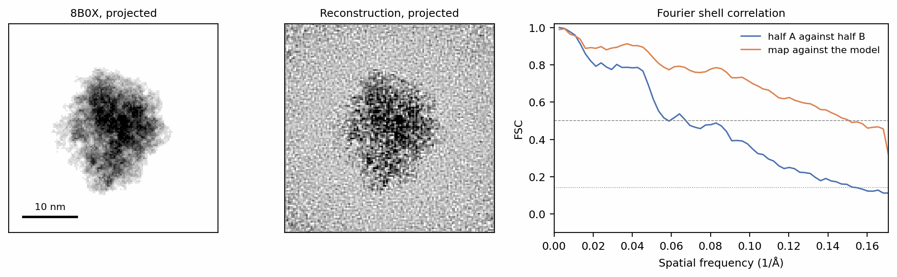

# Reconstruct a volume

Ghostbuster is the inverse of the forward simulator: it refines a 3D
scattering potential (and, optionally, per-particle rotations, translations,
and defocus) so that the same forward model `specter simulate particles`
uses reproduces a stack of experimental images. The forward pipeline goes
coordinates &rarr; images; `specter reconstruct particle` goes the other
way, images &rarr; volume. See [Pipeline overview](../concepts/pipeline-overview.md)
and [Forward simulation](../concepts/forward-simulation.md) for the model it
fits against.

`specter reconstruct particle` is also reachable as `specter ghostbuster
particle`: the two names run the same command, so it answers to whichever
one you or the docs use.

This covers single-particle reconstruction. Cryo-ET tilt-series
reconstruction (`TomogramGhostbuster`/`TomogramReconstructor`) exists in the
Python API and mirrors the same `run`/`test_run` pattern, but is not yet
wired into the CLI as `specter reconstruct tomogram`.

## Basic usage

Every run loads a TOML config first, then applies any flags you pass on the
command line as overrides:

```bash
specter reconstruct particle --config configs/reconstruct.toml
```

`configs/reconstruct.toml` has no runnable default: unlike the simulator
configs, its `[data]` section must name a real CryoSPARC (Punjani et al.
2017) dataset. Copy it and fill in the two paths reconstruction reads from:

```toml
[data]
cs_file = "path/to/particles.cs"
mrc_file = "path/to/particles.mrcs"
dose_per_angstrom = 40.0
```

`cs_file` supplies poses, CTF parameters, and per-particle scale; `mrc_file`
is the particle stack it pairs with. `dose_per_angstrom` sets the Poisson
statistics that weight the loss, so match it to the dataset's real fluence,
not a placeholder. Reconstruction currently reads CryoSPARC `.cs` only:
there is no RELION `.star` equivalent yet, unlike the [CryoSPARC dataset
twin](dataset-twin.md) path on the forward side (see [Generate a particle
stack](particle-stack.md#example-matching-empiar-11377) for a worked
`.cs`-driven example).

The forward model predicts electron counts per pixel, so the stack is
brought into those units before the fit. `image_units` states what the
stack holds. The default, `"normalized"`, is a CryoSPARC or RELION stack:
zero mean and unit variance. Each image is first brought to the polarity
the detector recorded by its `blob/sign` (-1, inverted contrast, when the
`.cs` file does not record one), then mapped to counts as `sqrt(N) * x + N`, where `N` is `dose_per_angstrom` times the
pixel area. `"counts"` is a stack already in electrons per pixel, such as
one written by `specter simulate particles` with
`normalize_particles = false`, and is used unchanged. The units are never
inferred from the image statistics, because a stack's mean and variance do
not identify its units reliably.

### Pairing rows to images

Row *i* of the `.cs` file is slice *i* of the stack. That is the contract,
and it is the one that survives a dataset being copied between machines,
where a CryoSPARC project's own layout does not.

CryoSPARC does not write its stacks that way. It records where each row's
image really is in two columns, `blob/path` and `blob/idx`, and a Restack
Particles job writes its output in the order it reads its inputs rather than
in the order of the rows it emits, leaving `blob/idx` a permutation. Reading
such a stack by row pairs every pose with a different particle's image. The
failure is silent: the images are real particles, the poses are real poses,
the loss falls, every per-image and rotationally averaged diagnostic looks
healthy, and the map is wrong.

So the contract is checked rather than assumed. When the `.cs` file carries
`blob/idx`, or a sibling `.cs` of the same particle group does, and it says
the stack is not in row order, the run is refused:

```
particles.cs says its images are not in row order: row 0 is slice 370 of
batch_0_restacked.mrc, not slice 0.
```

When there is nothing to check against, which is the ordinary state of a
passthrough file separated from its siblings, row order is still the
contract; it simply cannot be verified.

Two ways past a refusal. Put the dataset into row order once, with
`specter.io.write_row_ordered_csfile`:

```python
from specter.io import write_row_ordered_csfile

write_row_ordered_csfile("J398/J398_passthrough_particles.cs", "j398.cs")
```

That **reorders the rows**, not the images: the stack stays where CryoSPARC
wrote it, and `j398.cs` comes out sorted into its slice order, with each pose
carried onto its own particle's row and `blob/idx` equal to the row number. On
a 1000-particle set that is a 628 KB file written in under a second, against
774 MB to rewrite the stack. It also merges the poses and the image addresses
into one file, which a CryoSPARC particle group keeps separate.

Reordering rows needs them to account for every slice of one stack, since row
*i* can only be slice *i* if slice *i* belongs to the set at all. Passing
`stack_out` writes a new stack in the metadata's row order instead, which
handles a subset or several source stacks and produces a pair that reads on a
machine the CryoSPARC project is not on:

```python
write_row_ordered_csfile(
    "J398/J398_passthrough_particles.cs", "j398.cs", stack_out="j398.mrcs"
)
```

Either form has to run where `blob/path` still resolves and every `.cs` of the
particle group is present. Or skip it and read the CryoSPARC stack in place,
unchanged:

```bash
specter reconstruct particle ... --address_by_blob_idx true
```

Before committing to a full run, exercise every code path on a fraction of
the cost:

```bash
specter reconstruct particle --config configs/reconstruct.toml --test_run true
```

`--test_run` fits one epoch on `--bin_factor`-binned images (default 8) and
stops. It touches every `.cs` field, every physics setting, and the output
layout a full run would, so a config mistake surfaces in seconds instead of
after a multi-hour job. The
[command reference](../api/cli/reconstruct.md#specter-reconstruct-particle) documents
every field.

## The gold-standard workflow

`--halfset gold` is the default, not `--halfset all`. A bare `specter
reconstruct particle` run splits the particle stack into two halves, A and
B, reconstructs each independently, and computes the FSC (Harauz & van Heel
1986) between the two resulting half-maps. This is the same
independent-validation idea CryoSPARC and RELION use to report resolution
without a model bias (Henderson et al. 2012; Scheres & Chen 2012).
`--halfset all` reconstructs every particle into a single volume, ignoring
the split; `--halfset A` or `--halfset B` reconstructs one half alone, useful
for a quick look at a single volume before committing to a paired run.

The two halves run as separate worker processes: in parallel across
devices when `--device` names at least two, sequentially on one device
otherwise. Only the first two devices are ever used, since there are only
two halves to run.

### The converged solve

A gold-standard run has two stages. The first fits each half with Adam for
`--epochs` passes over its particles, as described above. The second,
selected by `--solver converged` (the default), solves each half to the
minimum of the same image loss plus a Wiener prior:

$$
\frac{1}{2}\sum_i \lVert y_i - p_i(V) \rVert^2
+ \frac{1}{2}\sum_k \lambda(k)\,\lvert \hat V(k) \rvert^2,
\qquad
\lambda(k) = \frac{\bar W(k)}{\mathrm{SSNR}(k)},
$$

where $p_i$ is the forward model's prediction of image $i$, $\bar W(k)$ the
curvature of the data term averaged over a Fourier shell, and
$\mathrm{SSNR}(k) = \mathrm{FSC}(k) / (1 - \mathrm{FSC}(k))$ the
signal-to-noise ratio of one half-map, computed from the FSC averaged over
five shells and made non-increasing with resolution. Where the FSC hovers
near zero, its shell-to-shell noise would otherwise change $\lambda$ by an
order of magnitude between neighbouring shells. This is the prior RELION places on a
reconstruction (Scheres 2012). The FSC comes from the two Adam
half-maps after a mask: `--fsc_mask` when it is a map on the reconstruction's
grid (a mask on any other grid is not used, with a warning, outside
`--test_run`), otherwise an auto-tightened mask, written to `mask_auto.mrc`, built
the way CryoSPARC's
[resolution mask](https://guide.cryosparc.com/processing-data/tutorials-and-case-studies/tutorial-dynamic-masking-in-refinements-v5.0)
is described. The mean of the halves, weighted by their FSC inside a soft
sphere, is thresholded at half its maximum; the mask is 1 within $2r$ of
that region and falls along a cosine to 0 at $5r$. The length $r$ starts at
the soft-sphere FSC = 0.143 resolution and decreases in steps of 0.125 Å,
and the mask kept is the tightest whose FSC crosses 0.143 within two Fourier
shells of its noise-substituted FSC (Chen et al. 2013), the FSC of the
halves with their phases randomised beyond FSC = 0.8, which measures the
correlation a mask introduces by itself. On CryoSPARC's half-maps of
EMPIAR-13202, 10551 and 12391 this mask agrees with the one CryoSPARC wrote
to within 4% in volume, and the SSNR the two masks give differs by less than
1% at the median. Each half is then minimised by preconditioned
nonlinear conjugate gradients from its Adam map: every iteration sums the
gradient over all of the half's particles, the step length comes from that
gradient's slope along the search direction and the loss's curvature along
it, measured on a random 5% of particles, and the preconditioner is
$1 / (\bar W(k) + \lambda(k))$. Symmetry enters as part of the model: the
solver varies a map $U$ and predicts the images of its point-group average
$S(U)$, so it never assumes that averaging an averaged map leaves it
unchanged, which for I1 holds only inside the inscribed sphere.

Adam on mini-batches stops at a level set by its learning rate and batch
size, and a map fitted without a prior over-fits the frequencies the data do
not determine. The minimiser of the regularised loss is instead a
Wiener-filtered map. Multiplying it by $1 + 1/\mathrm{SSNR}(k)$ undoes the
filter and gives the unfiltered half-map, which is what an FSC and later
sharpening expect. `--solver_iterations` (default 4) sets the number of
iterations. On EMPIAR-13202 at 100 kV (125,000 particles per half, a
300-voxel box) four iterations from five Adam epochs reached the same map as
sixteen iterations, to $1 - \mathrm{FSC} \le 3 \times 10^{-6}$ in every band.
An iteration costs about one Adam epoch. `--solver adam` keeps the Adam maps
as the result.

### Sharing a reference between halves

`--fsc_ref` and `--cryosparc_ref` log a map-to-model FSC against a known
reference on every epoch, for reporting only. The reconstruction never
optimises against it. `--cryosparc_ref` accepts a comma-separated
`"<A>,<B>"` pair as well as a single path. The pair matters for a
gold-standard run: it reconstructs both halves from one config, so without
the pair both halves would be plotted against the same CryoSPARC half-map,
silently mislabelling one of the two overlays. A single path works for
`--halfset A`/`B`/`all`, where you compare only one half (or the whole
stack).

### Outputs

A gold-standard run writes, into its job directory:

- `volume_A.mrc` / `volume_B.mrc`: the two half-map reconstructions. With
  the converged solve these are the unfiltered half-maps.
- `volume_A_filtered.mrc` / `volume_B_filtered.mrc`: the minimisers of the
  regularised loss, which are Wiener-filtered.
- `volume_A_adam.mrc` / `volume_B_adam.mrc`: the Adam stage's half-maps.
- `fsc_gold_standard_adam.png`: the half-map FSC of the Adam stage.
- `mask_auto.mrc`: the mask the SSNR was measured in, when `--fsc_mask` did
  not supply one.
- `epochs/<NNN>_A.mrc` / `epochs/<NNN>_B.mrc`: per-epoch snapshots of each
  half.
- `epochs/volume_<NNN>_A.png` / `epochs/volume_<NNN>_B.png`: a preview
  figure of each half's volume at every epoch, for checking progress without
  opening the `.mrc` files.
- `fsc_gold_standard.png`: the final half-map FSC, written once both
  halves finish, with the masked FSC drawn as well when there is a mask:
  the one the prior used, or `--fsc_mask` on the reconstruction's grid when
  `--solver adam`. `job.json` records both crossings
  (`resolution_gold_standard` and `resolution_gold_standard_masked`) and
  which mask (`resolution_gold_standard_mask`).
- `epochs/fsc_halfmap_<NNN>.png`: the half-map FSC recomputed after
  *every* epoch, not once at the end. Whichever worker finishes an epoch
  second finds its sibling's volume already on disk and computes the pair;
  the one that finishes first has nothing to compare against yet and skips.
- `epochs/fsc_<NNN>_A.png` / `epochs/fsc_<NNN>_B.png`: per-epoch
  map-to-model FSC against `--fsc_ref`, if you passed one.

The run below reconstructs data whose answer is known.
`docs-figures/cli_guides/reconstruction.py` writes a 1000-row `.cs` from the
64-particle EMPIAR-11377 (Fromm et al. 2023) refinement in
`docs-figures/data/`, with random poses, defoci between 1 and 2 µm and the
rows assigned alternately to halves A and B. `specter simulate particles` images 8B0X at those poses, and the
shipped config reconstructs both halves from the stack, with the rendered
model as `--fsc_ref`:

```bash
--8<-- "docs-includes/cli-guides/reconstruction-simulate.txt"
```

```bash
--8<-- "docs-includes/cli-guides/reconstruction-command.txt"
```

```{ .text .output }
--8<-- "docs-includes/cli-guides/reconstruction-run.txt"
--8<-- "docs-includes/cli-guides/reconstruction-result.txt"
```

{ width="900" style="display:block;margin:1.2em auto;" }
///caption
The model the stack was simulated from and the average of the two
half-maps, each projected along z, with the FSC curves up to the 5.85 Å
Nyquist frequency. After five epochs on 500 particles per half, the
half-maps correlate to 0.143 (Rosenthal & Henderson 2003) at 6.6 Å, the
`resolution_gold_standard` that `job.json` records, and the average of the
halves correlates with the model to 0.5 at 6.6 Å.
///

Reconstruction records four resolution numbers per epoch in `job.json`:
map-to-model and half-map, each masked and unmasked. Map-to-model needs
`--fsc_ref` to exist at all; the masked entries additionally need
`--fsc_mask`, and skip if a `--test_run`'s binning leaves the mask's shape
mismatched against the volume. Each of the four degrades independently
rather than failing the run: a config with no reference map has no
map-to-model entries; it doesn't crash the run. The masked
numbers come from a separate computation, not read off the figures: the
plotting helpers always report the *unmasked* crossing even when the curve
they draw is masked.

### Reconstructing halves separately

The two halves don't have to run in the same process invocation. Passing
the same `--job_id` across two separate calls, `--halfset A` first, then
`--halfset B`, reconstructs them independently into the same job
directory. This is useful for running each half on a different machine or
at a different time:

```bash
specter reconstruct particle --config configs/reconstruct.toml \
    --halfset A --job_id J004
specter reconstruct particle --config configs/reconstruct.toml \
    --halfset B --job_id J004
```

The second call's `job.json` update folds in what the first call already
recorded rather than overwriting it, so `results` ends up with the same
shape (`{"A": ..., "B": ..., "epochs": [...]}`) it would have from a single
`--halfset gold` run.

## Job tracking

`specter jobs` tracks every reconstruction run the same way it tracks
every other `specter` pipeline. See [Manage jobs](jobs.md) for the
directory layout, `job.json` contents, and the `specter jobs`
list/show/diff CLI. `--project` and `--job_id` behave as documented there.

## Compute

`--device` accepts `cpu`, `cuda`, `cuda:N`, a bare GPU index, or a
comma-separated list (`0,1`), which trains across them via Lightning DDP,
all-reducing gradients every step. For a gold-standard run, a
comma-separated list instead splits the two halves across devices (see
above) rather than sharding one half's batches across them. A
multi-GPU device string with `--halfset A`, `B` or `all` requires an
explicit `--job_id`: DDP re-runs the pipeline once per rank, and
auto-numbering needs a single process to choose the job directory. A
`gold` run does not need one, since its orchestrator opens the job once
before spawning the halves. `--precision`
controls Lightning's training precision (`16-mixed` by default, forced to
`32` on CPU); `--num_workers` sets dataloader worker processes. It defaults
to `0`: the particle images are already resident in memory, so workers add
process startup and interprocess transfers to each batch. You can still
set it explicitly for a workload where workers help.

Normalized particle stacks are converted to counts in bounded blocks,
reusing their private storage. The conversion arithmetic and training
precision are unchanged. See the [GPU comparison report](../assets/reconstruction-input-memory/report.md)
for complete five-epoch timings, host/GPU memory measurements and Fourier/FSC
comparisons at 256- and 512-pixel input sizes. The memory saving is on the host;
whole-command speed gains depend on the workload.

## Pose application

`--rotate_mode surface` computes each particle's exit wave from the
unrotated volume's transform, sampled on the posed Ewald surface with a
non-uniform FFT, instead of rotating the volume with trilinear interpolation
(`real`, the default, or `fourier`). It removes the interpolation error from
the forward model and is faster per particle, for the `projection`,
`firstborn`, `rytov` and `ctf` scattering models. It does not refine
rotations, so it cannot be combined with `--lr_R`. See
[Sampling the Ewald surface](../concepts/conventions.md#sampling-the-ewald-surface).

## Symmetry

`--symmetry` enforces a point-group symmetry (e.g. `C3`, `D7`, `I1`) on the
volume every epoch. Omit it for C1 (no symmetry). The default
`--symmetry_mode exact` averages the group through the volume's own transform
at rotated frequencies, computed with a non-uniform FFT (Barnett et al. 2019;
Shih et al. 2021), so no interpolation attenuates the map. `real` and
`fourier` rotate the volume with trilinear interpolation instead, which loses
amplitude on every epoch; see
[Conventions](../concepts/conventions.md#applying-a-pose-real-space-or-fourier-space)
for the measured loss. `--symmetry_batchsize` lowers the memory of those two
modes on a large box. An I1 average of a 560³ map takes about 30 s and 5 GiB
on a GPU with `exact`.

## Starting volume

A reconstruction starts from zeros unless `--init_volume` names a map (.mrc,
in volts) on the reconstruction's grid or an integer multiple of it; a finer
map is block-averaged down, which is what `--test_run` binning requires.
`--init_lowpass` filters the starting map to a given resolution in Å first.
Both halves of a gold-standard run start from the same map, so it should
carry no detail finer than the resolution the halves are meant to establish
independently; a 15 Å low-pass is a common choice.

A start matters most for strongly scattering specimens. With a peak projected
phase of several radians the loss has wrapped-phase local minima, and a
reconstruction from zeros can settle in one: in simulation, a specimen with a
peak phase near 17 rad reached FSC = 0.5 at 6.4 Å from zeros and 1.3 Å from
its own map low-passed to 15 Å. Protein specimens, with peak phases near
1 rad, converge from zeros.

## Ewald-sphere curvature sign

`--ews_curvature_sign` selects the sign of the Ewald-sphere curvature. Which
sign describes a dataset is a property of the instrument's image geometry,
not of the software that produced the particle file, so a new dataset should
be reconstructed with both. The wrong sign costs resolution wherever the
curvature matters, which for a particle of diameter D at wavelength λ is
below about √(2λD): on datasets measured during development the incorrect
sign cost 0.17 to 0.43 Å, and fell behind a projection reconstruction that
ignores curvature altogether. A simulated stack and its reconstruction must
use the same sign.

## Limitations

The converged solve holds poses, shifts and defocus fixed. A run that sets
`--lr_R`, `--lr_T` or `--lr_D` therefore keeps the Adam result and skips
the solve, with a warning. The solve also runs only for `--halfset gold`,
since its prior needs both halves; `--halfset A`, `B` and `all` stop after
the Adam stage. Each half runs on one device.

The prior depends on the Adam half-maps' FSC, so it depends on the mask that
FSC is measured in. Scaling every $\lambda(k)$ by a factor between 0.3 and 3
(RELION's regularisation parameter $T$) left the half-map FSC, the
map-to-model FSC and the cross-half FSC of the result unchanged on
EMPIAR-13202.

Pose, translation, and defocus refinement (`--lr_R`/`--lr_T`/`--lr_D`) are
validated against ground truth only with the map held fixed (no `--lr`).
Under that condition each group, and all three together, recover simulated
particles' true rotations, shifts and defocus from errors of 3°, 2 Å and
300 Å, to within 0.05°, 0.02 Å and 2 Å on noiseless images; with Poisson
noise they settle where refinement started from the truth also settles,
the noise-limited optimum (0.14°, 0.07 Å and 3 Å for 16 particles of 6BDF
[Campbell et al. 2015] at 4 Å and 50 e⁻/Ų). `--lr_D` refines one defocus
offset that every particle shares. Refinement alongside the map, where a rotation or shift of
the map can trade against the poses, is not validated: treat a run that
sets `--lr` together with any of these as an experiment, not a validated
result.

## References

- Barnett, A. H., Magland, J., & af Klinteberg, L. (2019). A parallel
  nonuniform fast Fourier transform library based on an "exponential of
  semicircle" kernel. *SIAM Journal on Scientific Computing*, 41(5),
  C479–C504.
  [doi:10.1137/18M120885X](https://doi.org/10.1137/18M120885X)
- Campbell, M. G., Veesler, D., Cheng, A., Potter, C. S., & Carragher, B.
  (2015). 2.8 Å resolution reconstruction of the *Thermoplasma acidophilum*
  20S proteasome using cryo-electron microscopy. *eLife*, 4, e06380.
  [doi:10.7554/eLife.06380](https://doi.org/10.7554/eLife.06380)
- Chen, S., McMullan, G., Faruqi, A. R., Murshudov, G. N., Short, J. M.,
  Scheres, S. H. W., & Henderson, R. (2013). High-resolution noise
  substitution to measure overfitting and validate resolution in 3D structure
  determination by single particle electron cryomicroscopy.
  *Ultramicroscopy*, 135, 24–35.
  [doi:10.1016/j.ultramic.2013.06.004](https://doi.org/10.1016/j.ultramic.2013.06.004)
- Fromm, S. A., O'Connor, K. M., Purdy, M., Bhatt, P. R., Loughran, G.,
  Atkins, J. F., Jomaa, A., & Mattei, S. (2023). The translating bacterial
  ribosome at 1.55 Å resolution generated by cryo-EM imaging services.
  *Nature Communications*, 14(1), 1095.
  [doi:10.1038/s41467-023-36742-3](https://doi.org/10.1038/s41467-023-36742-3)
- Harauz, G., & van Heel, M. (1986). Exact filters for general geometry three
  dimensional reconstruction. *Optik*, 73, 146–156.
- Henderson, R., Sali, A., Baker, M. L., Carragher, B., Devkota, B., Downing,
  K. H., et al. (2012). Outcome of the first electron microscopy validation
  task force meeting. *Structure*, 20(2), 205–214.
  [doi:10.1016/j.str.2011.12.014](https://doi.org/10.1016/j.str.2011.12.014)
- Punjani, A., Rubinstein, J. L., Fleet, D. J., & Brubaker, M. A. (2017).
  cryoSPARC: Algorithms for rapid unsupervised cryo-EM structure
  determination. *Nature Methods*, 14(3), 290–296.
  [doi:10.1038/nmeth.4169](https://doi.org/10.1038/nmeth.4169)
- Rosenthal, P. B., & Henderson, R. (2003). Optimal determination of particle
  orientation, absolute hand, and contrast loss in single-particle electron
  cryomicroscopy. *Journal of Molecular Biology*, 333(4), 721–745.
  [doi:10.1016/j.jmb.2003.07.013](https://doi.org/10.1016/j.jmb.2003.07.013)
- Scheres, S. H. W. (2012). RELION: Implementation of a Bayesian approach
  to cryo-EM structure determination. *Journal of Structural Biology*,
  180(3), 519–530.
  [doi:10.1016/j.jsb.2012.09.006](https://doi.org/10.1016/j.jsb.2012.09.006)
- Scheres, S. H. W., & Chen, S. (2012). Prevention of overfitting in cryo-EM
  structure determination. *Nature Methods*, 9(9), 853–854.
  [doi:10.1038/nmeth.2115](https://doi.org/10.1038/nmeth.2115)
- Shih, Y.-h., Wright, G., Andén, J., Blaschke, J., & Barnett, A. H. (2021).
  cuFINUFFT: A load-balanced GPU library for general-purpose nonuniform FFTs.
  In *2021 IEEE International Parallel and Distributed Processing Symposium
  Workshops (IPDPSW)* (pp. 688–697). IEEE.
  [doi:10.1109/IPDPSW52791.2021.00105](https://doi.org/10.1109/IPDPSW52791.2021.00105)
