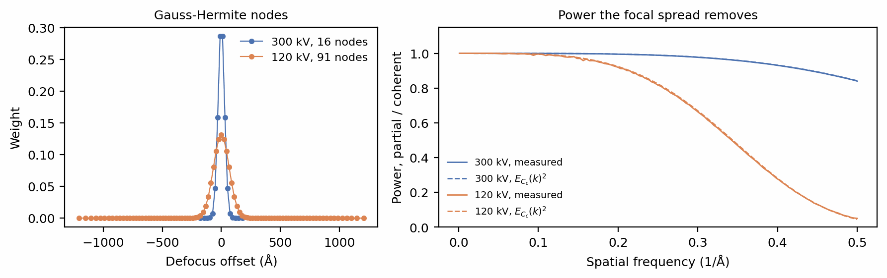
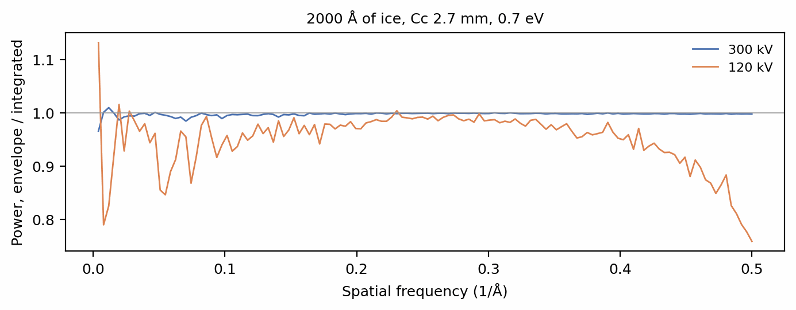
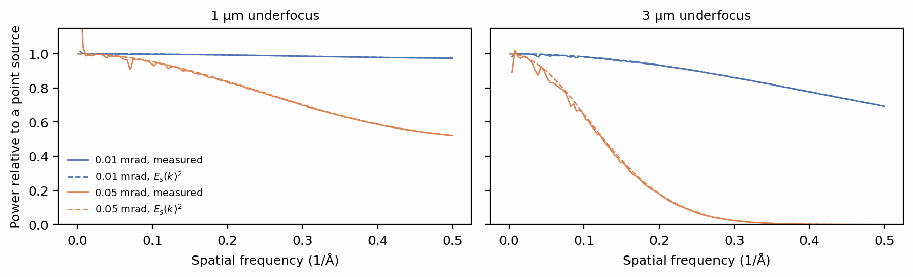

# Partial coherence

[Contrast transfer function](ctf.md) imaged every particle with a perfectly
coherent beam, in which every electron has the same energy and arrives from
the same direction. A real source has neither property. Its electrons are
spread in energy, and through the lens's chromatic aberration \(C_c\) each
energy is focused at a slightly different defocus: this is *temporal*
coherence. The source also has a finite size, so electrons arrive over a
small cone of angles: this is *spatial* coherence. Both blur the fine
detail of the image, and both grow worse at high spatial frequency. This page
shows how SPECTER models each, and how large the effects are.

## Setup

One particle in a box of ice at 1 µm underfocus, as on the previous page:

```python
--8<-- "docs-figures/walkthrough/coherence.py:setup"
```

## The focal spread

An energy spread \(\sigma_E\) about the beam energy \(U\), together with
fluctuations of the high tension and the lens current, spreads the defocus
(Hanszen & Trepte 1971) by a standard deviation

\[
\sigma_f = C_c\sqrt{\left(\frac{\sigma_E}{U}\right)^2
+ \left(\frac{\Delta V}{V}\right)^2 + \left(\frac{2\,\Delta I}{I}\right)^2 }.
\]

Each energy forms its own image, and the detector records their sum.
`ExitWave.intensity` forms that sum explicitly, as a weighted set of images at
defocus offsets \(\delta_i\) drawn from a Gauss-Hermite quadrature of the
Gaussian focal spread:

\[
I(\mathbf{r}) = \sum_i w_i\,\big|\,\psi(\mathbf{r}) \ast h_{\delta_i}(\mathbf{r})\big|^2 ,
\]

where \(h_{\delta}\) propagates the wave by an extra defocus \(\delta\).
`cc` takes the chromatic aberration in millimetres and `energy_spread` the
source's FWHM in eV. Both have defaults (2.7 mm and 0.7 eV), so
`intensity()` with no arguments already includes the focal spread;
`cc=None` or `cc=0` switches it off:

```python
--8<-- "docs-figures/walkthrough/coherence.py:focal-spread"
```

```{ .text .output }
--8<-- "docs-includes/walkthrough/coherence-focal-spread.txt"
```

The mean intensity is unchanged, because a sum of images at different defocus
conserves electrons. The contrast falls slightly, and the loss is
concentrated at high frequency.

## How many defocus samples

The quadrature needs enough nodes to integrate the fastest phase any pair of
frequencies on the grid can accumulate across the focal spread,
\(\pi\lambda\sigma_f k^2\) at the grid's largest \(k\). `FocalSpread` picks
the smallest rule that reaches a fixed accuracy:

```python
--8<-- "docs-figures/walkthrough/coherence.py:quadrature"
```

```{ .text .output }
--8<-- "docs-includes/walkthrough/coherence-quadrature.txt"
```

{ width="900" style="display:block;margin:1.2em auto;" }
///caption
Left: the defocus offsets and weights of the quadrature at 300 kV (16 nodes)
and 120 kV (91 nodes). Right: the image's power with the focal spread
relative to the coherent image (solid), against \(E_{C_c}(k)^2\), the square
of the envelope introduced below (dashed). Without the focal spread, the image
carries 1.16 times the power in the shell from 0.45 to 0.5 Å⁻¹ at 300 kV, and
12.2 times at 120 kV.
///

A 120 kV beam has a longer wavelength and a lower energy, so the same 0.7 eV
spread is a larger fraction of it. Its focal spread is 2.5 times wider than at
300 kV, it needs 91 nodes rather than 16, and it removes more than half of the
image power beyond 0.35 Å⁻¹ (2.9 Å). Each node costs one inverse FFT of the wave, which is small
against the two FFTs per slice of the multislice that produced the wave.

An energy filter does not remove this spread. A source's 0.3 to 0.7 eV lies
inside any zero-loss slit, and the filter removes inelastically scattered
electrons, a different population; see
[Temporal coherence is integrated, not enveloped](../concepts/aberrations.md#temporal-coherence-is-integrated-not-enveloped).

## Integrated or enveloped

The usual shortcut multiplies the wave by the Gaussian average of the defocus
phase (Wade & Frank 1977),

\[
E_{C_c}(k) = \exp\!\left[-\tfrac{1}{2}\left(\pi\lambda\sigma_f k^2\right)^2\right],
\]

and forms a single image. The envelope is exact for the part of the image
that is linear in the scattered wave, which dominates for a thin specimen,
and that is why the measured ratio above follows \(E_{C_c}^2\). It is not
exact for the part that is quadratic: two scattered beams interfere into
intensity at their difference frequency, and the focal spread damps that term
by how far apart the two beams' defocus phases are, not by the product of
their envelopes (Ishizuka 1980). The quadratic part grows with the amount of material the
beam crosses. `temporal_coherence="envelope"` selects the shortcut, which you
can compare against the sum in 2000 Å of ice:

```python
--8<-- "docs-figures/walkthrough/coherence.py:envelope"
```

```{ .text .output }
--8<-- "docs-includes/walkthrough/coherence-envelope.txt"
```

{ width="800" style="display:block;margin:1.2em auto;" }
///caption
Image power under the envelope relative to the integrated image, per
frequency shell, for a particle in 2000 Å of ice. At 300 kV the shells lie
between 0.966 and 1.010 of the integrated image, and the power below 10 Å is
0.42% lower. At 120 kV they range from 0.76 to 1.13, and the power below
10 Å is 4.8% lower.
///

The envelope also loses electrons: its mean intensity is 0.37% low at
300 kV and 5.2% low at 120 kV, because the intensity it removes from the
scattered beams is not redistributed anywhere. The integrated sum is the
default for this reason. The linear `ctf` scattering model has no quadratic
part, so for it the envelope is exact and always used.

## Spatial coherence

Illumination arriving over a cone of semi-angle \(\alpha\) shifts each
frequency's wave aberration by an amount proportional to its gradient, and
averaging over the cone damps the transfer function (Frank 1973) by

\[
E_s(k) = \exp\!\left[-\left(\frac{\pi\alpha}{\lambda}\right)^2
\left(C_s\lambda^3k^3 - \lambda\,\Delta f\,k\right)^2\right].
\]

`apply_ctf(convergence_angle=...)` applies it, with \(\alpha\) in
milliradians as the 1/e half-angle of the source's angular distribution. It
is off by default (`None`):

```python
--8<-- "docs-figures/walkthrough/coherence.py:spatial"
```

{ width="900" style="display:block;margin:1.2em auto;" }
///caption
Image power with an illumination cone of 0.01 and 0.05 mrad, relative to a
point source, at 1 µm (left) and 3 µm (right) underfocus, against
\(E_s(k)^2\) (dashed). In the shell from 0.45 to 0.5 Å⁻¹, 0.01 mrad keeps
97.5% of the power at 1 µm and 71% at 3 µm; 0.05 mrad keeps 53% at 1 µm and
none at 3 µm.
///

Because the defocus term \(\lambda\Delta f k\) dominates the gradient of
\(\chi\), the spatial envelope tightens with defocus: the same cone costs far
more at 3 µm than at 1 µm. A more parallel beam (smaller \(\alpha\)) or less
defocus keeps the high frequencies.

## In reconstruction

The focal spread and the illumination cone belong to the forward model only.
`Reconstructor` forms its images with `intensity(cc=None)` and no spatial
envelope: an experimental dataset does not determine these instrument
properties, and the information they removed is absorbed into the
reconstructed map rather than restored by assuming values for them. See
[Reconstruction](reconstruction.md).

## Next

[Detection](detection.md) turns the intensity into the electron counts a
camera records, with dose, shot noise and the detector's own response.

## References

- Frank, J. (1973). The envelope of electron microscopic transfer functions
  for partially coherent illumination. *Optik*, 38, 519–536. Reprinted in
  J. Frank, *Single-particle cryo-electron microscopy* (pp. 51–68), World
  Scientific, 2018.
  [doi:10.1142/9789813234864_0003](https://doi.org/10.1142/9789813234864_0003)
- Hanszen, K. J., & Trepte, L. (1971). Der Einfluß von Strom- und
  Spannungsschwankungen sowie der Energiebreite der Strahlelektronen auf
  Kontrastübertragung und Auflösung des Elektronenmikroskopes. *Optik*, 32,
  519–538.
- Ishizuka, K. (1980). Contrast transfer of crystal images in TEM.
  *Ultramicroscopy*, 5(1–3), 55–65.
  [doi:10.1016/0304-3991(80)90011-X](https://doi.org/10.1016/0304-3991(80)90011-X)
- Wade, R. H., & Frank, J. (1977). Electron microscope transfer functions
  for partially coherent axial illumination and chromatic defocus spread.
  *Optik*, 49, 81–92.
