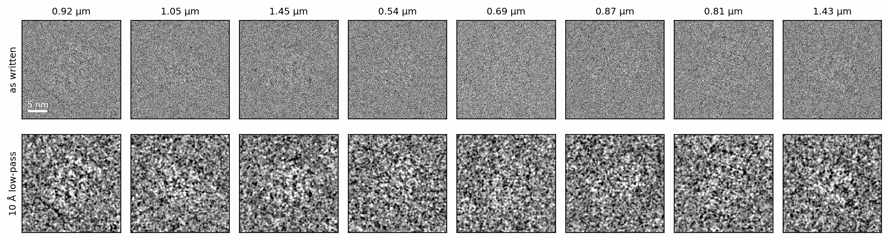
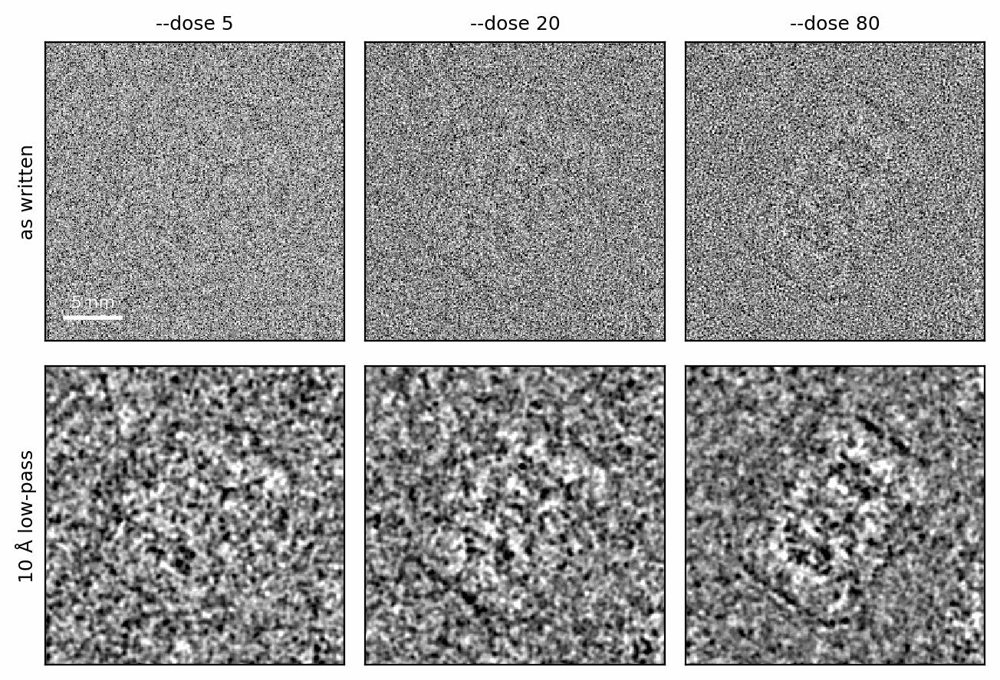

# From Python to the command line

The walkthrough built images one verb at a time, which is the right way to
see what each stage does. A production run wants something else: thousands of
images, batched to fit the GPU, spread over several GPUs, written to files
that RELION (Scheres 2012) and CryoSPARC (Punjani et al. 2017) read, and
recorded so it can be repeated. The `specter` command does that. Each of its
simulate commands loads a TOML config, builds the same `specter.imaging`
objects this walkthrough used, and writes the result to disk.

## A first run

`specter simulate particles` needs only the structure. Every other setting
has a default:

```bash
--8<-- "docs-includes/walkthrough/command_line-command.txt"
```

```{ .text .output }
--8<-- "docs-includes/walkthrough/command_line-run.txt"
```

The run writes an image stack and a RELION star file with one row per
particle, into `particles/` under the current directory:

```python
--8<-- "docs-figures/walkthrough/command_line.py:read"
```

```{ .text .output }
--8<-- "docs-includes/walkthrough/command_line-read.txt"
```

The star file records each particle's pose (`rlnAngleRot`, `rlnAngleTilt`,
`rlnAnglePsi`, `rlnOriginXAngst`, `rlnOriginYAngst`) and transfer function
(`rlnDefocusU`, `rlnDefocusV`, `rlnDefocusAngle`, `rlnPhaseShift`, voltage,
\(C_s\) and amplitude contrast), plus the SPECTER-specific dose and
coincidence radius. It imports into RELION as it is;
[Output: .mrcs + .star](../user-guide/particle-stack.md#output-mrcs-star)
lists every column.

{ width="900" style="display:block;margin:1.2em auto;" }
///caption
The eight particles the command wrote, titled with their defocus. The top
row is the stack as written, normalized to zero mean and unit standard
deviation per particle with the contrast inverted, as RELION and CryoSPARC
expect. The bottom row is low-pass filtered to 10 Å for display only.
///

The command's defaults are a realistic single-particle experiment rather than
the bare chain this walkthrough started from: the particle sits in
box-depth amorphous ice, surrounded by neighbouring copies of itself, and is
imaged at 20 e⁻/Ų with shot noise. [Defaults that differ](#defaults-that-differ)
lists every place where the command and the Python objects start from
different values.

## Configs and overrides

Once a run has more than a few settings, keep them in a TOML file and pass it
with `--config`:

```bash
specter simulate particles --config particle.toml
```

SPECTER loads the config first and then applies any flag given alongside it,
each flag overriding one field. A flag you do not pass never replaces a
value from the file. The example configs are not installed with the
package; they live in the repository, one per command, at
[`configs/`](https://github.com/joelyeois/specter/tree/main/configs):

```bash
curl -O https://raw.githubusercontent.com/joelyeois/specter/main/configs/particle.toml
```

Keep a config in step with the installed version. A field that does not
exist is rejected by name rather than ignored, so a config written for
another release fails at load time instead of running with a setting
silently dropped.

Overrides make parameter sweeps a shell loop. The same seed draws the same
poses and defocus values, so each run below images the same eight particles
and only the dose changes:

```bash
--8<-- "docs-includes/walkthrough/command_line-sweep.txt"
```

{ width="700" style="display:block;margin:1.2em auto;" }
///caption
The same particle, with the same pose, defocus and neighbours, at 5, 20 and
80 e⁻/Ų. Only the dose differs between the three runs. The bottom row is
low-pass filtered to 10 Å for display.
///

A field that samples a value per particle, such as `dose` or `defocus`,
takes a single number or a `[low, high]` range in TOML. On the command line
the range is one comma-separated token, `--defocus 5000,15000`, since a flag
carries a single value. The tables in a config (`[specimen]`,
`[microscope]`, ...) group fields for reading only; the loader flattens them,
so a field works under any table. [Configure a run](../user-guide/configuration.md)
covers both layers in detail.

## How the verbs map to fields

Each argument this walkthrough passed to a verb is a field of
`ParticleStackConfig`, spelled the same way as a TOML key and as a flag
(`pixel_size` and `--pixel_size`). The table gives the table each field sits
under in `configs/particle.toml`.

| Python | Config field | Table |
|---|---|---|
| `Structure.from_pdb("6bdf", assembly=True)` | `pdb_source`, `assembly` | `[specimen]` |
| `Structure.from_pdb(..., scattering_factors=)` | `scattering_factors` | `[advanced]` |
| `.render(voxel_size=1.0, box=256)` | `pixel_size`, `n_pixels` | `[specimen]` |
| `.render(method=, use_deposited_bfactors=)` | `potential_method`, `use_deposited_bfactors` | `[advanced]` |
| `.crowd(min_distance=)` | `crowd_min_distance` | `[advanced]` |
| `.solvate(model=, thickness=)` | `ice_model`, `ice_thickness` | `[advanced]`, `[specimen]` |
| `Poses.random(n, shift=)` | `n_particles`, `shift` | `[sampling]` |
| `.scatter(voltage=)` | `voltage` | `[microscope]` |
| `.scatter(scattering_model=, alpha=)` | `scattering_model`, `alpha` | `[models]`, `[microscope]` |
| `.scatter(oversample=, pad_fft=)` | `oversample`, `pad_fft` | `[advanced]` |
| `CTF.sample(n, defocus=, cs=)` | `defocus`, `cs` | `[sampling]`, `[microscope]` |
| `CTF.sample(..., astigmatism=, astigmatism_angle=)` | `astigmatism`, `astigmatism_angle` | `[advanced]` |
| `CTF.sample(..., phase_shift=)` | `phaseshift` (radians, not degrees) | `[advanced]` |
| `.apply_ctf(bfactor=, convergence_angle=)` | `bfactor`, `convergence_angle` | `[advanced]` |
| `.intensity(cc=, energy_spread=)` | `cc`, `energy_spread` | `[advanced]` |
| `Exposure(dose=, n_frames=)` | `dose`, `n_frames` | `[microscope]`, `[advanced]` |
| `.detect(detector=, noise=)` | `detector_model`, `noise_model` | `[models]` |
| `.detect(coincidence_radius=)` | `coincidence_radius` | `[advanced]` |
| `scatter(seed=)`, `detect(seed=)` | `seed` | `[advanced]` |

Units match the Python verbs, `cs` and `cc` in millimetres in both, with one
exception: the config's `phaseshift` is in radians where `CTF.sample`'s
`phase_shift` is in degrees.

### Defaults that differ

The command's defaults describe a typical experiment; the Python objects
default to the bare physics, so a verb you do not call does nothing. Where
the two disagree:

| Setting | `specter simulate particles` | Python |
|---|---|---|
| Crowding | On, `crowd_min_distance` = the structure's largest diameter (`0` turns it off) | Off until `.crowd()` |
| Ice | `ice_model = "gd"`, `ice_thickness = 0` (the box's own depth) | None until `.solvate()` |
| Amplitude contrast | `alpha = 0.1` | `alpha = 0.0` |
| Spherical aberration | `cs = 2.0` mm | `cs = 2.7` mm |
| FFT padding | `pad_fft = true` | `pad_fft = None`: off for a particle box |
| Ewald sphere sign | `ews_curvature_sign = "positive"` | `"negative"` |
| Frames | `n_frames` = the dose in e⁻/Ų, rounded down | None |
| Output | Normalized, contrast inverted | Raw counts |

## Running at scale

Two settings decide how a run uses the hardware, and neither changes what is
simulated:

- `batchsize` is how many particles go through the forward model at once.
  The default, `"auto"`, sizes the batch to the free memory on the device and
  stops growing it once a larger batch would no longer run faster, which is
  the line the first run printed. See
  [Batch size](../user-guide/particle-stack.md#batch-size).
- `device` names the hardware: `"cuda"` (the default, falling back to the
  CPU with a warning when there is no GPU), `"cpu"`, a single GPU as
  `"cuda:1"` or `"1"`, or several as `"0,1,2,3"`. With several, the particle
  indices are split into one contiguous share per GPU, each simulated by its
  own worker process.

A seeded stack is a function of the seed and each particle's index, not of
how the work was divided. Every particle draws its neighbours, its ice and
its shot noise from `(seed, index)`, so one GPU or four, and any batch size,
produce the same specimens. Without `--seed`, SPECTER draws one and prints
it. [Particle stacks](particle-stacks.md) shows the same seeding in Python, and
[Reproducibility](../concepts/conventions.md#reproducibility) states what a
seed does and does not guarantee.

The command line is a thin layer: `specter simulate particles` calls
`run_particle_stack` in `specter.pipelines`, which you can call yourself with
a config built in Python or loaded from a file:

```python
from specter.config import load_config
from specter.pipelines import run_particle_stack

config = load_config("particle.toml")
run_particle_stack(config)
```

## Tracking runs

By default a simulation writes to a plain folder and records nothing else.
Pass `--project` (or `--job_id`) and the run becomes a numbered job instead:

```bash
specter simulate particles --pdb_source 6bdf --project ring
```

writes to `ring/particles/J001/` under the project root, with a `job.json`
that records every setting and the SPECTER version and git commit that
produced it. The project root is the nearest directory at or above the
current one that holds a `.specter` marker, found the way `git` finds `.git`.
When there is none, the current directory becomes the root, after a
confirmation when the command runs at a terminal. Inspect past runs with
`specter jobs list`, `specter jobs show J001` and `specter jobs diff J001 J002`.
Reconstruction is always tracked. [Manage jobs](../user-guide/jobs.md)
describes the layout and how `output_dir` combines with a project.

Structures fetched by accession code are cached once per machine, outside
any project. `specter cache info` reports what is cached and
`specter cache clean` clears it; see
[Manage the PDB cache](../user-guide/cache.md).

## The other commands

Every command follows the same pattern of a TOML config, flag overrides and
an output folder:

| Command | What it does | Guide |
|---|---|---|
| `specter simulate particles` | A particle stack, synthetic or driven by a CryoSPARC `.cs` or RELION `.star` file | [Generate a particle stack](../user-guide/particle-stack.md) |
| `specter simulate micrograph` | Whole micrographs of particles in ice | [Generate a micrograph](../user-guide/micrograph.md) |
| `specter simulate tiltseries` | A tilt series of a specimen volume | [Generate a tilt series](../user-guide/tilt-series.md) |
| `specter build tomogram` | A cryo-ET specimen volume with membranes, filaments, packed proteins, beads and carbon | [Build a tomogram specimen](../user-guide/build-tomogram.md) |
| `specter build ice` | A replacement ice library at a pixel size the bundled one does not cover | [Using the ice cache](../user-guide/ice-cache.md) |
| `specter reconstruct particle` | A gold-standard reconstruction from real images; also `specter ghostbuster particle` | [Reconstruct a volume](../user-guide/reconstruction.md) |
| `specter match particles` | A config whose simulations match a real particle set | [Match an experimental dataset](../user-guide/dataset-twin.md) |
| `specter convert cs2star` | A CryoSPARC `.cs` file as a RELION `.star` file | [specter convert](../api/cli/convert.md) |
| `specter jobs` | List, show and compare tracked runs | [Manage jobs](../user-guide/jobs.md) |
| `specter cache` | Locate, inspect and clear the PDB cache | [Manage the PDB cache](../user-guide/cache.md) |

`specter <command> --help` lists every flag with its default, grouped in the
same order as the canonical config's tables, and the
[CLI reference](../api/cli/index.md) reproduces those tables.

## Next

This is the end of the walkthrough. The [tutorials](../tutorials/index.md)
take the Python objects into advanced topics, the
[Command-line guides](../user-guide/particle-stack.md) take each command
further, and [Theory](../concepts/index.md) holds the derivations behind
every stage.

## References

- Punjani, A., Rubinstein, J. L., Fleet, D. J., & Brubaker, M. A. (2017).
  cryoSPARC: Algorithms for rapid unsupervised cryo-EM structure
  determination. *Nature Methods*, 14(3), 290–296.
  [doi:10.1038/nmeth.4169](https://doi.org/10.1038/nmeth.4169)
- Scheres, S. H. W. (2012). RELION: Implementation of a Bayesian approach to
  cryo-EM structure determination. *Journal of Structural Biology*, 180(3),
  519–530. [doi:10.1016/j.jsb.2012.09.006](https://doi.org/10.1016/j.jsb.2012.09.006)
