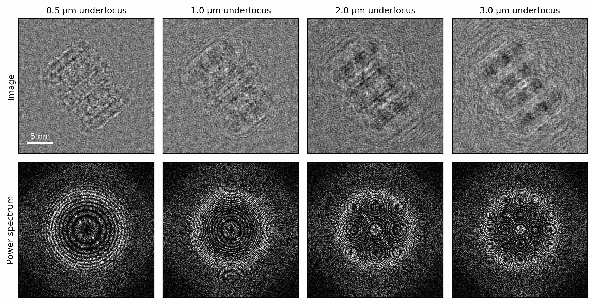
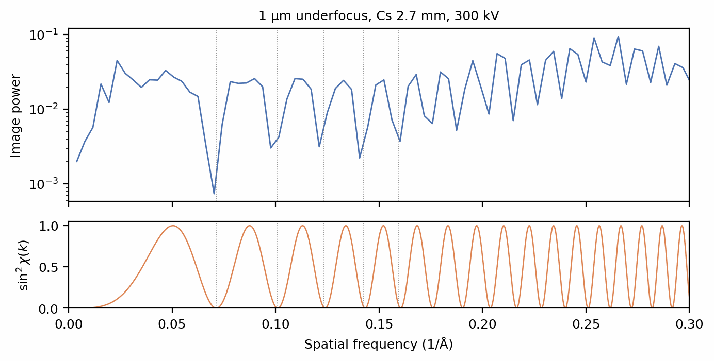
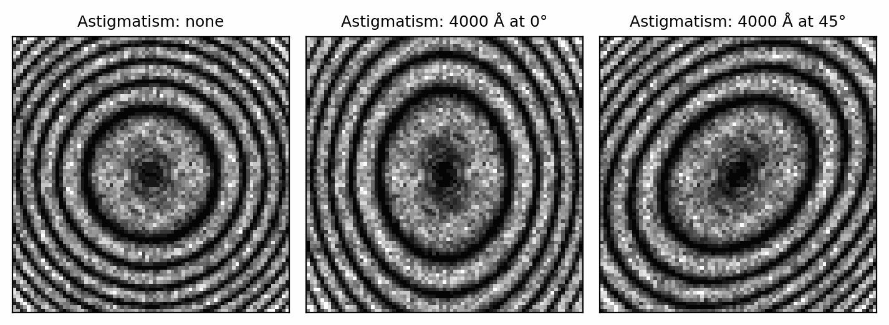
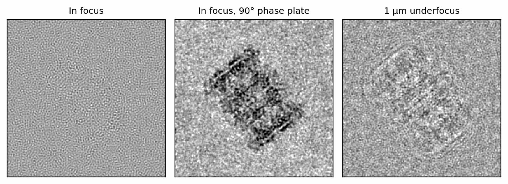
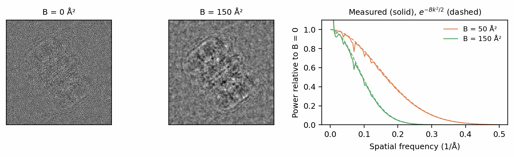
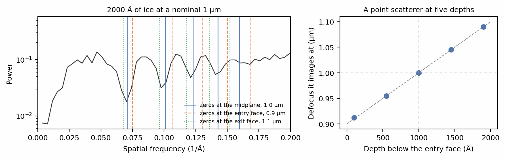
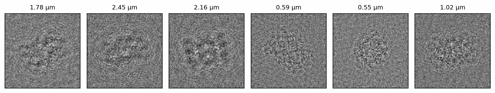

# Contrast transfer function

A biological specimen is almost a pure phase object: the exit wave from
[Scattering](scattering.md) has nearly uniform amplitude, and its information
is in the phase. A perfect lens would image it with almost no contrast. The
objective lens of a real microscope is not perfect. Its aberrations shift the
phase of each spatial frequency \(k\) of the wave by a different amount, the
wave aberration \(\chi(k)\), and that shift converts phase into amplitude
contrast. The lens acts on the wave as a multiplication in Fourier space,

\[
\psi_\text{image}(\mathbf{k}) = \psi_\text{exit}(\mathbf{k})\,e^{-i\chi(\mathbf{k})},
\qquad
\chi(k) = \pi\lambda k^2\left(\tfrac{1}{2}C_s\lambda^2k^2 - \Delta f\right),
\]

where \(\lambda\) is the electron wavelength, \(C_s\) the spherical aberration
and \(\Delta f\) the defocus, positive for underfocus. For a weak phase object
the image contrast at frequency \(k\) is proportional to \(\sin\chi(k)\), the
oscillating *contrast transfer function* (CTF; Erickson & Klug 1971). This page applies it with
`ExitWave.apply_ctf`. The sign conventions are set out in
[Optical sign conventions](../concepts/conventions.md#optical-sign-conventions),
and every term of \(\chi\) in [The transfer function](../concepts/aberrations.md#the-transfer-function).

## Setup

One particle of 6BDF (Campbell et al. 2015) in a box of ice, scattered once:

```python
--8<-- "docs-figures/walkthrough/ctf.py:setup"
```

```{ .text .output }
--8<-- "docs-includes/walkthrough/ctf-setup.txt"
```

The exit wave is complex and sits on the propagation grid, twice as fine as
the 256-pixel image (see [Scattering](scattering.md)). `apply_ctf` returns a
new `ExitWave` and leaves the original untouched, so one scattered wave can be
imaged at as many lens settings as you like. Propagation is the expensive
step; the transfer function costs a pair of FFTs.

## Defocus

`CTF.from_values` takes the defocus in ångströms and the spherical
aberration in millimetres. `intensity(cc=None)` forms the image with a
perfectly coherent beam, which isolates the transfer function; the default
`intensity()` includes the chromatic focal spread covered in
[Partial coherence](coherence.md). `pixels()` returns the image on the
256-pixel grid.

```python
--8<-- "docs-figures/walkthrough/ctf.py:defocus"
```

{ width="900" style="display:block;margin:1.2em auto;" }
///caption
The same exit wave imaged at 0.5, 1, 2 and 3 µm underfocus (top, low-pass
filtered to 5 Å for display) and the power spectrum of each image (bottom).
More defocus gives more low-frequency contrast and packs the Thon rings closer
together.
///

Close to focus, \(\sin\chi\) is small at low frequencies, so the particle's
overall shape barely shows and only fine detail is transferred. With more
defocus the first maximum of \(\sin\chi\) moves to lower frequency, the
particle's outline becomes visible, and the transfer function oscillates
faster, so the rings in the power spectrum crowd together.

## Thon rings

The rings are the zeros of \(\sin\chi\) (Thon 1966). Neglecting \(C_s\), the \(n\)-th
zero falls at \(k_n = \sqrt{n/(\lambda\Delta f)}\):

```python
--8<-- "docs-figures/walkthrough/ctf.py:thon-rings"
```

```{ .text .output }
--8<-- "docs-includes/walkthrough/ctf-thon-rings.txt"
```

{ width="800" style="display:block;margin:1.2em auto;" }
///caption
The rotationally averaged power spectrum of the 1 µm image (top) and
\(\sin^2\chi(k)\) for the same lens (bottom). Dotted lines mark the first five
zeros printed above; the spectrum's minima fall on them.
///

The broad rise in power towards 0.27 Å⁻¹ is the 3.7 Å ring of the amorphous
ice, which every image of vitreous ice carries (McMullan et al. 2015).
Fitting these minima is how CTF estimation programs measure the defocus of a
real micrograph (Rohou & Grigorieff 2015; Zhang 2016).

## Astigmatism

An objective lens that focuses more strongly along one axis than the other
has a different defocus along each. `astigmatism` is the difference
\(\Delta f_u - \Delta f_v\) in ångströms, and `astigmatism_angle` the angle
of the \(u\) axis in degrees. The spectra below are averaged over eight
particles, as a CTF estimation program averages over the tiles of a
micrograph:

```python
--8<-- "docs-figures/walkthrough/ctf.py:astigmatism"
```

```{ .text .output }
--8<-- "docs-includes/walkthrough/ctf-astigmatism.txt"
```

{ width="800" style="display:block;margin:1.2em auto;" }
///caption
The central region (below 0.15 Å⁻¹) of the power spectrum averaged over
eight particles, without astigmatism and with 4000 Å of astigmatism at 0° and
45°. The rings become ellipses whose axes turn with `astigmatism_angle`.
///

`CTF` stores its terms as the `ctf_params` dict printed above, in
CryoSPARC's units: `dfu`, `dfv` and `cs` in ångströms, `dfang` in degrees,
and `phaseshift` in radians. A `CTF` read from a CryoSPARC or RELION file
arrives in the same form; see [Particle stacks](particle-stacks.md).

## Phase plate

At zero defocus, \(\chi\) is close to zero over the low frequencies, and a
phase object shows no contrast there. A phase plate shifts the scattered wave
by a constant phase \(\phi_0\) relative to the unscattered beam (Danev &
Nagayama 2001; Danev et al. 2014), which enters
the wave aberration as \(\chi \to \chi - \phi_0\) (see
[Phase shift and amplitude contrast](../concepts/aberrations.md#phase-shift-and-amplitude-contrast)).
At \(\phi_0 = 90°\) the transfer at the lowest frequencies is at its
largest, in focus:

```python
--8<-- "docs-figures/walkthrough/ctf.py:phase-plate"
```

{ width="800" style="display:block;margin:1.2em auto;" }
///caption
In focus (left) the particle is invisible; the remaining texture is fine
detail of the ice, which the lens still transfers at high frequency. A 90° phase
shift (centre) gives strong in-focus contrast. At 1 µm underfocus (right) the
particle is visible without a phase plate, with weaker low-frequency contrast.
All three are low-pass filtered to 5 Å and share one grey scale.
///

## B-factor

`apply_ctf(bfactor=...)` multiplies the transfer function by the Gaussian
envelope \(E_B(k) = e^{-Bk^2/4}\) (Rosenthal & Henderson 2003), a single
empirical term for every blurring the rest of the model leaves out. It takes one value, or one per
image:

```python
--8<-- "docs-figures/walkthrough/ctf.py:bfactor"
```

{ width="900" style="display:block;margin:1.2em auto;" }
///caption
The image without a B-factor (left) and with B = 150 Ų (centre). Right: the
image's power relative to B = 0 (solid) against \(e^{-Bk^2/2}\), the square of
the amplitude envelope (dashed). Between 0.1 and 0.3 Å⁻¹ the median deviation
is 2% at B = 50 Ų and 5% at B = 150 Ų.
///

The power falls as \(E_B^2\) because the envelope acts on the wave's
amplitude. A deposited model's per-atom B-factors, applied to the potential
instead, were covered in
[Structures and potentials](potentials.md#deposited-b-factors). The other
envelopes on the transfer function, for partial coherence and radiation
damage, are listed under [Envelopes](../concepts/aberrations.md#envelopes).

## The defocus reference plane

A thick specimen does not have a single defocus: each layer sits at its own
distance from the plane the lens is focused on. The wave leaves the box at
its exit face, half the box's depth downstream of the midplane and that much
further from focus, so every `ExitWave` from a propagating model carries a
`defocus_shift` of minus half the depth, which `apply_ctf` subtracts from
`dfu` and `dfv`:

```python
--8<-- "docs-figures/walkthrough/ctf.py:reference-plane"
```

```{ .text .output }
--8<-- "docs-includes/walkthrough/ctf-reference-plane.txt"
```

The effect is that the defocus you pass is the defocus of the box's
midplane, where a particle sits. You can measure this directly. The section
below places a point scatterer at five depths in an otherwise empty
2000 Å box, images each at a nominal 1 µm, and finds the defocus at which
the same scatterer, projected with no depth at all, gives the same image:

```python
--8<-- "docs-figures/walkthrough/ctf.py:depth"
```

```{ .text .output }
--8<-- "docs-includes/walkthrough/ctf-depth.txt"
```

{ width="900" style="display:block;margin:1.2em auto;" }
///caption
Left: the power spectrum of the particle in 2000 Å of ice at a nominal 1 µm,
with the zeros expected if that defocus belonged to the midplane, the entry
face or the exit face. The minima follow the midplane. Right: the defocus at
which a point scatterer images, against its depth below the entry face
(25 Å search steps). The dashed line has slope +1 and passes through the
nominal defocus at the midplane.
///

A scatterer at the midplane images at exactly the nominal defocus, and each
ångström towards the exit face adds one ångström of underfocus, to within
the 25 Å search step: an underfocused lens images a plane upstream of the
specimen, so the further downstream a scatterer sits, the further it is
from focus. The power spectrum of a uniform slab of ice agrees: its
minima sit at the zeros for the nominal defocus, not at those for either
face. For a slab of uniform density, and for a particle centred in its box,
the midplane is the scattering centroid, the plane whose defocus the Thon
rings report (Balakrishnan et al. 2023). [The defocus reference plane](../concepts/conventions.md#the-defocus-reference-plane)
discusses the convention, including where it fails for a specimen whose
scattering is not centred in depth. The `projection` and linear `ctf`
models have no depth, and their `defocus_shift` is zero.

## Per-image values

A stack of images usually has one defocus per image. `CTF.sample` draws each
term from a `[low, high]` range, uniformly and independently per image, and
`apply_ctf` pairs the \(i\)-th entry with the \(i\)-th wave:

```python
--8<-- "docs-figures/walkthrough/ctf.py:sample"
```

```{ .text .output }
--8<-- "docs-includes/walkthrough/ctf-sample.txt"
```

{ width="900" style="display:block;margin:1.2em auto;" }
///caption
Six orientations of 6BDF, each at its own defocus drawn from 0.5 to 2.5 µm,
low-pass filtered to 5 Å for display.
///

`CTF.sample` accepts a scalar or a range for `defocus`, `astigmatism`,
`astigmatism_angle` and `phase_shift`; `cs` is one value for the whole
stack. A `CTF` must have as many entries as the wave has images, and
`apply_ctf` raises an error otherwise.

## Next

[Partial coherence](coherence.md) replaces the perfectly coherent beam
assumed on this page with a real source's spread of energies and angles.

## References

- Balakrishnan, D., Chee, S. W., Baraissov, Z., Bosman, M., Mirsaidov, U.,
  & Loh, N. D. (2023). Single-shot, coherent, pop-out 3D metrology.
  *Communications Physics*, 6(1), 321.
  [doi:10.1038/s42005-023-01431-6](https://doi.org/10.1038/s42005-023-01431-6)
- Campbell, M. G., Veesler, D., Cheng, A., Potter, C. S., & Carragher, B.
  (2015). 2.8 Å resolution reconstruction of the *Thermoplasma acidophilum*
  20S proteasome using cryo-electron microscopy. *eLife*, 4, e06380.
  [doi:10.7554/eLife.06380](https://doi.org/10.7554/eLife.06380)
- Danev, R., Buijsse, B., Khoshouei, M., Plitzko, J. M., & Baumeister, W.
  (2014). Volta potential phase plate for in-focus phase contrast
  transmission electron microscopy. *Proceedings of the National Academy of
  Sciences*, 111(44), 15635–15640.
  [doi:10.1073/pnas.1418377111](https://doi.org/10.1073/pnas.1418377111)
- Danev, R., & Nagayama, K. (2001). Transmission electron microscopy with
  Zernike phase plate. *Ultramicroscopy*, 88(4), 243–252.
  [doi:10.1016/S0304-3991(01)00088-2](https://doi.org/10.1016/S0304-3991(01)00088-2)
- Erickson, H. P., & Klug, A. (1971). Measurement and compensation of
  defocusing and aberrations by Fourier processing of electron micrographs.
  *Philosophical Transactions of the Royal Society of London. B, Biological
  Sciences*, 261(837), 105–118.
  [doi:10.1098/rstb.1971.0040](https://doi.org/10.1098/rstb.1971.0040)
- McMullan, G., Vinothkumar, K. R., & Henderson, R. (2015). Thon rings from
  amorphous ice and implications of beam-induced Brownian motion in single
  particle electron cryo-microscopy. *Ultramicroscopy*, 158, 26–32.
  [doi:10.1016/j.ultramic.2015.05.017](https://doi.org/10.1016/j.ultramic.2015.05.017)
- Rohou, A., & Grigorieff, N. (2015). CTFFIND4: Fast and accurate defocus
  estimation from electron micrographs. *Journal of Structural Biology*,
  192(2), 216–221.
  [doi:10.1016/j.jsb.2015.08.008](https://doi.org/10.1016/j.jsb.2015.08.008)
- Rosenthal, P. B., & Henderson, R. (2003). Optimal determination of
  particle orientation, absolute hand, and contrast loss in single-particle
  electron cryomicroscopy. *Journal of Molecular Biology*, 333(4), 721–745.
  [doi:10.1016/j.jmb.2003.07.013](https://doi.org/10.1016/j.jmb.2003.07.013)
- Thon, F. (1966). Zur Defokussierungsabhängigkeit des Phasenkontrastes bei
  der elektronenmikroskopischen Abbildung. *Zeitschrift für Naturforschung
  A*, 21(4), 476–478.
  [doi:10.1515/zna-1966-0417](https://doi.org/10.1515/zna-1966-0417)
- Zhang, K. (2016). Gctf: Real-time CTF determination and correction.
  *Journal of Structural Biology*, 193(1), 1–12.
  [doi:10.1016/j.jsb.2015.11.003](https://doi.org/10.1016/j.jsb.2015.11.003)
