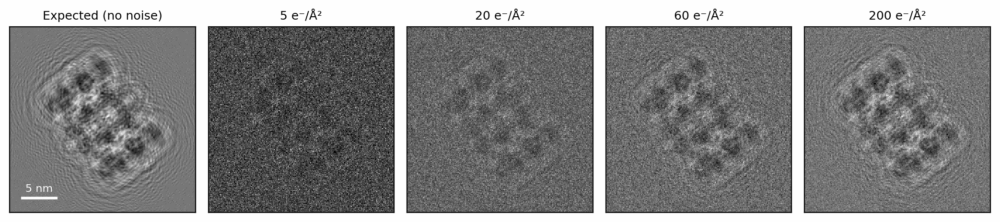
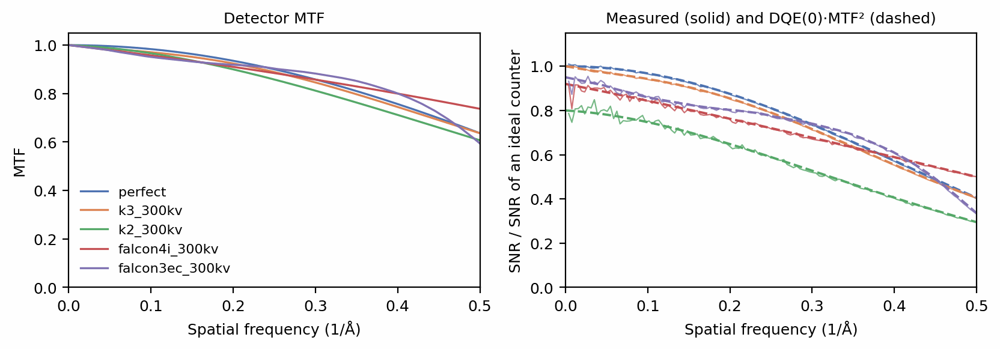
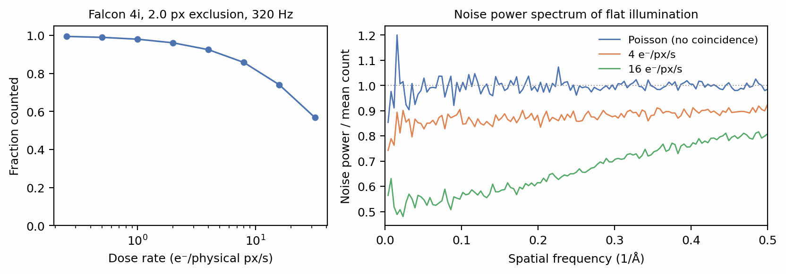

# Detection

The intensity leaving the lens is a probability density: it says where
electrons are likely to land, not where they did. The camera records a
finite number of them. For a dose \(D\) in e⁻/Ų and a pixel of side \(p\),
the expected number of electrons recorded in a pixel is

\[
\bar N(\mathbf{r}) = D\,p^2\,\mathrm{DQE}(0)\,\big[\mathrm{MTF} \ast I\big](\mathbf{r}),
\]

where \(I\) is the intensity relative to the unscattered beam, the MTF is the
detector's blur and \(\mathrm{DQE}(0)\) the fraction of electrons it counts at
all (McMullan et al. 2009). The recorded count is drawn from a Poisson distribution with that mean.
`Image.detect` performs these steps. This page records one particle at
several doses, compares the bundled detector models, and shows how
coincidence loss changes the noise of a counting detector.

## Setup

The example is one 6BDF particle (Campbell et al. 2015) in vacuum at 1.5 µm
underfocus, so the only
structure in the image is the particle itself:

```python
--8<-- "docs-figures/walkthrough/detection.py:setup"
```

```{ .text .output }
--8<-- "docs-includes/walkthrough/detection-setup.txt"
```

`image` is still on the propagation grid, twice as fine as the pixels (see
[Scattering](scattering.md)), and holds the intensity relative to the
vacuum beam, so its mean is 1.

## Recording an image

An `Exposure` holds the dose each image receives. `detect` scales the
intensity to expected counts, samples it down to the pixel grid and draws the
noise:

```python
--8<-- "docs-figures/walkthrough/detection.py:detect"
```

```{ .text .output }
--8<-- "docs-includes/walkthrough/detection-detect.txt"
```

The mean is the dose times the pixel area, 20 counts per 1 Å pixel. The
variance of a Poisson count equals its mean, and the 1.7 counts² above that
are the particle's own contrast. The result is an `Image` on the
256-pixel grid, with `detected=True`; a detected image refuses to be detected
again.

`seed` makes the draw reproducible: each image's noise comes from a generator
seeded by the run seed and that image's index, so the same image receives the
same noise whichever batch it is computed in (see
[Particle stacks](particle-stacks.md#reproducibility)). Without a seed the
noise comes from PyTorch's global generator.

## Dose and shot noise

`noise=None` returns the expected counts \(\bar N\) themselves. Comparing
them with a noisy draw gives the signal-to-noise ratio, here the variance of
the expected image over the variance of the noise:

```python
--8<-- "docs-figures/walkthrough/detection.py:dose"
```

```{ .text .output }
--8<-- "docs-includes/walkthrough/detection-dose.txt"
```

{ width="900" style="display:block;margin:1.2em auto;" }
///caption
The expected counts (left) and one Poisson draw at each of four doses. The
SNR rises in proportion to the dose, from 0.024 at 5 e⁻/Ų to 0.955 at
200 e⁻/Ų.
///

The signal grows as \(D^2\) in variance and the Poisson noise as \(D\), so the
SNR is proportional to the dose: four times the dose gives four times the
SNR. A single particle at a typical 40 e⁻/Ų sits well below an SNR of 1,
which is why particles are averaged by the thousand. The dose a specimen can
take is limited by radiation damage, which the
[Specimens](specimens.md) page covers.

## Detector models

`detector=` selects a bundled camera, which supplies an MTF and a
\(\mathrm{DQE}(0)\). The default, `detector=None`, is an ideal counter that
records every electron in the pixel it lands in.

```python
--8<-- "docs-figures/walkthrough/detection.py:detectors"
```

```{ .text .output }
--8<-- "docs-includes/walkthrough/detection-detectors.txt"
```

`perfect` is the limit set by the pixel's own aperture, a sinc that falls to
0.64 at Nyquist (McMullan et al. 2009). The others are measured or published curves for real
cameras at 300 kV ([MTF: a pure blur](../concepts/detector.md#mtf-a-pure-blur)).
K3's datasheet gives only lower bounds on its DQE at no stated dose rate,
not a low-dose-rate \(\mathrm{DQE}(0)\), so `k3_300kv` counts every electron
([DQE(0): a separate counting efficiency](../concepts/detector.md#dqe0-a-separate-counting-efficiency)).

{ width="900" style="display:block;margin:1.2em auto;" }
///caption
Left: the MTF of each camera. Right: the spectral SNR of the same particle at
40 e⁻/Ų on each camera, divided by that on an ideal counter, from 16 noise
draws (solid), against \(\mathrm{DQE}(0)\cdot\mathrm{MTF}^2\) (dashed).
///

The two effects act differently. \(\mathrm{DQE}(0)\) scales the expected
counts, which thins the electron arrivals and so lowers signal and noise
together; the SNR falls by the factor \(\mathrm{DQE}(0)\). The MTF blurs the
expected counts before the Poisson draw, so the signal loses power at high
frequency while the noise stays white, because each counted electron still
lands in one pixel. The SNR relative to an ideal counter is therefore
\(\mathrm{DQE}(0)\,\mathrm{MTF}(k)^2\), the detector's DQE (McMullan et al.
2009), and the measured curves follow it. Folding \(\mathrm{DQE}(0)\) into the MTF instead would get
the noise wrong, which is why the two are kept apart.

Two further `detect` arguments describe the camera geometry.
`detector_pixel_size` names the physical pixel when the images were binned or
Fourier-cropped after recording, so the MTF is read at the right frequencies
([Images resampled after recording](../concepts/detector.md#images-resampled-after-recording)).
`anisomag` applies an anisotropic magnification, one 2 × 2 matrix per image
(Zivanov et al. 2020). The image is resampled through its own trigonometric
interpolant, evaluated at the distorted pixel positions by a non-uniform FFT,
so the warp does not attenuate frequencies near Nyquist as an interpolation
of the pixel grid does.

## Coincidence loss

A counting detector finds electrons as events within each readout frame. Two
electrons that land close together in the same frame register as one, so at
high dose rates the camera loses counts (Li et al. 2013). `coincidence_radius` sets the
exclusion radius in pixels of the simulated image, and `Exposure(n_frames=)`
the number of frames the dose is split across. The radius for a real camera
follows from its calibrated exclusion radius in physical pixels, its hardware
frame rate and the dose rate, through the mean number of electrons per
exclusion cell per frame
([From a detector radius to a simulation radius](../concepts/detector.md#from-a-detector-radius-to-a-simulation-radius)):

```python
--8<-- "docs-figures/walkthrough/detection.py:coincidence"
```

```{ .text .output }
--8<-- "docs-includes/walkthrough/detection-coincidence.txt"
```

{ width="900" style="display:block;margin:1.2em auto;" }
///caption
Left: the fraction of incident electrons counted, for a Falcon 4i's 2.0 px
exclusion radius at 320 frames per second (Thermo Fisher Scientific 2022),
simulated at 1 Å, 40 e⁻/Ų and 40 frames. It falls from 99.5% at
0.25 e⁻/px/s to 57% at 32 e⁻/px/s.
Right: the noise power spectrum of the flat images, divided by the mean
count, so that plain Poisson noise sits at 1.
///

Coincidence loss does more than lower the count. An electron that has been
counted excludes its neighbourhood for the rest of the frame, which makes the
counts more even than independent arrivals would be. The noise therefore
falls below the Poisson level, and falls furthest at low spatial frequency:
at 16 e⁻/px/s, from about 0.8 of the mean count at Nyquist to about 0.5 at
the lowest frequencies. Real counting detectors show the same low-frequency
suppression (Li et al. 2013; McMullan et al. 2014; see
[Coincidence loss](../concepts/detector.md#coincidence-loss)).
A coincidence radius above zero requires `n_frames`.

## Noiseless images and saving

`noise=None` skips the Poisson draw and any coincidence loss and returns the
expected counts after the MTF, as used for the SNR above. A noiseless stack
is the reference to compare a reconstruction or a denoiser against.

`Image.save` writes the counts to an MRC file with the pixel size in its
header:

```python
--8<-- "docs-figures/walkthrough/detection.py:save"
```

```{ .text .output }
--8<-- "docs-includes/walkthrough/detection-save.txt"
```

## Next

[Particle stacks](particle-stacks.md) runs every stage so far for a whole
stack of particles, each with its own pose, defocus and draw of ice.

## References

- Campbell, M. G., Veesler, D., Cheng, A., Potter, C. S., & Carragher, B.
  (2015). 2.8 Å resolution reconstruction of the *Thermoplasma acidophilum*
  20S proteasome using cryo-electron microscopy. *eLife*, 4, e06380.
  [doi:10.7554/eLife.06380](https://doi.org/10.7554/eLife.06380)
- Li, X., Zheng, S. Q., Egami, K., Agard, D. A., & Cheng, Y. (2013).
  Influence of electron dose rate on electron counting images recorded with
  the K2 camera. *Journal of Structural Biology*, 184(2), 251–260.
  [doi:10.1016/j.jsb.2013.08.005](https://doi.org/10.1016/j.jsb.2013.08.005)
- McMullan, G., Chen, S., Henderson, R., & Faruqi, A. R. (2009). Detective
  quantum efficiency of electron area detectors in electron microscopy.
  *Ultramicroscopy*, 109(9), 1126–1143.
  [doi:10.1016/j.ultramic.2009.04.002](https://doi.org/10.1016/j.ultramic.2009.04.002)
- McMullan, G., Faruqi, A. R., Clare, D., & Henderson, R. (2014). Comparison
  of optimal performance at 300 keV of three direct electron detectors for
  use in low dose electron microscopy. *Ultramicroscopy*, 147, 156–163.
  [doi:10.1016/j.ultramic.2014.08.002](https://doi.org/10.1016/j.ultramic.2014.08.002)
- Thermo Fisher Scientific. (2022). *Falcon 4i Direct Electron Detector*
  (Datasheet DS0371-EN-01-2022).
  [documents.thermofisher.com](https://documents.thermofisher.com/TFS-Assets/MSD/Datasheets/falcon-detector-datasheet-ds0371.pdf)
- Zivanov, J., Nakane, T., & Scheres, S. H. W. (2020). Estimation of
  high-order aberrations and anisotropic magnification from cryo-EM data sets
  in *RELION*-3.1. *IUCrJ*, 7(2), 253–267.
  [doi:10.1107/S2052252520000081](https://doi.org/10.1107/S2052252520000081)
