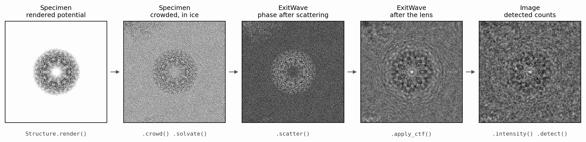

# Walkthrough

This walkthrough introduces SPECTER from examples, one stage of image
formation per page. Read it in order: each page builds on the objects the
previous one made, and together they follow a cryo-EM image from an atomic
model to a detected micrograph and back to a reconstructed map.

{ width="900" style="display:block;margin:1.2em auto;" }
///caption
One particle of 6BDF (Campbell et al. 2015) followed through image formation,
labelled with the object each stage returns and the call that produced it.
The last two panels are low-pass filtered to 5 Å for display.
///

Every stage is a verb on the object the previous stage returned:

```python
from specter.imaging import CTF, Exposure, Poses, Structure

specimen = Structure.from_pdb("6bdf").render(voxel_size=1.0, box=256)
specimen = specimen.crowd(min_distance=190.0).solvate(model="gd", thickness=500.0)

poses = Poses.random(16, shift=2.0)
exposure = Exposure(dose=40.0)
waves = specimen.scatter(poses, voltage=300.0, exposure=exposure, seed=0)
waves = waves.apply_ctf(CTF.sample(16, defocus=[5000.0, 15000.0]))
images = waves.intensity(cc=2.7).detect(exposure, detector="k3_300kv", seed=0)
```

| Page | Object | What it covers |
|---|---|---|
| [Structures and potentials](potentials.md) | `Structure`, `Specimen` | Loading a model, rendering its electrostatic potential, voxel size, scattering factors |
| [Specimens: crowding and ice](specimens.md) | `Specimen` | Neighbouring particles, amorphous ice, ice thickness, radiation damage |
| [Scattering](scattering.md) | `Poses`, `ExitWave` | Orientations, the exit wave, propagation models, oversampling |
| [Contrast transfer function](ctf.md) | `CTF`, `ExitWave` | Defocus, astigmatism, spherical aberration, phase plates |
| [Partial coherence](coherence.md) | `ExitWave`, `Image` | Chromatic focal spread, spatial coherence |
| [Detection](detection.md) | `Exposure`, `Image` | Dose, shot noise, detector MTF and DQE, coincidence loss |
| [Particle stacks](particle-stacks.md) | `simulate_particles` | A complete stack, per-image parameters, seeds and reproducibility |
| [Micrographs](micrographs.md) | `Field`, `Sample` | A field of particles in a slab of ice, imaged as one exposure |
| [Tilt series](tilt-series.md) | `TiltSeries` | Tilting a specimen volume through a dose-accumulating series |
| [Reconstruction](reconstruction.md) | `Ghostbuster` | Recovering a map from images with the same forward model |
| [From Python to the command line](command-line.md) | `specter` CLI | Running the same simulations at scale from a TOML config |

## Running the examples

The code on each page is quoted from a script in
[`docs-figures/walkthrough/`](https://github.com/joelyeois/specter/tree/main/docs-figures/walkthrough),
and the output under it is what that script printed when the page was built.
Run a page yourself with

```bash
uv run python docs-figures/walkthrough/potentials.py
```

The scripts assume a CUDA GPU (`device="cuda"`); select one with
`CUDA_VISIBLE_DEVICES`. Plotting code is kept out of the quoted sections and
lives in the same scripts.

The pages explain enough physics to make each step legible. The derivations,
conventions and validation behind them are in [Theory](../concepts/index.md),
and every page links to the relevant part.

## References

- Campbell, M. G., Veesler, D., Cheng, A., Potter, C. S., & Carragher, B.
  (2015). 2.8 Å resolution reconstruction of the *Thermoplasma acidophilum*
  20S proteasome using cryo-electron microscopy. *eLife*, 4, e06380.
  [doi:10.7554/eLife.06380](https://doi.org/10.7554/eLife.06380)
