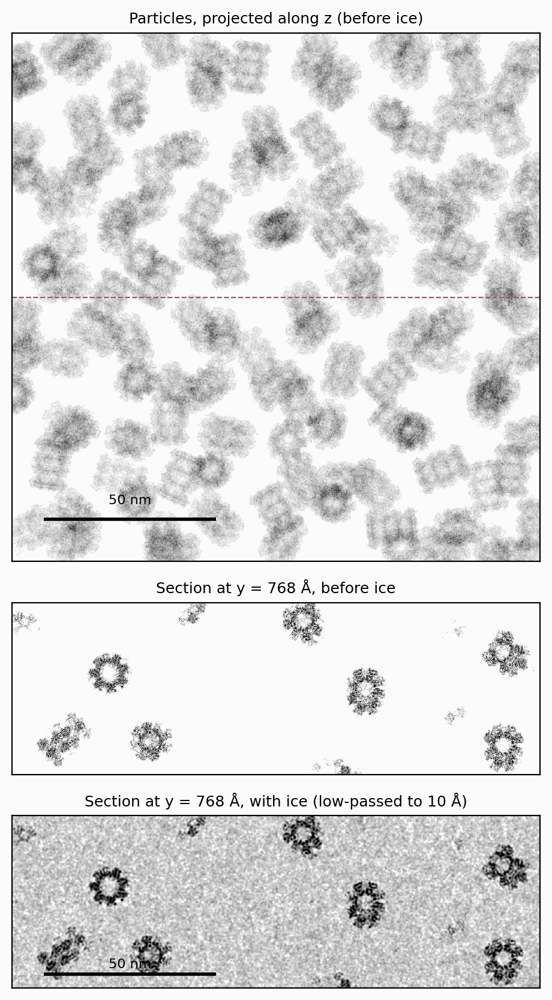
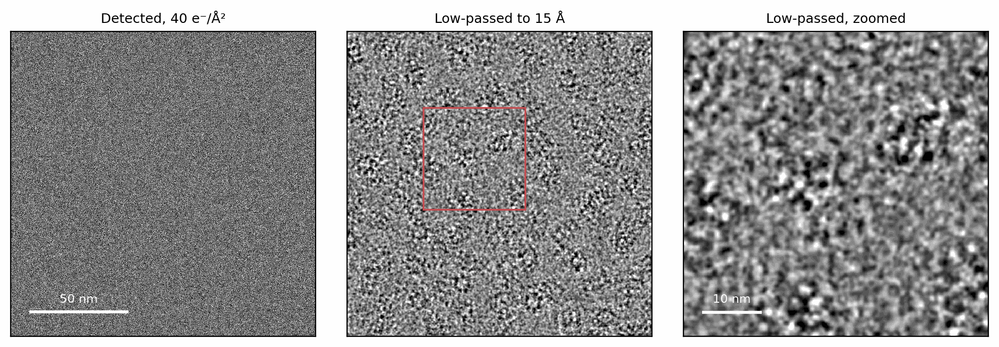
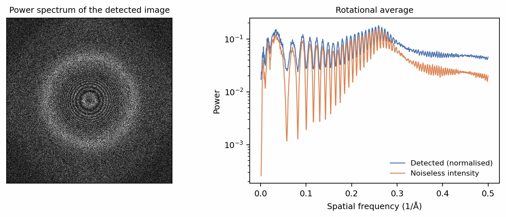
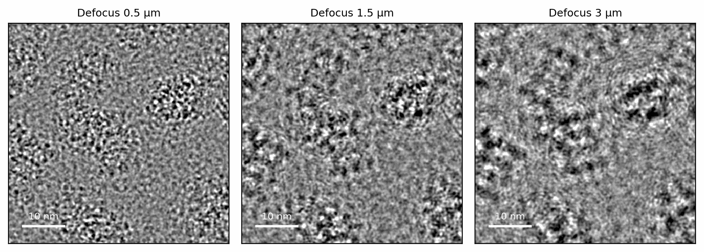
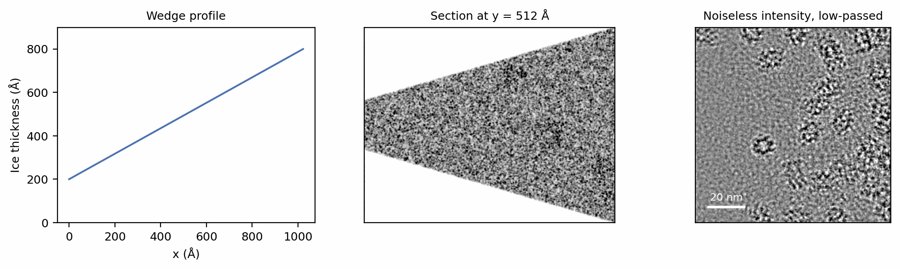

# Micrographs

A particle stack images each particle in its own box, and draws that box's
neighbours and ice afresh for every image. A micrograph is a different kind of
specimen: one wide field of particles frozen in one slab of ice, recorded in
one exposure. SPECTER splits it into a recipe and a realisation. A `Field`
records what fills the field of view, `Field.draw` assembles one `Sample`
volume from it, and the sample is then scattered into an `ExitWave` and
imaged and detected with the same verbs as a particle.

## Building a field

The field starts from the same rendered 6BDF template (Berman et al. 2000;
Campbell et al. 2015) as the previous pages:

```python
--8<-- "docs-figures/walkthrough/micrographs.py:setup"
```

`Field` takes the template's potential, the voxel size and the lateral size
of the field in voxels. `pack` places copies of the template through the
field, no closer than `min_distance` centre to centre, and `solvate` fills the
space between them with amorphous ice:

```python
--8<-- "docs-figures/walkthrough/micrographs.py:field"
```

A micrograph's volume is assembled in host memory, which is why the template
is moved to the CPU first: at 4096 px a 500 Å slab is 33.5 GB. Each copy is
rotated on the device and stamped into the host canvas, and the ice is built
and blended a slab at a time, so the device holds only a few slabs at once.
`molecular_mass` sets how much ice each copy displaces
([Solvent displacement](../concepts/ice.md#solvent-displacement)). Spacing the
copies by the template's largest diameter packs them as closely as their
bounding spheres allow; the [crowding](../concepts/pose-crowding.md#crowding)
theory page covers the placement.

The field here is 1536 px at 1 Å, a 1536 Å square, chosen so that this page
runs in about a minute on one GPU. A detector-sized micrograph follows the
same code with a larger `nxy`.

## Drawing a sample

`Field.draw` assembles one realisation of the field: the copies' positions
and orientations, and the ice between them.

```python
--8<-- "docs-figures/walkthrough/micrographs.py:draw"
```

```{ .text .output }
--8<-- "docs-includes/walkthrough/micrographs-draw.txt"
```

The depth of the volume is the ice thickness. `keep_dry=True` also keeps the
volume as it was before the ice was added, as `sample.dry`, which costs a
second canvas and is used here only to show where the particles are.

{ width="760" style="display:block;margin:1.2em auto;" }
///caption
One drawn sample. Top: the particles projected along the beam, before the
ice is added; the dashed line marks the section below. Middle: a 32 Å thick
section across the 500 Å slab, before ice. The copies sit at every depth of
the slab. Bottom: the same section with ice, low-passed to 10 Å for display.
///

## Imaging the sample

`Sample.scatter` propagates the beam through the volume slice by slice and
returns an `ExitWave`, which the lens and the camera image exactly as on the
previous pages:

```python
--8<-- "docs-figures/walkthrough/micrographs.py:image"
```

```{ .text .output }
--8<-- "docs-includes/walkthrough/micrographs-image.txt"
```

The wave is formed on a grid twice as fine as the pixels, and the detector
samples it down to the 1536 px image
([Grid aliasing](../concepts/scattering/multislice.md#grid-aliasing-oversample-and-klim)).
The defocus a `CTF` carries is that of the specimen's midplane, the value a
CTF fit reports and CryoSPARC (Punjani et al. 2017) and RELION (Scheres 2012)
record; the `ExitWave` records how
far its exit face lies from that plane and `apply_ctf` accounts for the
difference
([The defocus reference plane](../concepts/conventions.md#the-defocus-reference-plane)).

{ width="900" style="display:block;margin:1.2em auto;" }
///caption
The detected micrograph at 1.5 µm defocus and 40 e⁻/Ų (left). Shot noise
hides the particles at full resolution; a 15 Å low-pass (centre) and a
512 Å region of it (right) show them.
///

The power spectrum shows what the image is made of:

{ width="900" style="display:block;margin:1.2em auto;" }
///caption
Left: the power spectrum of the detected micrograph, with the Thon rings of
the 1.5 µm defocus. Right: its rotational average after dividing the image by
its mean, beside that of the noiseless intensity. The two differ by a flat
floor of 0.025 at every frequency.
///

Three features are visible. The Thon rings are the oscillation of the
transfer function, dark where it passes through zero (see
[Contrast transfer function](ctf.md)). The broad maximum near
0.26 Å⁻¹ is the structure of the amorphous ice, which scatters most strongly
at the spacing of neighbouring water molecules
([Ice structure](../concepts/ice.md#the-optimisation-target-sk)). The flat
floor between the two curves is shot noise. A pixel that expects \(N\)
electrons has a Poisson variance of \(N\), so the image divided by its mean
carries white noise of variance \(1/N\): at 40 electrons per pixel, 0.025,
which is the measured difference above 0.35 Å⁻¹ to four decimal places.

## One sample, many images

A drawn sample is a fixed specimen. Scattering it with several `ids` gives
several images of the same field, here a defocus series:

```python
--8<-- "docs-figures/walkthrough/micrographs.py:defocus-series"
```

```{ .text .output }
--8<-- "docs-includes/walkthrough/micrographs-defocus-series.txt"
```

Every image sees the same volume at the same orientation, so `scatter`
propagates the beam once and repeats the exit wave for each id; only the
transfer function differs between them.

{ width="900" style="display:block;margin:1.2em auto;" }
///caption
The same 512 Å region of one sample at three defoci, noiseless and low-passed
to 10 Å. Larger defocus transfers lower spatial frequencies, so whole
particles gain contrast while their fine detail is delocalized into fringes.
///

## Seeds

A seeded draw is a function of the run seed and the draw's `index`, through
a seed derived from both. The n-th micrograph of a run is therefore the same
however many were drawn before it, and two indices give independent fields:

```python
--8<-- "docs-figures/walkthrough/micrographs.py:seeds"
```

```{ .text .output }
--8<-- "docs-includes/walkthrough/micrographs-seeds.txt"
```

The detector's noise is seeded the same way, per image id, through
`detect(..., seed=)`. See
[Reproducibility](../concepts/conventions.md#reproducibility) for what a seed
does and does not fix.

## Ice thickness profiles

Ice in a foil hole is a meniscus rather than a slab (Noble et al. 2018), and
a micrograph taken off the hole's centre sees its thickness change across the
field. An
`IceProfile` replaces the uniform `thickness` with a thickness that varies
laterally. A wedge ramps it linearly:

```python
--8<-- "docs-figures/walkthrough/micrographs.py:profile"
```

```{ .text .output }
--8<-- "docs-includes/walkthrough/micrographs-profile.txt"
```

{ width="900" style="display:block;margin:1.2em auto;" }
///caption
A 200 to 800 Å wedge. Left: the thickness along \(x\). Centre: a section
through the drawn sample, with vacuum above and below the thin side. Right:
the noiseless image at 1.5 µm defocus, low-passed to 15 Å. The thin side
carries less ice texture around its particles.
///

The box is as deep as the thickest column, 800 Å here, so a wedge costs what
a uniform slab of its maximum thickness costs. Particles are placed within
each column's own slab of ice. The defocus refers to the ice's scattering
centroid, the thickness-weighted mean height of the film, which for a level
wedge is the box's midplane however much vacuum the box holds. A wedge also
pads its canvas by default: the field is periodic under the FFT, and without
padding the thick edge's signal wraps into the thin edge. [Ice thickness profiles](../user-guide/micrograph.md#ice-thickness-profiles)
covers the meniscus profile, a tilted slab and the size of the wrap-around
effect.

## From the command line

`specter simulate micrograph` runs this chain for every micrograph of a run,
from a TOML config, and writes the stack with a RELION `.star` file; see
[Generate a micrograph](../user-guide/micrograph.md) and
[From Python to the command line](command-line.md).

## Next

[Tilt series](tilt-series.md) images a specimen volume from many angles in
one dose-accumulating series.

## References

- Berman, H. M., Westbrook, J., Feng, Z., Gilliland, G., Bhat, T. N.,
  Weissig, H., Shindyalov, I. N., & Bourne, P. E. (2000). The Protein Data
  Bank. *Nucleic Acids Research*, 28(1), 235–242.
  [doi:10.1093/nar/28.1.235](https://doi.org/10.1093/nar/28.1.235)
- Campbell, M. G., Veesler, D., Cheng, A., Potter, C. S., & Carragher, B.
  (2015). 2.8 Å resolution reconstruction of the *Thermoplasma acidophilum*
  20S proteasome using cryo-electron microscopy. *eLife*, 4, e06380.
  [doi:10.7554/eLife.06380](https://doi.org/10.7554/eLife.06380)
- Noble, A. J., Dandey, V. P., Wei, H., Brasch, J., Chase, J., Acharya, P.,
  et al. (2018). Routine single particle CryoEM sample and grid
  characterization by tomography. *eLife*, 7, e34257.
  [doi:10.7554/eLife.34257](https://doi.org/10.7554/eLife.34257)
- Punjani, A., Rubinstein, J. L., Fleet, D. J., & Brubaker, M. A. (2017).
  cryoSPARC: Algorithms for rapid unsupervised cryo-EM structure
  determination. *Nature Methods*, 14(3), 290–296.
  [doi:10.1038/nmeth.4169](https://doi.org/10.1038/nmeth.4169)
- Scheres, S. H. W. (2012). RELION: Implementation of a Bayesian approach to
  cryo-EM structure determination. *Journal of Structural Biology*, 180(3),
  519–530.
  [doi:10.1016/j.jsb.2012.09.006](https://doi.org/10.1016/j.jsb.2012.09.006)
