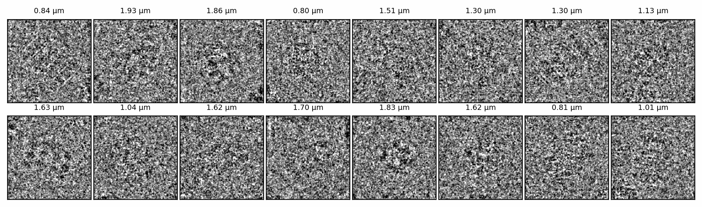
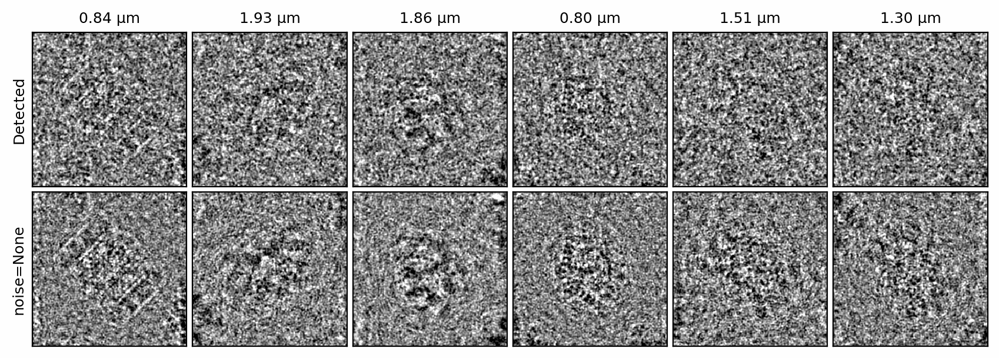
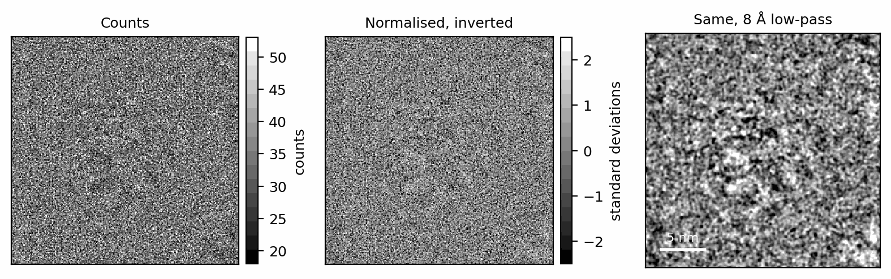

# Particle stacks

A single-particle dataset is many images of copies of one molecule. Each copy
lies in its own orientation, is imaged at its own defocus, and sits among its
own neighbours and its own patch of ice. The previous pages built each stage
for one image; `simulate_particles` runs the whole chain for a stack, batch by
batch, with every per-image quantity carried by the objects already
introduced.

## Setup

The specimen is the crowded, solvated 6BDF (Berman et al. 2000; Campbell et
al. 2015) recipe from [Specimens: crowding and ice](specimens.md):

```python
--8<-- "docs-figures/walkthrough/particle_stacks.py:setup"
```

```{ .text .output }
--8<-- "docs-includes/walkthrough/particle-stacks-setup.txt"
```

`crowd` and `solvate` record what to build around the template; nothing is
built yet. `plan` lists the steps `scatter` will take for each image. The box
is 500 voxels deep because the ice is 500 Å thick, and every image draws its
own neighbours and its own ice.

## Simulating a stack

`simulate_particles` takes the specimen and one `Poses`, `CTF` and `Exposure`
entry per image:

```python
--8<-- "docs-figures/walkthrough/particle_stacks.py:stack"
```

```{ .text .output }
--8<-- "docs-includes/walkthrough/particle-stacks-stack.txt"
```

{ width="900" style="display:block;margin:1.2em auto;" }
///caption
The sixteen particles, each titled with its defocus and low-pass filtered to
8 Å for display. At 40 e⁻/Ų and 1 Å pixels a single particle is barely
visible above the shot noise and the ice.
///

The four dictionaries pass keywords to the verbs the stack is built from:
`scatter` to `Specimen.scatter`, `optics` to `ExitWave.apply_ctf`, `coherence`
to `ExitWave.intensity` and `camera` to `Image.detect`. The mean of
34.3 counts per pixel is the 40 e⁻/Ų dose reduced by the Falcon 4i's
\(\mathrm{DQE}(0)\) of 0.92 (Thermo Fisher Scientific 2022) and by about 7%
coincidence loss (see [Detection](detection.md)).

`batch_size` is the number of images formed at once. An exit wave on the
propagation grid holds four times as many complex values as a pixel image, so
`simulate_particles` forms and detects each batch before it propagates the
next, and keeps only the counts. Raise `batch_size` until the GPU is full;
it changes the speed, and the result only at the level of floating-point
rounding ([Reproducibility](#reproducibility)).

## Per-image parameters

Every quantity that varies between particles is one entry per image in one of
these objects:

| Object | Per image | Built with |
|---|---|---|
| `Poses` | Orientation (unit quaternion), in-plane shift in Å | `Poses.random(n, shift=)` |
| `CTF` | Defocus, astigmatism and its angle, phase shift; Cs | `CTF.sample(n, defocus=[low, high], ...)`, `CTF.from_values(...)` |
| `Exposure` | Dose, pre-exposure | `Exposure(dose=tensor)` |
| `camera={"coincidence_radius": ...}` | Coincidence radius | a tensor of length `n` |

`CTF.sample` draws each term uniformly from a `[low, high]` range, or takes a
single value for every image. A tensor of length `n` in any of the four
dictionaries is cut to each batch along with the images, so any per-image
setting can vary across the stack. Each object can be indexed like a tensor:
`poses[8:12]` is the poses of particles 8 to 11, with their original indices.

`Poses.random` and `CTF.sample` draw from PyTorch's global generator unless
you pass them a `seed` of their own, as in `Poses.random(16, seed=0)`, which
leaves the global generator untouched. The example calls `specter.seed(0)`
before them instead, which fixes both. To repeat a stack exactly, seed them
either way, or keep the objects.

## Noiseless counterparts

The run seed fixes each particle's neighbours, ice and noise separately. With
the same seed and `noise=None`, the camera returns the expected counts of the
same specimens:

```python
--8<-- "docs-figures/walkthrough/particle_stacks.py:noiseless"
```

{ width="900" style="display:block;margin:1.2em auto;" }
///caption
Top: six detected particles. Bottom: the same particles with `noise=None`:
the same neighbours and the same ice, without the camera's noise. Both rows
are low-pass filtered to 8 Å.
///

The noiseless stack carries the ice and the neighbours but no shot noise or
coincidence loss. It is the ground truth for measuring a denoiser, and the
difference between the two stacks is what the camera's counting added.

## Reproducibility

Each particle's random draws come from its own generator, seeded by the run
seed, the particle's index in the stack (`poses.ids`) and the stage (crowding,
ice or detector noise). A particle therefore draws the same neighbours, ice
and noise however the stack is batched, and a slice of the stack reproduces
the same particles on its own:

```python
--8<-- "docs-figures/walkthrough/particle_stacks.py:reproducible"
```

```{ .text .output }
--8<-- "docs-includes/walkthrough/particle-stacks-reproducible.txt"
```

Particles 8 to 11 simulated alone, in one batch of four, are identical to the
same particles in the full stack. Changing the batch size leaves every draw
unchanged but changes the order of floating-point operations, so the images
agree only to rounding, below \(10^{-4}\) of the image's standard deviation.
A different seed draws different neighbours and ice for every particle. A
seed fixes the specimen, not every bit of the output; with Poisson noise, a
rounding difference occasionally moves a pixel across an integer count (see
[Reproducibility](../concepts/conventions.md#reproducibility)).

## Normalisation

Experimental particle stacks are usually stored normalised and with their
contrast inverted, so that protein is bright. `normalize_particles` subtracts
each particle's mean and divides by its standard deviation:

```python
--8<-- "docs-figures/walkthrough/particle_stacks.py:normalize"
```

```{ .text .output }
--8<-- "docs-includes/walkthrough/particle-stacks-normalize.txt"
```

{ width="900" style="display:block;margin:1.2em auto;" }
///caption
One particle as counts (left), normalised and inverted (centre), and the
normalised image low-pass filtered to 8 Å (right).
///

The mean and standard deviation are taken from the background, the pixels
outside a circle as wide as the box (`mask_diameter` sets a smaller circle).
Over the whole square the normalised mean and standard deviation therefore
differ from 0 and 1 in the second or third decimal place.
After normalisation the values are no longer electron counts
([Image polarity](../concepts/conventions.md#image-polarity)).

## Saving

`Image.save` writes the stack as an MRC file:

```python
--8<-- "docs-figures/walkthrough/particle_stacks.py:save"
```

```{ .text .output }
--8<-- "docs-includes/walkthrough/particle-stacks-save.txt"
```

The images alone do not record their poses and CTF terms.
`specter simulate particles` writes the stack together with a RELION
(Scheres 2012) `.star` file that does, and can take its poses and CTF terms
from an existing CryoSPARC (Punjani et al. 2017) or RELION dataset instead of
sampling them; see
[From Python to the command line](command-line.md).

## Next

[Micrographs](micrographs.md) images a whole field of particles in one slab
of ice, the way a micrograph records them before they are picked.

## References

- Berman, H. M., Westbrook, J., Feng, Z., Gilliland, G., Bhat, T. N.,
  Weissig, H., Shindyalov, I. N., & Bourne, P. E. (2000). The Protein Data
  Bank. *Nucleic Acids Research*, 28(1), 235–242.
  [doi:10.1093/nar/28.1.235](https://doi.org/10.1093/nar/28.1.235)
- Campbell, M. G., Veesler, D., Cheng, A., Potter, C. S., & Carragher, B.
  (2015). 2.8 Å resolution reconstruction of the *Thermoplasma acidophilum*
  20S proteasome using cryo-electron microscopy. *eLife*, 4, e06380.
  [doi:10.7554/eLife.06380](https://doi.org/10.7554/eLife.06380)
- Punjani, A., Rubinstein, J. L., Fleet, D. J., & Brubaker, M. A. (2017).
  cryoSPARC: Algorithms for rapid unsupervised cryo-EM structure
  determination. *Nature Methods*, 14(3), 290–296.
  [doi:10.1038/nmeth.4169](https://doi.org/10.1038/nmeth.4169)
- Scheres, S. H. W. (2012). RELION: Implementation of a Bayesian approach to
  cryo-EM structure determination. *Journal of Structural Biology*, 180(3),
  519–530.
  [doi:10.1016/j.jsb.2012.09.006](https://doi.org/10.1016/j.jsb.2012.09.006)
- Thermo Fisher Scientific. (2022). *Falcon 4i Direct Electron Detector*
  (Datasheet DS0371-EN-01-2022).
  [documents.thermofisher.com](https://documents.thermofisher.com/TFS-Assets/MSD/Datasheets/falcon-detector-datasheet-ds0371.pdf)
