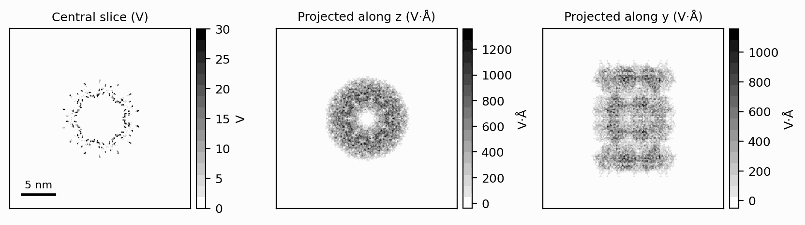
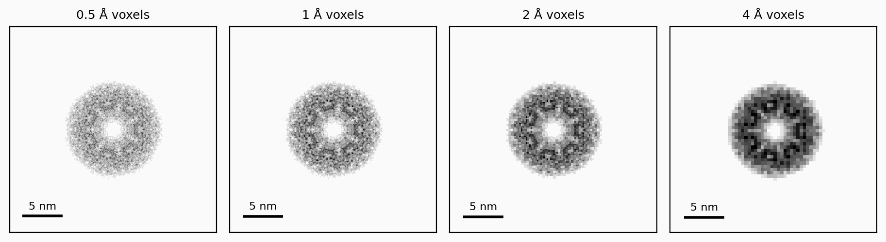
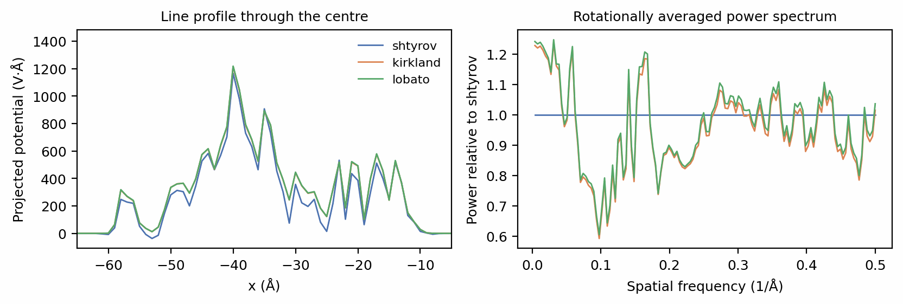
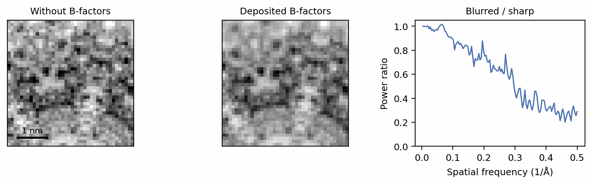

# Structures and potentials

An electron passing through a specimen is deflected by the specimen's
electrostatic potential, the field set up by its nuclei and their electron
clouds. Every image SPECTER simulates starts from that potential. It is built
from an atomic model as a superposition of one potential per atom,

\[
V(\mathbf{r}) = \sum_i V_i(\mathbf{r} - \mathbf{r}_i),
\]

the *independent atom model* (Kirkland 2010). Each \(V_i\) is a fitted, spherically symmetric
function of the atom's type, and \(V\) is measured in volts. This page loads a
structure, renders its potential onto a voxel grid, and shows the two choices
that change the result: the voxel size and the scattering factors.

## Loading a structure

`Structure.from_pdb` reads an atomic model from a PDB (Berman et al. 2000)
accession code or a local `.pdb`/`.cif` file. The example is the 660 kDa
20S proteasome of [6BDF](https://www.rcsb.org/structure/6BDF) (Campbell et al. 2015):

```python
--8<-- "docs-figures/walkthrough/potentials.py:load"
```

```{ .text .output }
--8<-- "docs-includes/walkthrough/potentials-load.txt"
```

An accession code is downloaded once into the PDB cache
(`~/.cache/specter/pdb` by default; see
[Manage the PDB cache](../user-guide/cache.md)) and read from there afterwards.
`assembly=True`, the default, builds the biological assembly rather than the
asymmetric unit. A local file is read where it lies:

```python
structure = Structure.from_pdb("path/to/model.cif")
```

Each atom carries a *bonded species* as well as an element: `N(HHHC)` is a
nitrogen bonded to three hydrogens and a carbon. The default scattering
factors are fitted per bonded species (Shtyrov et al. 2026), which is why the structure is typed
from its bond topology as it loads ([Scattering factors](#scattering-factors)
below). The largest diameter is worth keeping: the next page uses it to space
neighbouring particles.

## Rendering a potential

`Structure.render` evaluates the potential on a cubic grid of `box` voxels of
`voxel_size` Å, centred on the model, and returns a `Specimen`:

```python
--8<-- "docs-figures/walkthrough/potentials.py:render"
```

```{ .text .output }
--8<-- "docs-includes/walkthrough/potentials-render.txt"
```

`specimen.potential` is an ordinary `(Z, Y, X)` tensor, with the beam
travelling along \(z\). Rendering runs on the device you name and the result
stays there. The analytic renderer evaluates each atom's potential in closed
form, which is a loop of small operations per atom and an order of magnitude
faster on a GPU than on a CPU.

The volume can be inspected with plain tensor operations:

```python
--8<-- "docs-figures/walkthrough/potentials.py:project"
```

{ width="900" style="display:block;margin:1.2em auto;" }
///caption
A central slice through the rendered potential (left), and its projection
along the beam (centre) and across it (right). The slice resolves individual
atoms as sharp peaks. The projection along \(z\) is what a thin specimen
imposes on the beam's phase.
///

The projected potential \(\int V\,dz\), in V·Å, is the quantity a thin
specimen's image depends on. A thicker specimen is not described by its
projection alone, which is why SPECTER keeps the full volume and propagates
through it (see [Scattering](scattering.md)).

## Voxel size

The voxel size sets the image's pixel size and its Nyquist frequency,
\(1/(2\,\Delta x)\). Rendering the same structure at four voxel sizes, with
the box scaled to cover the same 256 Å:

```python
--8<-- "docs-figures/walkthrough/potentials.py:voxel-size"
```

```{ .text .output }
--8<-- "docs-includes/walkthrough/potentials-voxel-size.txt"
```

{ width="900" style="display:block;margin:1.2em auto;" }
///caption
The same structure rendered at four voxel sizes. Coarser voxels average the
atomic peaks away; the total scattering is unchanged.
///

The integral of the potential agrees to within 0.01% at every voxel size,
while the peak value changes by a factor of 35. Each
voxel holds the average of the potential over its own volume, so the integral
(the specimen's total scattering at zero frequency) is conserved, and an atom's
peak, which is a cusp with no grid-independent value, is not. Compare
potentials across voxel sizes by integrals or by spectra, never by peak
values. [From a single atom to a potential volume](../concepts/atomic-potentials.md#from-a-single-atom-to-a-potential-volume)
describes how the renderer supersamples and pools to achieve this.

Choose the voxel size from the resolution you need to simulate. A voxel of
1 Å reaches 2 Å Nyquist, which covers single-particle work. Coarser voxels are
common for tomography, where a field of view is thousands of ångströms across.

## Scattering factors

Each atom's \(V_i\) comes from a parameterized fit to its electron scattering
factor. `scattering_factors` selects the fit:

| Value | Fitted per | Use |
|---|---|---|
| `shtyrov` (default; Shtyrov et al. 2026) | Bonded species, e.g. `C(HHHC)` | Biomolecules |
| `kirkland` (Kirkland 2010) | Element | Bulk materials: ice, carbon, gold |
| `lobato` (Lobato & Van Dyck 2014) | Element | Bulk materials |

```python
--8<-- "docs-figures/walkthrough/potentials.py:parameterizations"
```

```{ .text .output }
--8<-- "docs-includes/walkthrough/potentials-parameterizations.txt"
```

{ width="900" style="display:block;margin:1.2em auto;" }
///caption
The projected potential under the three parameterizations. The line profiles
(left) agree in shape, and the per-element fits sit higher. Relative to
Shtyrov (right), their power is 23% higher at the lowest frequencies and
ranges from 40% lower to 20% higher in the bands above.
///

The per-element fits put 11% more total scattering into this protein than the
bonded-species fit does. Bonding moves electron density into the bonds and
changes how strongly a hydrogen scatters, which an element-only fit cannot
represent. Shtyrov factors were fitted to biomolecules for this reason, and
are the default for anything with bond topology. Bulk materials, which lie
outside the range of those fits, use `kirkland`; SPECTER applies that split
for you when it adds ice, carbon or gold (see
[Which parameterization applies to what](../concepts/atomic-potentials.md#which-parameterization-applies-to-what)).

Shtyrov typing needs the structure's hydrogens. A structure deposited without
them still loads, and the atoms whose bonded species cannot be read fall back
to per-element factors (Peng et al. 1996). Installing the
[Monomer Library](../installation.md#monomer-library-for-shtyrov-scattering-factors)
(Vagin et al. 2004) lets SPECTER add the missing hydrogens
from ideal geometry; see
[Hydrogen coordinates](../concepts/atomic-potentials.md#hydrogen-coordinates).

## Deposited B-factors

A deposited model carries a B-factor per atom, which describes how far that
atom is spread by thermal motion and disorder. `use_deposited_bfactors=True`
blurs each atom's potential by its own B-factor:

```python
--8<-- "docs-figures/walkthrough/potentials.py:bfactors"
```

```{ .text .output }
--8<-- "docs-includes/walkthrough/potentials-bfactors.txt"
```

{ width="900" style="display:block;margin:1.2em auto;" }
///caption
A 40 Å patch of the projected potential without and with the deposited
B-factors. The blur leaves low frequencies untouched and removes 70% of the
power at Nyquist.
///

The B-factor is off by default. A rendered potential is a fixed model, and
the blur it applies is a property of one particular deposition; a global
B-factor applied to the image instead is covered in
[Contrast transfer function](ctf.md).

## Rendering from coordinates

A specimen from `Structure.render` is rendered once, and each image rotates
that volume to its own pose. This is fast and adequate for a fixed model. When the atomic coordinates are themselves
the variable, for example when refining a model against images,
`Specimen.from_atoms` renders the atoms afresh at every pose so the image is a
differentiable function of them:

```python
from specter.imaging import Specimen

specimen = Specimen.from_atoms(coordinates, atomic_numbers, voxel_size=1.0, box=256)
```

Bare coordinates carry no bonds, so every atom takes its element's scattering
factors.

## Next

[Specimens: crowding and ice](specimens.md) surrounds this potential with
neighbouring particles and a slab of amorphous ice.

## References

- Berman, H. M., Westbrook, J., Feng, Z., Gilliland, G., Bhat, T. N.,
  Weissig, H., Shindyalov, I. N., & Bourne, P. E. (2000). The Protein Data
  Bank. *Nucleic Acids Research*, 28(1), 235–242.
  [doi:10.1093/nar/28.1.235](https://doi.org/10.1093/nar/28.1.235)
- Campbell, M. G., Veesler, D., Cheng, A., Potter, C. S., & Carragher, B.
  (2015). 2.8 Å resolution reconstruction of the *Thermoplasma acidophilum*
  20S proteasome using cryo-electron microscopy. *eLife*, 4, e06380.
  [doi:10.7554/eLife.06380](https://doi.org/10.7554/eLife.06380)
- Kirkland, E. J. (2010). *Advanced computing in electron microscopy* (2nd
  ed.). Springer.
  [doi:10.1007/978-1-4419-6533-2](https://doi.org/10.1007/978-1-4419-6533-2)
- Lobato, I., & Van Dyck, D. (2014). An accurate parameterization for
  scattering factors, electron densities and electrostatic potentials for
  neutral atoms that obey all physical constraints. *Acta Crystallographica
  Section A: Foundations and Advances*, 70(6), 636–649.
  [doi:10.1107/S205327331401643X](https://doi.org/10.1107/S205327331401643X)
- Peng, L.-M., Ren, G., Dudarev, S. L., & Whelan, M. J. (1996). Robust
  parameterization of elastic and absorptive electron atomic scattering
  factors. *Acta Crystallographica Section A*, 52(2), 257–276.
  [doi:10.1107/S0108767395014371](https://doi.org/10.1107/S0108767395014371)
- Shtyrov, A., Wilson, H., Slowik, D., Yamashita, K., Li, J., Wojdyr, M.,
  et al. (2026). Measurement of atomic scattering factors by cryoelectron
  microscopy. *Proceedings of the National Academy of Sciences*, 123(19),
  e2528758123.
  [doi:10.1073/pnas.2528758123](https://doi.org/10.1073/pnas.2528758123)
- Vagin, A. A., Steiner, R. A., Lebedev, A. A., Potterton, L., McNicholas,
  S., Long, F., & Murshudov, G. N. (2004). REFMAC5 dictionary: Organization
  of prior chemical knowledge and guidelines for its use. *Acta
  Crystallographica Section D: Biological Crystallography*, 60(12),
  2184–2195.
  [doi:10.1107/S0907444904023510](https://doi.org/10.1107/S0907444904023510)
