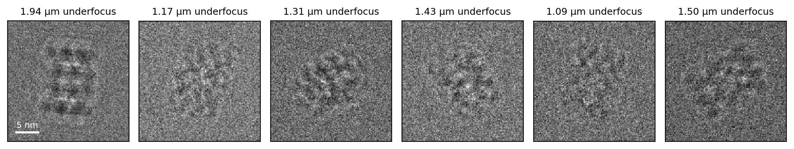
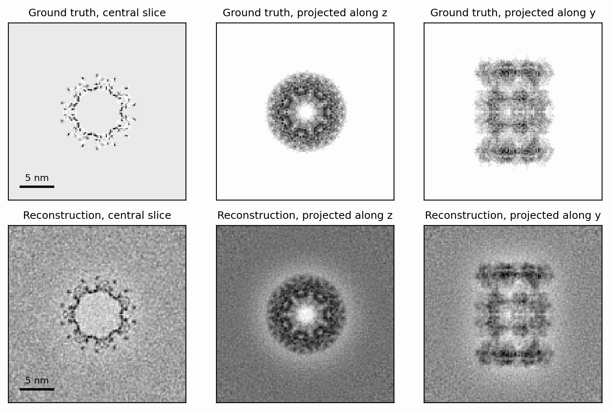
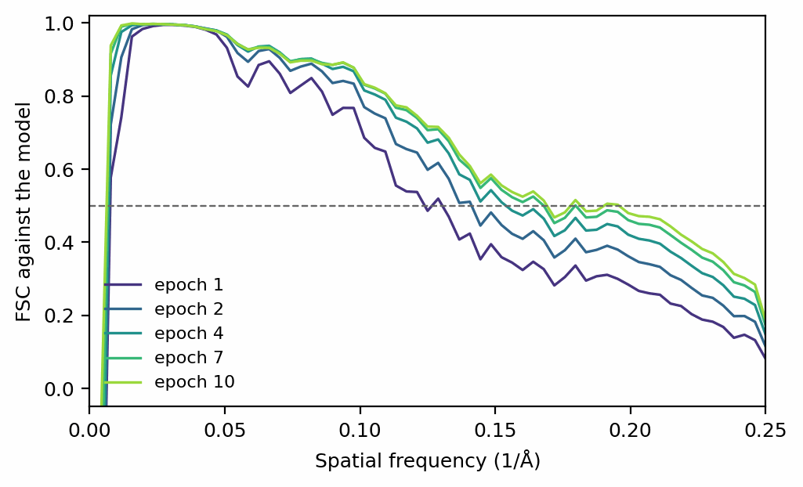
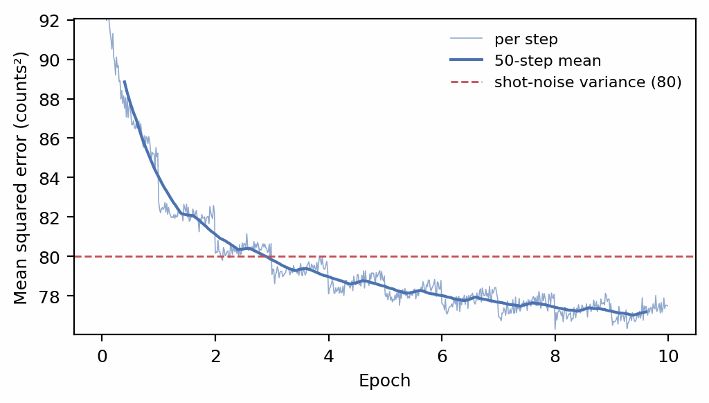
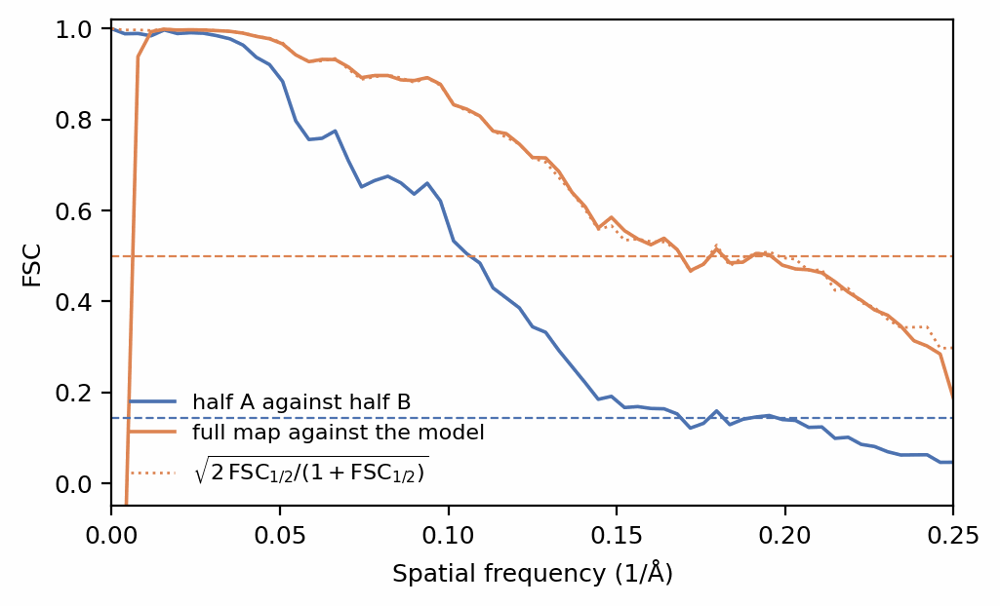

# Reconstruction

The previous pages computed images from a potential. Reconstruction runs the
other way: given images and the imaging parameters of each, it finds the
potential \(V\) whose simulated images best match them,

\[
\hat V = \arg\min_V \sum_i \big\| I_i - f(V;\, \mathbf{q}_i, \mathrm{CTF}_i) \big\|^2,
\]

where \(I_i\) is the \(i\)-th recorded image, \(\mathbf{q}_i\) its pose, and
\(f\) the forward model of this walkthrough: `scatter`, `apply_ctf`,
`intensity` and `detect`, without noise. Every step of \(f\) is a PyTorch
operation, so the gradient of the misfit with respect to every voxel comes
from backpropagation, and the map is fitted by gradient descent. SPECTER's
reconstructor is called Ghostbuster.

This page simulates a stack whose answer is known, reconstructs it, and
measures the map against the model it came from and against itself.

## A stack with a known answer

The ground truth is 6BDF (Campbell et al. 2015) rendered at 2 Å voxels, in a
256 Å box that holds the 192 Å complex at any orientation:

```python
--8<-- "docs-figures/walkthrough/reconstruction.py:setup"
```

```{ .text .output }
--8<-- "docs-includes/walkthrough/reconstruction-setup.txt"
```

`simulate_particles` runs the whole chain of the previous pages, a batch at a
time (see [Particle stacks](particle-stacks.md)). The particles are imaged in
vacuum, with no ice or neighbours, so that the reconstruction can be compared
with the rendered potential directly:

```python
--8<-- "docs-figures/walkthrough/reconstruction.py:simulate"
```

```{ .text .output }
--8<-- "docs-includes/walkthrough/reconstruction-simulate.txt"
```

{ width="900" style="display:block;margin:1.2em auto;" }
///caption
Six of the simulated particles, titled with their defocus. At 20 e⁻/Ų a
2 Å pixel collects 80 electrons on average, and shot noise dominates every
image.
///

## Fitting a map

`Reconstructor` holds the map as a trainable tensor and each image's pose and
transfer function as fixed buffers. A PyTorch Lightning `Trainer` feeds it
batches of images, and every step simulates those images from the current
map, compares them with the data, and updates the map. The callback keeps a
copy of the map after every epoch:

```python
--8<-- "docs-figures/walkthrough/reconstruction.py:reconstruct"
```

```{ .text .output }
--8<-- "docs-includes/walkthrough/reconstruction-reconstruct.txt"
```

The map starts from an empty box. `kmask` confines it to the sphere of
frequencies the voxel grid can represent, and `lr` is the learning rate of
the AdamW optimizer (Loshchilov & Hutter 2019) that updates it.

{ width="760" style="display:block;margin:1.2em auto;" }
///caption
The ground truth (top) and the reconstruction from 1000 particles after ten
epochs (bottom): a central slice and projections along \(z\) and \(y\). The
reconstruction sits on a grey background with a light halo around the
particle.
///

The halo and the background are the parts of the map the images do not
determine. A uniform potential adds the same phase to the whole wave and
changes no intensity, so the map's mean value is nearly invisible to the
data, and
the lowest nonzero frequencies are seen only weakly through the transfer
function, which vanishes at zero frequency. The first shell of the FSC below
reports the mean's sign: it is \(-1\) here, a map whose total is negative
against a model whose total is positive. A nonzero amplitude contrast
(`alpha`) constrains the mean, which these images, simulated with
`alpha = 0`, do not have.

### What the reconstructor models

`Reconstructor.forward` runs the chain of this walkthrough on its own
parameters: `Specimen.scatter`, `ExitWave.apply_ctf`,
`intensity(cc=None)` and `detect(noise=None)`, which returns the expected
counts. Because the simulator and the reconstructor share that code, a
change to the physics of either reaches both, and the conventions that must
agree, such as the plane defocus is measured from, cannot drift apart.

The reconstructor accepts only two of the settings groups the simulator
takes: `Propagation` (how the exit wave is computed) and `Optics` (the
transfer-function engine). The coherence and radiation-damage envelopes
(`Envelopes`) and the camera's response (`Camera`) are absent on purpose. A
real dataset gives no way to determine them, and the high-frequency signal
they remove is absorbed into the reconstructed map instead, so assuming
values for them would add information the data do not contain. The stack
here was simulated with the default 2.7 mm \(C_c\), and the reconstruction
models none. What the reconstructor does take is what processing software
estimates from the data: each image's defocus and astigmatism, and
optionally a B-factor.
[The same chain runs in reverse](../concepts/pipeline-overview.md#the-same-chain-runs-in-reverse)
gives the details.

## Measuring the map

The Fourier shell correlation (Harauz & van Heel 1986) compares two maps one
spatial frequency at a time,

\[
\mathrm{FSC}(k) = \frac{\mathrm{Re}\sum_{|\mathbf{k}| \in k} F_1(\mathbf{k})\, F_2^*(\mathbf{k})}
{\sqrt{\sum_{|\mathbf{k}| \in k} |F_1(\mathbf{k})|^2 \, \sum_{|\mathbf{k}| \in k} |F_2(\mathbf{k})|^2}},
\]

summing over the shell of Fourier components at frequency \(k\). Against a
known model, the resolution is conventionally read where the FSC falls
through 0.5 (Rosenthal & Henderson 2003):

```python
--8<-- "docs-figures/walkthrough/reconstruction.py:fsc"
```

```{ .text .output }
--8<-- "docs-includes/walkthrough/reconstruction-fsc.txt"
```

{ width="600" style="display:block;margin:1.2em auto;" }
///caption
FSC against the ground truth after five of the ten epochs. Each pass over
the data extends the frequencies the map has recovered; the dashed line is
the 0.5 threshold. The vertical rise at the far left is the first shell,
discussed above.
///

Ten epochs took the map from 7.7 Å to 5.1 Å, and it was still improving.
The loss tells a different story. Each step's loss is the mean squared
difference between the recorded and simulated counts per pixel. A map that
reproduced every image exactly, apart from its shot noise, would leave a
residual whose variance is the Poisson variance, equal to the mean count per
pixel:

```{ .text .output }
--8<-- "docs-includes/walkthrough/reconstruction-loss.txt"
```

{ width="600" style="display:block;margin:1.2em auto;" }
///caption
The loss over training, per step and as a 50-step running mean, with the
shot-noise variance of the data (dashed).
///

The loss falls below the shot-noise variance at the end of the third epoch,
which means the map has begun to reproduce the noise of the particular images
it was trained on. The steps down at the epoch boundaries are the same
effect: from the second epoch on, every image has been seen before. The FSC
kept improving for the seven epochs after that, so the training loss alone
cannot say when a reconstruction has finished. Without a model to compare against, the
half maps below are what to watch.

## Half maps

Real data come without a model to compare against. The gold-standard
procedure splits the particles into two halves, reconstructs each
independently, and correlates the two half maps (Henderson et al. 2012;
Scheres & Chen 2012). Their noise is independent, so the FSC between them
measures the signal they share:

```python
--8<-- "docs-figures/walkthrough/reconstruction.py:halves"
```

```{ .text .output }
--8<-- "docs-includes/walkthrough/reconstruction-halves.txt"
```

{ width="600" style="display:block;margin:1.2em auto;" }
///caption
The FSC between the two half maps (blue) and between the full map and the
ground truth (orange). The dotted curve predicts the second from the first
alone, \(\sqrt{2\,\mathrm{FSC}_{1/2}/(1+\mathrm{FSC}_{1/2})}\); the dashed
lines are the 0.143 and 0.5 thresholds.
///

Each half was trained for twenty epochs, so that it takes as many optimizer
steps as the full map. Each holds half the particles, so its map is noisier
than the full map, and the half-map FSC sits below the full map's FSC against
the truth. The relation between them follows from the half maps' independent
noise (Rosenthal & Henderson 2003): the full map's correlation with the
truth is \(\sqrt{2\,\mathrm{FSC}_{1/2}/(1+\mathrm{FSC}_{1/2})}\), and a half-map
FSC of 0.143 corresponds to 0.5 against the truth. That is why half maps are
read at 0.143. Here the prediction follows the measured curve across the
band, and the two thresholds give 5.05 Å and 5.11 Å.

## Real data

For a real dataset, use `specter reconstruct particle` (also available as
`specter ghostbuster particle`) or the `Ghostbuster` class it calls. Both
read poses and transfer functions from a CryoSPARC `.cs` file, bring a
normalized particle stack back to counts, split it into gold-standard halves
by default, compute the half-map FSC after every epoch, and record the run as
a numbered job. [Reconstruct a volume](../user-guide/reconstruction.md)
covers the workflow.

`Reconstructor` can also refine each particle's rotation and shift, and a
defocus offset, alongside the map (`lr_R`, `lr_T`, `lr_D`). With the map held
fixed that refinement recovers the true values of simulated particles;
alongside map refinement it is not validated. See
[Limitations](../user-guide/reconstruction.md#limitations).

## Next

[From Python to the command line](command-line.md) runs the simulations of
this walkthrough at scale with the `specter` command.

## References

- Campbell, M. G., Veesler, D., Cheng, A., Potter, C. S., & Carragher, B.
  (2015). 2.8 Å resolution reconstruction of the *Thermoplasma acidophilum*
  20S proteasome using cryo-electron microscopy. *eLife*, 4, e06380.
  [doi:10.7554/eLife.06380](https://doi.org/10.7554/eLife.06380)
- Harauz, G., & van Heel, M. (1986). Exact filters for general geometry three
  dimensional reconstruction. *Optik*, 73, 146–156.
- Henderson, R., Sali, A., Baker, M. L., Carragher, B., Devkota, B., Downing,
  K. H., et al. (2012). Outcome of the first electron microscopy validation
  task force meeting. *Structure*, 20(2), 205–214.
  [doi:10.1016/j.str.2011.12.014](https://doi.org/10.1016/j.str.2011.12.014)
- Loshchilov, I., & Hutter, F. (2019). Decoupled weight decay regularization.
  *International Conference on Learning Representations (ICLR)*.
  [arXiv:1711.05101](https://arxiv.org/abs/1711.05101)
- Rosenthal, P. B., & Henderson, R. (2003). Optimal determination of particle
  orientation, absolute hand, and contrast loss in single-particle electron
  cryomicroscopy. *Journal of Molecular Biology*, 333(4), 721–745.
  [doi:10.1016/j.jmb.2003.07.013](https://doi.org/10.1016/j.jmb.2003.07.013)
- Scheres, S. H. W., & Chen, S. (2012). Prevention of overfitting in cryo-EM
  structure determination. *Nature Methods*, 9(9), 853–854.
  [doi:10.1038/nmeth.2115](https://doi.org/10.1038/nmeth.2115)
