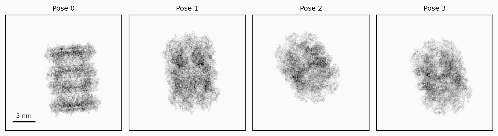
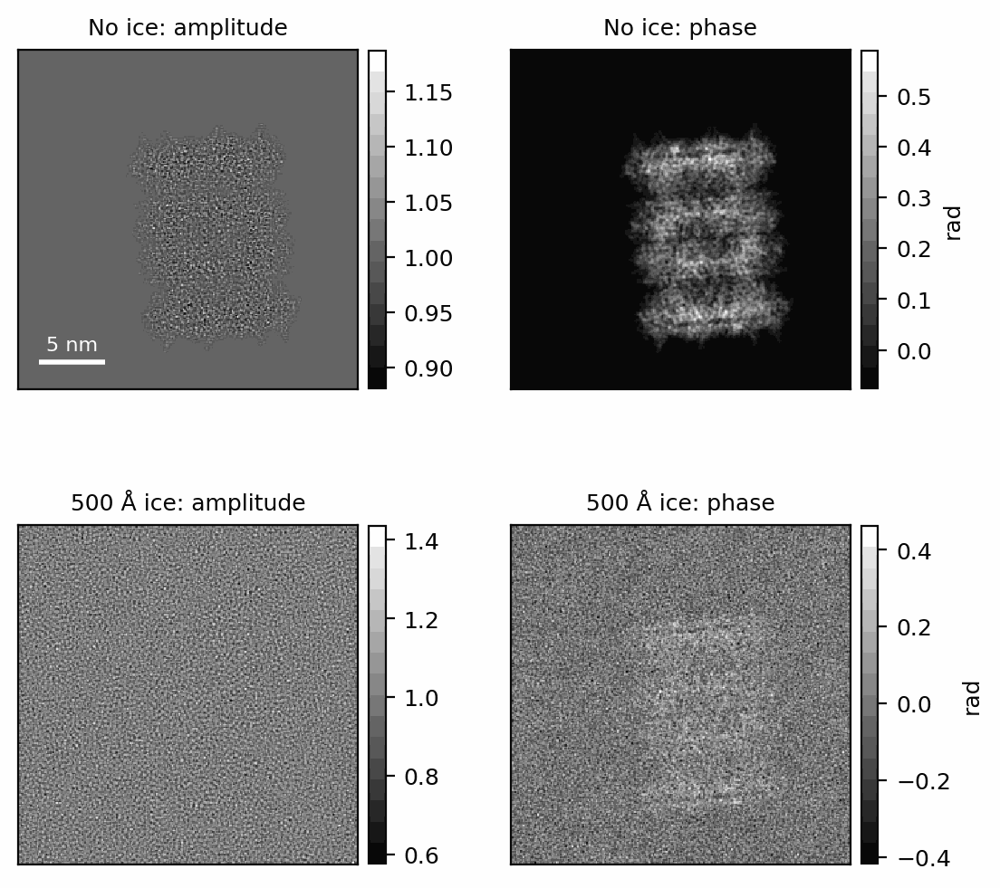
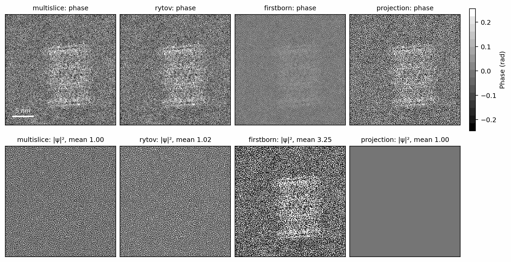
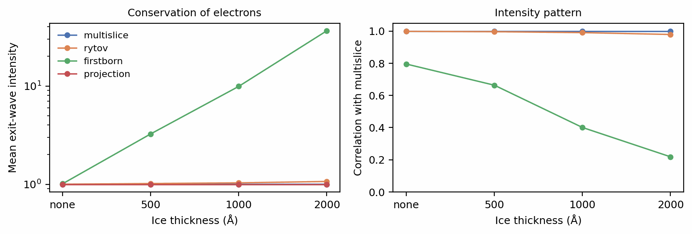
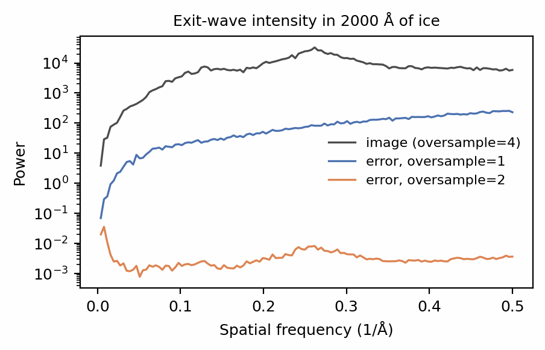
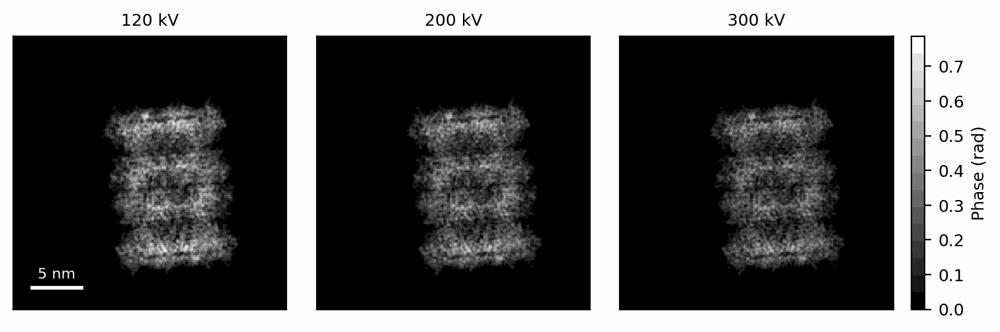

# Scattering

An electron wave crossing the specimen picks up a phase wherever the
potential is non-zero. For a specimen thin enough that the wave does not
spread while crossing it, the wave leaving the far face is

\[
\psi(x, y) = \exp\!\Big(i\sigma \int V(x, y, z)\,dz\Big),
\]

the *phase-object approximation* (Kirkland 2010, Ch. 5): the projected potential of the previous
pages, multiplied by the interaction parameter \(\sigma\). A real specimen
plus its ice is hundreds to thousands of ångströms thick, and over that
depth the wave diffracts as it goes. `Specimen.scatter` therefore propagates
the wave through the full volume, slice by slice (Cowley & Moodie 1957), and returns the result as
an `ExitWave`. This page covers the two physical constants that set the
interaction, the poses that orient each particle, the exit wave itself, the
propagation models, and the grid the propagation runs on.

## Wavelength and interaction parameter

An electron accelerated through \(U\) kilovolts has the relativistic de
Broglie wavelength \(\lambda\), and couples to the potential through the
interaction parameter \(\sigma\), the phase per volt per ångström of path:

```python
--8<-- "docs-figures/walkthrough/scattering.py:constants"
```

```{ .text .output }
--8<-- "docs-includes/walkthrough/scattering-constants.txt"
```

The 300 kV wavelength, 1.9687 pm, is the textbook value. A faster electron
interacts more weakly: \(\sigma\) at 120 kV is 32% larger than at 300 kV,
so the same specimen imposes a larger phase at lower voltage. Both formulas
are in [Two numbers set the whole propagation problem](../concepts/scattering/index.md#two-numbers-set-the-whole-propagation-problem).

## Orienting the particle

The setup is the rendered 6BDF (Campbell et al. 2015) potential from
[Structures and potentials](potentials.md):

```python
--8<-- "docs-figures/walkthrough/scattering.py:setup"
```

A `Poses` holds one orientation and one in-plane shift per image.
`Poses.random` draws orientations uniformly over the rotation group and
shifts uniformly within `±shift` Å along each axis:

```python
--8<-- "docs-figures/walkthrough/scattering.py:poses"
```

```{ .text .output }
--8<-- "docs-includes/walkthrough/scattering-poses.txt"
```

Orientations are unit quaternions in the scalar-last \((x, y, z, w)\) order
of `roma` (Bregier 2021), and shifts are in ångströms with the origin-offset
sign of RELION (Scheres 2012). `ids`
numbers the images within their stack. When you pass a seed, every
per-image random draw (the neighbours, the ice, the detector noise) is
derived from it and the image's id, which
[Particle stacks](particle-stacks.md) relies on. The conventions are set out
in [Poses](../concepts/conventions.md#poses).

`Specimen.materialize` returns the volumes `scatter` would propagate, one per
pose, which is the way to look at what the beam will see:

```python
--8<-- "docs-figures/walkthrough/scattering.py:materialize"
```

```{ .text .output }
--8<-- "docs-includes/walkthrough/scattering-materialize.txt"
```

{ width="900" style="display:block;margin:1.2em auto;" }
///caption
The materialized volumes, projected along the beam, for the four random
poses. Each particle is rotated about the box centre and then shifted in the
image plane.
///

## The exit wave

`Specimen.scatter` builds each image's specimen at its pose and propagates a
unit-amplitude plane wave through it:

```python
--8<-- "docs-figures/walkthrough/scattering.py:scatter"
```

```{ .text .output }
--8<-- "docs-includes/walkthrough/scattering-scatter.txt"
```

The wave is complex, one per pose. `waves.array` lies on the *propagation
grid*, `oversample` times finer than the pixels per axis
([Oversampling](#oversampling) below explains why), and `waves.pixels()`
Fourier-crops it to the pixel grid for inspection. The later stages consume
`waves.array` directly, so the image is formed on the finer grid.
`defocus_shift` is minus half the depth of the box, −128 Å here, since the
wave leaves at the exit face, downstream of the midplane and further from
focus. The next page subtracts it from the defocus, so that the defocus you
pass is that of the box's midplane; see
[The defocus reference plane](ctf.md#the-defocus-reference-plane).

Ice changes the exit wave substantially. Solvating the same specimen in
500 Å of amorphous ice (the subject of the
[previous page](specimens.md)) and scattering it with the same pose and seed:

```python
--8<-- "docs-figures/walkthrough/scattering.py:ice"
```

```{ .text .output }
--8<-- "docs-includes/walkthrough/scattering-ice.txt"
```

{ width="640" style="display:block;margin:1.2em auto;" }
///caption
Amplitude (left) and phase relative to the mean wave (right) of the exit
wave, without ice (top) and in 500 Å of ice (bottom). The ice adds a
uniform phase of 1.5 rad, which the panels remove, and a speckle in both
amplitude and phase from its own structure.
///

The phase carries the particle. The amplitude departs from 1 only because
the wave diffracts inside the specimen; a pure phase object would leave it
flat. The uniform 1.495 rad that 500 Å of ice adds is close to
\(\sigma \times 4.5\ \mathrm{V} \times 500\) Å, the interaction parameter
times ice's mean inner potential times the thickness. A uniform phase carries
no contrast. The ice's structure does: its amplitude fluctuation is six times
the dry specimen's.

## Propagation models

`scattering_model` selects how the wave is carried through the volume:

| Model | Exit wave | Use |
|---|---|---|
| `multislice` (default) | Transmit through each slice, then propagate to the next | Every simulation; the reference |
| `rytov` | Exponential of a summed, propagated phase | Reconstruction, where it is the default |
| `firstborn` | The same sum, linearized: \(1 + i\Theta\) | Thin, weakly scattering specimens |
| `projection` | \(\exp(i\sigma\int V\,dz)\), no propagation | Coarse previews |

Scattering the same pose through no ice and three ice thicknesses with each
model, and comparing the exit-wave intensity \(|\psi|^2\) with multislice's:

```python
--8<-- "docs-figures/walkthrough/scattering.py:models"
```

```{ .text .output }
--8<-- "docs-includes/walkthrough/scattering-models.txt"
```

The specimens are identical across models: the ice is drawn from the seed and
the pose, not from the model.

{ width="900" style="display:block;margin:1.2em auto;" }
///caption
Phase (top, shared scale) and intensity (bottom) of the exit wave in 500 Å
of ice under each model. First Born's intensity is drawn on its own offset
scale, since its mean is 3.25.
///

{ width="900" style="display:block;margin:1.2em auto;" }
///caption
Left: the mean intensity of the exit wave, which should be 1 because the
specimen absorbs nothing. Right: how well each model's intensity pattern
correlates with multislice's. Projection's intensity is flat and has no
pattern to correlate.
///

Three behaviours follow from the forms in the table.

- **Rytov** tracks multislice closely: its intensity pattern correlates at
  0.979 or better at every thickness. Its mean intensity is not exactly
  conserved, and drifts upward with thickness, by 6.7% at 2000 Å.
- **First Born** does not conserve electrons. Its mean intensity is
  approximately \(1 + |\Theta|^2\), so the 1.5 rad of uniform phase per 500 Å
  of ice becomes a mean of 3.25 at 500 Å and 36.5 at 2000 Å, and the
  spurious \(|\Theta|^2\) term overwhelms the pattern: correlation falls from
  0.80 without ice to 0.22 at 2000 Å. The particle that shows in its
  intensity in the bottom row comes from that spurious term.
- **Projection** is a pure phase object, so its exit-wave intensity is
  exactly flat. Its phase carries the projected potential, and for a thin
  specimen the lens turns that phase into contrast much as it would the
  propagated wave.

The derivations and accuracy measurements against thickness are in
[Rytov](../concepts/scattering/rytov.md#accuracy-vs-thickness) and
[Where the linearization breaks down](../concepts/scattering/other-modes.md#where-the-linearization-breaks-down).

Two further models complete the set. `kinematic` keeps each slice's
transmission exact but adds the slices rather than multiplying them, and
shares first Born's failure for that reason
([Kinematic](../concepts/scattering/other-modes.md#kinematic)). `ctf` returns
the real projected potential \(2\sigma\int V\,dz\) on the pixel grid rather
than a wave. It feeds the linear (weak-phase)
image model, in which amplitude contrast enters through the transfer function
instead of the potential. It suits a quick preview of a thin specimen and is
covered with the transfer function on the [next page](ctf.md).

## Oversampling

Multislice multiplies the wave by each slice's transmission function
\(e^{i\sigma V\Delta z}\). The product carries frequencies up to twice the
grid's Nyquist frequency, and on a grid that cannot hold them they wrap
around into the band. Over thousands of slices the wrapped content
accumulates. `oversample` runs the recursion, and forms the image, on a grid
that many times finer per axis, so the product has room to exist; the
detector later samples the intensity back to the pixels. Comparing the
default, `oversample=2`, and the volume's own grid, `oversample=1`, against a
4× reference in 2000 Å of ice:

```python
--8<-- "docs-figures/walkthrough/scattering.py:oversample"
```

```{ .text .output }
--8<-- "docs-includes/walkthrough/scattering-oversample.txt"
```

{ width="560" style="display:block;margin:1.2em auto;" }
///caption
The rotationally averaged power spectrum of the exit-wave intensity in
2000 Å of ice (grey), and of its error against the 4× reference at
`oversample=1` (blue) and `oversample=2` (orange).
///

On the volume's own grid the wrapped content is 2% of the image's contrast
power, and its power grows with frequency. At `oversample=2` the error falls to
4.1e-7, the float32 noise floor, with no bandlimit needed. Two is the default
because it is converged; the cost and the comparison with Kirkland's (2010) `klim`
bandlimit are in
[Grid aliasing](../concepts/scattering/multislice.md#grid-aliasing-oversample-and-klim).

## Accelerating voltage

Lowering the voltage raises \(\sigma\), so the same specimen shifts the phase
further:

```python
--8<-- "docs-figures/walkthrough/scattering.py:voltage"
```

```{ .text .output }
--8<-- "docs-includes/walkthrough/scattering-voltage.txt"
```

{ width="900" style="display:block;margin:1.2em auto;" }
///caption
The exit-wave phase at three voltages on a shared scale. The largest phase
shift grows from 0.64 rad at 300 kV to 0.79 rad at 120 kV as \(\sigma\)
grows.
///

A stronger phase means more contrast per electron, and also more multiple
scattering in thick ice. `voltage` is passed to `scatter` because it sets
\(\sigma\) and \(\lambda\) for the propagation; the transfer function and the
coherence model read it from the `ExitWave`.

## Propagation settings

`scatter` takes the fields of the `Propagation` settings group as keywords,
or a `Propagation` object, never both:

```python
--8<-- "docs-figures/walkthrough/scattering.py:settings"
```

```{ .text .output }
--8<-- "docs-includes/walkthrough/scattering-settings.txt"
```

The two spellings give bit-identical waves. Besides `scattering_model` and
`oversample`, the group holds `alpha` (the amplitude-contrast ratio, applied
to the potential before propagation), `pad_fft` (a wider real-space frame
against wrap at the box edge), `ews_curvature_sign`, `absorption_model` and
`rotate_mode`; see [`specter.settings`](../api/core.md#spectersettings) in
the API reference.

## Next

[Contrast transfer function](ctf.md) passes the exit wave through the
objective lens: defocus, astigmatism and spherical aberration.

## References

- Bregier, R. (2021). Deep regression on manifolds: A 3D rotation case
  study. In *2021 International Conference on 3D Vision (3DV)* (pp.
  166–174). IEEE.
  [doi:10.1109/3DV53792.2021.00027](https://doi.org/10.1109/3DV53792.2021.00027)
- Campbell, M. G., Veesler, D., Cheng, A., Potter, C. S., & Carragher, B.
  (2015). 2.8 Å resolution reconstruction of the *Thermoplasma acidophilum*
  20S proteasome using cryo-electron microscopy. *eLife*, 4, e06380.
  [doi:10.7554/eLife.06380](https://doi.org/10.7554/eLife.06380)
- Cowley, J. M., & Moodie, A. F. (1957). The scattering of electrons by atoms
  and crystals. I. A new theoretical approach. *Acta Crystallographica*,
  10(10), 609–619.
  [doi:10.1107/S0365110X57002194](https://doi.org/10.1107/S0365110X57002194)
- Kirkland, E. J. (2010). *Advanced computing in electron microscopy* (2nd
  ed.). Springer.
  [doi:10.1007/978-1-4419-6533-2](https://doi.org/10.1007/978-1-4419-6533-2)
- Scheres, S. H. W. (2012). RELION: Implementation of a Bayesian approach to
  cryo-EM structure determination. *Journal of Structural Biology*, 180(3),
  519–530.
  [doi:10.1016/j.jsb.2012.09.006](https://doi.org/10.1016/j.jsb.2012.09.006)
