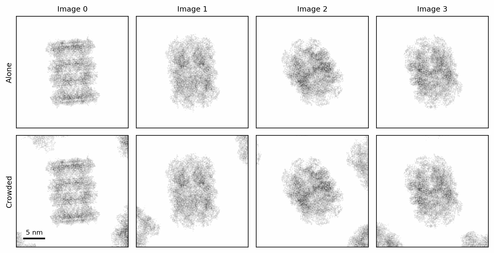
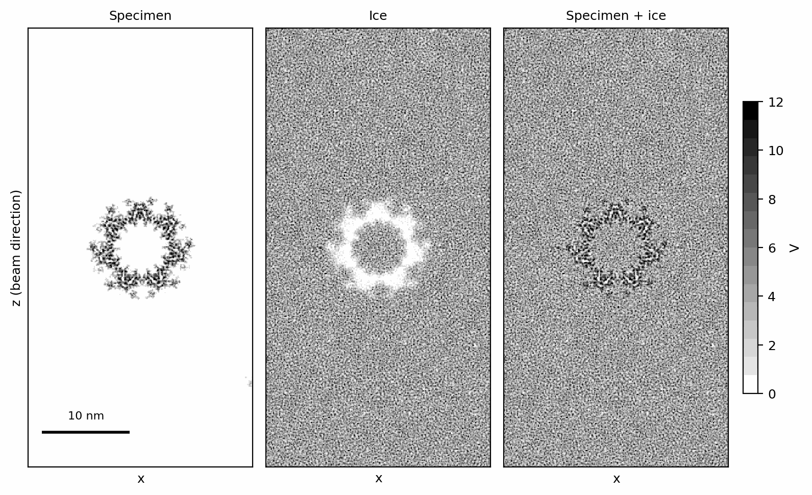
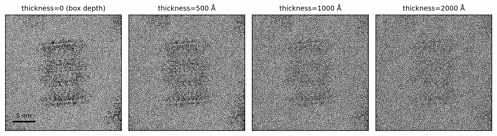
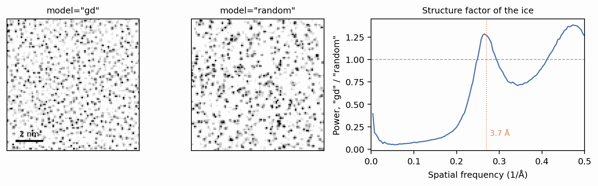

# Specimens: crowding and ice

A particle in a real cryo-EM sample is not alone in vacuum. It sits in a film
of vitreous ice, usually a few hundred ångströms thick, and other copies of
the same particle lie close by. Both contribute to the image: the ice adds a
structured background that the particle's contrast has to compete with, and
neighbours that overlap the box add density that is not the particle's own.
This page surrounds the potential rendered in
[Structures and potentials](potentials.md) with neighbouring copies and a
slab of amorphous ice, and shows the settings that control each.

The setup renders the same 6BDF potential (Berman et al. 2000; Campbell et
al. 2015) as the previous page and keeps its largest diameter for spacing the
neighbours:

```python
--8<-- "docs-figures/walkthrough/specimens.py:setup"
```

## A specimen is a recipe

`Specimen.crowd` and `Specimen.solvate` do not modify the potential. Each
returns a new `Specimen` that records what to build around the template, and
the building happens later, once per image, when the specimen is scattered.
Every image therefore gets its own neighbours and its own ice, drawn afresh
around the particle at that image's pose. `Specimen.plan` lists the steps a
scatter will take, in order:

```python
--8<-- "docs-figures/walkthrough/specimens.py:recipe"
```

```{ .text .output }
--8<-- "docs-includes/walkthrough/specimens-recipe.txt"
```

The order is fixed by the physics rather than by the order of the calls: the
template is rotated to the image's pose first, the neighbours are placed
around it, and the ice fills whatever space they leave. The last step belongs
to the next page, [Scattering](scattering.md).

`Specimen.materialize` takes the same arguments as `Specimen.scatter` and
returns the volumes the beam would pass through, as a `(n, Z, Y, X)` tensor,
without propagating anything. The rest of this page uses it to look inside
the recipe.

## Crowding

`crowd` places randomly rotated copies of the template around the particle
by Poisson-disk sampling (Bridson 2007), so that no two copies sit closer than
`min_distance`, centre to centre. Spacing them by the particle's largest
diameter keeps the copies from interpenetrating. The same four poses, with
and without neighbours:

```python
--8<-- "docs-figures/walkthrough/specimens.py:crowd"
```

```{ .text .output }
--8<-- "docs-includes/walkthrough/specimens-crowd.txt"
```

{ width="900" style="display:block;margin:1.2em auto;" }
///caption
The projected potential of four images, without (top) and with (bottom)
crowding. Each image draws its own neighbours, which enter the box at its
edges and corners.
///

With a 192 Å spacing in a 256 Å box, only parts of the neighbours fall inside
the box, adding 25% to 35% to the potential the particle alone carries. A
smaller `min_distance` packs the copies more densely.

`crowd` takes its settings as keywords, as here, or as one
`specter.settings.Crowding` object, never both:

```python
from specter.settings import Crowding

crowded = specimen.crowd(Crowding(min_distance=192.0))
```

The neighbours are placed within a slab of depth `max_distance_z` around the
particle. It defaults to the template's own depth (256 Å here) and does not
grow with the ice thickness set below, so thicker ice adds water above and
below the neighbours rather than more neighbours.
`water_air_interface=True` biases the copies toward the two surfaces of the
ice, where particles adsorb during vitrification (Noble et al. 2018). Both are
described in
[Pose & crowding](../concepts/pose-crowding.md#crowding).

## Ice

`solvate` embeds the specimen in amorphous ice. `model="gd"` draws the ice
from SPECTER's bundled library of water configurations, whose molecular
positions were optimised to reproduce the structure factor of low-density
amorphous ice (see [Ice structure](../concepts/ice.md#the-optimisation-target-sk)).
Each image draws a randomly rotated and translated crop of that library.
`thickness` sets the depth of the ice column in Å.

The ice must not overlap the protein: a voxel the particle already fills has
no room for water. SPECTER reads how full each voxel is from the specimen's
potential, coarse-grained over 2 Å (the size of a water molecule), and scales
the ice by the free fraction:

\[
o(\mathbf{r}) = \min\!\left(\frac{\bar V(\mathbf{r})}{V_{\text{ref}}},\,1\right),
\qquad
V_{\text{ice}}(\mathbf{r}) \to \bigl(1 - o(\mathbf{r})\bigr)\,V_{\text{ice}}(\mathbf{r}).
\]

`Structure.render` records the molecule's mass on the specimen, and
\(V_{\text{ref}}\) is solved from it, so the particle displaces exactly its own
volume of water ([Solvent displacement](../concepts/ice.md#solvent-displacement)).
`Specimen.dry` returns the same recipe with the ice removed, which draws the
same neighbours for the same poses and seed, so the difference between the
two volumes is the ice alone:

```python
--8<-- "docs-figures/walkthrough/specimens.py:solvate"
```

```{ .text .output }
--8<-- "docs-includes/walkthrough/specimens-solvate.txt"
```

{ width="900" style="display:block;margin:1.2em auto;" }
///caption
A 16 Å thick slab through the centre of one image's volume, seen from the
side with the beam travelling down the page: the particle (left), the ice
with the particle's volume cut out of it (centre), and their sum (right). The
ice fills the ring's central channel, which the protein does not occupy.
///

In the sum, the protein stands out from the ice only by the difference
between its mean potential and the water's. A particle in ice therefore has
less contrast than the same particle in vacuum. The mean ice potential over
this box sits below the 4.55 V of unobstructed ice (measured under
[Ice models](#ice-models) below) by the water the particle and its neighbours
displace.

## Ice thickness

`thickness` sizes the box along the beam. A thickness smaller than the
template's own depth leaves the box unchanged, so `thickness=0` means ice
filling the template's 256 Å box, not vacuum:

```python
--8<-- "docs-figures/walkthrough/specimens.py:thickness"
```

```{ .text .output }
--8<-- "docs-includes/walkthrough/specimens-thickness.txt"
```

{ width="900" style="display:block;margin:1.2em auto;" }
///caption
The projected potential of one image at four ice thicknesses, each on its own
grey scale. The neighbours are placed identically in every panel. The 256 Å
box cuts off the parts of them that extend past its top and bottom faces;
from 500 Å on they are whole, and only the water above and below changes.
///

The ice's projected potential grows in proportion to the thickness, but a
uniform phase shift is invisible in an image. What competes with the particle
is the ice's fluctuation about that mean, which grows from 179 to 411 V·Å
between the box depth and 2000 Å while the particle's own projection stays the
same. `thickness` is therefore a contrast setting: it changes the imaging
conditions without changing the specimen. Later pages show what thick ice
does to the image itself.

## Ice models

`model="random"` places water molecules uniformly at random, at the same
density and with the same molecular potential as `"gd"`. It is instant and
has no structure. The two models can be compared on a specimen with nothing
in it, which is pure ice:

```python
--8<-- "docs-figures/walkthrough/specimens.py:models"
```

```{ .text .output }
--8<-- "docs-includes/walkthrough/specimens-models.txt"
```

Both models give the mean inner potential of ice, to within 0.5% of each other.
Because they also share the molecular potential, the ratio of their power
spectra cancels it and leaves the structure factor \(S(k)\) of the `"gd"`
water positions, with \(S(k) = 1\) for positions without correlations:

{ width="900" style="display:block;margin:1.2em auto;" }
///caption
A 96 Å patch of one slice of each ice model (left), and the ratio of their 3D
power spectra (right), which is the structure factor of the `"gd"` ice. The
dotted line marks 3.7 Å.
///

The `"gd"` ice has its first peak at 0.266 Å⁻¹ (3.76 Å), the water ring seen
in the power spectra of real micrographs (McMullan et al. 2015), and a second
near Nyquist. Below
0.15 Å⁻¹ its structure factor falls to between 0.05 and 0.11: ice is nearly
incompressible, so its density fluctuates far less over long distances than
randomly placed molecules do. Random ice has neither feature, and below 0.15 Å⁻¹
it carries 9 to 20 times the power of structured ice. Use `"random"` for quick
tests and `"gd"` for anything compared with experimental data.

The ice uses Kirkland scattering factors (Kirkland 2010) by default
(`Ice(parameterization="kirkland")`), independently of the structure's,
since ice is a bulk material outside the range of the Shtyrov fits
(Shtyrov et al. 2026).

The bundled library holds 20 configurations, each a periodic 256 Å cell of
molecular coordinates rather than a voxel grid, so it renders at whatever
voxel size the specimen uses. A box larger than one cell, such as the
2000 Å column above, is filled with several crops placed side by side. The
library's structure was optimised up to 0.5 Å⁻¹, the Nyquist frequency of
1 Å voxels; [Using the ice cache](../user-guide/ice-cache.md) describes
building a library for finer sampling.

## Seeds

Every random draw a specimen makes (the neighbours' positions and
orientations, the ice crop) comes from a seed derived from the run's `seed`,
the image's id in its stack (`poses.ids`) and the stage. The same seed
therefore reproduces a stack exactly, and an image draws the same specimen
whether it is built alone or as part of the stack:

```python
--8<-- "docs-figures/walkthrough/specimens.py:seeds"
```

```{ .text .output }
--8<-- "docs-includes/walkthrough/specimens-seeds.txt"
```

Slicing `poses` keeps each image's id, which is why `poses[2:3]` draws what
image 2 drew in the full stack. The seed is an argument to each call, not
state on the specimen, so batches and worker processes need nothing shared to
agree. Without a `seed`, the draws come from the global random number
generator and depend on how the images were batched. `specter.seed(0)` in the
setup fixes that generator, and with it the poses `Poses.random` draws;
`Poses.random(n, seed=...)` fixes the poses alone. See
[Reproducibility](../concepts/conventions.md#reproducibility).

## Radiation damage

`damage` applies each exposure's dose envelope (Grant & Grigorieff 2015) to
the specimen's potential, fading its high-resolution structure as the electron
dose destroys it. It acts
on the specimen before the ice is added, so the ice keeps its structure, and
the volume the specimen displaces is read from the undamaged potential.
`plan` shows that order:

```python
--8<-- "docs-figures/walkthrough/specimens.py:damage"
```

```{ .text .output }
--8<-- "docs-includes/walkthrough/specimens-damage.txt"
```

A damaged specimen needs the `Exposure` that damages it whenever it is
scattered or materialized. The ice itself is not damaged by the dose but
rearranges under it; `Ice(motion_variance=...)` models the loss of ice
structure across an exposure. Both are described in
[The solvent under exposure](../concepts/ice.md#the-solvent-under-exposure).

## Next

[Scattering](scattering.md) propagates an electron wave through these volumes
and produces the exit wave.

## References

- Berman, H. M., Westbrook, J., Feng, Z., Gilliland, G., Bhat, T. N.,
  Weissig, H., Shindyalov, I. N., & Bourne, P. E. (2000). The Protein Data
  Bank. *Nucleic Acids Research*, 28(1), 235–242.
  [doi:10.1093/nar/28.1.235](https://doi.org/10.1093/nar/28.1.235)
- Bridson, R. (2007). Fast Poisson disk sampling in arbitrary dimensions.
  In *ACM SIGGRAPH 2007 Sketches* (p. 22). ACM.
  [doi:10.1145/1278780.1278807](https://doi.org/10.1145/1278780.1278807)
- Campbell, M. G., Veesler, D., Cheng, A., Potter, C. S., & Carragher, B.
  (2015). 2.8 Å resolution reconstruction of the *Thermoplasma acidophilum*
  20S proteasome using cryo-electron microscopy. *eLife*, 4, e06380.
  [doi:10.7554/eLife.06380](https://doi.org/10.7554/eLife.06380)
- Grant, T., & Grigorieff, N. (2015). Measuring the optimal exposure for
  single particle cryo-EM using a 2.6 Å reconstruction of rotavirus VP6.
  *eLife*, 4, e06980.
  [doi:10.7554/eLife.06980](https://doi.org/10.7554/eLife.06980)
- Kirkland, E. J. (2010). *Advanced computing in electron microscopy* (2nd
  ed.). Springer.
  [doi:10.1007/978-1-4419-6533-2](https://doi.org/10.1007/978-1-4419-6533-2)
- McMullan, G., Vinothkumar, K. R., & Henderson, R. (2015). Thon rings from
  amorphous ice and implications of beam-induced Brownian motion in single
  particle electron cryo-microscopy. *Ultramicroscopy*, 158, 26–32.
  [doi:10.1016/j.ultramic.2015.05.017](https://doi.org/10.1016/j.ultramic.2015.05.017)
- Noble, A. J., Dandey, V. P., Wei, H., Brasch, J., Chase, J., Acharya, P.,
  et al. (2018). Routine single particle CryoEM sample and grid
  characterization by tomography. *eLife*, 7, e34257.
  [doi:10.7554/eLife.34257](https://doi.org/10.7554/eLife.34257)
- Shtyrov, A., Wilson, H., Slowik, D., Yamashita, K., Li, J., Wojdyr, M.,
  et al. (2026). Measurement of atomic scattering factors by cryoelectron
  microscopy. *Proceedings of the National Academy of Sciences*, 123(19),
  e2528758123.
  [doi:10.1073/pnas.2528758123](https://doi.org/10.1073/pnas.2528758123)
