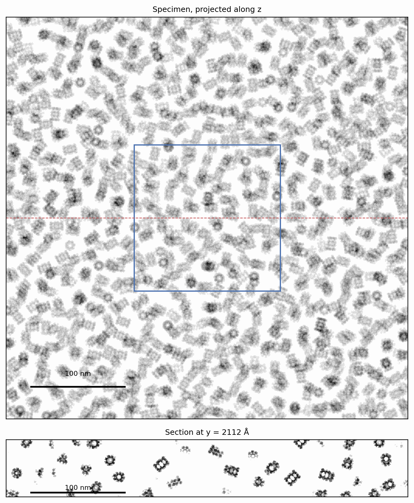
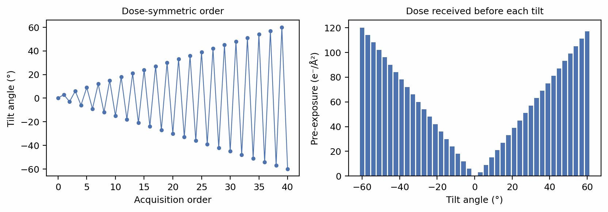
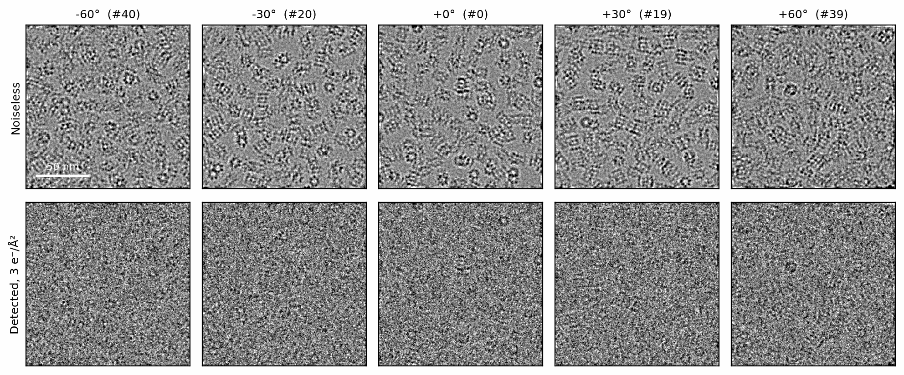
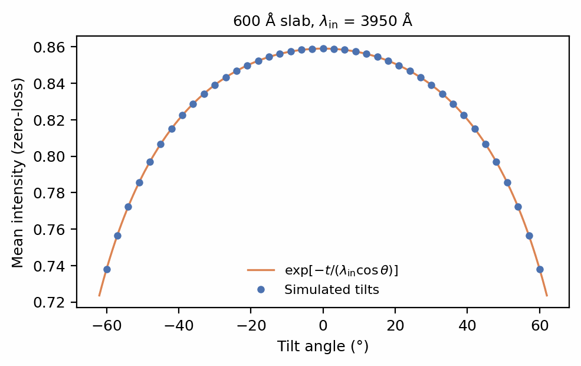

# Tilt series

Cryo-electron tomography records one specimen at many tilt angles and
reconstructs a 3D volume from the series. Each tilt is a full image of the
tilted specimen, so SPECTER propagates the beam through the whole volume at
every angle rather than projecting it. The specimen is the same across the
series while its dose accumulates: every tilt is taken after the exposure of
the tilts before it. A `TiltSeries` prepares a specimen volume once for a set
of tilts, and `TiltSeries.scatter(i)` returns tilt \(i\)'s `ExitWave`, which
the lens and the camera image as on the previous pages.

## A specimen volume

A tilt series images a pre-assembled volume, wrapped by
`Sample.from_volume`. The volume can come from anywhere: the output of
`specter build tomogram`, a map read from an MRC file, or, as here, a field of
6BDF copies (Campbell et al. 2015) drawn without ice. Tomography works at coarser voxels than
single-particle imaging, so the template is rendered at 4 Å:

```python
--8<-- "docs-figures/walkthrough/tilt_series.py:setup"
```

```python
--8<-- "docs-figures/walkthrough/tilt_series.py:volume"
```

```{ .text .output }
--8<-- "docs-includes/walkthrough/tilt-series-volume.txt"
```

The volume is dry: a tilt series blends its own ice into it, once, before it
is tilted. It is also far wider than the 1536 Å field the series will image,
for a reason the coverage check below makes explicit.

{ width="680" style="display:block;margin:1.2em auto;" }
///caption
The specimen: 6BDF copies through a 600 Å slab, projected along the beam
(top) and in a section along the dashed line (bottom). The square marks the
1536 Å field each tilt images.
///

## Tilt angles and exposure

`Poses.tilt_series` turns tilt angles into one pose per tilt, in acquisition
order, about the \(x\) axis by default. `Exposure.tilt_series` gives each tilt
its dose and the dose the specimen had already received when the tilt began.
The angles here follow a dose-symmetric scheme (Hagen et al. 2017), which
starts at zero and alternates sides so that the low tilts, which carry the most information, are
recorded before the specimen is damaged:

```python
--8<-- "docs-figures/walkthrough/tilt_series.py:acquisition"
```

```{ .text .output }
--8<-- "docs-includes/walkthrough/tilt-series-acquisition.txt"
```

{ width="900" style="display:block;margin:1.2em auto;" }
///caption
Left: tilt angle against acquisition order. Right: the dose each tilt's
specimen had received before that tilt was recorded, rising from 0 at 0° to
120 e⁻/Ų at −60°.
///

## Preparing the series

`Sample.tilt_series` does the work every tilt shares: it blends ice into the
volume, builds the absorption field, and checks that the volume covers the
widest tilt.

```python
--8<-- "docs-figures/walkthrough/tilt_series.py:series"
```

```{ .text .output }
--8<-- "docs-includes/walkthrough/tilt-series-series.txt"
```

A view tilted by \(\theta\) about \(x\) sees a strip of specimen longer than
the image along \(y\). For an image of \(n\) pixels through a slab of
\(n_z\) slices it needs

\[
n_\theta = \frac{n}{\cos\theta} + n_z \tan\theta
\]

pixels of volume across: \(384/\cos 60° + 150\tan 60° \approx 1028\) here.
A narrower volume is reflect-padded to that width, which mirrors the specimen
into the flanks the high tilts see. Give the series a volume that is wide
enough, as this one is, whenever the specimen's lateral content matters.

Two settings are specific to this page.
`absorption_model="inelastic_mfp"` removes inelastically scattered electrons
from the image, as an energy filter does, at the measured mean free path of
amorphous ice ([Mean-free-path absorption support](../concepts/scattering/index.md#mean-free-path-absorption-support)).
A tilt series also propagates on a canvas with a 32 px margin (`pad_fft`, on
by default for tilts), keeps it through the transfer function, and crops the
image to the field at the detector. The FFT treats the frame as periodic,
and under tilt its two edges cross the slab at different depths; without the
margin the edges of the high tilts darken, by 16% at 60° for a uniform slab
([`IterativeScattering` and tilted volumes](../concepts/scattering/multislice.md#iterativescattering-and-tilted-volumes)).

## Imaging each tilt

`TiltSeries.scatter(i)` propagates tilt \(i\) through the tilted volume and
returns its exit wave. The transfer function, the focal spread and the
detector act on it as on any other wave:

```python
--8<-- "docs-figures/walkthrough/tilt_series.py:scatter"
```

```{ .text .output }
--8<-- "docs-includes/walkthrough/tilt-series-scatter.txt"
```

The wave is 896 points across: the 384 px field and its 32 px margin on
each side, on the propagation grid twice as fine as the pixels. The detector
crops the image back to the field.

Each wave carries the offset from its own tilted column's exit face to the
specimen's midplane, so the defocus in the `CTF` stays the nominal,
midplane value at every tilt
([The defocus reference plane](../concepts/conventions.md#the-defocus-reference-plane)).
The noise of tilt \(i\) is drawn from the run seed, the series and \(i\), so
any one tilt can be regenerated alone.

{ width="900" style="display:block;margin:1.2em auto;" }
///caption
Five tilts of the series at 3 µm defocus, labelled with their position in the
acquisition order. Top: the noiseless intensity. Bottom: the detected image at
3 e⁻/Ų. Both are low-passed to 12 Å for display. At ±60° the beam crosses
twice the ice, and the tilted slab places particles across the field at
different heights, and so at different defoci.
///

## Path length and the zero-loss intensity

Tilting the slab lengthens the beam's path through it from \(t\) to
\(t/\cos\theta\). Under `inelastic_mfp` absorption, an electron crossing a
path of length \(L\) reaches the image unscattered by inelastic events with
probability \(e^{-L/\lambda_\mathrm{in}}\), the relation by which zero-loss
imaging measures ice thickness (Rice et al. 2018), so the mean intensity of
each tilt should follow

\[
\bar I(\theta) = \exp\!\left(-\frac{t}{\lambda_\mathrm{in}\cos\theta}\right).
\]

{ width="560" style="display:block;margin:1.2em auto;" }
///caption
The mean noiseless intensity of each of the 41 tilts (points) against
\(\exp[-t/(\lambda_\mathrm{in}\cos\theta)]\) for the 600 Å slab and the
3950 Å inelastic mean free path of ice at 300 kV (line; Rice et al. 2018).
///

The simulated tilts agree with the prediction to within \(2\times10^{-4}\)
relative, from 0.859 at 0° to 0.738 at ±60°: at the highest tilts a quarter
of the electrons leave the image, against 14% at zero tilt. The agreement
checks that the tilted propagation sees the path a tilted slab presents. The
loss grows as \(1/\cos\theta\), steeply beyond 60°, which limits the tilt
range a thick specimen can be imaged over.

## Radiation damage

`damaged=True` damages the specimen, and not its ice, before every tilt: tilt
\(i\) sees the specimen under the damage envelope of its own dose after the
pre-exposure of the tilts before it. The series keeps the dry specimen as its
3D spectrum, so each tilt's damaged volume costs one inverse transform. See
[Envelopes](../concepts/aberrations.md#envelopes) for the damage model and
[The solvent under exposure](../concepts/ice.md#the-solvent-under-exposure)
for the ice.

## From the command line

A cellular specimen, with membranes, filaments, microtubules, gold fiducials
and a carbon film around densely packed proteins, is built by
`specter build tomogram`, and `specter simulate tiltseries` images it with the
chain on this page; see [Build a tomogram specimen](../user-guide/build-tomogram.md)
and [Generate a tilt series](../user-guide/tilt-series.md). Tilt geometry
taken from a real acquisition, with a tilt axis off the image axes, is
described in
[Beyond angles](../user-guide/tilt-series.md#beyond-angles-real-tilt-geometry-quaternions-and-aretomo3).

## Next

[Reconstruction](reconstruction.md) inverts the forward model: it recovers a
map from images by simulating them with the same chain.

## References

- Campbell, M. G., Veesler, D., Cheng, A., Potter, C. S., & Carragher, B.
  (2015). 2.8 Å resolution reconstruction of the *Thermoplasma acidophilum*
  20S proteasome using cryo-electron microscopy. *eLife*, 4, e06380.
  [doi:10.7554/eLife.06380](https://doi.org/10.7554/eLife.06380)
- Hagen, W. J. H., Wan, W., & Briggs, J. A. G. (2017). Implementation of a
  cryo-electron tomography tilt-scheme optimized for high resolution
  subtomogram averaging. *Journal of Structural Biology*, 197(2), 191–198.
  [doi:10.1016/j.jsb.2016.06.007](https://doi.org/10.1016/j.jsb.2016.06.007)
- Rice, W. J., Cheng, A., Noble, A. J., Eng, E. T., Kim, L. Y., Carragher,
  B., & Potter, C. S. (2018). Routine determination of ice thickness for
  cryo-EM grids. *Journal of Structural Biology*, 204(1), 38–44.
  [doi:10.1016/j.jsb.2018.06.007](https://doi.org/10.1016/j.jsb.2018.06.007)
  (Apparent inelastic mean free path of 395 ± 11 nm at 300 kV.)
